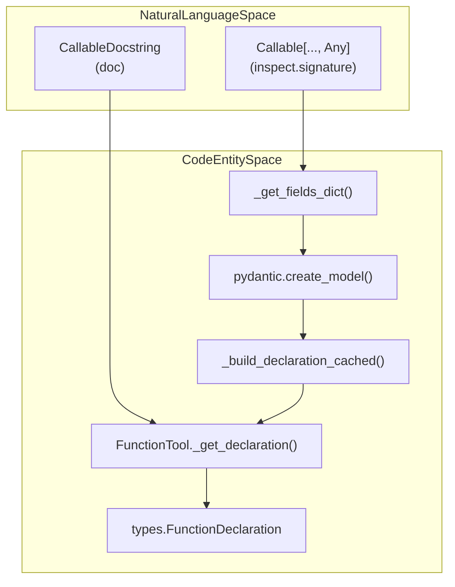
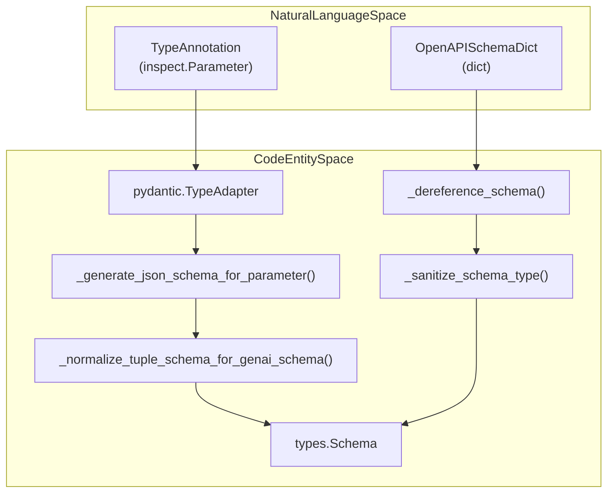
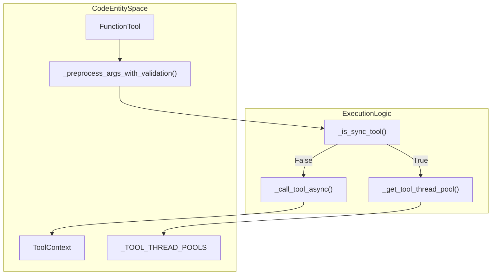

<!-- source: DeepWiki mcp.deepwiki.com · repo google/adk-python · page 6.6 Function Call Handling · fetched 2026-10-29 -->

# Function Call Handling

Relevant source files

The following files were used as context for generating this wiki page:

- [docs/guides/agents/invocation_context/index.md](docs/guides/agents/invocation_context/index.md)
- [src/google/adk/flows/llm_flows/functions.py](src/google/adk/flows/llm_flows/functions.py)
- [src/google/adk/live/_active_background_tool.py](src/google/adk/live/_active_background_tool.py)
- [src/google/adk/tools/_automatic_function_calling_util.py](src/google/adk/tools/_automatic_function_calling_util.py)
- [src/google/adk/tools/_function_parameter_parse_util.py](src/google/adk/tools/_function_parameter_parse_util.py)
- [src/google/adk/tools/_function_tool_declarations.py](src/google/adk/tools/_function_tool_declarations.py)
- [src/google/adk/tools/_gemini_schema_util.py](src/google/adk/tools/_gemini_schema_util.py)
- [src/google/adk/tools/function_tool.py](src/google/adk/tools/function_tool.py)
- [src/google/adk/tools/set_model_response_tool.py](src/google/adk/tools/set_model_response_tool.py)
- [src/google/adk/utils/_callable_utils.py](src/google/adk/utils/_callable_utils.py)
- [src/google/adk/utils/_callback_pipeline.py](src/google/adk/utils/_callback_pipeline.py)
- [src/google/adk/utils/context_utils.py](src/google/adk/utils/context_utils.py)
- [tests/unittests/flows/llm_flows/test_async_tool_callbacks.py](tests/unittests/flows/llm_flows/test_async_tool_callbacks.py)
- [tests/unittests/flows/llm_flows/test_live_tool_callbacks.py](tests/unittests/flows/llm_flows/test_live_tool_callbacks.py)
- [tests/unittests/flows/llm_flows/test_model_callbacks.py](tests/unittests/flows/llm_flows/test_model_callbacks.py)
- [tests/unittests/flows/llm_flows/test_tool_callbacks.py](tests/unittests/flows/llm_flows/test_tool_callbacks.py)
- [tests/unittests/live/test_active_background_tool.py](tests/unittests/live/test_active_background_tool.py)
- [tests/unittests/tools/test_build_function_declaration.py](tests/unittests/tools/test_build_function_declaration.py)
- [tests/unittests/tools/test_from_function_with_options.py](tests/unittests/tools/test_from_function_with_options.py)
- [tests/unittests/tools/test_function_tool.py](tests/unittests/tools/test_function_tool.py)
- [tests/unittests/tools/test_function_tool_declarations.py](tests/unittests/tools/test_function_tool_declarations.py)
- [tests/unittests/tools/test_function_tool_with_import_annotations.py](tests/unittests/tools/test_function_tool_with_import_annotations.py)
- [tests/unittests/tools/test_gemini_schema_util.py](tests/unittests/tools/test_gemini_schema_util.py)
- [tests/unittests/tools/test_set_model_response_tool.py](tests/unittests/tools/test_set_model_response_tool.py)
- [tests/unittests/utils/test_callable_utils.py](tests/unittests/utils/test_callable_utils.py)
- [tests/unittests/utils/test_callback_pipeline.py](tests/unittests/utils/test_callback_pipeline.py)
- [tests/unittests/utils/test_context_utils.py](tests/unittests/utils/test_context_utils.py)

## Purpose and Scope
This page details function call handling in ADK, covering tool declaration building, Gemini schema utilities, automatic function calling, function parameter parsing, and function response handling. It manages the complete lifecycle of tool invocations from LLM responses through execution and back to the model.

Sources: [src/google/adk/tools/_automatic_function_calling_util.py:1-46](), [src/google/adk/tools/_function_parameter_parse_util.py:1-36]()

---

## Function Declaration Building and Caching
ADK converts Python functions and Pydantic models into LLM-compatible function declarations and schemas using automatic function calling utilities and Gemini schema helpers.

- **`FunctionTool._get_declaration()`**: Wraps user-defined Python callables and delegates to `_build_declaration_cached()` [src/google/adk/tools/function_tool.py:53-149](). Caching avoids expensive Pydantic `create_model` and JSON schema generation on every LLM interaction [src/google/adk/tools/function_tool.py:53-73]().
- **`_automatic_function_calling_util.py`**: Inspects Python callables, extracts signatures via `_get_fields_dict()`, and builds `types.FunctionDeclaration` objects using Pydantic [src/google/adk/tools/_automatic_function_calling_util.py:69-103]().

**Diagram: Natural Language Space to Code Entity Space - Function Declaration Building**

Sources: [src/google/adk/tools/function_tool.py:53-149](), [src/google/adk/tools/_automatic_function_calling_util.py:69-103]()

---

## Parameter Parsing and Gemini Schema Utilities
ADK processes parameter annotations and normalizes schemas to meet the requirements of different LLM providers (`GoogleLLMVariant`).

- **`_function_parameter_parse_util.py`**: Handles parameter parsing, deferred annotations via `_handle_params_as_deferred_annotations()`, and tuple schema normalization (`_normalize_tuple_schema_for_genai_schema()`) [src/google/adk/tools/_function_parameter_parse_util.py:54-139](). JSON schemas for parameters are generated via `_generate_json_schema_for_parameter()` using `pydantic.TypeAdapter` [src/google/adk/tools/_function_parameter_parse_util.py:186-207]().
- **`_gemini_schema_util.py`**: Provides OpenAPI-to-Gemini schema conversion (`_to_gemini_schema`), reference resolution (`_dereference_schema()`), and type sanitization (`_sanitize_schema_type()`) [src/google/adk/tools/_gemini_schema_util.py:81-194](). It also includes helper utilities like `_to_snake_case()` for property naming [src/google/adk/tools/_gemini_schema_util.py:39-78]().

**Diagram: Natural Language Space to Code Entity Space - Schema Sanitization and Dereferencing**

Sources: [src/google/adk/tools/_function_parameter_parse_util.py:54-207](), [src/google/adk/tools/_gemini_schema_util.py:39-194]()

---

## Automatic Function Calling and Execution Dispatch
ADK automatically executes tool calls returned by the model by mapping arguments, handling context injection, and dispatching execution safely.

- **Parameter Preprocessing & Validation**: `FunctionTool._preprocess_args()` and `_preprocess_args_with_validation()` validate and coerce primitive types, enums, and nested Pydantic models from raw LLM tool arguments [src/google/adk/tools/function_tool.py:151-189]().
- **Thread Pool Isolation**: Synchronous tools are dispatched to dedicated thread pools via `_get_tool_thread_pool()` to prevent blocking the asynchronous event loop [src/google/adk/flows/llm_flows/functions.py:71-75]().

**Diagram: Tool Execution Dispatch Path**

Sources: [src/google/adk/tools/function_tool.py:151-189](), [src/google/adk/flows/llm_flows/functions.py:71-75]()

---

## Function Response Handling
Once a tool finishes execution, ADK normalizes its return value and constructs a response event for the model.

- **Result Normalization**: `_normalize_tool_result()` ensures that tool return values (whether dictionaries, primitives, or objects) conform to the structured payloads expected by callbacks and event builders [src/google/adk/flows/llm_flows/functions.py:40]().
- **Batch and Parallel Execution**: Modules in `_batch_executor.py` (exposed via the backward-compatibility shim `functions.py`) handle parallel tool execution, gathering results, and merging function response events [src/google/adk/flows/llm_flows/functions.py:20-26]().

Sources: [src/google/adk/flows/llm_flows/functions.py:20-40]()

---

