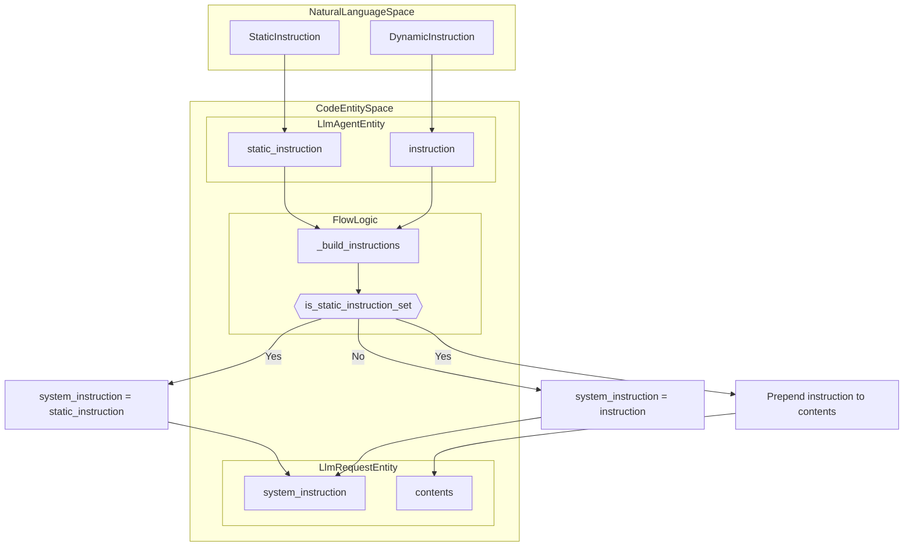
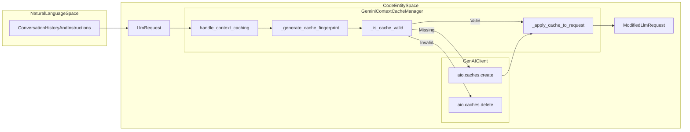

<!-- source: DeepWiki mcp.deepwiki.com · repo google/adk-python · page 6.7 Context Caching · fetched 2026-10-29 -->

# Context Caching

Relevant source files

The following files were used as context for generating this wiki page:

- [src/google/adk/agents/context_cache_config.py](src/google/adk/agents/context_cache_config.py)
- [src/google/adk/flows/llm_flows/compaction.py](src/google/adk/flows/llm_flows/compaction.py)
- [src/google/adk/flows/llm_flows/context_cache_processor.py](src/google/adk/flows/llm_flows/context_cache_processor.py)
- [src/google/adk/models/cache_metadata.py](src/google/adk/models/cache_metadata.py)
- [src/google/adk/models/gemini_context_cache_manager.py](src/google/adk/models/gemini_context_cache_manager.py)
- [src/google/adk/utils/cache_performance_analyzer.py](src/google/adk/utils/cache_performance_analyzer.py)
- [tests/unittests/agents/test_context_cache_config.py](tests/unittests/agents/test_context_cache_config.py)
- [tests/unittests/agents/test_gemini_context_cache_manager.py](tests/unittests/agents/test_gemini_context_cache_manager.py)
- [tests/unittests/models/test_cache_metadata.py](tests/unittests/models/test_cache_metadata.py)
- [tests/unittests/utils/test_cache_performance_analyzer.py](tests/unittests/utils/test_cache_performance_analyzer.py)

## Purpose and Scope

Context caching reduces costs and latency by caching portions of prompts that are reused across multiple requests. This document covers:
- The implementation of explicit context caching via `ContextCacheConfig` [src/google/adk/agents/context_cache_config.py:27-82]().
- The role of `static_instruction` in caching optimization.
- Lifecycle management through `GeminiContextCacheManager` [src/google/adk/models/gemini_context_cache_manager.py:84-115]().
- Cache metadata tracking via `CacheMetadata` [src/google/adk/models/cache_metadata.py:25-99]() and performance analysis utilities via `CachePerformanceAnalyzer` [src/google/adk/utils/cache_performance_analyzer.py:34-102]().
- Configuration for cache creation timeout control and Gemini cache floors [src/google/adk/agents/context_cache_config.py:84-94](), [src/google/adk/models/gemini_context_cache_manager.py:41-55]().

For information about general LLM provider integration, see page 6.1. For details about request/response processing, see page 6.3.

Sources: [src/google/adk/agents/context_cache_config.py:27-94](), [src/google/adk/models/gemini_context_cache_manager.py:41-115](), [src/google/adk/models/cache_metadata.py:25-99](), [src/google/adk/utils/cache_performance_analyzer.py:34-102]()

---

## Overview

Context caching allows the system to persist static content (instructions, tools, and early conversation history) so it doesn't need to be re-processed by the model on every turn. ADK supports two caching strategies:

### Implicit Cache
Automatic caching performed by model providers (e.g., Gemini's internal optimizations or Anthropic's prompt caching) without explicit ADK configuration.

### Explicit Cache
User-controlled caching managed by ADK. This is primarily implemented for Gemini models using `GeminiContextCacheManager` [src/google/adk/models/gemini_context_cache_manager.py:84-115](). Explicit caching provides control over:
- **Cache Intervals**: How many invocations a cache should last before being refreshed [src/google/adk/agents/context_cache_config.py:53-61]().
- **TTL (Time-to-Live)**: Expiration duration in seconds [src/google/adk/agents/context_cache_config.py:63-68]().
- **Minimum Token Thresholds**: Ensuring caching is only used when cost-effective [src/google/adk/agents/context_cache_config.py:69-82]().
- **HTTP Options**: Timeout control for cache creation calls via `create_http_options` [src/google/adk/agents/context_cache_config.py:84-94]().

The `App` class allows for a global `context_cache_config` that applies to all LLM agents in the application. This configuration is propagated via the `Runner` to the `InvocationContext`.

Sources: [src/google/adk/agents/context_cache_config.py:53-94](), [src/google/adk/models/gemini_context_cache_manager.py:84-115](), [src/google/adk/models/cache_metadata.py:25-99]()

---

## Static Instructions and Caching

The `static_instruction` field on `LlmAgent` is a key optimization for context caching. It separates truly static prompt content from dynamic instructions that might contain session-specific variables.

### The static_instruction Field
When `static_instruction` is provided, ADK treats it as the primary cacheable prefix. Unlike the standard `instruction` field, it is sent literally without variable substitution.

| Configuration | `instruction` behavior | `system_instruction` content | User content prefix |
|---------------|-----------------------|-----------------------------|---------------------|
| `static_instruction=None` | Sent as system instruction | `instruction` value | (none) |
| `static_instruction` set | Sent as first user message | `static_instruction` value | `instruction` value |

This ensures that the `system_instruction` (which is always at the start of the prompt) remains identical across calls, maximizing cache hits.

Sources: [src/google/adk/agents/context_cache_config.py:27-82]()

---

## Instruction Processing Flow

The following diagram bridges natural language space to code entity space by mapping how agent instruction entities are resolved into the `LlmRequest` used for caching.

**Diagram: Instruction Resolution and Caching Logic**

Sources: [src/google/adk/agents/context_cache_config.py:27-82](), [src/google/adk/models/gemini_context_cache_manager.py:84-115]()

---

## Gemini Context Cache Manager

The `GeminiContextCacheManager` [src/google/adk/models/gemini_context_cache_manager.py:84-115]() manages the lifecycle of cached content on the Gemini API.

### Key Functions
- `handle_context_caching(llm_request)`: Validates existing cache metadata or triggers new cache creation [src/google/adk/models/gemini_context_cache_manager.py:100-115]().
- `_is_cache_valid(llm_request)`: Checks if the cache exists and hasn't expired [src/google/adk/models/gemini_context_cache_manager.py:125-125]().
- `_generate_cache_fingerprint(llm_request, contents_count)`: Creates a hash of the system instruction, tools, and a prefix of message contents [src/google/adk/models/gemini_context_cache_manager.py:153-155]().

### Continuous User Batch Strategy
To ensure the model always receives the most recent user intent, the manager identifies the last continuous batch of user messages and caches everything *prior* to that batch. This prevents the "tail" of the conversation from being locked in a cache, allowing for dynamic responses.

The following diagram bridges natural language prompt/session concepts to the cache manager code entities and GenAI client operations.

**Diagram: Cache Manager Data Flow and Code Mapping**

Sources: [src/google/adk/models/gemini_context_cache_manager.py:84-182]()

---

## Context Cache Request Processor

The `ContextCacheRequestProcessor` [src/google/adk/flows/llm_flows/context_cache_processor.py:24]() bridges the session history and the LLM request within the execution flow. This module is primarily for backward compatibility, with the core logic having moved to `google.adk.flows.llm_flows.context._cache` [src/google/adk/flows/llm_flows/context_cache_processor.py:17-18]().

### Metadata Retrieval
It uses `_find_cache_info_from_events` (now within `google.adk.flows.llm_flows.context._cache`) to scan the `Session` for existing cache state:
1. **Latest Cache**: Retrieves `CacheMetadata` from the most recent event for the agent.
2. **Invocation Tracking**: If the metadata belongs to a previous invocation and has an active cache name, it increments `invocations_used`.
3. **Token Context**: Retrieves the `prompt_token_count` from the last response to help the manager determine if the model-specific minimum has been met.

Sources: [src/google/adk/flows/llm_flows/context_cache_processor.py:17-29]()

---

## Cache Metadata and Performance

### CacheMetadata Class
The `CacheMetadata` [src/google/adk/models/cache_metadata.py:25-54]() is an immutable Pydantic model storing:
- `cache_name`: The full resource name (e.g., `projects/.../cachedContents/...`). It is `None` when in a "fingerprint-only" state [src/google/adk/models/cache_metadata.py:60-65]().
- `fingerprint`: Hash of the instruction, tools, and cached contents [src/google/adk/models/cache_metadata.py:72-74]().
- `expire_soon`: Boolean property indicating if the cache expires within 120 seconds [src/google/adk/models/cache_metadata.py:110-117]().
- `contents_count`: Number of contents cached (if active) or total contents in request (if fingerprint-only) [src/google/adk/models/cache_metadata.py:85-91]().

### Performance Analyzer
`CachePerformanceAnalyzer` [src/google/adk/utils/cache_performance_analyzer.py:34-38]() calculates metrics from session history via `analyze_agent_cache_performance` [src/google/adk/utils/cache_performance_analyzer.py:76-102]():
- **Cache Hit Ratio**: `total_cached_tokens / total_prompt_tokens` [src/google/adk/utils/cache_performance_analyzer.py:135-139]().
- **Utilization Ratio**: Percentage of requests using a cache hit [src/google/adk/utils/cache_performance_analyzer.py:141-145]().
- **Average Invocations**: How many turns a single cache instance typically survives [src/google/adk/utils/cache_performance_analyzer.py:151-165]().

Sources: [src/google/adk/models/cache_metadata.py:25-117](), [src/google/adk/utils/cache_performance_analyzer.py:34-178]()

---

## Optimization Strategies

### Token Thresholds
Explicit caching requires reaching a model-specific minimum token count. These thresholds are:
- **Gemini 2.5**: 2,048 tokens [src/google/adk/models/gemini_context_cache_manager.py:41-41]().
- **Gemini 3**: 4,096 tokens [src/google/adk/models/gemini_context_cache_manager.py:42-42]().

If a request is below this, the manager returns "fingerprint-only" metadata. This allows the system to track content stability without incurring the overhead of creating a remote cache until the threshold is reached.

### Fingerprint Stability
To avoid thrashing, the manager uses the `fingerprint` to ensure content is stable. If a cache expires but the content fingerprint remains the same, a new cache is created immediately.

### Cache Creation Timeout
The `ContextCacheConfig` includes the `create_http_options` field [src/google/adk/agents/context_cache_config.py:84-94](). This allows developers to specify a timeout (via `google.genai.types.HttpOptions`) specifically for the cache creation call. If the cache creation exceeds this timeout, the manager logs a failure and the LLM request proceeds without caching, ensuring transient network issues do not block agent execution.

Sources: [src/google/adk/models/gemini_context_cache_manager.py:41-43](), [src/google/adk/agents/context_cache_config.py:84-94]()

---

