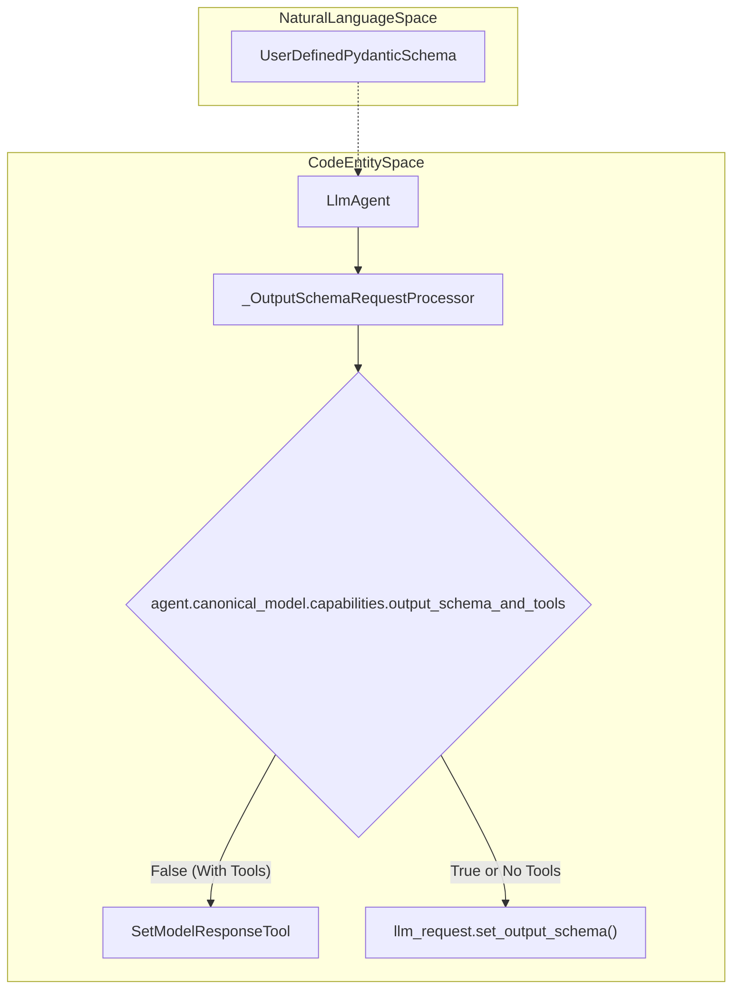
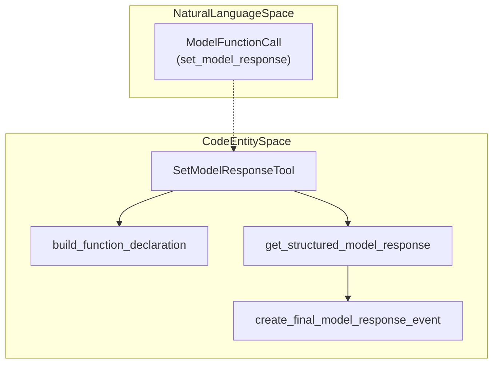

<!-- source: DeepWiki mcp.deepwiki.com · repo google/adk-python · page 6.8 Structured Output and Response Schemas · fetched 2026-10-29 -->

# Structured Output and Response Schemas

<details>
<summary>Relevant source files</summary>

The following files were used as context for generating this wiki page:

- [src/google/adk/flows/llm_flows/core/_function_call_postprocessor.py](src/google/adk/flows/llm_flows/core/_function_call_postprocessor.py)
- [src/google/adk/flows/llm_flows/core/_resume.py](src/google/adk/flows/llm_flows/core/_resume.py)
- [src/google/adk/flows/llm_flows/extensions/_agent_transfer.py](src/google/adk/flows/llm_flows/extensions/_agent_transfer.py)
- [src/google/adk/flows/llm_flows/prompt/_identity.py](src/google/adk/flows/llm_flows/prompt/_identity.py)
- [src/google/adk/flows/llm_flows/prompt/_schema.py](src/google/adk/flows/llm_flows/prompt/_schema.py)
- [src/google/adk/flows/llm_flows/tools/_batch_executor.py](src/google/adk/flows/llm_flows/tools/_batch_executor.py)
- [src/google/adk/tools/_automatic_function_calling_util.py](src/google/adk/tools/_automatic_function_calling_util.py)
- [src/google/adk/tools/_function_parameter_parse_util.py](src/google/adk/tools/_function_parameter_parse_util.py)
- [src/google/adk/tools/_function_tool_declarations.py](src/google/adk/tools/_function_tool_declarations.py)
- [src/google/adk/tools/_gemini_schema_util.py](src/google/adk/tools/_gemini_schema_util.py)
- [src/google/adk/tools/function_tool.py](src/google/adk/tools/function_tool.py)
- [src/google/adk/tools/set_model_response_tool.py](src/google/adk/tools/set_model_response_tool.py)
- [src/google/adk/utils/_callable_utils.py](src/google/adk/utils/_callable_utils.py)
- [src/google/adk/utils/context_utils.py](src/google/adk/utils/context_utils.py)
- [tests/unittests/flows/llm_flows/core/test_function_call_postprocessor.py](tests/unittests/flows/llm_flows/core/test_function_call_postprocessor.py)
- [tests/unittests/flows/llm_flows/core/test_resume.py](tests/unittests/flows/llm_flows/core/test_resume.py)
- [tests/unittests/flows/llm_flows/prompt/test_schema.py](tests/unittests/flows/llm_flows/prompt/test_schema.py)
- [tests/unittests/flows/llm_flows/tools/test_batch_executor.py](tests/unittests/flows/llm_flows/tools/test_batch_executor.py)
- [tests/unittests/flows/llm_flows/tools/test_functions_parallel.py](tests/unittests/flows/llm_flows/tools/test_functions_parallel.py)
- [tests/unittests/flows/llm_flows/tools/test_functions_parallel_error.py](tests/unittests/flows/llm_flows/tools/test_functions_parallel_error.py)
- [tests/unittests/flows/llm_flows/tools/test_functions_simple.py](tests/unittests/flows/llm_flows/tools/test_functions_simple.py)
- [tests/unittests/runners/test_resume_invocation.py](tests/unittests/runners/test_resume_invocation.py)
- [tests/unittests/tools/test_build_function_declaration.py](tests/unittests/tools/test_build_function_declaration.py)
- [tests/unittests/tools/test_from_function_with_options.py](tests/unittests/tools/test_from_function_with_options.py)
- [tests/unittests/tools/test_function_tool.py](tests/unittests/tools/test_function_tool.py)
- [tests/unittests/tools/test_function_tool_declarations.py](tests/unittests/tools/test_function_tool_declarations.py)
- [tests/unittests/tools/test_function_tool_with_import_annotations.py](tests/unittests/tools/test_function_tool_with_import_annotations.py)
- [tests/unittests/tools/test_gemini_schema_util.py](tests/unittests/tools/test_gemini_schema_util.py)
- [tests/unittests/tools/test_set_model_response_tool.py](tests/unittests/tools/test_set_model_response_tool.py)
- [tests/unittests/utils/test_callable_utils.py](tests/unittests/utils/test_callable_utils.py)
- [tests/unittests/utils/test_context_utils.py](tests/unittests/utils/test_context_utils.py)

</details>


This page covers how to configure agents to return responses in structured, predictable JSON formats using the `output_schema` field, how Pydantic integration works under the hood, how the output schema processor handles models with and without native multi-modal capabilities, and how schemas are converted across providers. For general `LlmAgent` configuration options, see [LlmAgent Configuration](). For broader request/response processing concepts, see [Request and Response Processing]().

---

## Overview

Structured output constrains the LLM to generate responses matching a predefined schema, ensuring predictable, parseable JSON output. This is useful for data extraction, form filling, API responses, and strict type safety using Pydantic models.

Historically, some models could not simultaneously use `output_schema` and `tools`. ADK provides a robust mechanism to handle this by leveraging native provider support or injecting a specialized tool-based workaround called `SetModelResponseTool`.

Sources: [src/google/adk/flows/llm_flows/prompt/_schema.py:34-55]()

---

## Configuration and Pydantic Integration

Configure structured output by setting the `output_schema` field on `LlmAgent`. ADK explicitly supports combining `output_schema` with tools and sub-agents.

```python
from pydantic import BaseModel, Field
from google.adk.agents import LlmAgent

class PersonSchema(BaseModel):
    name: str = Field(description="A person's name")
    age: int = Field(description="A person's age")
    city: str = Field(description="The city they live in")

agent = LlmAgent(
    name="info_extractor",
    model="gemini-2.5-flash",
    output_schema=PersonSchema,
    tools=[my_search_tool]
)
```

ADK leverages Pydantic for schema definition and validation. When an `output_schema` is provided as a `BaseModel` or container type, ADK converts it into the provider's expected format using Pydantic's JSON schema and `TypeAdapter` utilities.

Sources: [src/google/adk/tools/set_model_response_tool.py:129-153](), [tests/unittests/tools/test_set_model_response_tool.py:34-40]()

---

## Implementation and Data Flow

The conversion of a high-level `output_schema` into a provider-specific configuration occurs during the LLM flow via specialized request processors such as `_OutputSchemaRequestProcessor`.

### Schema Processing Strategy Selection

The `LlmCapabilities` class defines whether a model can natively handle both structured output and tool use simultaneously. This capability is checked by `_OutputSchemaRequestProcessor` to decide between native handling or dynamic tool injection.

Title: Schema Processing Strategy Selection


Sources: [src/google/adk/flows/llm_flows/prompt/_schema.py:34-70]()

---

## Tool-Based Workaround: SetModelResponseTool

When a model lacks native support for combining `output_schema` with `tools`, ADK injects `SetModelResponseTool`. This tool dynamically constructs a function signature matching the target `output_schema`.

### Workaround Execution Flow
1. **Detection**: `_OutputSchemaRequestProcessor` detects that the model cannot pair output schemas with tools.
2. **Tool Injection**: `SetModelResponseTool` is appended to the request's tools, along with a system instruction instructing the model to use `set_model_response` for its final answer.
3. **Invocation & Validation**: When the model calls `set_model_response`, arguments are validated against the Pydantic schema.
4. **Extraction**: `get_structured_model_response()` intercepts the function response and extracts the validated result into model events.

Title: SetModelResponseTool Invocation and Extraction


Sources: [src/google/adk/tools/set_model_response_tool.py:119-178](), [src/google/adk/flows/llm_flows/prompt/_schema.py:34-122](), [src/google/adk/tools/_automatic_function_calling_util.py:160-171]()

---

## Provider Schema Conversion and Sanitization

ADK handles schema normalization and translation to bridge differences across LLM providers via utilities located in `_gemini_schema_util.py` and `_function_parameter_parse_util.py`:
- **Schema Sanitization**: `_sanitize_schema_type` and `_sanitize_schema_formats_for_gemini` ensure that JSON Schema definitions comply with Gemini and Vertex AI requirements (e.g., handling null types, converting lists of types, stripping unsupported keywords).
- **Reference Dereferencing**: `_dereference_schema` resolves `$ref` pointers and `$defs` / `definitions` blocks in incoming tool or schema specifications.
- **Tuple & Parameter Normalization**: `_normalize_tuple_schema_for_genai_schema` converts Pydantic-emitted tuple structures (`prefixItems`) into structures compatible with `types.Schema`.

Sources: [src/google/adk/tools/_gemini_schema_util.py:80-183](), [src/google/adk/tools/_function_parameter_parse_util.py:98-139]()

---

## Response Handling and Validation

Responses returned via `SetModelResponseTool` or native outputs are validated using Pydantic type adapters. If invalid data is provided by the model, a `ValidationError` is raised. Validated dictionaries are stored in tool context actions (`tool_context.actions.set_model_response`) and formatted into standard model response events using `create_final_model_response_event()`.

Additionally, rehydration and resumption utilities process stored outputs to ensure type consistency between fresh runs and rehydrated runs, logging warnings and falling back to unvalidated JSON parsing if schema validation fails during resumption.

Sources: [src/google/adk/tools/set_model_response_tool.py:30-33](), [src/google/adk/flows/llm_flows/prompt/_schema.py:74-122]()

---

