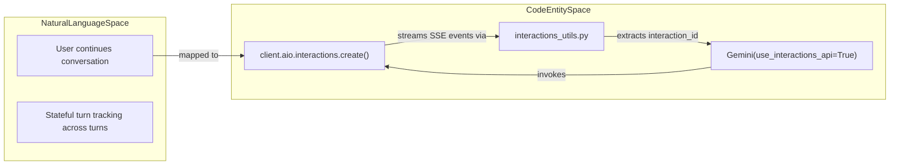
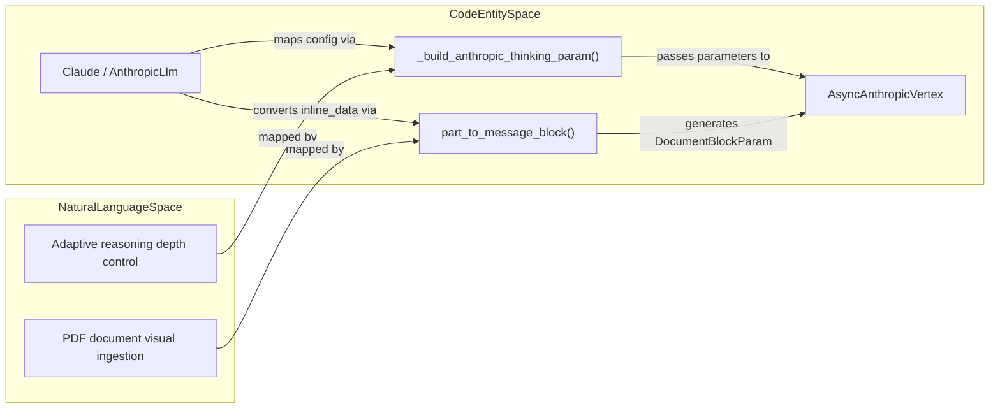
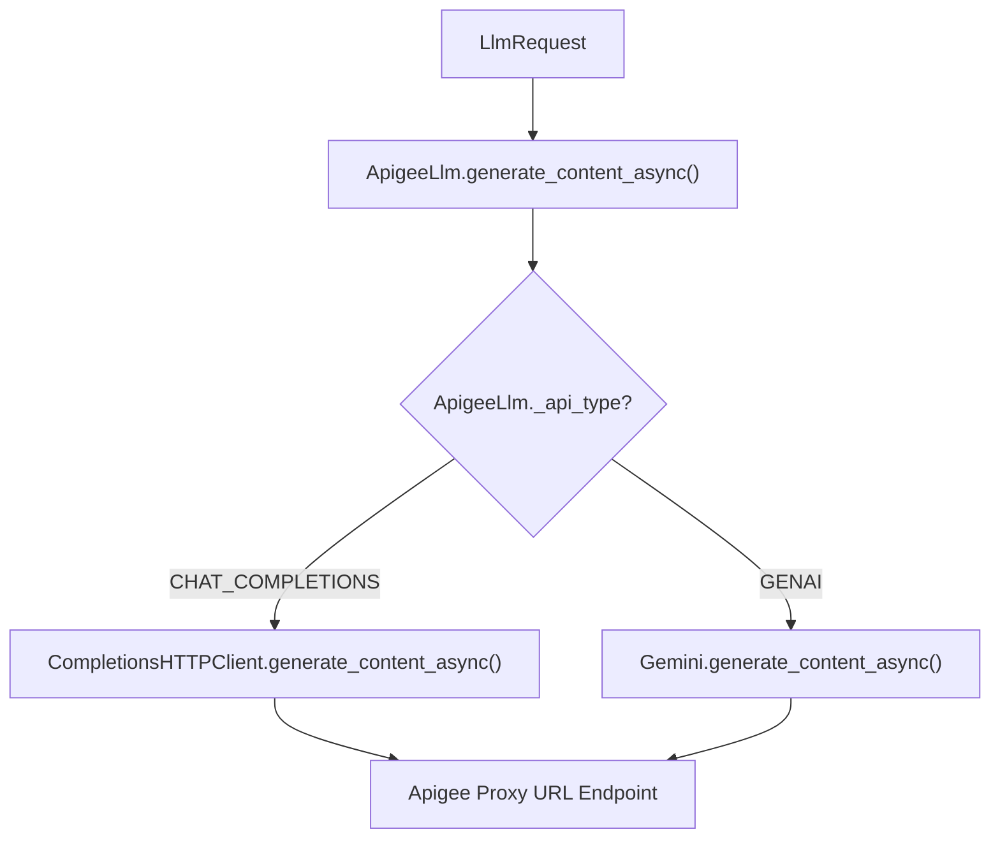

<!-- source: DeepWiki mcp.deepwiki.com · repo google/adk-python · page 6.9 Provider-Specific Features · fetched 2026-10-29 -->

# Provider-Specific Features

Relevant source files

The following files were used as context for generating this wiki page:

- [src/google/adk/flows/llm_flows/context/_fencing.py](src/google/adk/flows/llm_flows/context/_fencing.py)
- [src/google/adk/integrations/openai/_openai_llm.py](src/google/adk/integrations/openai/_openai_llm.py)
- [src/google/adk/integrations/openai/_openai_responses_llm.py](src/google/adk/integrations/openai/_openai_responses_llm.py)
- [src/google/adk/models/anthropic_llm.py](src/google/adk/models/anthropic_llm.py)
- [src/google/adk/models/apigee_llm.py](src/google/adk/models/apigee_llm.py)
- [src/google/adk/models/google_llm.py](src/google/adk/models/google_llm.py)
- [src/google/adk/models/interactions_utils.py](src/google/adk/models/interactions_utils.py)
- [src/google/adk/models/lite_llm.py](src/google/adk/models/lite_llm.py)
- [src/google/adk/telemetry/_gcp_resource.py](src/google/adk/telemetry/_gcp_resource.py)
- [src/google/adk/telemetry/google_cloud.py](src/google/adk/telemetry/google_cloud.py)
- [src/google/adk/telemetry/setup.py](src/google/adk/telemetry/setup.py)
- [tests/unittests/integrations/openai/test_openai_responses_llm.py](tests/unittests/integrations/openai/test_openai_responses_llm.py)
- [tests/unittests/models/test_anthropic_llm.py](tests/unittests/models/test_anthropic_llm.py)
- [tests/unittests/models/test_apigee_llm.py](tests/unittests/models/test_apigee_llm.py)
- [tests/unittests/models/test_completions_http_client.py](tests/unittests/models/test_completions_http_client.py)
- [tests/unittests/models/test_google_llm.py](tests/unittests/models/test_google_llm.py)
- [tests/unittests/models/test_interactions_utils.py](tests/unittests/models/test_interactions_utils.py)
- [tests/unittests/models/test_lite_llm_gemma_tool_role.py](tests/unittests/models/test_lite_llm_gemma_tool_role.py)
- [tests/unittests/models/test_litellm.py](tests/unittests/models/test_litellm.py)
- [tests/unittests/telemetry/test_gcp_resource.py](tests/unittests/telemetry/test_gcp_resource.py)
- [tests/unittests/telemetry/test_google_cloud.py](tests/unittests/telemetry/test_google_cloud.py)
- [tests/unittests/telemetry/test_setup.py](tests/unittests/telemetry/test_setup.py)

This page documents unique capabilities, configuration flags, and data flows specific to individual LLM providers supported by the ADK framework. For general LLM integration concepts, see [Model Providers](6.1) and [BaseLlm Interface](6.2). For context caching specifically, see [Context Caching](6.7).

## Purpose and Scope

While ADK provides a unified `BaseLlm` abstraction layer, underlying model providers (`Gemini`, `Claude`, `AnthropicLlm`, `LiteLLM`, `ApigeeLlm`) expose distinct architectural features such as advanced reasoning blocks, PDF document ingestion, stateful conversational interactions APIs, strict schema validations, custom routing proxies, and model-specific tool role adjustments. This page details the exact implementation details, functions, and data transformations used to integrate these provider-specific quirks into the ADK runtime.

Sources: [src/google/adk/models/google_llm.py:99-188](), [src/google/adk/models/anthropic_llm.py:156-190](), [src/google/adk/models/apigee_llm.py:95-179]()

---

## 1. Gemini-Specific Features

Gemini models integrate directly via the `Gemini` class [src/google/adk/models/google_llm.py:99-125](), supporting context caching, speech configurations, retry options, and stateful conversation processing through the Interactions API.

### Context Caching and Thinking Config
Gemini supports automatic context caching through `GeminiContextCacheManager` when `cache_config` is specified on an `LlmRequest`. Additionally, native thinking parameters (`thinking_config`) configured via `types.GenerateContentConfig` dictate budget and model reasoning allocation.

Sources: [src/google/adk/models/google_llm.py:132-197](), [tests/unittests/models/test_google_llm.py:114-127]()

### Interactions API Integration and Streaming
The Interactions API (`use_interactions_api=True` on `Gemini`) allows stateful conversation chaining using `previous_interaction_id` instead of transmitting full chronological history [src/google/adk/models/google_llm.py:172-188](). Streaming events are handled via `interactions_utils.py` helpers [src/google/adk/models/interactions_utils.py:15-29]().

Title: Interactions API Entity Mapping

Sources: [src/google/adk/models/google_llm.py:172-188](), [src/google/adk/models/interactions_utils.py:15-29](), [tests/unittests/models/test_interactions_utils.py:69-117]()

---

## 2. Anthropic and Claude Features

Anthropic models (`AnthropicLlm` and `Claude`) support advanced reasoning configurations, effort controls, first-class PDF parsing, and native cached token extraction [src/google/adk/models/anthropic_llm.py:156-190]().

### Thinking Config and Effort Mapping
Anthropic thinking parameters are constructed via `_build_anthropic_thinking_param()` [src/google/adk/models/anthropic_llm.py:156-190](). Negative thinking budgets (e.g., `-1`) activate adaptive thinking (`thinking.type: "adaptive"`), whereas positive budgets enforce manual token caps (`thinking.type: "enabled"`). Newer models (e.g., Claude Opus 4.7+) require adaptive or disabled modes.

Title: Anthropic Thinking and PDF Parsing Entity Mapping

Sources: [src/google/adk/models/anthropic_llm.py:156-190](), [tests/unittests/models/test_anthropic_llm.py:142-155]()

### PDF Document Support and Cached Token Reporting
The ADK parses `inline_data` parts with `application/pdf` MIME types into Anthropic's `DocumentBlockParam` format. Furthermore, `AnthropicLlm` extracts `cache_read_input_tokens` and `cache_creation_input_tokens` from Anthropic `Usage` responses to populate ADK `UsageMetadata`, tracking cache performance across turns.

Sources: [src/google/adk/models/anthropic_llm.py:79-94](), [tests/unittests/models/test_anthropic_llm.py:76-84]()

---

## 3. LiteLLM Provider-Specific Features and Quirks

`LiteLlm` wraps non-native models via LiteLLM proxies, providing specialized handling for reasoning outputs, schema validation, token caches, and custom model tool roles.

### Reasoning, Strict Schemas, and Argument Repair
- **Reasoning Extraction**: Extracts reasoning contents from provider-specific payload fields like `reasoning_content` or deepseek tool call payloads [src/google/adk/models/lite_llm.py:41-43]().
- **Strict Schema Enforcement**: `_enforce_strict_openai_schema` modifies nested JSON schemas to comply with OpenAI strict mode requirements (`additionalProperties: false`) [src/google/adk/models/lite_llm.py:38-38]().
- **Argument Repair**: `_parse_tool_call_arguments` handles unquoted object keys or Python dict literals returned during tool calls by certain providers [src/google/adk/models/lite_llm.py:196-215]().

### Gemma Model Tool Role Handling
Gemma 4 models (hosted via Ollama or vLLM) expect `role='tool_responses'` for tool result messages to match their specific chat template expectations, avoiding infinite tool-calling loops associated with the standard OpenAI `role='tool'` [tests/unittests/models/test_lite_llm_gemma_tool_role.py:15-20](). `_content_to_message_param` dynamically adjusts the message role based on whether the model name matches a Gemma pattern [tests/unittests/models/test_lite_llm_gemma_tool_role.py:91-115]().

Sources: [src/google/adk/models/lite_llm.py:196-215](), [tests/unittests/models/test_lite_llm_gemma_tool_role.py:15-115]()

---

## 4. ApigeeLlm Routing and API Types

`ApigeeLlm` routes requests through Apigee enterprise proxies, supporting both `GENAI` and `CHAT_COMPLETIONS` API styles [src/google/adk/models/apigee_llm.py:95-179]().

Title: ApigeeLlm Request Routing Architecture

Sources: [src/google/adk/models/apigee_llm.py:95-179](), [tests/unittests/models/test_apigee_llm.py:64-113]()

---

