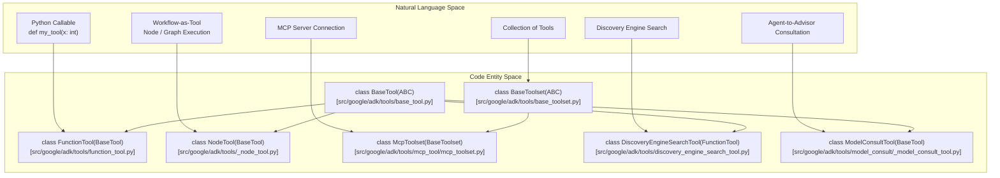
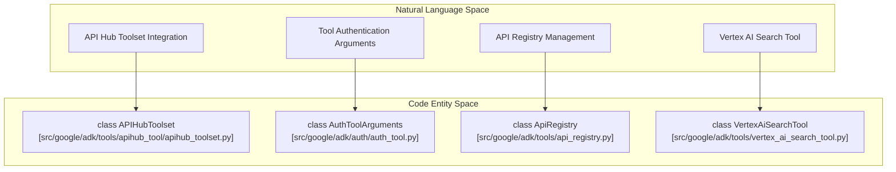
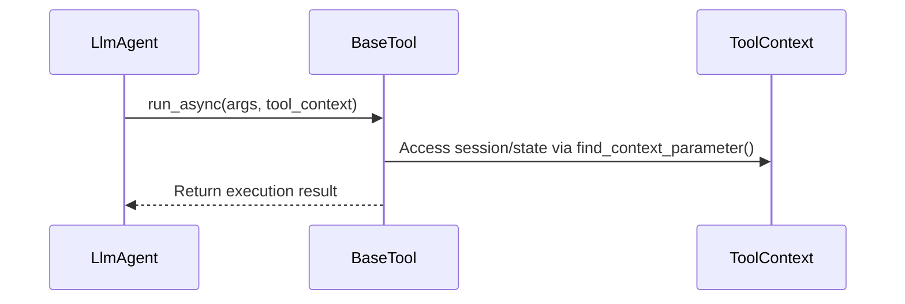

<!-- source: DeepWiki mcp.deepwiki.com · repo google/adk-python · page 7 Tools and Extensions · fetched 2026-10-29 -->

# Tools and Extensions

Relevant source files

The following files were used as context for generating this wiki page:

- [src/google/adk/tools/__init__.py](src/google/adk/tools/__init__.py)
- [src/google/adk/tools/discovery_engine_search_tool.py](src/google/adk/tools/discovery_engine_search_tool.py)
- [tests/unittests/tools/test_discovery_engine_search_tool.py](tests/unittests/tools/test_discovery_engine_search_tool.py)

This page provides a high-level overview of the ADK tool framework and extension subsystems, enabling agents to interact with external APIs, databases, execution environments, and user interfaces. With support for advanced capabilities like the skill and environment toolsets, MCP SDK 2.x compatibility, and enhanced data connectors, the tool framework normalizes diverse capabilities into a unified execution pipeline [src/google/adk/tools/__init__.py:51-135]().

For details on model-specific function calling, see [Function Call Handling](#6.6). For tool usage in agent contexts and callbacks, see [Callbacks and Hooks](#3.6).

---

## Tool Framework Overview

The ADK tool framework provides core abstractions like `BaseTool` and `BaseToolset` to normalize diverse tool sources—ranging from simple Python functions to Model Context Protocol (MCP) servers and cloud services—into a common execution interface [src/google/adk/tools/__init__.py:55-113]().

### Tool Entity Mapping

The following diagram maps high-level tool concepts in natural language space to their concrete implementation classes within the codebase.

**Tool Entity Mapping**

Sources: [src/google/adk/tools/base_tool.py:51-121](), [src/google/adk/tools/discovery_engine_search_tool.py:132-183]()

### Extension Toolset Mapping

The following diagram maps additional specialized extension toolsets from natural language descriptions to their corresponding code entities.

**Extension Toolset Mapping**

Sources: [src/google/adk/tools/__init__.py:55-113](), [src/google/adk/tools/discovery_engine_search_tool.py:132-183]()

---

## Tool Execution Pipeline

Tools execute through a managed pipeline that handles argument validation, context injection, and asynchronous execution. The `BaseTool.run_async` method serves as the primary execution entry point [src/google/adk/tools/base_tool.py:136-153]().

**Tool Execution Flow**

Sources: [src/google/adk/tools/base_tool.py:136-170]()

---

## Subsystem Overviews and Child Pages

The tool and extension ecosystem spans several modular subsystems. Below is a high-level summary linking to each dedicated child page.

### Tool Framework
The core abstractions `BaseToolset`, `BaseTool`, tool filtering, and prefix application allow granular control over tool exposure. This subsystem also covers `AgentTool`, `NodeTool`, and long-running tool execution wrappers [src/google/adk/tools/__init__.py:55-56]().
For details, see [Tool Framework](#7.1).

### Python Function Tools
`FunctionTool` wraps standard Python functions, automatically mapping docstrings and type annotations to JSON schemas. It integrates argument mapping, `ExampleTool`, `LongRunningFunctionTool`, user choice utilities, and response scheduling alongside LangChain and CrewAI wrappers [src/google/adk/tools/__init__.py:72-73]().
For details, see [Python Function Tools](#7.2).

### MCP (Model Context Protocol) Tools
`McpToolset` and `MCPSessionManager` handle connection types (stdio, SSE, streamable HTTP), session pooling, idle eviction, and MCP resources with SDK 2.x compatibility. It also includes `to_mcp_server` for exposing ADK agents over MCP [src/google/adk/tools/__init__.py:110-111]().
For details, see [MCP (Model Context Protocol) Tools](#7.3).

### Data and Database Tools
Provides query, metadata, search, and data-insights tools via `tools/bigquery` and `integrations/bigquery`, alongside Dataplex search, `DataAgentToolset`, and Spanner, Bigtable, and PubSub toolsets. This includes `DiscoveryEngineSearchTool` for Vertex AI Search [src/google/adk/tools/__init__.py:58-65]().
For details, see [Data and Database Tools](#7.4).

### OpenAPI and REST Tools
Enables dynamic tool generation from API specs via `OpenAPIToolset`, `RestApiTool`, operation parsers, credential exchangers, `APIHubToolset`, `ApplicationIntegrationToolset`, and the API Registry [src/google/adk/tools/__init__.py:57-58]().
For details, see [OpenAPI and REST Tools](#7.5).

### Built-In Tools
Covers Google Search, `VertexAiSearchTool`, `DiscoveryEngineSearchTool`, `url_context`, enterprise search, `google_maps_grounding`, memory/artifact loading utilities, GCS storage toolsets, Computer Use, and Toolbox. This also includes `ModelConsultTool` for agent-to-advisor consultations [src/google/adk/tools/__init__.py:29-45](), [src/google/adk/tools/__init__.py:91-94]().
For details, see [Built-in Tools](#7.6).

### Tool Authentication
Manages credentials, auth configuration, and token exchange via `AuthConfig`, `CredentialManager`, `AuthProviderRegistry`, OAuth2, API keys, GCP agent identity IAM connectors, and mTLS utilities [src/google/adk/tools/__init__.py:56-57]().
For details, see [Tool Authentication](#7.7).

### Tool Confirmation (HITL)
Supports Human-in-the-Loop workflows using `require_confirmation`, `ToolConfirmation`, confirmation events, and the `request_input` flow processor [src/google/adk/tools/__init__.py:96-97]().
For details, see [Tool Confirmation (HITL)](#7.8).

### Skills and Environment Toolsets
Includes `SkillToolset` and the skills subsystem (registry, models, prompt assembly), GCP skill integration, the feature registry gating experimental capabilities, `BashTool`, and environment toolsets with local and remote execution capabilities.
For details, see [Skills and Environment Toolsets](#7.9).

Sources: [src/google/adk/tools/__init__.py:29-45](), [src/google/adk/tools/__init__.py:56-58](), [src/google/adk/tools/__init__.py:72-73](), [src/google/adk/tools/__init__.py:91-94](), [src/google/adk/tools/__init__.py:96-97](), [src/google/adk/tools/__init__.py:110-111](), [src/google/adk/tools/discovery_engine_search_tool.py:132-183]()

---

