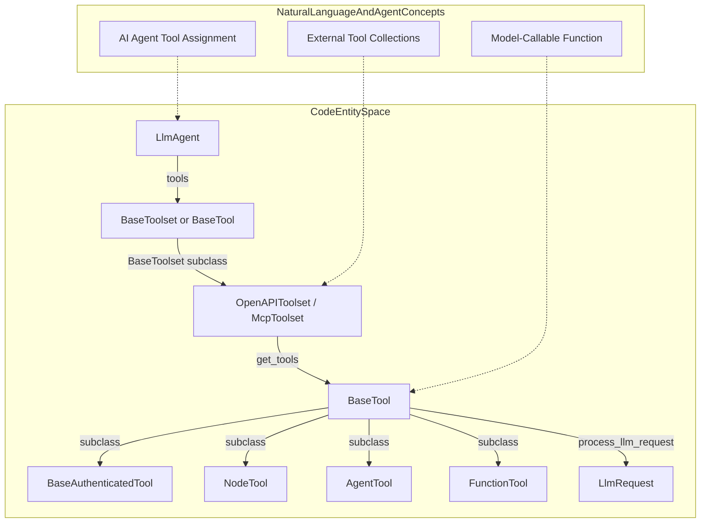
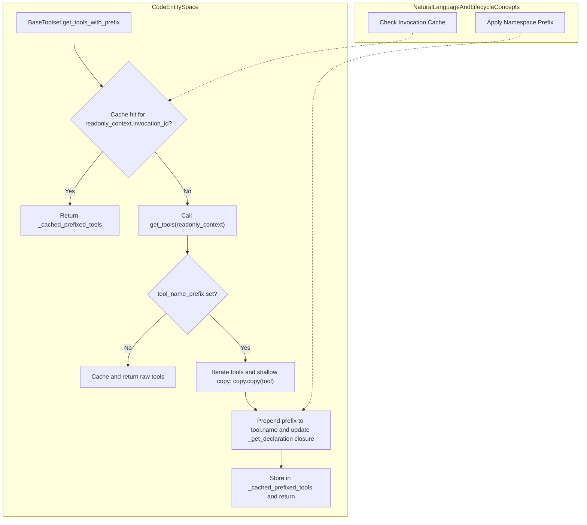
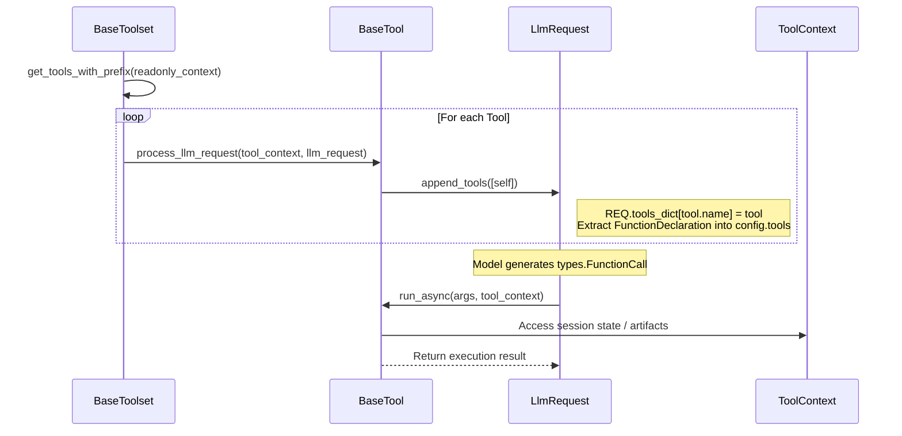

<!-- source: DeepWiki mcp.deepwiki.com · repo google/adk-python · page 7.1 Tool Framework · fetched 2026-10-29 -->

# Tool Framework

Relevant source files

The following files were used as context for generating this wiki page:

- [contributing/samples/integrations/authn-adk-all-in-one/adk_agents/agent_openapi_tools/agent.py](contributing/samples/integrations/authn-adk-all-in-one/adk_agents/agent_openapi_tools/agent.py)
- [src/google/adk/models/llm_request.py](src/google/adk/models/llm_request.py)
- [src/google/adk/tools/__init__.py](src/google/adk/tools/__init__.py)
- [src/google/adk/tools/_url_validator.py](src/google/adk/tools/_url_validator.py)
- [src/google/adk/tools/agent_tool.py](src/google/adk/tools/agent_tool.py)
- [src/google/adk/tools/apihub_tool/apihub_toolset.py](src/google/adk/tools/apihub_tool/apihub_toolset.py)
- [src/google/adk/tools/base_tool.py](src/google/adk/tools/base_tool.py)
- [src/google/adk/tools/base_toolset.py](src/google/adk/tools/base_toolset.py)
- [src/google/adk/tools/discovery_engine_search_tool.py](src/google/adk/tools/discovery_engine_search_tool.py)
- [src/google/adk/tools/google_search_agent_tool.py](src/google/adk/tools/google_search_agent_tool.py)
- [src/google/adk/tools/load_web_page.py](src/google/adk/tools/load_web_page.py)
- [src/google/adk/tools/long_running_tool.py](src/google/adk/tools/long_running_tool.py)
- [src/google/adk/tools/openapi_tool/auth/credential_exchangers/base_credential_exchanger.py](src/google/adk/tools/openapi_tool/auth/credential_exchangers/base_credential_exchanger.py)
- [src/google/adk/tools/openapi_tool/common/common.py](src/google/adk/tools/openapi_tool/common/common.py)
- [src/google/adk/tools/openapi_tool/openapi_spec_parser/__init__.py](src/google/adk/tools/openapi_tool/openapi_spec_parser/__init__.py)
- [src/google/adk/tools/openapi_tool/openapi_spec_parser/openapi_spec_parser.py](src/google/adk/tools/openapi_tool/openapi_spec_parser/openapi_spec_parser.py)
- [src/google/adk/tools/openapi_tool/openapi_spec_parser/openapi_toolset.py](src/google/adk/tools/openapi_tool/openapi_spec_parser/openapi_toolset.py)
- [src/google/adk/tools/openapi_tool/openapi_spec_parser/operation_parser.py](src/google/adk/tools/openapi_tool/openapi_spec_parser/operation_parser.py)
- [src/google/adk/tools/openapi_tool/openapi_spec_parser/rest_api_tool.py](src/google/adk/tools/openapi_tool/openapi_spec_parser/rest_api_tool.py)
- [tests/unittests/models/test_llm_request.py](tests/unittests/models/test_llm_request.py)
- [tests/unittests/tools/openapi_tool/common/test_common.py](tests/unittests/tools/openapi_tool/common/test_common.py)
- [tests/unittests/tools/openapi_tool/openapi_spec_parser/test_openapi_spec_parser.py](tests/unittests/tools/openapi_tool/openapi_spec_parser/test_openapi_spec_parser.py)
- [tests/unittests/tools/openapi_tool/openapi_spec_parser/test_openapi_toolset.py](tests/unittests/tools/openapi_tool/openapi_spec_parser/test_openapi_toolset.py)
- [tests/unittests/tools/openapi_tool/openapi_spec_parser/test_operation_parser.py](tests/unittests/tools/openapi_tool/openapi_spec_parser/test_operation_parser.py)
- [tests/unittests/tools/openapi_tool/openapi_spec_parser/test_rest_api_tool.py](tests/unittests/tools/openapi_tool/openapi_spec_parser/test_rest_api_tool.py)
- [tests/unittests/tools/test_agent_tool.py](tests/unittests/tools/test_agent_tool.py)
- [tests/unittests/tools/test_base_tool.py](tests/unittests/tools/test_base_tool.py)
- [tests/unittests/tools/test_base_toolset.py](tests/unittests/tools/test_base_toolset.py)
- [tests/unittests/tools/test_discovery_engine_search_tool.py](tests/unittests/tools/test_discovery_engine_search_tool.py)
- [tests/unittests/tools/test_google_search_agent_tool.py](tests/unittests/tools/test_google_search_agent_tool.py)
- [tests/unittests/tools/test_load_web_page.py](tests/unittests/tools/test_load_web_page.py)
- [tests/unittests/tools/test_long_running_tool.py](tests/unittests/tools/test_long_running_tool.py)
- [tests/unittests/tools/test_url_validator.py](tests/unittests/tools/test_url_validator.py)

## Purpose and Scope

The tool framework provides the foundational architecture for extending agent capabilities through external functions, APIs, and services. This page covers the core abstractions—`BaseToolset`, `BaseTool`, and `BaseAuthenticatedTool`—that define how tools are discovered, filtered, configured, and integrated into agent execution [src/google/adk/tools/base_toolset.py:66-89](), [src/google/adk/tools/base_tool.py:57-114](), [src/google/adk/auth/auth_tool.py](). It also details key specializations including `AgentTool`, `NodeTool` (Workflow-as-Tool), long-running tools (`is_long_running` and `_defers_response`), and `response_scheduling` for Live API tools [src/google/adk/tools/base_tool.py:65-124](), [src/google/adk/tools/agent_tool.py:110-137]().

Sources: [src/google/adk/tools/base_toolset.py:66-89](), [src/google/adk/tools/base_tool.py:57-124](), [src/google/adk/tools/agent_tool.py:110-137](), [src/google/adk/auth/auth_tool.py]()

---

## Architecture Overview

The tool framework follows a two-tier hierarchy: toolsets contain collections of tools (`BaseToolset`), and individual tools implement executable functionality (`BaseTool`). Agents reference toolsets and tools, which are processed during LLM flow execution to generate function declarations and handle function calls via `LlmRequest` [src/google/adk/tools/base_toolset.py:91-120](), [src/google/adk/tools/base_tool.py:132-164]().

### Diagram: Tool Framework Component Mapping (Bridging Natural Language Space to Code Entity Space)

Sources: [src/google/adk/tools/base_toolset.py:66-120](), [src/google/adk/tools/base_tool.py:57-181](), [src/google/adk/models/llm_request.py:51-85](), [src/google/adk/tools/agent_tool.py:110-137]()

---

## BaseToolset and Tool Filtering

`BaseToolset` defines the interface for tool collections. Toolsets are responsible for providing a list of tools based on context, optionally filtering them, prefixing names, and managing lifecycle resources [src/google/adk/tools/base_toolset.py:66-89]().

### Core Interface

**Key Methods:**

| Method | Return Type | Purpose |
|--------|-------------|---------|
| `get_tools(readonly_context)` | `list[BaseTool]` | Returns tools available in the given context (abstract) [src/google/adk/tools/base_toolset.py:91-120](). |
| `get_tools_with_prefix(readonly_context)` | `list[BaseTool]` | Returns tools with optional name prefixing applied and cached per invocation (final) [src/google/adk/tools/base_toolset.py:121-190](). |
| `close()` | `None` | Cleanup network connections and background tasks [src/google/adk/tools/base_toolset.py:191-196](). |

**Constructor Parameters:**

| Parameter | Type | Default | Description |
|-----------|------|---------|-------------|
| `tool_filter` | `Union[ToolPredicate, List[str]]` | `None` | Filter to select subset of tools [src/google/adk/tools/base_toolset.py:72-85](). |
| `tool_name_prefix` | `str` | `None` | Prefix to prepend to all tool names [src/google/adk/tools/base_toolset.py:72-85](). |

Sources: [src/google/adk/tools/base_toolset.py:66-196]()

### Tool Discovery and Filtering

The `get_tools()` method is called during agent execution to resolve active tools. Toolsets filter tools via the `tool_filter` attribute. If it's a `ToolPredicate` (a `Protocol` defining a `__call__`), it is evaluated against each tool with the current `ReadonlyContext` [src/google/adk/tools/base_toolset.py:43-61](), [src/google/adk/tools/base_toolset.py:72-85](). If it's a list of strings, it acts as an allowlist for tool names.

### Tool Name Prefixing

Tool name prefixing prevents naming conflicts when multiple toolsets are combined. The `tool_name_prefix` parameter enables automatic prefixing via `get_tools_with_prefix()` [src/google/adk/tools/base_toolset.py:121-136](). This method checks an invocation-level cache (`_cached_invocation_id`), creates shallow copies of tools using `copy.copy(tool)`, and updates both the `name` attribute and the internal `_get_declaration` closure so that the prefix is reflected in the model's function declarations [src/google/adk/tools/base_toolset.py:137-190]().

### Diagram: Toolset Prefixing and Caching Flow (Bridging Natural Language Space to Code Entity Space)

Sources: [src/google/adk/tools/base_toolset.py:121-190]()

---

## BaseTool and Specialized Implementations

`BaseTool` is the fundamental unit of functionality, defining how a tool describes itself to an LLM and how it executes [src/google/adk/tools/base_tool.py:57-64]().

### BaseTool Interface and Attributes
- `name`: Unique string identifier for the tool [src/google/adk/tools/base_tool.py:60-61]().
- `description`: Instructions for the LLM on when and how to use the tool [src/google/adk/tools/base_tool.py:62-63]().
- `is_long_running`: Boolean flag marking if the tool returns a resource ID immediately and finishes asynchronously [src/google/adk/tools/base_tool.py:65-67]().
- `_defers_response`: Internal flag. When `True`, automatic `FunctionResponse` generation is skipped if `run_async` returns a falsy value (e.g., `None`), deferring response emission to an external orchestrator or webhook [src/google/adk/tools/base_tool.py:69-88]().
- `custom_metadata`: Optional JSON-serializable dictionary for storing tool manifests and metadata [src/google/adk/tools/base_tool.py:90-97]().
- `behavior`: Controls whether the tool is blocking or non-blocking (Live API only) [src/google/adk/tools/base_tool.py:99-107]().
- `response_scheduling`: Controls when the model reacts to tool responses in Live API sessions (`SILENT`, `WHEN_IDLE`, `INTERRUPT`) [src/google/adk/tools/base_tool.py:109-124]().
- `_get_declaration()`: Returns the `FunctionDeclaration` schema for the LLM [src/google/adk/tools/base_tool.py:144-157]().
- `run_async(args, tool_context)`: The asynchronous execution handler invoked when the model calls the tool [src/google/adk/tools/base_tool.py:159-176]().
- `process_llm_request(tool_context, llm_request)`: Adds the tool to the outgoing request via `llm_request.append_tools([self])` [src/google/adk/tools/base_tool.py:178-188]().

Sources: [src/google/adk/tools/base_tool.py:57-188]()

### Specialized Tool Classes

| Class | Purpose | Key File |
|-------|---------|----------|
| `AgentTool` | Wraps a `BaseAgent` as an executable tool. Extracts input/output schemas from the wrapped agent and runs it inside a nested runner context [src/google/adk/tools/agent_tool.py:110-137](). | `src/google/adk/tools/agent_tool.py` |
| `NodeTool` | Wraps a `BaseNode` or `Workflow` as an LLM-callable tool with automatic `FunctionNode` parameter inference. | `src/google/adk/workflow/_node_tool.py` |
| `BaseAuthenticatedTool` | Base class handling credential retrieval before execution via `ToolAuthHandler`. | `src/google/adk/auth/auth_tool.py` |
| `FunctionTool` | Automatically inspects Python callables to generate tool declarations. Supports Pydantic models and tuple parameters. | `src/google/adk/tools/function_tool.py` |
| `RestApiTool` | Interacts with REST APIs based on OpenAPI operations [src/google/adk/tools/openapi_tool/openapi_spec_parser/rest_api_tool.py:177-182](). | `src/google/adk/tools/openapi_tool/openapi_spec_parser/rest_api_tool.py` |
| `OpenAPIToolset` | Parses OpenAPI spec into a list of `RestApiTool` instances [src/google/adk/tools/openapi_tool/openapi_spec_parser/openapi_toolset.py:47-66](). | `src/google/adk/tools/openapi_tool/openapi_spec_parser/openapi_toolset.py` |

Sources: [src/google/adk/tools/agent_tool.py:110-137](), [src/google/adk/tools/base_tool.py:57-188](), [src/google/adk/tools/openapi_tool/openapi_spec_parser/rest_api_tool.py:177-182](), [src/google/adk/tools/openapi_tool/openapi_spec_parser/openapi_toolset.py:47-66]()

---

## Tool Integration and Data Flow

When an agent prepares a request to an LLM, active tools are gathered, prefixed, and registered into an `LlmRequest` instance.

### Diagram: Tool Execution and Request Processing Sequence

Sources: [src/google/adk/tools/base_toolset.py:121-190](), [src/google/adk/tools/base_tool.py:159-176](), [src/google/adk/models/llm_request.py:52-85]()

### LLM Request Population
The `LlmRequest` model manages a `tools_dict` dictionary mapping tool names to `BaseTool` instances [src/google/adk/models/llm_request.py:84-85](). When `append_tools()` is invoked, it retrieves the `FunctionDeclaration` via `_get_declaration()` and consolidates declarations into the underlying `types.GenerateContentConfig.tools` collection, avoiding duplicate entries while populating `tools_dict` [src/google/adk/models/llm_request.py:34-49](), [src/google/adk/models/llm_request.py:84-85]().

Sources: [src/google/adk/models/llm_request.py:34-85]()

---

## Summary of Key Classes

| Class | File Path | Role |
|-------|-----------|------|
| `BaseToolset` | `src/google/adk/tools/base_toolset.py` | Container interface for grouping, filtering, and prefixing tools. |
| `BaseTool` | `src/google/adk/tools/base_tool.py` | Abstract base class for all executable tool units. |
| `AgentTool` | `src/google/adk/tools/agent_tool.py` | Wraps an agent as a tool, executing it within a nested invocation runner [src/google/adk/tools/agent_tool.py:110-137](). |
| `NodeTool` | `src/google/adk/workflow/_node_tool.py` | Wraps a `BaseNode` or `Workflow` as an LLM-callable tool. |
| `BaseAuthenticatedTool` | `src/google/adk/auth/auth_tool.py` | Manages OAuth2/API key credentials before tool execution. |
| `FunctionTool` | `src/google/adk/tools/function_tool.py` | Automatically inspects Python callables to generate tool declarations. |
| `LlmRequest` | `src/google/adk/models/llm_request.py` | Holds outgoing model requests, tool mappings (`tools_dict`), and configurations. |
| `OpenAPIToolset` | `src/google/adk/tools/openapi_tool/openapi_spec_parser/openapi_toolset.py` | Parses OpenAPI specs into `RestApiTool` collections [src/google/adk/tools/openapi_tool/openapi_spec_parser/openapi_toolset.py:47-66](). |
| `RestApiTool` | `src/google/adk/tools/openapi_tool/openapi_spec_parser/rest_api_tool.py` | Executes HTTP requests against REST API endpoints [src/google/adk/tools/openapi_tool/openapi_spec_parser/rest_api_tool.py:177-182](). |

Sources: [src/google/adk/tools/base_toolset.py:66](), [src/google/adk/tools/base_tool.py:57](), [src/google/adk/tools/agent_tool.py:110](), [src/google/adk/auth/auth_tool.py](), [src/google/adk/models/llm_request.py:52](), [src/google/adk/tools/openapi_tool/openapi_spec_parser/openapi_toolset.py:47](), [src/google/adk/tools/openapi_tool/openapi_spec_parser/rest_api_tool.py:177]()

---

