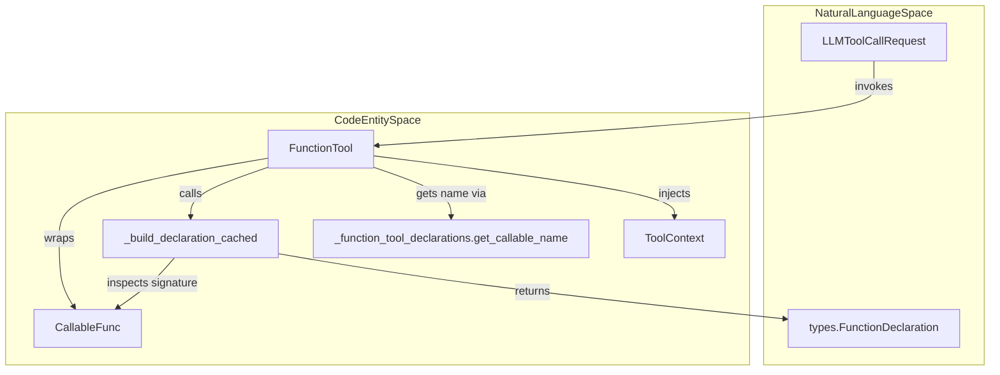
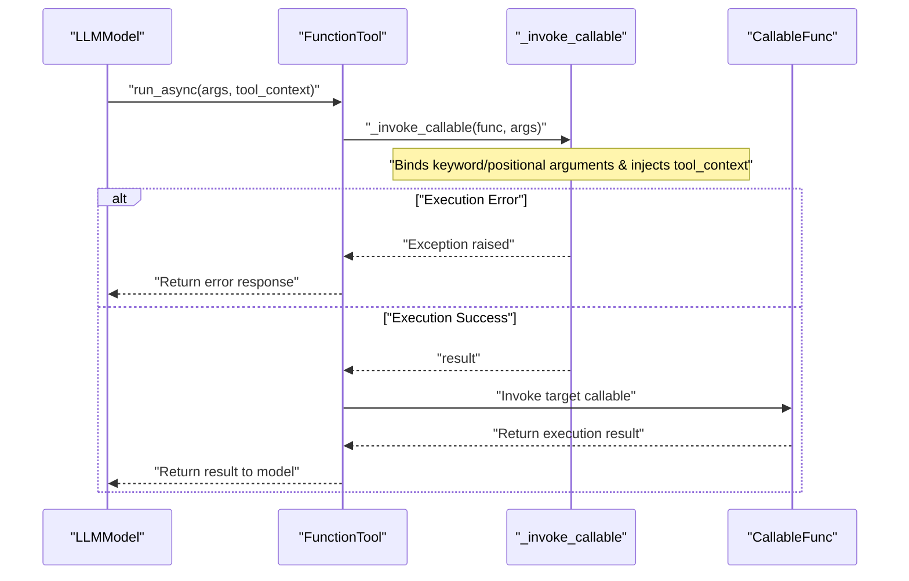

<!-- source: DeepWiki mcp.deepwiki.com · repo google/adk-python · page 7.2 Python Function Tools · fetched 2026-10-29 -->

# Python Function Tools

<details>
<summary>Relevant source files</summary>

The following files were used as context for generating this wiki page:

- [docs/guides/examples/example/index.md](docs/guides/examples/example/index.md)
- [src/google/adk/examples/example_util.py](src/google/adk/examples/example_util.py)
- [src/google/adk/examples/vertex_ai_example_store.py](src/google/adk/examples/vertex_ai_example_store.py)
- [src/google/adk/integrations/crewai/__init__.py](src/google/adk/integrations/crewai/__init__.py)
- [src/google/adk/integrations/crewai/crewai_tool.py](src/google/adk/integrations/crewai/crewai_tool.py)
- [src/google/adk/integrations/langchain/__init__.py](src/google/adk/integrations/langchain/__init__.py)
- [src/google/adk/integrations/langchain/langchain_tool.py](src/google/adk/integrations/langchain/langchain_tool.py)
- [src/google/adk/labs/__init__.py](src/google/adk/labs/__init__.py)
- [src/google/adk/tools/_automatic_function_calling_util.py](src/google/adk/tools/_automatic_function_calling_util.py)
- [src/google/adk/tools/_function_parameter_parse_util.py](src/google/adk/tools/_function_parameter_parse_util.py)
- [src/google/adk/tools/_function_tool_declarations.py](src/google/adk/tools/_function_tool_declarations.py)
- [src/google/adk/tools/_gemini_schema_util.py](src/google/adk/tools/_gemini_schema_util.py)
- [src/google/adk/tools/crewai_tool.py](src/google/adk/tools/crewai_tool.py)
- [src/google/adk/tools/example_tool.py](src/google/adk/tools/example_tool.py)
- [src/google/adk/tools/function_tool.py](src/google/adk/tools/function_tool.py)
- [src/google/adk/tools/langchain_tool.py](src/google/adk/tools/langchain_tool.py)
- [src/google/adk/tools/set_model_response_tool.py](src/google/adk/tools/set_model_response_tool.py)
- [src/google/adk/utils/_callable_utils.py](src/google/adk/utils/_callable_utils.py)
- [src/google/adk/utils/_dependency.py](src/google/adk/utils/_dependency.py)
- [src/google/adk/utils/content_utils.py](src/google/adk/utils/content_utils.py)
- [src/google/adk/utils/context_utils.py](src/google/adk/utils/context_utils.py)
- [tests/unittests/examples/__init__.py](tests/unittests/examples/__init__.py)
- [tests/unittests/examples/test_example_util.py](tests/unittests/examples/test_example_util.py)
- [tests/unittests/examples/test_vertex_ai_example_store.py](tests/unittests/examples/test_vertex_ai_example_store.py)
- [tests/unittests/integrations/crewai/test_crewai_tool.py](tests/unittests/integrations/crewai/test_crewai_tool.py)
- [tests/unittests/integrations/langchain/test_langchain_tool.py](tests/unittests/integrations/langchain/test_langchain_tool.py)
- [tests/unittests/tools/test_build_function_declaration.py](tests/unittests/tools/test_build_function_declaration.py)
- [tests/unittests/tools/test_example_tool.py](tests/unittests/tools/test_example_tool.py)
- [tests/unittests/tools/test_from_function_with_options.py](tests/unittests/tools/test_from_function_with_options.py)
- [tests/unittests/tools/test_function_tool.py](tests/unittests/tools/test_function_tool.py)
- [tests/unittests/tools/test_function_tool_declarations.py](tests/unittests/tools/test_function_tool_declarations.py)
- [tests/unittests/tools/test_function_tool_with_import_annotations.py](tests/unittests/tools/test_function_tool_with_import_annotations.py)
- [tests/unittests/tools/test_gemini_schema_util.py](tests/unittests/tools/test_gemini_schema_util.py)
- [tests/unittests/tools/test_set_model_response_tool.py](tests/unittests/tools/test_set_model_response_tool.py)
- [tests/unittests/utils/test_callable_utils.py](tests/unittests/utils/test_callable_utils.py)
- [tests/unittests/utils/test_content_utils.py](tests/unittests/utils/test_content_utils.py)
- [tests/unittests/utils/test_context_utils.py](tests/unittests/utils/test_context_utils.py)
- [tests/unittests/utils/test_dependency.py](tests/unittests/utils/test_dependency.py)

</details>


## Purpose and Scope

This document covers the **FunctionTool** system, which enables ordinary Python functions to be used as agent tools through automatic schema generation, type mapping, argument preprocessing, and execution wrapping. Python Function Tools convert function signatures, docstrings, and type hints into tool declarations that LLM agents can understand and invoke.

This page also details specialized tools for few-shot prompting (`ExampleTool`), long-running asynchronous tasks (`LongRunningFunctionTool`), mid-generation model consultation (`ModelConsultTool`), and proactive human-in-the-loop (HITL) interactions (`get_user_choice`, `request_input`, response scheduling). Additionally, it covers third-party integration wrappers for LangChain (`LangchainTool`) and CrewAI (`CrewaiTool`).

For information about:
- The base tool interface and framework, see [Tool Framework](7.1)()
- MCP tool integration, see [MCP (Model Context Protocol) Tools](7.3)()
- Tool authentication, see [Tool Authentication](7.7)()
- Human-in-the-loop confirmation, see [Tool Confirmation (HITL)](7.8)()

Sources: `[src/google/adk/tools/function_tool.py:79-158]`, `[src/google/adk/tools/langchain_tool.py:17-32]()`

---

## Overview

Python Function Tools allow developers to expose Python functions directly to agents without manually defining tool schemas. The system automatically:
- Extracts function signatures and converts them to `types.FunctionDeclaration` via `_automatic_function_calling_util.py` and `_function_tool_declarations.py` `[src/google/adk/tools/function_tool.py:70-76]`, `[src/google/adk/tools/_function_tool_declarations.py:15-23]()`.
- Caches expensive schema builds using `_build_declaration_cached` with feature flags like `JSON_SCHEMA_FOR_FUNC_DECL` `[src/google/adk/tools/function_tool.py:55-76]()`.
- Maps Python type hints to schema types `[src/google/adk/tools/_automatic_function_calling_util.py:47-64]()`.
- Handles both synchronous and asynchronous functions using `CallableSpec` and execution utilities `[src/google/adk/utils/_callable_utils.py]()`.
- Provides `ToolContext` injection for accessing session state and execution services `[src/google/adk/tools/function_tool.py:182-190]()`.
- Validates arguments against signatures when argument validation features are enabled `[src/google/adk/tools/function_tool.py:160-204]()`.

Sources: `[src/google/adk/tools/function_tool.py:55-204]`, `[src/google/adk/tools/_automatic_function_calling_util.py:47-64]`, `[src/google/adk/tools/_function_tool_declarations.py:15-23]()`

---

## FunctionTool Architecture

### Conceptual Structure: Bridging Natural Language Space to Code Entity Space



**Diagram: Mapping LLM tool invocations to Python code entities via `FunctionTool`.**

Sources: `[src/google/adk/tools/function_tool.py:55-204]`, `[src/google/adk/tools/_function_tool_declarations.py:33-56]()`

The `FunctionTool` class wraps a Python callable and implements the `BaseTool` interface `[src/google/adk/tools/function_tool.py:160-187]()`. It:
1. **Metadata Extraction**: Inspects the function name via `_function_tool_declarations.get_callable_name(func)` and extracts the docstring using `CallableSpec` `[src/google/adk/tools/function_tool.py:182-186]()`.
2. **Declaration Generation**: Uses `_build_declaration_cached` to cache schemas generated by `build_function_declaration` `[src/google/adk/tools/function_tool.py:55-76]()`.
3. **Argument Preprocessing**: Preprocesses LLM-provided arguments, converting JSON dicts to Pydantic models and validating types if requested `[src/google/adk/tools/function_tool.py:160-204]()`.
4. **Execution**: Handles context parameter filtering and async/sync invocation `[src/google/adk/tools/function_tool.py:182-204]()`.

Sources: `[src/google/adk/tools/function_tool.py:55-204]`, `[src/google/adk/tools/_function_tool_declarations.py:33-56]()`

---

## Automatic Schema Generation

The conversion of Python signatures to JSON schemas is handled by `_automatic_function_calling_util.py` and `_function_tool_declarations.py`.

### Type Mapping Table

| Python Type / Annotation | LLM Schema Type (`types.Type`) | File Reference |
| :--- | :--- | :--- |
| `str`, `string` | `STRING` | `[src/google/adk/tools/_automatic_function_calling_util.py:47-49]()` |
| `int`, `integer` | `INTEGER` | `[src/google/adk/tools/_automatic_function_calling_util.py:49-53]()` |
| `float`, `number` | `NUMBER` | `[src/google/adk/tools/_automatic_function_calling_util.py:50-54]()` |
| `bool`, `boolean` | `BOOLEAN` | `[src/google/adk/tools/_automatic_function_calling_util.py:51-55]()` |
| `list`, `array`, `tuple` | `ARRAY` | `[src/google/adk/tools/_automatic_function_calling_util.py:56-58]()` |
| `dict`, `object`, `Dict` | `OBJECT` | `[src/google/adk/tools/_automatic_function_calling_util.py:59-60]()` |
| `Any` | `TYPE_UNSPECIFIED` | `[src/google/adk/tools/_automatic_function_calling_util.py:63-63]()` |

Sources: `[src/google/adk/tools/_automatic_function_calling_util.py:47-64]()`

### Pydantic and Complex Type Integration
If a parameter is annotated with a Pydantic `BaseModel`, `_function_tool_declarations` builds a nested object schema using Pydantic's underlying generation routines `[src/google/adk/tools/_function_tool_declarations.py:15-48]()`. During tool execution, argument validation automatically checks incoming JSON dictionaries against Pydantic models `[src/google/adk/tools/function_tool.py:160-204]()`.

Sources: `[src/google/adk/tools/_automatic_function_calling_util.py:47-64]`, `[src/google/adk/tools/_function_tool_declarations.py:15-48]`, `[src/google/adk/tools/function_tool.py:160-204]()`

---

## Context Injection

Function tools can access the execution context by including a parameter annotated with `ToolContext` (or falling back to the name `tool_context`) `[src/google/adk/tools/function_tool.py:182-190]()`.

```python
from google.adk.tools.tool_context import ToolContext

def my_tool(query: str, tool_context: ToolContext):
    user_id = tool_context.invocation_context.session.state.get("user_id")
    return f"Processed {query} for {user_id}"
```

### Detection Logic
The system uses `CallableSpec` and context utils to locate the context argument:
1. It looks for parameters annotated with `Context`, `ToolContext`, or `CallbackContext`.
2. It handles `Optional[Context]` and string-based forward references.
3. If no annotation matches, `FunctionTool` checks for the parameter named `tool_context` and excludes it from the LLM schema declaration (`_ignore_params`) `[src/google/adk/tools/function_tool.py:189-190]()`.

Sources: `[src/google/adk/tools/function_tool.py:182-191]`, `[src/google/adk/utils/context_utils.py]()`

---

## Tool Execution Flow

### Data Flow: From Code Entity Space to LLM Interaction



**Diagram: Detailed invocation workflow linking `FunctionTool` to execution and invocation utilities.**

Sources: `[src/google/adk/tools/function_tool.py:160-204]`, `[src/google/adk/utils/_sync_runner.py]()`

---

## Specialized Function Tools

### ExampleTool (Few-shot Prompting)
`ExampleTool` provides few-shot examples to the LLM, letting developers define expected tool call sequences and outputs to guide agent behavior.

### LongRunningFunctionTool (Async HITL)
For operations requiring extended execution or external authorization, long-running tool helpers integrate with task suspension, A2A conversion, and execution tracking `[src/google/adk/tools/base_tool.py]()`.

### ModelConsultTool (Mid-Generation Escalation)
`ModelConsultTool` allows a fast executor agent model to consult a stronger advisor model mid-task, reading session history and returning a plan or course correction.

### Clarification and Confirmation Tools
ADK provides built-in mechanisms for proactive user interaction:
- **`get_user_choice`**: Prompts users to select from predefined options.
- **`request_input` / tool confirmation**: Allows the LLM to pause execution, request missing inputs, or confirm high-impact actions via confirmation events `[src/google/adk/tools/function_tool.py:171-181]()`.

Sources: `[src/google/adk/tools/function_tool.py:171-181]`, `[src/google/adk/tools/base_tool.py]()`

---

## Integration Wrappers

ADK provides integration wrappers for third-party agent ecosystems with compatibility shims and warnings:
- **CrewAI**: `CrewaiTool` (located in `google.adk.integrations.crewai`) wraps CrewAI tools for ADK compatibility `[src/google/adk/integrations/crewai/crewai_tool.py]()`.
- **LangChain**: `LangchainTool` (located in `google.adk.integrations.langchain`) wraps LangChain `BaseTool` or structured tools, preserving execution semantics and schema declarations `[src/google/adk/integrations/langchain/langchain_tool.py]()`.

Sources: `[src/google/adk/integrations/crewai/crewai_tool.py]`, `[src/google/adk/integrations/langchain/langchain_tool.py]`, `[src/google/adk/tools/langchain_tool.py:17-32]()`

---

## Summary of Key Classes and Functions

| Entity | Role | File Reference |
| :--- | :--- | :--- |
| `FunctionTool` | Primary class wrapping Python callables into ADK tools. | `[src/google/adk/tools/function_tool.py:160]()` |
| `build_function_declaration` | Utility to generate `types.FunctionDeclaration` from a function. | `[src/google/adk/tools/_automatic_function_calling_util.py:71]()` |
| `CallableSpec` | Introspection and signature specification for callables. | `[src/google/adk/utils/_callable_utils.py]()` |
| `LangchainTool` | Wrapper for LangChain ecosystem tools. | `[src/google/adk/integrations/langchain/langchain_tool.py]()` |
| `CrewaiTool` | Wrapper for CrewAI ecosystem tools. | `[src/google/adk/integrations/crewai/crewai_tool.py]()` |

Sources: `[src/google/adk/tools/function_tool.py]`, `[src/google/adk/utils/_callable_utils.py]`, `[src/google/adk/integrations/langchain/langchain_tool.py]`, `[src/google/adk/integrations/crewai/crewai_tool.py]()`

---

