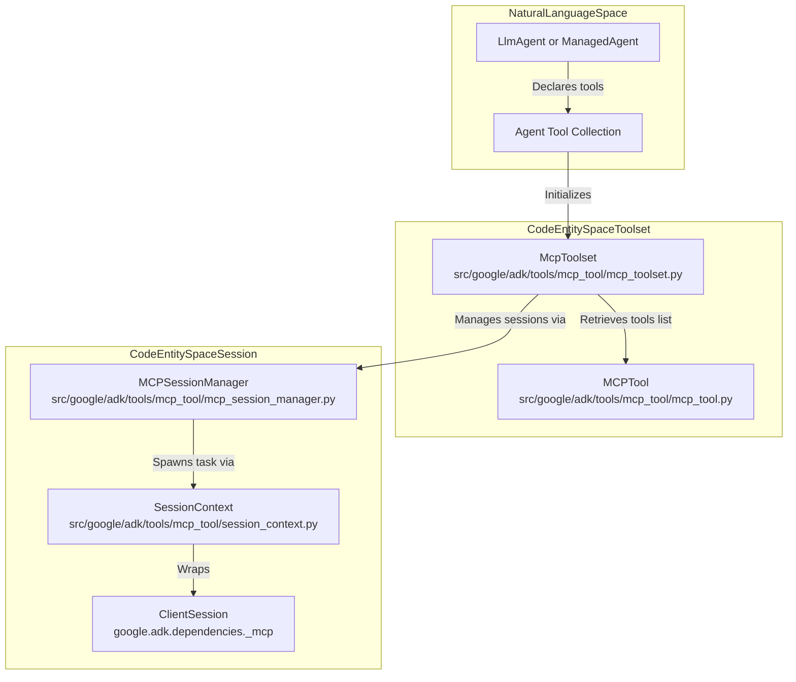

<!-- source: DeepWiki mcp.deepwiki.com · repo google/adk-python · page 7.3 MCP (Model Context Protocol) Tools · fetched 2026-10-29 -->

# MCP (Model Context Protocol) Tools

<details>
<summary>Relevant source files</summary>

The following files were used as context for generating this wiki page:

- [src/google/adk/dependencies/_mcp.py](src/google/adk/dependencies/_mcp.py)
- [src/google/adk/tools/load_mcp_resource_tool.py](src/google/adk/tools/load_mcp_resource_tool.py)
- [src/google/adk/tools/mcp_tool/__init__.py](src/google/adk/tools/mcp_tool/__init__.py)
- [src/google/adk/tools/mcp_tool/mcp_session_manager.py](src/google/adk/tools/mcp_tool/mcp_session_manager.py)
- [src/google/adk/tools/mcp_tool/mcp_tool.py](src/google/adk/tools/mcp_tool/mcp_tool.py)
- [src/google/adk/tools/mcp_tool/mcp_toolset.py](src/google/adk/tools/mcp_tool/mcp_toolset.py)
- [src/google/adk/tools/mcp_tool/session_context.py](src/google/adk/tools/mcp_tool/session_context.py)
- [tests/unittests/tools/mcp_tool/test_dependencies_mcp.py](tests/unittests/tools/mcp_tool/test_dependencies_mcp.py)
- [tests/unittests/tools/mcp_tool/test_mcp_session_manager.py](tests/unittests/tools/mcp_tool/test_mcp_session_manager.py)
- [tests/unittests/tools/mcp_tool/test_mcp_tool.py](tests/unittests/tools/mcp_tool/test_mcp_tool.py)
- [tests/unittests/tools/mcp_tool/test_mcp_toolset.py](tests/unittests/tools/mcp_tool/test_mcp_toolset.py)
- [tests/unittests/tools/mcp_tool/test_session_context.py](tests/unittests/tools/mcp_tool/test_session_context.py)

</details>


## Purpose and Scope

This page documents ADK's integration with the Model Context Protocol (MCP), enabling agents to connect to external tool providers and resource servers. The MCP integration allows ADK agents to discover and execute tools, read resources from any MCP-compliant server, and expose ADK agents as native MCP servers using `to_mcp_server`.

The subsystem handles local processes (`stdio`), remote connections (`SSE`), streamable HTTP transports, connection pooling with idle eviction, and seamless compatibility across MCP SDK 1.x and 2.x.

Sources: `[src/google/adk/tools/mcp_tool/mcp_toolset.py:120-148]()`, `[src/google/adk/tools/mcp_tool/mcp_session_manager.py:110-128]()`

## Architecture Overview

### Client-Side Architecture: Natural Language to Code Entities

The following diagram bridges the conceptual agent tool integration layer to the precise Python classes and file modules that implement MCP client capabilities in ADK.

Client-Side Architecture Diagram


Sources: `[src/google/adk/tools/mcp_tool/mcp_toolset.py:120-143]()`, `[src/google/adk/tools/mcp_tool/mcp_tool.py:38-44]()`, `[src/google/adk/tools/mcp_tool/mcp_session_manager.py:136-160]()`, `[src/google/adk/tools/mcp_tool/session_context.py:164-184]()`

### Server-Side Architecture: Exposing ADK Agents as MCP Servers

Server-Side Architecture Diagram
```mermaid
graph TB
    subgraph "ExternalClientSpace"
        MCPClient[""External MCP Host / Client""]
        ExternalProtocol[""JSON-RPC over Transport""]
    end

    subgraph "CodeEntitySpaceServer"
        FastMCP[""FastMCP Instance<br/>src/google/adk/dependencies/_mcp.py""]
        ToMcpServer[""to_mcp_server()<br/>src/google/adk/tools/mcp_tool/__init__.py""]
    end

    subgraph "CodeEntitySpaceADKExecution"
        Runner[""Runner engine""]
        Agent[""BaseAgent / LlmAgent""]
    end

    MCPClient -->|"Calls tool"| ExternalProtocol
    ExternalProtocol -->|"Dispatches to"| FastMCP
    FastMCP -->|"Invokes wrapper"| ToMcpServer
    ToMcpServer -->|"Drives execution"| Runner
    Runner -->|"Runs"| Agent
```

Sources: `[src/google/adk/tools/mcp_tool/__init__.py:18-40]()`, `[src/google/adk/dependencies/_mcp.py:44-76]()`

## Core Components and Implementation

### McpToolset

`McpToolset` inherits from `BaseToolset` and serves as the primary bridge between ADK agents and MCP servers `[src/google/adk/tools/mcp_tool/mcp_toolset.py:120-148]()`. It manages connection parameters (`StdioConnectionParams`, `SseConnectionParams`, `StreamableHTTPConnectionParams`), tool filtering predicates or lists, caching of tool lists with a TTL (`_MAX_TOOL_LIST_CACHE_ENTRIES`), and dynamic header injection via `header_provider` `[src/google/adk/tools/mcp_tool/mcp_toolset.py:150-180]()`.

Sources: `[src/google/adk/tools/mcp_tool/mcp_toolset.py:120-180]()`

### MCPTool

`MCPTool` wraps individual tools retrieved from an MCP server (`mcp.types.Tool`) into ADK-compatible `BaseAuthenticatedTool` objects `[src/google/adk/tools/mcp_tool/mcp_tool.py:38-44]()`. It handles argument verification, schema mapping via `_to_gemini_schema`, progress reporting via `ProgressCallbackFactory`, and response error detection `[src/google/adk/tools/mcp_tool/mcp_tool.py:63-73]()`.

Sources: `[src/google/adk/tools/mcp_tool/mcp_tool.py:38-73]()`

### MCPSessionManager

`MCPSessionManager` coordinates connection establishment, pooling, and lifecycle management for MCP client sessions `[src/google/adk/tools/mcp_tool/mcp_session_manager.py:136-245]()`. It handles authentication headers, mTLS options via `AsyncAuthorizedSession`, and HTTP transport debugging/instrumentation `[src/google/adk/tools/mcp_tool/mcp_session_manager.py:44-129]()`.

Sources: `[src/google/adk/tools/mcp_tool/mcp_session_manager.py:44-245]()`

### SessionContext

Because AnyIO's `TaskGroup` and `CancelScope` require task boundaries to align, `SessionContext` spawns a dedicated background asyncio task to manage the entire lifetime of an MCP client connection (bringing up the async context, calling `initialize()`, and handling graceful teardown) `[src/google/adk/tools/mcp_tool/session_context.py:164-198]()`.

Sources: `[src/google/adk/tools/mcp_tool/session_context.py:164-198]()`

## Connection Types and Session Management

ADK supports three primary connection protocols:

| Connection Type | Parameter Class | Transport Mechanism |
| :--- | :--- | :--- |
| **Stdio** | `StdioConnectionParams` | Local subprocess execution via `stdio_client` (e.g., `npx`, `python`) `[src/google/adk/tools/mcp_tool/mcp_session_manager.py:89-90]()` |
| **SSE** | `SseConnectionParams` | Remote or local Server-Sent Events via `sse_client` `[src/google/adk/tools/mcp_tool/mcp_session_manager.py:88-88]()` |
| **Streamable HTTP** | `StreamableHTTPConnectionParams` | Modern HTTP stream transport via `streamable_http_client` `[src/google/adk/tools/mcp_tool/mcp_session_manager.py:91-91]()` |

Sources: `[src/google/adk/tools/mcp_tool/mcp_session_manager.py:88-91]()`

### Session Pooling and Idle Eviction

`MCPSessionManager` maintains a pool of active client sessions. Unused sessions are subject to idle eviction:
- **Idle TTL:** Sessions unused for longer than `_SESSION_IDLE_TTL_SECONDS` (900 seconds / 15 minutes) are closed during the next pool sweep `[src/google/adk/tools/mcp_tool/mcp_session_manager.py:110-118]()`.
- **In-Flight Protection:** A session with an ongoing call or active use count is held out of the eviction sweep regardless of duration `[src/google/adk/tools/mcp_tool/mcp_session_manager.py:114-116]()`.
- **Pin Warnings:** If a session remains pinned for longer than `_SESSION_USE_PIN_WARN_SECONDS`, a warning log is emitted to surface potential resource leaks `[src/google/adk/tools/mcp_tool/mcp_session_manager.py:119-123]()`.

Sources: `[src/google/adk/tools/mcp_tool/mcp_session_manager.py:110-123]()`

## MCP SDK 2.x Compatibility

ADK provides robust compatibility layers for interacting across different MCP Python SDK major versions (1.x vs 2.x):
- **Field Name Normalization:** MCP SDK 1.x uses camelCase for wire attributes (e.g., `inputSchema`, `isError`), while SDK 2.x adopts snake_case (`input_schema`, `is_error`). Attributes are checked dynamically to ensure compatibility `[src/google/adk/dependencies/_mcp.py:60-76]()`.
- **Model Dumping (`_dump_mcp_model`):** Handles serialization differences by checking `IS_MCP_SDK_V2`, applying alias conversions, and safely restoring `_meta` property keys through `_restore_meta_keys` `[src/google/adk/tools/mcp_tool/mcp_tool.py:150-176]()`.
- **Timeouts (`_read_timeout`):** Translates float seconds into `timedelta` objects for SDK 1.x while passing raw floats directly for SDK 2.x `[src/google/adk/tools/mcp_tool/session_context.py:114-134]()`.

Sources: `[src/google/adk/dependencies/_mcp.py:60-76]()`, `[src/google/adk/tools/mcp_tool/mcp_tool.py:150-176]()`, `[src/google/adk/tools/mcp_tool/session_context.py:114-134]()`

## MCP Resources

When `use_mcp_resources=True` is set on `McpToolset`, the toolset integrates MCP resource capabilities. This includes listing available resources and utilizing the `LoadMcpResourceTool` `[src/google/adk/tools/load_mcp_resource_tool.py:39-48]()` to fetch contents (Text or Blob resource contents) into the agent's runtime context.

The `LoadMcpResourceTool` is a `BaseTool` that, when called, lists available resources from the MCP server and appends dynamic instructions to the LLM request, guiding the agent to use `load_mcp_resource` to access them. It also handles the conversion of MCP content blocks (text, blob) into ADK `types.Part` objects for inclusion in the LLM request `[src/google/adk/tools/load_mcp_resource_tool.py:96-179]()`.

Sources: `[src/google/adk/tools/load_mcp_resource_tool.py:39-48]`, `[src/google/adk/tools/load_mcp_resource_tool.py:96-179]()`

## Exposing ADK Agents over MCP (`to_mcp_server`)

ADK agents can be exposed as standard MCP servers using the `to_mcp_server` function exported in the package initialization module `[src/google/adk/tools/mcp_tool/__init__.py:18-40]()`.

- **Single Tool Exposure:** Wraps the target agent into a FastMCP server tool whose name corresponds to the configuration or agent identifier.
- **Session Reuse per Connection:** Maintains dedicated ADK sessions per client connection, preserving conversation history across multiple remote tool invocations.
- **Progress Reporting:** Intermediate text events emitted during agent execution are automatically reported back to the MCP host as progress notifications.

Sources: `[src/google/adk/tools/mcp_tool/__init__.py:18-40]()`

---

