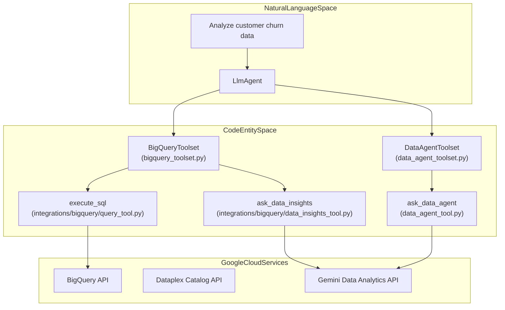
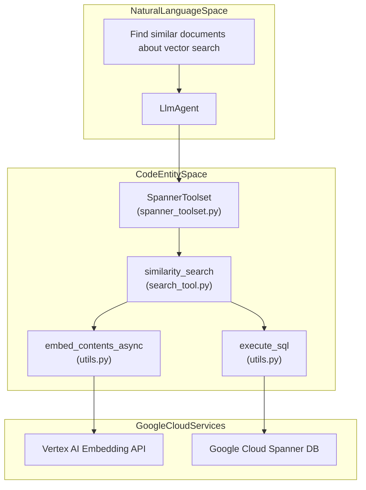

<!-- source: DeepWiki mcp.deepwiki.com · repo google/adk-python · page 7.4 Data and Database Tools · fetched 2026-10-29 -->

# Data and Database Tools

Relevant source files

The following files were used as context for generating this wiki page:

- [contributing/samples/integrations/data_agent/README.md](contributing/samples/integrations/data_agent/README.md)
- [contributing/samples/integrations/data_agent/agent.py](contributing/samples/integrations/data_agent/agent.py)
- [docs/guides/integrations/mongodb/mongodb_toolset/index.md](docs/guides/integrations/mongodb/mongodb_toolset/index.md)
- [src/google/adk/integrations/bigquery/data_insights_tool.py](src/google/adk/integrations/bigquery/data_insights_tool.py)
- [src/google/adk/integrations/mongodb/README.md](src/google/adk/integrations/mongodb/README.md)
- [src/google/adk/integrations/mongodb/_client.py](src/google/adk/integrations/mongodb/_client.py)
- [src/google/adk/integrations/mongodb/_mongodb_toolset.py](src/google/adk/integrations/mongodb/_mongodb_toolset.py)
- [src/google/adk/integrations/mongodb/_search_tool.py](src/google/adk/integrations/mongodb/_search_tool.py)
- [src/google/adk/integrations/mongodb/_settings.py](src/google/adk/integrations/mongodb/_settings.py)
- [src/google/adk/tools/_gda_stream_util.py](src/google/adk/tools/_gda_stream_util.py)
- [src/google/adk/tools/bigquery/__init__.py](src/google/adk/tools/bigquery/__init__.py)
- [src/google/adk/tools/bigquery/bigquery_credentials.py](src/google/adk/tools/bigquery/bigquery_credentials.py)
- [src/google/adk/tools/bigquery/bigquery_toolset.py](src/google/adk/tools/bigquery/bigquery_toolset.py)
- [src/google/adk/tools/bigquery/client.py](src/google/adk/tools/bigquery/client.py)
- [src/google/adk/tools/bigquery/config.py](src/google/adk/tools/bigquery/config.py)
- [src/google/adk/tools/bigquery/data_insights_tool.py](src/google/adk/tools/bigquery/data_insights_tool.py)
- [src/google/adk/tools/bigquery/metadata_tool.py](src/google/adk/tools/bigquery/metadata_tool.py)
- [src/google/adk/tools/bigquery/query_tool.py](src/google/adk/tools/bigquery/query_tool.py)
- [src/google/adk/tools/bigquery/search_tool.py](src/google/adk/tools/bigquery/search_tool.py)
- [src/google/adk/tools/bigtable/__init__.py](src/google/adk/tools/bigtable/__init__.py)
- [src/google/adk/tools/bigtable/bigtable_toolset.py](src/google/adk/tools/bigtable/bigtable_toolset.py)
- [src/google/adk/tools/bigtable/client.py](src/google/adk/tools/bigtable/client.py)
- [src/google/adk/tools/bigtable/metadata_tool.py](src/google/adk/tools/bigtable/metadata_tool.py)
- [src/google/adk/tools/bigtable/query_tool.py](src/google/adk/tools/bigtable/query_tool.py)
- [src/google/adk/tools/data_agent/__init__.py](src/google/adk/tools/data_agent/__init__.py)
- [src/google/adk/tools/data_agent/config.py](src/google/adk/tools/data_agent/config.py)
- [src/google/adk/tools/data_agent/data_agent_tool.py](src/google/adk/tools/data_agent/data_agent_tool.py)
- [src/google/adk/tools/data_agent/data_agent_toolset.py](src/google/adk/tools/data_agent/data_agent_toolset.py)
- [src/google/adk/tools/spanner/admin_tool.py](src/google/adk/tools/spanner/admin_tool.py)
- [src/google/adk/tools/spanner/admin_toolset.py](src/google/adk/tools/spanner/admin_toolset.py)
- [src/google/adk/tools/spanner/client.py](src/google/adk/tools/spanner/client.py)
- [src/google/adk/tools/spanner/metadata_tool.py](src/google/adk/tools/spanner/metadata_tool.py)
- [src/google/adk/tools/spanner/query_tool.py](src/google/adk/tools/spanner/query_tool.py)
- [src/google/adk/tools/spanner/search_tool.py](src/google/adk/tools/spanner/search_tool.py)
- [src/google/adk/tools/spanner/settings.py](src/google/adk/tools/spanner/settings.py)
- [src/google/adk/tools/spanner/spanner_toolset.py](src/google/adk/tools/spanner/spanner_toolset.py)
- [src/google/adk/tools/spanner/utils.py](src/google/adk/tools/spanner/utils.py)
- [tests/unittests/integrations/bigquery/test_bigquery_data_insights_tool.py](tests/unittests/integrations/bigquery/test_bigquery_data_insights_tool.py)
- [tests/unittests/integrations/mongodb/test_mongodb_toolset.py](tests/unittests/integrations/mongodb/test_mongodb_toolset.py)
- [tests/unittests/integrations/mongodb/test_search_tool.py](tests/unittests/integrations/mongodb/test_search_tool.py)
- [tests/unittests/tools/bigtable/__init__](tests/unittests/tools/bigtable/__init__)
- [tests/unittests/tools/bigtable/test_bigtable_credentials.py](tests/unittests/tools/bigtable/test_bigtable_credentials.py)
- [tests/unittests/tools/bigtable/test_bigtable_metadata_tool.py](tests/unittests/tools/bigtable/test_bigtable_metadata_tool.py)
- [tests/unittests/tools/bigtable/test_bigtable_query_tool.py](tests/unittests/tools/bigtable/test_bigtable_query_tool.py)
- [tests/unittests/tools/bigtable/test_bigtable_toolset.py](tests/unittests/tools/bigtable/test_bigtable_toolset.py)
- [tests/unittests/tools/bigtable/test_client.py](tests/unittests/tools/bigtable/test_client.py)
- [tests/unittests/tools/data_agent/test_data_agent_tool.py](tests/unittests/tools/data_agent/test_data_agent_tool.py)
- [tests/unittests/tools/data_agent/test_data_agent_toolset.py](tests/unittests/tools/data_agent/test_data_agent_toolset.py)
- [tests/unittests/tools/spanner/test_admin_tool.py](tests/unittests/tools/spanner/test_admin_tool.py)
- [tests/unittests/tools/spanner/test_metadata_tool.py](tests/unittests/tools/spanner/test_metadata_tool.py)
- [tests/unittests/tools/spanner/test_search_tool.py](tests/unittests/tools/spanner/test_search_tool.py)
- [tests/unittests/tools/spanner/test_spanner_client.py](tests/unittests/tools/spanner/test_spanner_client.py)
- [tests/unittests/tools/spanner/test_spanner_query_tool.py](tests/unittests/tools/spanner/test_spanner_query_tool.py)
- [tests/unittests/tools/spanner/test_spanner_tool_settings.py](tests/unittests/tools/spanner/test_spanner_tool_settings.py)
- [tests/unittests/tools/spanner/test_spanner_toolset.py](tests/unittests/tools/spanner/test_spanner_toolset.py)
- [tests/unittests/tools/spanner/test_utils.py](tests/unittests/tools/spanner/test_utils.py)
- [tests/unittests/tools/test__gda_stream_util.py](tests/unittests/tools/test__gda_stream_util.py)

This page documents the data and database toolsets in ADK Python, covering the BigQuery toolset (`tools/bigquery` and `integrations/bigquery`), Dataplex search, `DataAgentToolset`, as well as the Google Cloud Spanner, Bigtable, PubSub, and MongoDB toolsets. These toolsets equip LLM agents with secure, robust capabilities to query data warehouses, search metadata catalogs, interact with managed data agents, and perform operations on transactional, messaging, NoSQL, and vector storage backends.

For general tool framework concepts, see [7.1 Tool Framework](). For authentication mechanisms, see [7.7 Tool Authentication](). For BigQuery event logging and analytics, see [12.8 BigQuery Analytics Plugin]().

## Overview and Purpose

The data toolsets provide `BaseToolset` implementations that expose cloud database and data analytics operations as callable tools for LLM agents. These tools are hand-crafted to ensure they are LLM-friendly, feature built-in safety guardrails (such as preventing unauthorized data mutations and SQL injection protection), and provide high-level data abstractions.

Key capabilities include:
- **BigQuery & Data Insights**: SQL execution, BigQuery ML queries, metadata exploration, catalog search via Dataplex, and natural language data insights `[src/google/adk/integrations/bigquery/query_tool.py:19-26]()`, `[src/google/adk/integrations/bigquery/data_insights_tool.py:19-26]()`.
- **Data Agent Orchestration**: High-level `DataAgentToolset` for automated data discovery and conversational analysis via the Gemini Data Analytics (GDA) API `[src/google/adk/tools/data_agent/data_agent_tool.py:14-1389]()`, `[src/google/adk/tools/data_agent/data_agent_toolset.py:1-20]()`.
- **Spanner Toolset**: Read-only SQL query execution, metadata catalog exploration, and vector similarity search (kNN/ANN) with Spanner or Vertex AI embedding models `[src/google/adk/tools/spanner/utils.py:50-81]()`, `[src/google/adk/tools/spanner/search_tool.py:91-120]()`, `[src/google/adk/tools/spanner/settings.py:130-180]()`.
- **Bigtable Toolset**: NoSQL query and metadata tools for Google Cloud Bigtable `[src/google/adk/tools/bigtable/bigtable_toolset.py:1-20]()`.
- **PubSub Toolset**: Messaging integration for publishing and reading messages via Cloud Pub/Sub `[src/google/adk/tools/pubsub/client.py:1-20]()`.
- **MongoDB Toolset**: Vector and hybrid search over MongoDB collections, embedding query text on the fly `[pyproject.toml:128-128]()`.

Sources: `[pyproject.toml:68-139]`, `[src/google/adk/integrations/bigquery/query_tool.py:19-26]`, `[src/google/adk/integrations/bigquery/data_insights_tool.py:19-26]`, `[src/google/adk/tools/data_agent/data_agent_tool.py:14-1390]`, `[src/google/adk/tools/data_agent/data_agent_toolset.py:1-20]`, `[src/google/adk/tools/spanner/utils.py:50-81]`, `[src/google/adk/tools/spanner/search_tool.py:91-120]`, `[src/google/adk/tools/spanner/settings.py:130-180]`, `[src/google/adk/tools/bigtable/bigtable_toolset.py:1-20]`, `[src/google/adk/tools/pubsub/client.py:1-20]`, `[pyproject.toml:128-128]()`

---

## BigQuery and Data Agent Architecture

The BigQuery toolset modules have been migrated to the `google.adk.integrations.bigquery` namespace for stable, long-term maintenance, with legacy paths in `google.adk.tools.bigquery` preserved as deprecated forwarding wrappers `[src/google/adk/tools/bigquery/query_tool.py:17-26]()`.

### Diagram: BigQuery & Data Agent Execution Flow

Sources: `[src/google/adk/tools/bigquery/bigquery_toolset.py:19-26]`, `[src/google/adk/tools/bigquery/query_tool.py:17-26]`, `[src/google/adk/integrations/bigquery/data_insights_tool.py:19-26]`, `[src/google/adk/tools/data_agent/data_agent_tool.py:14-1389]()`

---

## BigQuery and Data Insights Tools

The BigQuery and Data Agent integrations expose several specialized tools:

| Tool Name | Module | Description |
|-----------|--------|-------------|
| `execute_sql` | `integrations/bigquery/query_tool.py` | Runs SQL and BigQuery ML queries with safety checks `[src/google/adk/integrations/bigquery/query_tool.py:19-26]()` |
| `ask_data_insights` | `integrations/bigquery/data_insights_tool.py` | Natural language data analysis via the GDA API `[src/google/adk/integrations/bigquery/data_insights_tool.py:19-26]()` |
| `search_catalog` | `bigquery/search_tool.py` | Metadata discovery using Dataplex Catalog `[src/google/adk/tools/bigquery/search_tool.py:19-26]()` |
| `ask_data_agent` | `data_agent_tool.py` | Conversational interface for managed GDA data agents `[src/google/adk/tools/data_agent/data_agent_tool.py:211-218]()` |
| `list_accessible_data_agents` | `data_agent_tool.py` | Lists accessible data agents in a GCP project `[src/google/adk/tools/data_agent/data_agent_tool.py:28-42]()` |
| `get_data_agent_info` | `data_agent_tool.py` | Retrieves metadata about a specific data agent `[src/google/adk/tools/data_agent/data_agent_tool.py:160-175]()` |

Sources: `[src/google/adk/integrations/bigquery/query_tool.py:19-26]`, `[src/google/adk/integrations/bigquery/data_insights_tool.py:19-26]`, `[src/google/adk/tools/bigquery/search_tool.py:19-26]`, `[src/google/adk/tools/data_agent/data_agent_tool.py:28-218]()`

---

## Spanner Toolset

The Spanner toolset (`src/google/adk/tools/spanner/`) enables agents to execute read-only queries, inspect metadata, and conduct vector similarity searches (both exact kNN and approximate ANN) across Spanner tables.

### Key Components and Settings
- **`execute_sql`**: Executes read-only GoogleSQL queries against Spanner databases, supporting parameter replacement (`params`, `params_types`) and row truncation limits `[src/google/adk/tools/spanner/utils.py:50-81]()`, `[src/google/adk/tools/spanner/utils.py:101-130]()`.
- **`SpannerVectorStoreSettings`**: Configures project, instance, database, table name, embedding columns, vector length, and nearest neighbor algorithms (`EXACT_NEAREST_NEIGHBORS` or `APPROXIMATE_NEAREST_NEIGHBORS`) `[src/google/adk/tools/spanner/settings.py:130-180]()`.
- **SQL Sanitization**: Employs rigorous regex validators (`_SAFE_IDENTIFIER_RE`, `_SAFE_FILTER_RE`) to ensure table names, column lists, and additional filters are safe against SQL injection `[src/google/adk/tools/spanner/search_tool.py:43-83]()`, `[src/google/adk/tools/spanner/search_tool.py:117-146]()`.

### Diagram: Spanner Vector Similarity Search Flow

Sources: `[src/google/adk/tools/spanner/search_tool.py:91-120]`, `[src/google/adk/tools/spanner/utils.py:50-192]`, `[src/google/adk/tools/spanner/settings.py:130-180]()`

---

## Bigtable, PubSub, and MongoDB Toolsets

### Bigtable Toolset
Located in `src/google/adk/tools/bigtable/`, the Bigtable toolset provides tools for interacting with Google Cloud Bigtable NoSQL databases:
- **`query_tool.py`**: Executes GoogleSQL queries against Bigtable tables, handling execution results and error management `[src/google/adk/tools/bigtable/query_tool.py:1-20]()`.
- **`metadata_tool.py`**: Inspects tables, column families, and cluster layouts `[src/google/adk/tools/bigtable/metadata_tool.py:1-20]()`.
- **`bigtable_toolset.py`**: Aggregates Bigtable capabilities into a unified toolset `[src/google/adk/tools/bigtable/bigtable_toolset.py:1-20]()`.

### PubSub Toolset
Located in `src/google/adk/tools/pubsub/`, the PubSub toolset provides asynchronous messaging capabilities:
- **`client.py`**: Manages Google Cloud Pub/Sub publisher and subscriber clients `[src/google/adk/tools/pubsub/client.py:1-20]()`.

### MongoDB Toolset
The MongoDB toolset (`MongoDbToolset`) supports vector and hybrid search over MongoDB collections, embedding query text on the fly during search executions `[pyproject.toml:128-128]()`.

Sources: `[src/google/adk/tools/bigtable/bigtable_toolset.py:1-20]`, `[src/google/adk/tools/bigtable/query_tool.py:1-20]`, `[src/google/adk/tools/bigtable/metadata_tool.py:1-20]`, `[src/google/adk/tools/pubsub/client.py:1-20]`, `[pyproject.toml:128-128]()`

---
**Related Pages:**
- [7.1 Tool Framework]()
- [7.7 Tool Authentication]()
- [12.8 BigQuery Analytics Plugin]()

---

