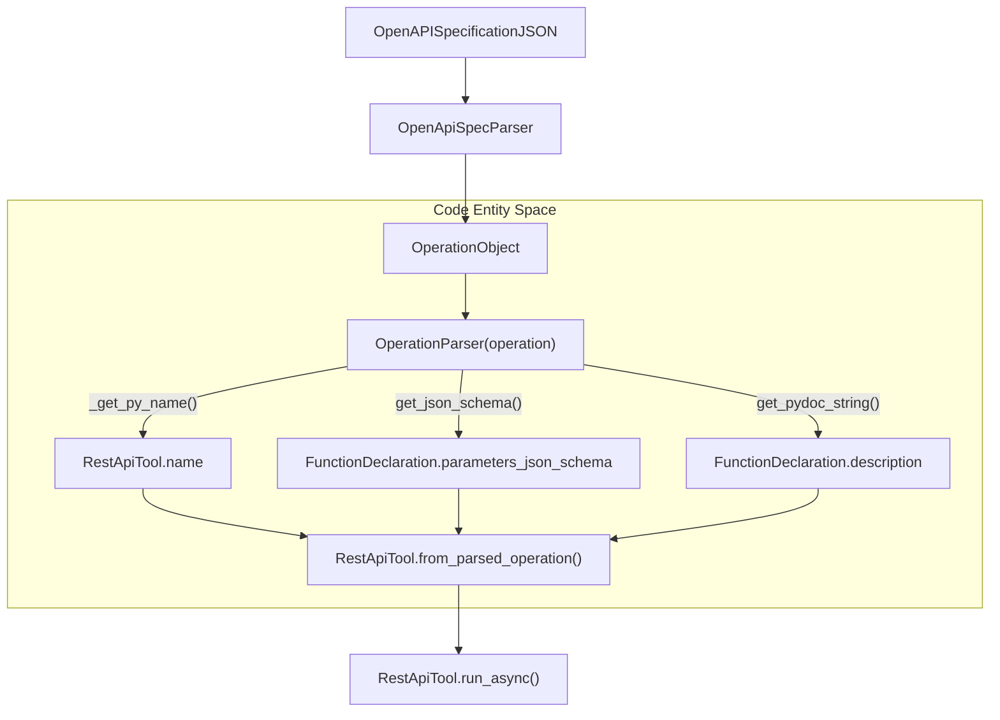
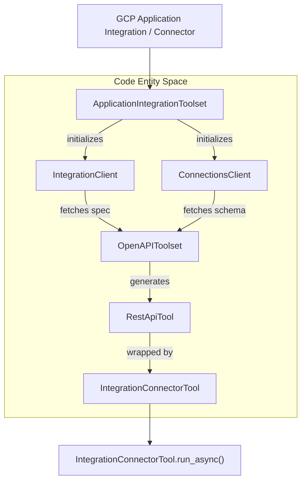

<!-- source: DeepWiki mcp.deepwiki.com · repo google/adk-python · page 7.5 OpenAPI and REST Tools · fetched 2026-10-29 -->

# OpenAPI and REST Tools

<details>
<summary>Relevant source files</summary>

The following files were used as context for generating this wiki page:

- [contributing/samples/integrations/authn-adk-all-in-one/adk_agents/agent_openapi_tools/agent.py](contributing/samples/integrations/authn-adk-all-in-one/adk_agents/agent_openapi_tools/agent.py)
- [src/google/adk/tools/_url_validator.py](src/google/adk/tools/_url_validator.py)
- [src/google/adk/tools/apihub_tool/apihub_toolset.py](src/google/adk/tools/apihub_tool/apihub_toolset.py)
- [src/google/adk/tools/apihub_tool/clients/apihub_client.py](src/google/adk/tools/apihub_tool/clients/apihub_client.py)
- [src/google/adk/tools/application_integration_tool/__init__.py](src/google/adk/tools/application_integration_tool/__init__.py)
- [src/google/adk/tools/application_integration_tool/application_integration_toolset.py](src/google/adk/tools/application_integration_tool/application_integration_toolset.py)
- [src/google/adk/tools/application_integration_tool/clients/connections_client.py](src/google/adk/tools/application_integration_tool/clients/connections_client.py)
- [src/google/adk/tools/application_integration_tool/clients/integration_client.py](src/google/adk/tools/application_integration_tool/clients/integration_client.py)
- [src/google/adk/tools/application_integration_tool/integration_connector_tool.py](src/google/adk/tools/application_integration_tool/integration_connector_tool.py)
- [src/google/adk/tools/base_toolset.py](src/google/adk/tools/base_toolset.py)
- [src/google/adk/tools/load_web_page.py](src/google/adk/tools/load_web_page.py)
- [src/google/adk/tools/openapi_tool/auth/credential_exchangers/base_credential_exchanger.py](src/google/adk/tools/openapi_tool/auth/credential_exchangers/base_credential_exchanger.py)
- [src/google/adk/tools/openapi_tool/common/common.py](src/google/adk/tools/openapi_tool/common/common.py)
- [src/google/adk/tools/openapi_tool/openapi_spec_parser/__init__.py](src/google/adk/tools/openapi_tool/openapi_spec_parser/__init__.py)
- [src/google/adk/tools/openapi_tool/openapi_spec_parser/openapi_spec_parser.py](src/google/adk/tools/openapi_tool/openapi_spec_parser/openapi_spec_parser.py)
- [src/google/adk/tools/openapi_tool/openapi_spec_parser/openapi_toolset.py](src/google/adk/tools/openapi_tool/openapi_spec_parser/openapi_toolset.py)
- [src/google/adk/tools/openapi_tool/openapi_spec_parser/operation_parser.py](src/google/adk/tools/openapi_tool/openapi_spec_parser/operation_parser.py)
- [src/google/adk/tools/openapi_tool/openapi_spec_parser/rest_api_tool.py](src/google/adk/tools/openapi_tool/openapi_spec_parser/rest_api_tool.py)
- [tests/unittests/cli/test_cli_feature_options.py](tests/unittests/cli/test_cli_feature_options.py)
- [tests/unittests/cli/test_cli_tools_click_option_mismatch.py](tests/unittests/cli/test_cli_tools_click_option_mismatch.py)
- [tests/unittests/tools/apihub_tool/clients/test_apihub_client.py](tests/unittests/tools/apihub_tool/clients/test_apihub_client.py)
- [tests/unittests/tools/application_integration_tool/clients/test_connections_client.py](tests/unittests/tools/application_integration_tool/clients/test_connections_client.py)
- [tests/unittests/tools/application_integration_tool/clients/test_integration_client.py](tests/unittests/tools/application_integration_tool/clients/test_integration_client.py)
- [tests/unittests/tools/application_integration_tool/test_application_integration_toolset.py](tests/unittests/tools/application_integration_tool/test_application_integration_toolset.py)
- [tests/unittests/tools/application_integration_tool/test_integration_connector_tool.py](tests/unittests/tools/application_integration_tool/test_integration_connector_tool.py)
- [tests/unittests/tools/openapi_tool/common/test_common.py](tests/unittests/tools/openapi_tool/common/test_common.py)
- [tests/unittests/tools/openapi_tool/openapi_spec_parser/test_openapi_spec_parser.py](tests/unittests/tools/openapi_tool/openapi_spec_parser/test_openapi_spec_parser.py)
- [tests/unittests/tools/openapi_tool/openapi_spec_parser/test_openapi_toolset.py](tests/unittests/tools/openapi_tool/openapi_spec_parser/test_openapi_toolset.py)
- [tests/unittests/tools/openapi_tool/openapi_spec_parser/test_operation_parser.py](tests/unittests/tools/openapi_tool/openapi_spec_parser/test_operation_parser.py)
- [tests/unittests/tools/openapi_tool/openapi_spec_parser/test_rest_api_tool.py](tests/unittests/tools/openapi_tool/openapi_spec_parser/test_rest_api_tool.py)
- [tests/unittests/tools/test_base_toolset.py](tests/unittests/tools/test_base_toolset.py)
- [tests/unittests/tools/test_load_web_page.py](tests/unittests/tools/test_load_web_page.py)
- [tests/unittests/tools/test_url_validator.py](tests/unittests/tools/test_url_validator.py)

</details>


This page documents the OpenAPI and REST tool integration in the ADK framework. It covers architectural design, specification parsing, parameter normalization, HTTP execution, credential handling, and specialized toolsets such as `OpenAPIToolset`, `RestApiTool`, `ApplicationIntegrationToolset`, and cloud connector clients.

---

## Overview and Architecture

The ADK REST tool subsystem bridges external RESTful services and LLM agents by converting OpenAPI specifications into executable tool definitions. The core components include:
1. **`OpenAPIToolset`**: Ingests OpenAPI specifications (JSON/YAML) and instantiates collections of `RestApiTool` objects [src/google/adk/tools/openapi_tool/openapi_spec_parser/openapi_toolset.py:47-66]().
2. **`RestApiTool`**: Represents a single API operation, handling parameter serialization, path safety validation, authentication headers, and asynchronous HTTP execution [src/google/adk/tools/openapi_tool/openapi_spec_parser/rest_api_tool.py:177-185]().
3. **`OperationParser`**: Extracts paths, query parameters, request bodies, and response schemas from OpenAPI operations to generate Gemini-compatible function signatures [src/google/adk/tools/openapi_tool/openapi_spec_parser/operation_parser.py:61-102]().
4. **`ApplicationIntegrationToolset`**: Dynamically generates tools from Google Cloud Application Integration flows and Integration Connector resources [src/google/adk/tools/application_integration_tool/application_integration_toolset.py:47-82]().

Sources: [src/google/adk/tools/openapi_tool/openapi_spec_parser/openapi_toolset.py:47-66](), [src/google/adk/tools/openapi_tool/openapi_spec_parser/rest_api_tool.py:177-185](), [src/google/adk/tools/openapi_tool/openapi_spec_parser/operation_parser.py:61-102](), [src/google/adk/tools/application_integration_tool/application_integration_toolset.py:47-82]()

---

## Class Hierarchy and Code Entities

### OpenAPI Tool Class Diagram

```mermaid
classDiagram
    class "BaseToolset" {
        <<abstract>>
        +get_tools(readonly_context) List~BaseTool~
        +get_tools_with_prefix(readonly_context) List~BaseTool~
    }
    
    class "OpenAPIToolset" {
        -spec_dict: Dict
        -_tools: List~RestApiTool~
        -preserve_property_names: bool
        +get_tools() List~RestApiTool~
        +get_tool(name) RestApiTool
    }
    
    class "RestApiTool" {
        +name: str
        +endpoint: OperationEndpoint
        +operation: Operation
        -_operation_parser: OperationParser
        +run_async(args, tool_context)
    }

    class "ApplicationIntegrationToolset" {
        +project: str
        +location: str
        +get_tools() List~BaseTool~
    }

    class "IntegrationConnectorTool" {
        -_rest_api_tool: RestApiTool
        -_connection_name: str
        +run_async(args, tool_context)
    }
    
    class "OperationParser" {
        -params: List~ApiParameter~
        -return_value: Optional~ApiParameter~
        +get_parameters() List~ApiParameter~
        +get_json_schema() Dict
    }

    class "ApiParameter" {
        +original_name: str
        +py_name: str
        +param_location: str
    }
    
    "BaseToolset" <|-- "OpenAPIToolset"
    "BaseToolset" <|-- "ApplicationIntegrationToolset"
    "OpenAPIToolset" "1" *-- "many" "RestApiTool" : "contains"
    "ApplicationIntegrationToolset" "1" *-- "many" "IntegrationConnectorTool" : "generates"
    "IntegrationConnectorTool" "1" *-- "1" "RestApiTool" : "wraps"
    "RestApiTool" "1" *-- "1" "OperationParser" : "uses_for_parsing"
    "OperationParser" "1" *-- "many" "ApiParameter" : "extracts"
```
Sources: [src/google/adk/tools/base_toolset.py:66-94](), [src/google/adk/tools/openapi_tool/openapi_spec_parser/openapi_toolset.py:47-85](), [src/google/adk/tools/openapi_tool/openapi_spec_parser/rest_api_tool.py:177-185](), [src/google/adk/tools/openapi_tool/openapi_spec_parser/operation_parser.py:61-102](), [src/google/adk/tools/application_integration_tool/application_integration_toolset.py:47-135](), [src/google/adk/tools/application_integration_tool/integration_connector_tool.py:39-122]()

---

## Natural Language Space to Code Entity Space Mappings

### Diagram 1: OpenAPI Spec to Function Declaration Mapping


Sources: [src/google/adk/tools/openapi_tool/openapi_spec_parser/openapi_spec_parser.py:68-102](), [src/google/adk/tools/openapi_tool/openapi_spec_parser/operation_parser.py:61-119](), [src/google/adk/tools/openapi_tool/openapi_spec_parser/rest_api_tool.py:177-185]()

### Diagram 2: Cloud Integration and Connectors Mapping


Sources: [src/google/adk/tools/application_integration_tool/application_integration_toolset.py:47-171](), [src/google/adk/tools/application_integration_tool/clients/connections_client.py:57-117](), [src/google/adk/tools/application_integration_tool/integration_connector_tool.py:39-160]()

---

## OpenAPIToolset and API Spec Parsing

`OpenAPIToolset` inherits from `BaseToolset` and parses OpenAPI dictionaries or strings into a list of `RestApiTool` instances [src/google/adk/tools/openapi_tool/openapi_spec_parser/openapi_toolset.py:47-85]().

### Configuration Parameters
*   `spec_dict` / `spec_str`: The source specification data in JSON or YAML format [src/google/adk/tools/openapi_tool/openapi_spec_parser/openapi_toolset.py:68-73]().
*   `auth_scheme` / `auth_credential`: Global authentication credentials applied across all generated tools [src/google/adk/tools/openapi_tool/openapi_spec_parser/openapi_toolset.py:74-76]().
*   `ssl_verify`: Supports boolean flags, CA bundle paths, or custom `ssl.SSLContext` instances for enterprise TLS-intercepting proxies [src/google/adk/tools/openapi_tool/openapi_spec_parser/openapi_toolset.py:79-130]().
*   `httpx_client_factory`: A zero-argument callable returning a fresh `httpx.AsyncClient` per request, unlocking proxies, HTTP/2, and custom transport signers [src/google/adk/tools/openapi_tool/openapi_spec_parser/openapi_toolset.py:83-144]().
*   `preserve_property_names`: When set to `True`, preserves camelCase or original casing instead of translating property names to `snake_case` [src/google/adk/tools/openapi_tool/openapi_spec_parser/openapi_toolset.py:84-151]().

Sources: [src/google/adk/tools/openapi_tool/openapi_spec_parser/openapi_toolset.py:47-151]()

---

## OperationParser and Parameter Normalization

`OperationParser` processes OpenAPI operations to extract schemas, parameters, and return types [src/google/adk/tools/openapi_tool/openapi_spec_parser/operation_parser.py:61-102]().

### Normalization Logic
1.  **Parameter Iteration**: Validates path, query, header, and cookie parameters against concrete `Schema` instances [src/google/adk/tools/openapi_tool/openapi_spec_parser/operation_parser.py:127-160](). Path parameters are strictly marked as required [src/google/adk/tools/openapi_tool/openapi_spec_parser/operation_parser.py:145-149]().
2.  **Request Body Expansion**: Expands JSON object request bodies into individual tool parameters, handling nested objects and array schemas [src/google/adk/tools/openapi_tool/openapi_spec_parser/operation_parser.py:172-185]().
3.  **Keyword Sanitization**: Automatically renames Python reserved words (e.g., `class`, `for`, `in`) via `rename_python_keywords` [src/google/adk/tools/openapi_tool/common/common.py:37-38]().

Sources: [src/google/adk/tools/openapi_tool/openapi_spec_parser/operation_parser.py:61-185](), [src/google/adk/tools/openapi_tool/common/common.py:37-38]()

---

## RestApiTool Execution and Authentication

`RestApiTool` executes the concrete HTTP calls corresponding to parsed operations [src/google/adk/tools/openapi_tool/openapi_spec_parser/rest_api_tool.py:177-185]().

### Security and Path Protection
*   **Path Segment Traversal Prevention**: `_encode_path_param()` percent-encodes path parameters while rejecting RFC 3986 dot-segments (`.` or `..`) to prevent path traversal attacks [src/google/adk/tools/openapi_tool/openapi_spec_parser/rest_api_tool.py:143-174]().
*   **Parameter Serialization**: `_to_param_string()` serializes header, cookie, and path parameters into string representations compliant with `httpx` requirements [src/google/adk/tools/openapi_tool/openapi_spec_parser/rest_api_tool.py:91-117]().
*   **Timeouts**: Default request timeouts enforce connection and pool constraints (`10s`) alongside generous read and write budgets (`600s`) [src/google/adk/tools/openapi_tool/openapi_spec_parser/rest_api_tool.py:135-140]().

Sources: [src/google/adk/tools/openapi_tool/openapi_spec_parser/rest_api_tool.py:91-185]()

---

## ApplicationIntegrationToolset and Cloud Connectors

`ApplicationIntegrationToolset` integrates Google Cloud Application Integration and Integration Connectors by synthesizing OpenAPI toolsets dynamically [src/google/adk/tools/application_integration_tool/application_integration_toolset.py:47-82]().

### Supporting Clients
*   **`IntegrationClient`**: Interfaces with the Application Integration API to fetch integration definitions and trigger configurations [src/google/adk/tools/application_integration_tool/clients/integration_client.py:54-105]().
*   **`ConnectionsClient`**: Interacts with the Google Cloud Connectors API (`connectors.googleapis.com`) to retrieve connection metadata, service names, hosts, and entity/action JSON schemas [src/google/adk/tools/application_integration_tool/clients/connections_client.py:57-190]().
*   **`IntegrationConnectorTool`**: Wraps a `RestApiTool` to inject connection-specific headers, entity parameters, and dynamic credential handling [src/google/adk/tools/application_integration_tool/integration_connector_tool.py:39-160]().

Sources: [src/google/adk/tools/application_integration_tool/application_integration_toolset.py:47-171](), [src/google/adk/tools/application_integration_tool/clients/connections_client.py:57-190](), [src/google/adk/tools/application_integration_tool/integration_connector_tool.py:39-160]()

---

