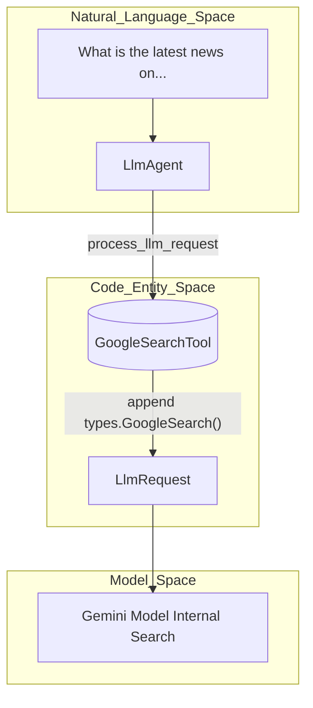
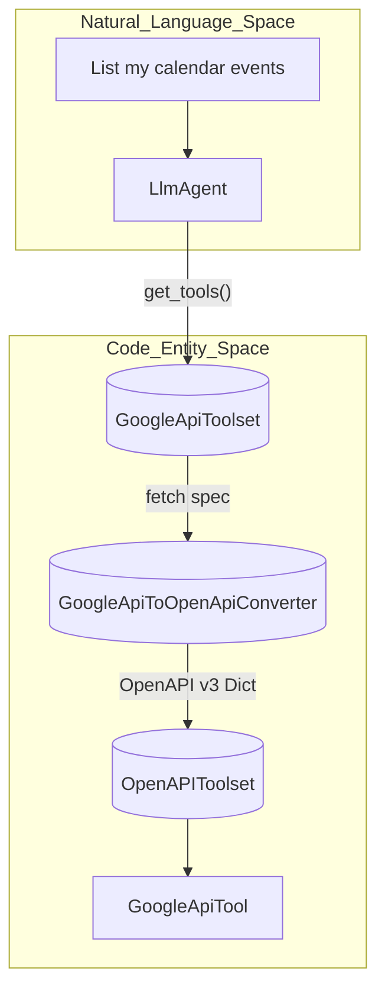

<!-- source: DeepWiki mcp.deepwiki.com · repo google/adk-python · page 7.6 Built-in Tools · fetched 2026-10-29 -->

# Built-in Tools

Relevant source files

The following files were used as context for generating this wiki page:

- [contributing/samples/multimodal/computer_use/playwright.py](contributing/samples/multimodal/computer_use/playwright.py)
- [src/google/adk/code_executors/built_in_code_executor.py](src/google/adk/code_executors/built_in_code_executor.py)
- [src/google/adk/tools/computer_use/base_computer.py](src/google/adk/tools/computer_use/base_computer.py)
- [src/google/adk/tools/computer_use/computer_use_tool.py](src/google/adk/tools/computer_use/computer_use_tool.py)
- [src/google/adk/tools/computer_use/computer_use_toolset.py](src/google/adk/tools/computer_use/computer_use_toolset.py)
- [src/google/adk/tools/data_agent/credentials.py](src/google/adk/tools/data_agent/credentials.py)
- [src/google/adk/tools/enterprise_search_tool.py](src/google/adk/tools/enterprise_search_tool.py)
- [src/google/adk/tools/environment/__init__.py](src/google/adk/tools/environment/__init__.py)
- [src/google/adk/tools/environment/_constants.py](src/google/adk/tools/environment/_constants.py)
- [src/google/adk/tools/environment/_environment_toolset.py](src/google/adk/tools/environment/_environment_toolset.py)
- [src/google/adk/tools/environment/_tools.py](src/google/adk/tools/environment/_tools.py)
- [src/google/adk/tools/google_api_tool/__init__.py](src/google/adk/tools/google_api_tool/__init__.py)
- [src/google/adk/tools/google_api_tool/google_api_tool.py](src/google/adk/tools/google_api_tool/google_api_tool.py)
- [src/google/adk/tools/google_api_tool/google_api_toolset.py](src/google/adk/tools/google_api_tool/google_api_toolset.py)
- [src/google/adk/tools/google_api_tool/google_api_toolsets.py](src/google/adk/tools/google_api_tool/google_api_toolsets.py)
- [src/google/adk/tools/google_api_tool/googleapi_to_openapi_converter.py](src/google/adk/tools/google_api_tool/googleapi_to_openapi_converter.py)
- [src/google/adk/tools/google_maps_grounding_tool.py](src/google/adk/tools/google_maps_grounding_tool.py)
- [src/google/adk/tools/google_search_tool.py](src/google/adk/tools/google_search_tool.py)
- [src/google/adk/tools/load_artifacts_tool.py](src/google/adk/tools/load_artifacts_tool.py)
- [src/google/adk/tools/load_memory_tool.py](src/google/adk/tools/load_memory_tool.py)
- [src/google/adk/tools/retrieval/__init__.py](src/google/adk/tools/retrieval/__init__.py)
- [src/google/adk/tools/retrieval/base_retrieval_tool.py](src/google/adk/tools/retrieval/base_retrieval_tool.py)
- [src/google/adk/tools/retrieval/files_retrieval.py](src/google/adk/tools/retrieval/files_retrieval.py)
- [src/google/adk/tools/retrieval/llama_index_retrieval.py](src/google/adk/tools/retrieval/llama_index_retrieval.py)
- [src/google/adk/tools/retrieval/vertex_ai_rag_retrieval.py](src/google/adk/tools/retrieval/vertex_ai_rag_retrieval.py)
- [src/google/adk/tools/url_context_tool.py](src/google/adk/tools/url_context_tool.py)
- [src/google/adk/tools/vertex_ai_search_tool.py](src/google/adk/tools/vertex_ai_search_tool.py)
- [src/google/adk/utils/model_name_utils.py](src/google/adk/utils/model_name_utils.py)
- [tests/unittests/code_executors/test_built_in_code_executor.py](tests/unittests/code_executors/test_built_in_code_executor.py)
- [tests/unittests/tools/computer_use/test_base_computer.py](tests/unittests/tools/computer_use/test_base_computer.py)
- [tests/unittests/tools/computer_use/test_computer_use_tool.py](tests/unittests/tools/computer_use/test_computer_use_tool.py)
- [tests/unittests/tools/computer_use/test_computer_use_toolset.py](tests/unittests/tools/computer_use/test_computer_use_toolset.py)
- [tests/unittests/tools/google_api_tool/test_docs_batchupdate.py](tests/unittests/tools/google_api_tool/test_docs_batchupdate.py)
- [tests/unittests/tools/google_api_tool/test_google_api_tool.py](tests/unittests/tools/google_api_tool/test_google_api_tool.py)
- [tests/unittests/tools/google_api_tool/test_google_api_toolset.py](tests/unittests/tools/google_api_tool/test_google_api_toolset.py)
- [tests/unittests/tools/google_api_tool/test_googleapi_to_openapi_converter.py](tests/unittests/tools/google_api_tool/test_googleapi_to_openapi_converter.py)
- [tests/unittests/tools/retrieval/test_base_retrieval_tool.py](tests/unittests/tools/retrieval/test_base_retrieval_tool.py)
- [tests/unittests/tools/retrieval/test_files_retrieval.py](tests/unittests/tools/retrieval/test_files_retrieval.py)
- [tests/unittests/tools/retrieval/test_llama_index_retrieval.py](tests/unittests/tools/retrieval/test_llama_index_retrieval.py)
- [tests/unittests/tools/retrieval/test_vertex_ai_rag_retrieval.py](tests/unittests/tools/retrieval/test_vertex_ai_rag_retrieval.py)
- [tests/unittests/tools/test_environment_toolset.py](tests/unittests/tools/test_environment_toolset.py)
- [tests/unittests/tools/test_google_search_tool.py](tests/unittests/tools/test_google_search_tool.py)
- [tests/unittests/tools/test_load_artifacts_tool.py](tests/unittests/tools/test_load_artifacts_tool.py)
- [tests/unittests/tools/test_load_mcp_resource_tool.py](tests/unittests/tools/test_load_mcp_resource_tool.py)
- [tests/unittests/tools/test_load_memory_tool.py](tests/unittests/tools/test_load_memory_tool.py)
- [tests/unittests/tools/test_url_context_tool.py](tests/unittests/tools/test_url_context_tool.py)
- [tests/unittests/tools/test_vertex_ai_search_tool.py](tests/unittests/tools/test_vertex_ai_search_tool.py)
- [tests/unittests/utils/test_model_name_utils.py](tests/unittests/utils/test_model_name_utils.py)

## Purpose and Scope

This page documents the core built-in tools, model grounding tools, retrieval systems, and toolsets provided by the ADK framework. These components empower agents to perform web grounding, enterprise search via Vertex AI and Discovery Engine, location grounding via Google Maps, artifact and memory management, Google API and GCS storage interactions, and complex desktop automation via Computer Use and Toolboxes.

Built-in tools are distinct from:
- **Custom Python function tools** — covered in [7.2 Python Function Tools]()
- **OpenAPI and REST tools** — covered in [7.5 OpenAPI and REST Tools]()

For the underlying tool abstraction architecture, see [7.1 Tool Framework]().

Sources: [src/google/adk/tools/google_search_tool.py:32-88](), [src/google/adk/tools/vertex_ai_search_tool.py:36-189]()

---

## Model Built-in Grounding Tools

ADK provides wrappers for Gemini model built-in grounding and search capabilities. These tools operate internally within the model or configure the `GenerateContentConfig` directly without requiring local code execution.

### Google Search Tool
The `GoogleSearchTool` configures Gemini models to retrieve search results from Google Search [src/google/adk/tools/google_search_tool.py:32-37]().
*   **Implementation**: Overrides `process_llm_request` to append `types.Tool(google_search=types.GoogleSearch())` to `llm_request.config.tools` [src/google/adk/tools/google_search_tool.py:61-81]().
*   **Model Validation**: Enforces that the target model is a Gemini model via `is_gemini_model()` unless model checks are disabled or it is a managed agent [src/google/adk/tools/google_search_tool.py:71-78](), [src/google/adk/utils/model_name_utils.py:94-108]().

**Google Search Data Flow**

Sources: [src/google/adk/tools/google_search_tool.py:32-88](), [src/google/adk/utils/model_name_utils.py:94-108]()

### Vertex AI Search and Discovery Engine Tools
*   **`VertexAiSearchTool`**: Integrates Vertex AI Search data stores or search engines for grounded RAG [src/google/adk/tools/vertex_ai_search_tool.py:36-61](). Requires either `data_store_id` or `search_engine_id` [src/google/adk/tools/vertex_ai_search_tool.py:96-101](). Subclasses can override `_build_vertex_ai_search_config` to supply dynamic filters based on runtime context [src/google/adk/tools/vertex_ai_search_tool.py:43-61](). Appends `types.Retrieval(vertex_ai_search=...)` into the generation config.
*   **`DiscoveryEngineSearchTool`**: Bridges discovery engine specifications for enterprise unstructured and structured search pipelines.

Sources: [src/google/adk/tools/vertex_ai_search_tool.py:36-189]()

### URL Context, Enterprise Search, and Google Maps Grounding
*   **`UrlContextTool`**: Automatically invoked by Gemini models to retrieve and digest content from URLs mentioned in prompts or context [src/google/adk/tools/url_context_tool.py:32-37]().
*   **`EnterpriseWebSearchTool`**: Provides web grounding tailored for Enterprise compliance guidelines [src/google/adk/tools/enterprise_search_tool.py:31-39]().
*   **`GoogleMapsGroundingTool`**: Configures location-based grounding through Google Maps API parameters.

Sources: [src/google/adk/tools/url_context_tool.py:32-67](), [src/google/adk/tools/enterprise_search_tool.py:31-70](), [src/google/adk/tools/google_maps_grounding_tool.py:31-60]()

---

## Retrieval, Artifact, and Memory Tools

### Load Artifacts Tool
The `LoadArtifactsTool` (`load_artifacts`) fetches session or user-scoped artifacts [src/google/adk/tools/load_artifacts_tool.py:1-41]().
*   **Parsing**: Automatically inspects MIME types, falling back to text conversion for CSV, JSON, and XML [src/google/adk/tools/load_artifacts_tool.py:60-71](). It parses spreadsheets (XLSX) into markdown tables (capped at 100 rows) and extracts raw text from DOCX binaries using safe zip extraction and regex parsing [src/google/adk/tools/load_artifacts_tool.py:114-201]().

Sources: [src/google/adk/tools/load_artifacts_tool.py:1-204]()

### Retrieval and Memory Tools
*   **Retrieval Tools**: `FilesRetrieval` and `VertexAiRagRetrieval` modules encapsulate document grounding and vector database lookups [src/google/adk/tools/retrieval/vertex_ai_rag_retrieval.py:31-36]().
    *   `FilesRetrieval`: A tool for retrieving files from the artifact service.
    *   `VertexAiRagRetrieval`: A tool for retrieving information from Vertex AI RAG [src/google/adk/tools/retrieval/vertex_ai_rag_retrieval.py:78-102]().
*   **Memory Tools**: `LoadMemoryTool` and `PreloadMemoryTool` inject historical memory records and retrieved snippets into agent contexts dynamically.
    *   `LoadMemoryTool`: A tool that loads the memory for the current user [src/google/adk/tools/load_memory_tool.py:33-38]().
    *   `PreloadMemoryTool`: A tool that preloads the memory for the current user, automatically executed for each LLM request [src/google/adk/tools/preload_memory_tool.py:33-39]().

Sources: [src/google/adk/tools/retrieval/files_retrieval.py:1-50](), [src/google/adk/tools/retrieval/vertex_ai_rag_retrieval.py:1-118](), [src/google/adk/tools/load_memory_tool.py:1-50](), [src/google/adk/tools/preload_memory_tool.py:1-99]()

---

## Google API and Cloud Storage Toolsets

### Google API Toolset
The `GoogleApiToolset` enables dynamic interaction with Google APIs by discovering REST specifications and converting them into OpenAPI v3 schemas [src/google/adk/tools/google_api_tool/google_api_toolset.py:39-102]().
*   **Discovery Conversion**: Uses `GoogleApiToOpenApiConverter` to fetch Google API discovery documents and translate resources, methods, and schemas into executable OpenAPI tool definitions [src/google/adk/tools/google_api_tool/googleapi_to_openapi_converter.py:37-158]().
*   **Authentication & mTLS**: Supports OAuth2 client credentials, service accounts, OpenID Connect, and mutual TLS (mTLS) client certificates [src/google/adk/tools/google_api_tool/google_api_toolset.py:46-99]().

**Google API Conversion Flow**

Sources: [src/google/adk/tools/google_api_tool/google_api_toolset.py:39-175](), [src/google/adk/tools/google_api_tool/googleapi_to_openapi_converter.py:37-158]()

### GCS Storage Toolset
The GCS storage toolset (`src/google/adk/integrations/gcs/storage_toolset.py` and `storage_tool.py`) provides agents with bucket and object management capabilities, letting models read, write, list, and delete files stored in Google Cloud Storage.

Sources: [docs/guides/integrations/gcs/gcs_toolset/index.md]()

---

## Computer Use Toolset and Toolbox

### Computer Use Toolset
The `ComputerUseToolset` exposes desktop or browser environment capabilities (such as screen interaction, clicking, typing, and navigation) as model-callable tools via a `BaseComputer` implementation [src/google/adk/tools/computer_use/computer_use_toolset.py:55-70]().
*   **State Binding**: Wraps computer methods to automatically bind session state from `ToolContext` before execution [src/google/adk/tools/computer_use/computer_use_toolset.py:131-176]().
*   **URL Safety Validation**: Intercepts `navigate` calls to validate target URLs against private network access rules and blocklists, preventing server-side request forgery (SSRF) [src/google/adk/tools/computer_use/computer_use_toolset.py:178-188]().

Sources: [src/google/adk/tools/computer_use/computer_use_toolset.py:55-188]()

### Toolbox
The Toolbox integration aggregates multiple modular toolsets into a unified interface, allowing agents to hot-swap or dynamically select specialized tool groupings during runtime.

Sources: [src/google/adk/tools/computer_use/computer_use_toolset.py:55-188]()

---

## Tool Summary Table

| Tool / Toolset | Primary Class / Module | Purpose | Key Integration |
|:---|:---|:---|:---|
| **Google Search** | `GoogleSearchTool` | Model built-in Google Search grounding | `types.GoogleSearch` |
| **Vertex AI Search** | `VertexAiSearchTool` | Enterprise RAG via Vertex AI Search datastores | `types.VertexAISearch` |
| **Discovery Engine** | `DiscoveryEngineSearchTool` | Enterprise unstructured/structured search | `types.DiscoveryEngine` |
| **URL Context** | `UrlContextTool` | Grounding against URLs in prompts | `types.UrlContext` |
| **Google Maps** | `GoogleMapsGroundingTool` | Location-based grounding | Maps API parameters |
| **Artifact Loader** | `LoadArtifactsTool` | Load & parse artifacts (DOCX, XLSX, CSV) | `ArtifactService` |
| **Memory Tools** | `LoadMemoryTool`, `PreloadMemoryTool` | Memory bank and context snippet injection | Memory Services |
| **Google API Toolset** | `GoogleApiToolset` | Dynamic Google API invocation via Discovery | `GoogleApiToOpenApiConverter` |
| **GCS Storage** | `StorageToolset` | Google Cloud Storage bucket & object management | GCS Client SDK |
| **Computer Use** | `ComputerUseToolset` | Desktop/browser automation | `BaseComputer` |

Sources: [src/google/adk/tools/google_search_tool.py:32](), [src/google/adk/tools/vertex_ai_search_tool.py:36](), [src/google/adk/tools/url_context_tool.py:32](), [src/google/adk/tools/load_artifacts_tool.py:38](), [src/google/adk/tools/google_api_tool/google_api_toolset.py:39](), [src/google/adk/tools/computer_use/computer_use_toolset.py:55](), [src/google/adk/tools/enterprise_search_tool.py:31](), [src/google/adk/tools/google_maps_grounding_tool.py:31](), [src/google/adk/tools/load_memory_tool.py:33](), [src/google/adk/tools/preload_memory_tool.py:33]()

---

