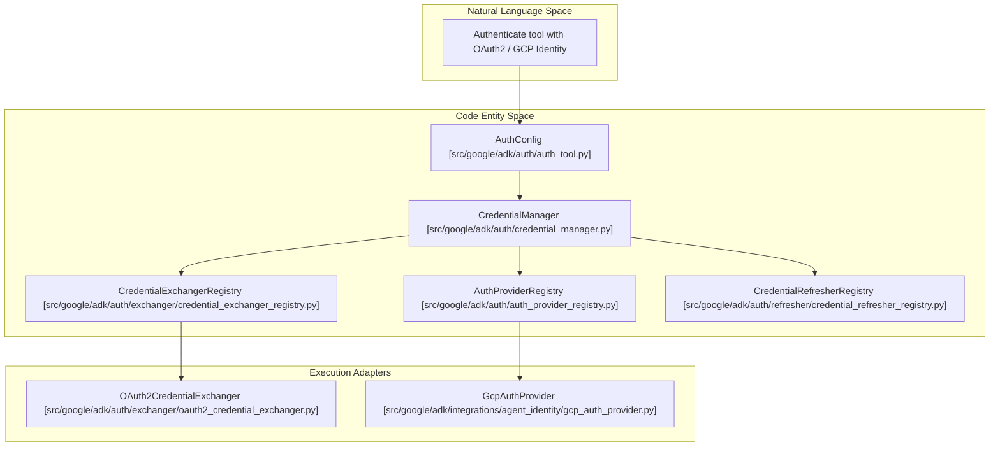
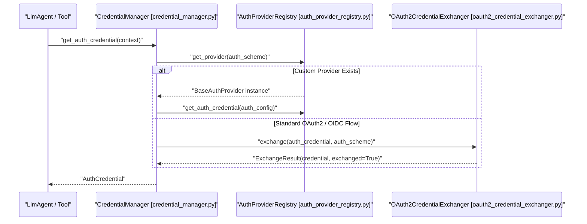

<!-- source: DeepWiki mcp.deepwiki.com · repo google/adk-python · page 7.7 Tool Authentication · fetched 2026-10-29 -->

# Tool Authentication

Relevant source files

The following files were used as context for generating this wiki page:

- [constraints-3.11.txt](constraints-3.11.txt)
- [constraints-3.12.txt](constraints-3.12.txt)
- [constraints-3.13.txt](constraints-3.13.txt)
- [constraints-3.14.txt](constraints-3.14.txt)
- [constraints-3.15.txt](constraints-3.15.txt)
- [docs/guides/auth/tool_auth/index.md](docs/guides/auth/tool_auth/index.md)
- [pyproject.toml](pyproject.toml)
- [src/google/adk/auth/__init__.py](src/google/adk/auth/__init__.py)
- [src/google/adk/auth/_auth_resume.py](src/google/adk/auth/_auth_resume.py)
- [src/google/adk/auth/auth_credential.py](src/google/adk/auth/auth_credential.py)
- [src/google/adk/auth/auth_handler.py](src/google/adk/auth/auth_handler.py)
- [src/google/adk/auth/auth_preprocessor.py](src/google/adk/auth/auth_preprocessor.py)
- [src/google/adk/auth/auth_provider_registry.py](src/google/adk/auth/auth_provider_registry.py)
- [src/google/adk/auth/auth_schemes.py](src/google/adk/auth/auth_schemes.py)
- [src/google/adk/auth/auth_tool.py](src/google/adk/auth/auth_tool.py)
- [src/google/adk/auth/base_auth_provider.py](src/google/adk/auth/base_auth_provider.py)
- [src/google/adk/auth/credential_manager.py](src/google/adk/auth/credential_manager.py)
- [src/google/adk/auth/exchanger/credential_exchanger_registry.py](src/google/adk/auth/exchanger/credential_exchanger_registry.py)
- [src/google/adk/auth/exchanger/oauth2_credential_exchanger.py](src/google/adk/auth/exchanger/oauth2_credential_exchanger.py)
- [src/google/adk/auth/oauth2_credential_util.py](src/google/adk/auth/oauth2_credential_util.py)
- [src/google/adk/auth/oauth2_discovery.py](src/google/adk/auth/oauth2_discovery.py)
- [src/google/adk/auth/refresher/credential_refresher_registry.py](src/google/adk/auth/refresher/credential_refresher_registry.py)
- [src/google/adk/auth/refresher/oauth2_credential_refresher.py](src/google/adk/auth/refresher/oauth2_credential_refresher.py)
- [src/google/adk/integrations/agent_identity/README.md](src/google/adk/integrations/agent_identity/README.md)
- [src/google/adk/integrations/agent_identity/__init__.py](src/google/adk/integrations/agent_identity/__init__.py)
- [src/google/adk/integrations/agent_identity/_agent_identity_credentials_provider.py](src/google/adk/integrations/agent_identity/_agent_identity_credentials_provider.py)
- [src/google/adk/integrations/agent_identity/_iam_connector_credentials_provider.py](src/google/adk/integrations/agent_identity/_iam_connector_credentials_provider.py)
- [src/google/adk/integrations/agent_identity/gcp_auth_provider.py](src/google/adk/integrations/agent_identity/gcp_auth_provider.py)
- [src/google/adk/integrations/agent_identity/gcp_auth_provider_scheme.py](src/google/adk/integrations/agent_identity/gcp_auth_provider_scheme.py)
- [src/google/adk/tools/openapi_tool/openapi_spec_parser/tool_auth_handler.py](src/google/adk/tools/openapi_tool/openapi_spec_parser/tool_auth_handler.py)
- [src/google/adk/utils/_mtls_utils.py](src/google/adk/utils/_mtls_utils.py)
- [src/google/adk/workflow/_tool_node.py](src/google/adk/workflow/_tool_node.py)
- [src/google/adk/workflow/utils/_workflow_hitl_utils.py](src/google/adk/workflow/utils/_workflow_hitl_utils.py)
- [tests/integration/integrations/agent_identity/test_2lo_flow.py](tests/integration/integrations/agent_identity/test_2lo_flow.py)
- [tests/integration/integrations/agent_identity/test_3lo_flow.py](tests/integration/integrations/agent_identity/test_3lo_flow.py)
- [tests/integration/integrations/agent_identity/test_agent_identity_2lo_flow.py](tests/integration/integrations/agent_identity/test_agent_identity_2lo_flow.py)
- [tests/integration/integrations/agent_identity/test_agent_identity_3lo_flow.py](tests/integration/integrations/agent_identity/test_agent_identity_3lo_flow.py)
- [tests/unittests/auth/exchanger/test_credential_exchanger_registry.py](tests/unittests/auth/exchanger/test_credential_exchanger_registry.py)
- [tests/unittests/auth/exchanger/test_oauth2_credential_exchanger.py](tests/unittests/auth/exchanger/test_oauth2_credential_exchanger.py)
- [tests/unittests/auth/refresher/test_credential_refresher_registry.py](tests/unittests/auth/refresher/test_credential_refresher_registry.py)
- [tests/unittests/auth/refresher/test_oauth2_credential_refresher.py](tests/unittests/auth/refresher/test_oauth2_credential_refresher.py)
- [tests/unittests/auth/test_auth_config.py](tests/unittests/auth/test_auth_config.py)
- [tests/unittests/auth/test_auth_credential.py](tests/unittests/auth/test_auth_credential.py)
- [tests/unittests/auth/test_auth_handler.py](tests/unittests/auth/test_auth_handler.py)
- [tests/unittests/auth/test_auth_preprocessor.py](tests/unittests/auth/test_auth_preprocessor.py)
- [tests/unittests/auth/test_auth_provider_registry.py](tests/unittests/auth/test_auth_provider_registry.py)
- [tests/unittests/auth/test_auth_resume.py](tests/unittests/auth/test_auth_resume.py)
- [tests/unittests/auth/test_credential_manager.py](tests/unittests/auth/test_credential_manager.py)
- [tests/unittests/auth/test_oauth2_credential_util.py](tests/unittests/auth/test_oauth2_credential_util.py)
- [tests/unittests/auth/test_oauth2_discovery.py](tests/unittests/auth/test_oauth2_discovery.py)
- [tests/unittests/integrations/agent_identity/test_agent_identity_credentials_provider.py](tests/unittests/integrations/agent_identity/test_agent_identity_credentials_provider.py)
- [tests/unittests/integrations/agent_identity/test_gcp_auth_provider.py](tests/unittests/integrations/agent_identity/test_gcp_auth_provider.py)
- [tests/unittests/integrations/agent_identity/test_iam_connector_credentials_provider.py](tests/unittests/integrations/agent_identity/test_iam_connector_credentials_provider.py)
- [tests/unittests/tools/openapi_tool/openapi_spec_parser/test_tool_auth_handler.py](tests/unittests/tools/openapi_tool/openapi_spec_parser/test_tool_auth_handler.py)
- [tests/unittests/utils/test_mtls_utils.py](tests/unittests/utils/test_mtls_utils.py)
- [tests/unittests/workflow/test_tool_node.py](tests/unittests/workflow/test_tool_node.py)
- [tests/unittests/workflow/utils/test_workflow_hitl_utils.py](tests/unittests/workflow/utils/test_workflow_hitl_utils.py)

Tool authentication enables ADK agents to securely access protected external APIs, user data stores, and cloud services. This page covers the core authentication architecture, including `AuthConfig`, `CredentialManager`, `AuthProviderRegistry`, credential exchangers and refreshers, OAuth2 and API key auth, GCP agent identity and IAM connectors, and mTLS.

---

## Purpose and Scope

The ADK provides a robust authentication framework that isolates credential negotiation, storage, and lifecycle management from agent tool execution. This subsystem handles token exchanges, credential rehydration, token refreshing, secret redaction, and enterprise integrations like GCP agent identity and mTLS-bound endpoints.

Sources: [src/google/adk/auth/credential_manager.py:90-126](), [src/google/adk/auth/auth_handler.py:135-152]()

---

## Core Authentication Architecture

The core framework relies on three primary components: `AuthConfig` for defining requirements, `CredentialManager` for orchestrating lifecycles, and `AuthProviderRegistry` for custom provider lookups [src/google/adk/auth/credential_manager.py:90-150](), [src/google/adk/auth/auth_tool.py:1-60]().

- **`AuthConfig`**: Encapsulates an authentication scheme (`auth_scheme`), a raw credential template (`raw_auth_credential`), an exchanged credential (`exchanged_auth_credential`), and a unique lookup identifier (`credential_key`).
- **`CredentialManager`**: Implements the core state machine for loading, rehydrating, requesting, and exchanging credentials, utilizing event-loop-local locking via `_get_credential_lock()` to ensure thread-safe and concurrent request handling [src/google/adk/auth/credential_manager.py:136-154]().
- **`AuthProviderRegistry`**: Manages custom authentication providers mapped against specific auth scheme classes [src/google/adk/auth/auth_provider_registry.py:1-40]().

### Natural Language to Code Entity Mapping

The following diagram bridges the conceptual requirement of authenticating a tool call to the exact classes responsible for fulfilling it in the codebase.

Sources: [src/google/adk/auth/auth_tool.py:1-60](), [src/google/adk/auth/credential_manager.py:90-181](), [src/google/adk/auth/auth_provider_registry.py:1-40](), [src/google/adk/integrations/agent_identity/gcp_auth_provider.py:1-60]()

---

## Credential Exchangers and Refreshers

`CredentialManager` delegates token conversion and extension to pluggable registries:
- **`CredentialExchangerRegistry`**: Maps `AuthCredentialTypes` (such as `OAUTH2`, `OPEN_ID_CONNECT`, or `SERVICE_ACCOUNT`) to concrete exchangers like `OAuth2CredentialExchanger` and `ServiceAccountCredentialExchanger` [src/google/adk/auth/credential_manager.py:178-180]().
- **`CredentialRefresherRegistry`**: Registers token refresh handlers such as `OAuth2CredentialRefresher` to renew expired access tokens using stored refresh tokens [src/google/adk/auth/credential_manager.py:42-43]().

### Credential Preparation Sequence

Sources: [src/google/adk/auth/credential_manager.py:90-181](), [src/google/adk/auth/exchanger/oauth2_credential_exchanger.py:1-80]()

---

## OAuth2 and API Key Authentication

ADK provides hardened data models for credentials via Pydantic classes inheriting from `BaseModelWithConfig`, which prevents sensitive attributes (like client secrets, tokens, and passwords) from leaking into logs or LLM error strings via custom `__repr_args__` overrides [src/google/adk/auth/auth_credential.py:79-106]().

- **`OAuth2Auth`**: Captures `client_id`, `client_secret`, `access_token`, `refresh_token`, `auth_uri`, PKCE parameters (`code_verifier`, `code_challenge_method`), and token endpoint authentication methods [src/google/adk/auth/auth_credential.py:140-175]().
- **Client Secret Isolation**: To prevent exposing developer client secrets to the client browser or storing them in plaintext session state, `AuthHandler` and related utility functions strip client secrets before transit (`_credential_without_client_secret`) and re-attach them securely on the server side during token exchange (`_with_configured_client`) [src/google/adk/auth/auth_handler.py:101-133](), [src/google/adk/auth/oauth2_credential_util.py:1-50]().

Sources: [src/google/adk/auth/auth_credential.py:79-175](), [src/google/adk/auth/auth_handler.py:101-133](), [src/google/adk/auth/oauth2_credential_util.py:1-50]()

---

## GCP Agent Identity and IAM Connectors

For Google Cloud environments, ADK integrates specialized identity providers located under `src/google/adk/integrations/agent_identity/` [src/google/adk/integrations/agent_identity/gcp_auth_provider.py:1-50]().

- **`GcpAuthProvider`**: Supports schemes conforming to GCP authentication requirements.
- **IAM Connectors vs Agent Identity**: Inspects the scheme resource name. If it matches an IAM connector resource path, it delegates credential retrieval to `_IamConnectorCredentialsProvider`; otherwise, it uses `_AgentIdentityCredentialsProvider` [src/google/adk/integrations/agent_identity/gcp_auth_provider.py:1-60]().

Sources: [src/google/adk/integrations/agent_identity/gcp_auth_provider.py:1-60]()

---

## mTLS Utilities and Secure Transport

When making token requests to Google APIs where client certificates are required (such as Context-Aware Access), ADK configures `authlib`'s `OAuth2Session` using mutual TLS (mTLS) utilities [src/google/adk/auth/oauth2_credential_util.py:1-100]().

- **`create_oauth2_session`**: Instantiates an `OAuth2Session` with appropriate timeouts and security settings.
- **mTLS Binding**: Validates if the token endpoint requires mutual TLS and whether effective client certificates are enabled via `_mtls_utils.use_client_cert_effective()`, updating both the session configuration and the endpoint URL accordingly [src/google/adk/utils/_mtls_utils.py:1-40]().

Sources: [src/google/adk/auth/oauth2_credential_util.py:1-100](), [src/google/adk/utils/_mtls_utils.py:1-40]()

---

