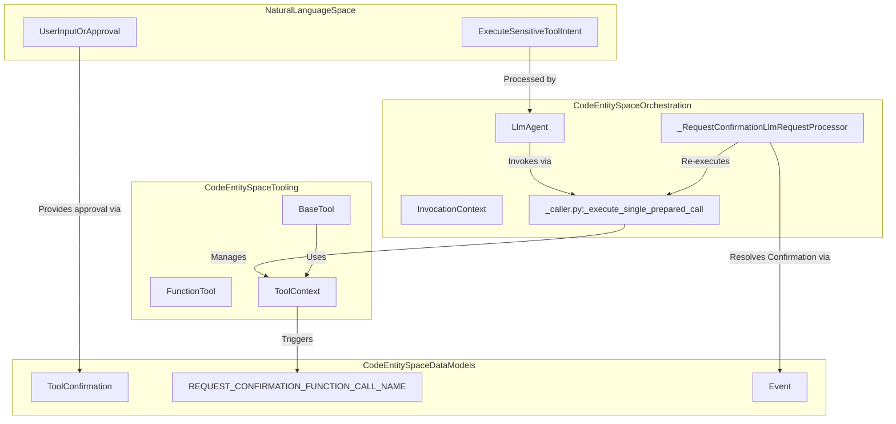
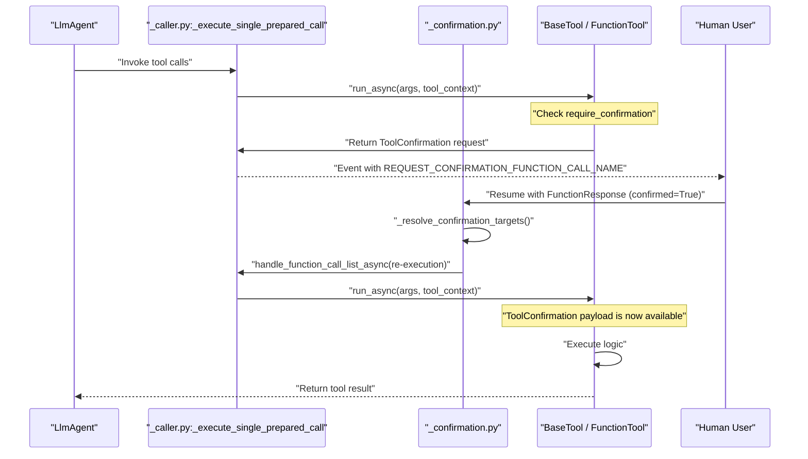

<!-- source: DeepWiki mcp.deepwiki.com · repo google/adk-python · page 7.8 Tool Confirmation (HITL) · fetched 2026-10-29 -->

# Tool Confirmation (HITL)

Relevant source files

The following files were used as context for generating this wiki page:

- [.agents/skills/adk-debug/references/failure-modes.md](.agents/skills/adk-debug/references/failure-modes.md)
- [docs/guides/plugins/reflect_retry_model_plugin/index.md](docs/guides/plugins/reflect_retry_model_plugin/index.md)
- [src/google/adk/a2a/converters/request_converter.py](src/google/adk/a2a/converters/request_converter.py)
- [src/google/adk/a2a/converters/utils.py](src/google/adk/a2a/converters/utils.py)
- [src/google/adk/flows/llm_flows/request_confirmation.py](src/google/adk/flows/llm_flows/request_confirmation.py)
- [src/google/adk/flows/llm_flows/tools/_caller.py](src/google/adk/flows/llm_flows/tools/_caller.py)
- [src/google/adk/flows/llm_flows/tools/_confirmation.py](src/google/adk/flows/llm_flows/tools/_confirmation.py)
- [src/google/adk/flows/llm_flows/tools/_error_handler.py](src/google/adk/flows/llm_flows/tools/_error_handler.py)
- [src/google/adk/flows/llm_flows/tools/_thread_pool.py](src/google/adk/flows/llm_flows/tools/_thread_pool.py)
- [src/google/adk/plugins/_reflect_retry_model_plugin.py](src/google/adk/plugins/_reflect_retry_model_plugin.py)
- [src/google/adk/plugins/_reflect_retry_utils.py](src/google/adk/plugins/_reflect_retry_utils.py)
- [src/google/adk/plugins/reflect_retry_tool_plugin.py](src/google/adk/plugins/reflect_retry_tool_plugin.py)
- [src/google/adk/tools/authenticated_function_tool.py](src/google/adk/tools/authenticated_function_tool.py)
- [src/google/adk/tools/base_authenticated_tool.py](src/google/adk/tools/base_authenticated_tool.py)
- [src/google/adk/tools/tool_configs.py](src/google/adk/tools/tool_configs.py)
- [src/google/adk/tools/tool_confirmation.py](src/google/adk/tools/tool_confirmation.py)
- [src/google/adk/utils/_sync_runner.py](src/google/adk/utils/_sync_runner.py)
- [tests/unittests/a2a/converters/test_request_converter.py](tests/unittests/a2a/converters/test_request_converter.py)
- [tests/unittests/a2a/converters/test_utils.py](tests/unittests/a2a/converters/test_utils.py)
- [tests/unittests/flows/llm_flows/tools/test_caller.py](tests/unittests/flows/llm_flows/tools/test_caller.py)
- [tests/unittests/flows/llm_flows/tools/test_confirmation.py](tests/unittests/flows/llm_flows/tools/test_confirmation.py)
- [tests/unittests/flows/llm_flows/tools/test_functions_thread_pool.py](tests/unittests/flows/llm_flows/tools/test_functions_thread_pool.py)
- [tests/unittests/plugins/test_reflect_retry_model_plugin.py](tests/unittests/plugins/test_reflect_retry_model_plugin.py)
- [tests/unittests/plugins/test_reflect_retry_tool_plugin.py](tests/unittests/plugins/test_reflect_retry_tool_plugin.py)
- [tests/unittests/runners/__init__.py](tests/unittests/runners/__init__.py)
- [tests/unittests/runners/test_run_tool_confirmation.py](tests/unittests/runners/test_run_tool_confirmation.py)
- [tests/unittests/tools/test_authenticated_function_tool.py](tests/unittests/tools/test_authenticated_function_tool.py)
- [tests/unittests/tools/test_base_authenticated_tool.py](tests/unittests/tools/test_base_authenticated_tool.py)
- [tests/unittests/utils/test_sync_runner.py](tests/unittests/utils/test_sync_runner.py)

## Purpose and Scope

This page documents the tool confirmation mechanism, which enables **Human-in-the-Loop (HITL)** patterns for tool execution. Tool confirmation allows agents to request explicit user approval before executing sensitive or irreversible tool operations.

The ADK implements this through the `require_confirmation` property on tools and a specialized event flow that pauses execution until a user provides a `ToolConfirmation` payload. This is tightly integrated with the `InvocationContext`, `ToolContext`, and session resumability features.

Sources: `[src/google/adk/tools/tool_confirmation.py:29-30]()`, `[src/google/adk/flows/llm_flows/tools/_confirmation.py:29-30]()`, `[src/google/adk/tools/function_tool.py:53-63]()`, `[src/google/adk/flows/llm_flows/request_confirmation.py:15-28]()`

## Overview

Tool confirmation provides a safety mechanism where tools can request user approval before execution. This is critical for operations that:
- Modify external state (e.g., deleting files, making purchases, sending emails).
- Access sensitive data.
- Trigger costly operations.
- Require contextual user judgment.

In ADK, confirmation can be triggered automatically by tool configuration or manually within the tool's implementation. The system uses specialized function call names to signal these HITL requirements to the client:
*   `REQUEST_CONFIRMATION_FUNCTION_CALL_NAME`: Used for general approval of tool execution `[src/google/adk/flows/llm_flows/tools/_confirmation.py:32-32]()`.
*   `REQUEST_INPUT_FUNCTION_CALL_NAME`: Used for proactive LLM clarification.

Sources: `[src/google/adk/flows/llm_flows/tools/_confirmation.py:25-33]()`, `[src/google/adk/tools/tool_confirmation.py:29-46]()`, `[src/google/adk/tools/function_tool.py:89-90]()`

## Tool Confirmation Architecture

The following diagram bridges the **Natural Language Space** (User Intent) to the **Code Entity Space** (Classes and Functions) for the HITL flow.

### HITL Component Mapping

Sources: `[src/google/adk/flows/llm_flows/tools/_confirmation.py:25-33]()`, `[src/google/adk/flows/llm_flows/tools/_confirmation.py:1-100]()`, `[src/google/adk/tools/tool_confirmation.py:29-30]()`, `[src/google/adk/tools/function_tool.py:42-54]()`, `[src/google/adk/flows/llm_flows/tools/_caller.py:1-188]()`

## Tool Confirmation Process

The tool confirmation process follows a multi-turn flow where the agent pauses and yields control back to the caller. The system tracks these pending requests and uses the function calling logic in `_caller.py` and the request processor in `_confirmation.py` (re-exported via `request_confirmation.py`) to resume execution once the user responds.

### HITL Execution Sequence

Sources: `[src/google/adk/flows/llm_flows/tools/_caller.py:1-188]()`, `[src/google/adk/flows/llm_flows/request_confirmation.py:15-28]()`, `[src/google/adk/flows/llm_flows/tools/_confirmation.py:1-100]()`, `[src/google/adk/tools/function_tool.py:53-63]()`

## Key Components

### ToolConfirmation (Data Model)
The `ToolConfirmation` object wraps the user's decision and any associated data.
*   **confirmed**: A boolean indicating approval or rejection `[src/google/adk/tools/tool_confirmation.py:41-42]()`.
*   **payload**: An optional custom data payload needed from the user to continue the flow `[src/google/adk/tools/tool_confirmation.py:43-45]()`.
*   **hint**: Text explaining why the input is needed `[src/google/adk/tools/tool_confirmation.py:39-40]()`.

Sources: `[src/google/adk/tools/tool_confirmation.py:29-46]()`

### Function Tool HITL Configuration
The `FunctionTool` allows specifying confirmation requirements during initialization.
*   **require_confirmation**: Can be a boolean or a callable that inspects function arguments to decide if confirmation is needed at runtime `[src/google/adk/tools/function_tool.py:53-63]()`.
*   **_context_param_name**: Automatically detects if the tool function expects a `ToolContext` to access confirmation actions or state `[src/google/adk/tools/function_tool.py:87-88]()`.

Sources: `[src/google/adk/tools/function_tool.py:49-90]()`, `[src/google/adk/utils/context_utils.py:34-40]()`

### Request Confirmation Processor
The `_RequestConfirmationLlmRequestProcessor` (implemented in `src/google/adk/flows/llm_flows/tools/_confirmation.py` and re-exported by `request_confirmation.py`) is responsible for scanning the session history to find and resolve pending confirmations.
*   **_resolve_confirmation_targets**: Maps user-provided confirmation responses back to the original function calls that requested them `[src/google/adk/flows/llm_flows/request_confirmation.py:27-28]()`.
*   **Deduplication**: The processor removes tools that have already been confirmed to prevent double-execution `[tests/unittests/flows/llm_flows/tools/test_confirmation.py:117-117]()`.
*   **Re-execution**: It triggers `handle_function_call_list_async` for the tools that have received user approval `[tests/unittests/flows/llm_flows/tools/test_confirmation.py:207-208]()`.

Sources: `[src/google/adk/flows/llm_flows/request_confirmation.py:15-28]()`, `[src/google/adk/flows/llm_flows/tools/_confirmation.py:1-150]()`, `[tests/unittests/flows/llm_flows/tools/test_confirmation.py:117-117]()`, `[tests/unittests/flows/llm_flows/tools/test_confirmation.py:207-208]()`

## Data Flow Summary

| Component | Role | File Reference |
| :--- | :--- | :--- |
| `_execute_single_prepared_call` | Orchestrates tool execution and handles HITL interrupts. | `[src/google/adk/flows/llm_flows/tools/_caller.py:111-115]()` |
| `ToolConfirmation` | Pydantic model representing the HITL approval and optional payload. | `[src/google/adk/tools/tool_confirmation.py:29]()` |
| `_RequestConfirmationLlmRequestProcessor` | Logic for resuming execution after a confirmation response is received. | `[src/google/adk/flows/llm_flows/request_confirmation.py:26]()` |
| `FunctionTool` | Supports `require_confirmation` boolean or callable for dynamic HITL. | `[src/google/adk/tools/function_tool.py:42]()` |
| `REQUEST_CONFIRMATION_FUNCTION_CALL_NAME` | Internal tool name used to signal approval requests to clients. | `[src/google/adk/flows/llm_flows/tools/_confirmation.py:32]()` |

Sources: `[src/google/adk/flows/llm_flows/tools/_confirmation.py:25-33]()`, `[src/google/adk/tools/tool_confirmation.py:29-30]()`, `[src/google/adk/flows/llm_flows/request_confirmation.py:15-28]()`, `[src/google/adk/tools/function_tool.py:42-63]()`, `[src/google/adk/flows/llm_flows/tools/_caller.py:111-115]()`

---

