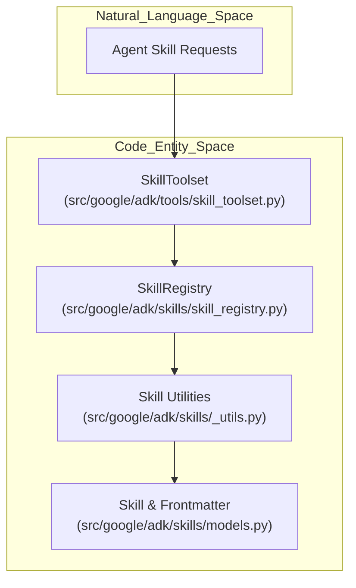
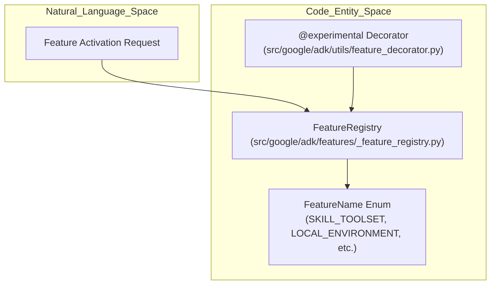
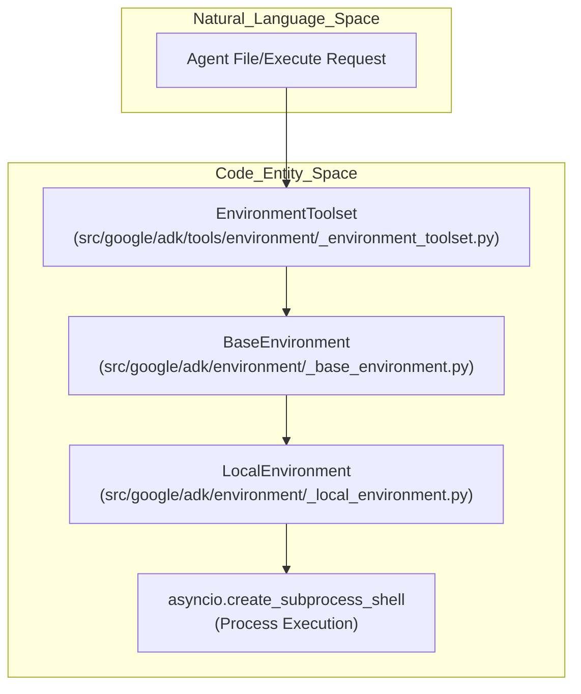

<!-- source: DeepWiki mcp.deepwiki.com · repo google/adk-python · page 7.9 Skills and Environment Toolsets · fetched 2026-10-29 -->

# Skills and Environment Toolsets

Relevant source files

The following files were used as context for generating this wiki page:

- [contributing/samples/multimodal/computer_use/playwright.py](contributing/samples/multimodal/computer_use/playwright.py)
- [docs/guides/skills/skill/index.md](docs/guides/skills/skill/index.md)
- [src/google/adk/features/_feature_registry.py](src/google/adk/features/_feature_registry.py)
- [src/google/adk/integrations/api_registry/__init__.py](src/google/adk/integrations/api_registry/__init__.py)
- [src/google/adk/integrations/api_registry/api_registry.py](src/google/adk/integrations/api_registry/api_registry.py)
- [src/google/adk/integrations/skill_registry/gcp_skill_registry.py](src/google/adk/integrations/skill_registry/gcp_skill_registry.py)
- [src/google/adk/skills/__init__.py](src/google/adk/skills/__init__.py)
- [src/google/adk/skills/_utils.py](src/google/adk/skills/_utils.py)
- [src/google/adk/skills/models.py](src/google/adk/skills/models.py)
- [src/google/adk/skills/prompt.py](src/google/adk/skills/prompt.py)
- [src/google/adk/skills/skill_registry.py](src/google/adk/skills/skill_registry.py)
- [src/google/adk/tools/api_registry.py](src/google/adk/tools/api_registry.py)
- [src/google/adk/tools/bash_tool.py](src/google/adk/tools/bash_tool.py)
- [src/google/adk/tools/computer_use/base_computer.py](src/google/adk/tools/computer_use/base_computer.py)
- [src/google/adk/tools/computer_use/computer_use_tool.py](src/google/adk/tools/computer_use/computer_use_tool.py)
- [src/google/adk/tools/computer_use/computer_use_toolset.py](src/google/adk/tools/computer_use/computer_use_toolset.py)
- [src/google/adk/tools/environment/__init__.py](src/google/adk/tools/environment/__init__.py)
- [src/google/adk/tools/environment/_constants.py](src/google/adk/tools/environment/_constants.py)
- [src/google/adk/tools/environment/_environment_toolset.py](src/google/adk/tools/environment/_environment_toolset.py)
- [src/google/adk/tools/environment/_tools.py](src/google/adk/tools/environment/_tools.py)
- [src/google/adk/tools/skill_toolset.py](src/google/adk/tools/skill_toolset.py)
- [tests/unittests/integrations/api_registry/__init__.py](tests/unittests/integrations/api_registry/__init__.py)
- [tests/unittests/integrations/api_registry/test_api_registry.py](tests/unittests/integrations/api_registry/test_api_registry.py)
- [tests/unittests/integrations/skill_registry/test_gcp_skill_registry.py](tests/unittests/integrations/skill_registry/test_gcp_skill_registry.py)
- [tests/unittests/skills/test__utils.py](tests/unittests/skills/test__utils.py)
- [tests/unittests/skills/test_models.py](tests/unittests/skills/test_models.py)
- [tests/unittests/skills/test_prompt.py](tests/unittests/skills/test_prompt.py)
- [tests/unittests/tools/computer_use/test_base_computer.py](tests/unittests/tools/computer_use/test_base_computer.py)
- [tests/unittests/tools/computer_use/test_computer_use_tool.py](tests/unittests/tools/computer_use/test_computer_use_tool.py)
- [tests/unittests/tools/computer_use/test_computer_use_toolset.py](tests/unittests/tools/computer_use/test_computer_use_toolset.py)
- [tests/unittests/tools/test_bash_tool.py](tests/unittests/tools/test_bash_tool.py)
- [tests/unittests/tools/test_environment_toolset.py](tests/unittests/tools/test_environment_toolset.py)
- [tests/unittests/tools/test_skill_path_traversal.py](tests/unittests/tools/test_skill_path_traversal.py)
- [tests/unittests/tools/test_skill_toolset.py](tests/unittests/tools/test_skill_toolset.py)

## Purpose and Scope
This section details the Agent Development Kit (ADK) Python subsystem responsible for modular agent capabilities ("Skills") and sandbox execution environments ("Environment Toolsets"). It covers the `SkillToolset` implementation, skill storage and loading utilities, remote GCP Skill Registry integration, feature gating via `FeatureRegistry` and the `@experimental` decorator, and safe execution wrappers including `ExecuteBashTool` and the environment toolset spanning local and remote environments.

---

## 1. The Skills Subsystem and `SkillToolset`
The skills subsystem allows agents to dynamically discover, read, and execute specialized capabilities bundled in structured directories or archives. At the center is `SkillToolset`, which exposes tools like `list_skills`, `search_skills`, `load_skill`, `unload_skill`, `load_skill_resource`, and `run_skill_script` [src/google/adk/tools/skill_toolset.py:88-93]().

Sources:
- `src/google/adk/tools/skill_toolset.py:17-192`
- `src/google/adk/skills/skill_registry.py`

`SkillToolset` supports advanced lifecycle configurations via `SkillLifecycleConfig` and `SkillLifecycleMode` (such as `PERSISTENT`, `BOUNDED`, and `EPHEMERAL`), controlling how long a skill remains active per agent turn or session [src/google/adk/tools/skill_toolset.py:125-153](). State helpers like `_read_activated_skills` and `_write_activated_skills` track state mutations within the session [src/google/adk/tools/skill_toolset.py:104-120]().

Sources:
- `src/google/adk/tools/skill_toolset.py:17-192`

---

## 2. Skill Storage, Parsing, and Utilities
Skills follow the Agent Skills convention. The underlying utilities in `src/google/adk/skills/_utils.py` handle directory loading, resource extraction, and markdown parsing [src/google/adk/skills/_utils.py:15-216]().

Key functions include:
- `_validate_relative_resource_path`: Validates and normalizes relative resource paths preventing directory traversal [src/google/adk/skills/_utils.py:54-83]().
- `_load_dir`: Recursively loads files into UTF-8 text strings or binary `bytes` maps [src/google/adk/skills/_utils.py:86-112]().
- `_build_scripts`: Wraps script sources in `Script` models [src/google/adk/skills/_utils.py:115-136]().
- `_parse_skill_md_content` and `_parse_skill_md`: Parse YAML frontmatter and markdown body from `SKILL.md` [src/google/adk/skills/_utils.py:139-203]().
- Zip security bounds (`_MAX_ZIP_ENTRIES = 2000`, `_MAX_ZIP_UNCOMPRESSED_BYTES = 32 * 1024 * 1024`) protect against malicious skill archives [src/google/adk/skills/_utils.py:37-38]().

Sources:
- `src/google/adk/skills/_utils.py:15-226`

---

## 3. GCP Skill Registry Integration
Remote skills are managed through `GCPSkillRegistry`, which connects to Google Cloud Agent Registry endpoints (`agentregistry.googleapis.com`) to search, fetch metadata, and download skill archives (`.zip`) dynamically [src/google/adk/integrations/skill_registry/gcp_skill_registry.py:70-127](). The client validates downloaded frontmatter properties, handles secure token exchange via `google.auth`, and materializes revisions in-memory or inside workspace execution environments.

The `GCPSkillRegistry` class initializes with `project_id`, `location`, and optional `credentials` [src/google/adk/integrations/skill_registry/gcp_skill_registry.py:73-79](). It constructs the base URL for the Agent Registry API, potentially using mTLS if configured [src/google/adk/integrations/skill_registry/gcp_skill_registry.py:90-127](). The `_get_headers` method handles credential refreshing and adds authorization headers [src/google/adk/integrations/skill_registry/gcp_skill_registry.py:136-161](). Requests are made via `_make_request` using `httpx.AsyncClient` [src/google/adk/integrations/skill_registry/gcp_skill_registry.py:163-183]().

Sources:
- `src/google/adk/integrations/skill_registry/gcp_skill_registry.py`
- `tests/unittests/integrations/skill_registry/test_gcp_skill_registry.py`

---

## 4. Feature Registry and Gating
Experimental capabilities, toolsets, and integration modules are controlled via `FeatureRegistry` and `FeatureName` enums [src/google/adk/features/_feature_registry.py:26-78](). Each feature is mapped to a `FeatureConfig` tracking its lifecycle stage (`FeatureStage`) and default activation state [src/google/adk/features/_feature_registry.py:80-107]().

Decorators such as `@experimental` intercept class instantiation or function execution, evaluating environment variables to emit warnings or block execution of unreleased components [src/google/adk/utils/feature_decorator.py:72-211]().

Sources:
- `src/google/adk/features/_feature_registry.py:1-187`
- `src/google/adk/utils/feature_decorator.py:1-212`

---

## 5. Bash Tool Execution (`ExecuteBashTool`)
`ExecuteBashTool` runs shell commands inside a configured workspace while enforcing safety policies defined in `BashToolPolicy` [src/google/adk/tools/bash_tool.py:62-174]().

Key mechanisms include:
- **Command Validation**: Checks command strings against allowed prefixes and blocked operators (e.g., `|`, `;`, `&&`) via `_validate_command` [src/google/adk/tools/bash_tool.py:99-131]().
- **Resource Constraints**: Applies limits on memory, file size, and child processes via the `resource` module (`_set_resource_limits`) [src/google/adk/tools/bash_tool.py:134-157]().
- **Process Management**: Uses `asyncio.create_subprocess_shell` for execution and `_kill_process_group` for termination [src/google/adk/tools/bash_tool.py:159-170]().
- **Tool Integration**: Inherits from `BaseTool` and declares tool schema for execution parameters [src/google/adk/tools/bash_tool.py:172-211]().

Sources:
- `src/google/adk/tools/bash_tool.py:1-218`
- `tests/unittests/tools/test_bash_tool.py`

---

## 6. Environment Toolset and Execution
The environment subsystem unifies file management and command execution across local and remote infrastructure via `BaseEnvironment` and `LocalEnvironment` [src/google/adk/environment/_local_environment.py:30-74]().

Sources:
- `src/google/adk/environment/_local_environment.py:1-203`

`LocalEnvironment` manages temporary directories, initializes subprocess sessions with isolated process groups (`start_new_session=True`), and handles graceful termination with timeout enforcement (`_kill_command`) [src/google/adk/environment/_local_environment.py:103-200](). The environment toolset exposes specific primitives for agents to read, write, edit files, and execute scripts securely.

Sources:
- `src/google/adk/environment/_local_environment.py:1-203`

---

