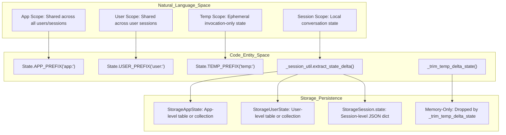
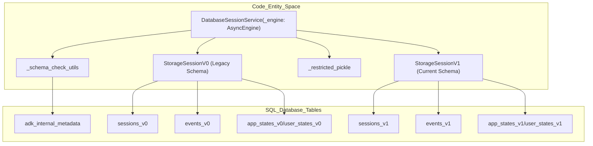

<!-- source: DeepWiki mcp.deepwiki.com · repo google/adk-python · page 8 Persistence and State · fetched 2026-10-29 -->

# Persistence and State

Relevant source files

The following files were used as context for generating this wiki page:

- [src/google/adk/sessions/_session_util.py](src/google/adk/sessions/_session_util.py)
- [src/google/adk/sessions/base_session_service.py](src/google/adk/sessions/base_session_service.py)
- [src/google/adk/sessions/database_session_service.py](src/google/adk/sessions/database_session_service.py)
- [src/google/adk/sessions/in_memory_session_service.py](src/google/adk/sessions/in_memory_session_service.py)
- [src/google/adk/sessions/sqlite_session_service.py](src/google/adk/sessions/sqlite_session_service.py)
- [src/google/adk/sessions/vertex_ai_session_service.py](src/google/adk/sessions/vertex_ai_session_service.py)
- [tests/unittests/sessions/test_session_service.py](tests/unittests/sessions/test_session_service.py)
- [tests/unittests/sessions/test_session_util.py](tests/unittests/sessions/test_session_util.py)
- [tests/unittests/sessions/test_v0_storage_event.py](tests/unittests/sessions/test_v0_storage_event.py)
- [tests/unittests/sessions/test_vertex_ai_session_service.py](tests/unittests/sessions/test_vertex_ai_session_service.py)

## Purpose and Scope

This document provides a high-level overview of ADK's persistence and state management subsystems, which manage conversational sessions, application and user state, event history, artifacts, memory, and database services. ADK supports multiple storage backends ranging from ephemeral in-memory stores for local testing to robust relational and cloud-native databases for production.

As a parent page, this section introduces major storage concepts and links to detailed child pages. For specific technical depth, see the child pages:
- [Session Management](#8.1) — Session CRUD, `BaseSessionService`, and implementations (`InMemorySessionService`, `SqliteSessionService`, `DatabaseSessionService`, `VertexAiSessionService`, `FirestoreSessionService`, `RedisSessionService`), TTL/expiration, and conformance tests.
- [State Hierarchy](#8.2) — Scoping semantics (`app:`, `user:`, session-level, and `temp:` prefixes) and merging rules across backends.
- [Event System and History](#8.3) — `Event` and `EventActions` structure, chronological history, deduplication, branch/sub-branch routing, and `request_input` events.
- [Artifact Storage](#8.4) — `BaseArtifactService`, file/GCS/in-memory implementations, `ForwardingArtifactService`, versioning, and atomic publishing.
- [Memory Services](#8.5) — `BaseMemoryService`, in-memory, Vertex AI Memory Bank, Vertex AI RAG memory, and Firestore-backed memory providers.
- [Database Session Service](#8.6) — `DatabaseSessionService` internals: SQLAlchemy engines, v0/v1 schemas, locking, DB support, restricted unpickling.

Sources: [src/google/adk/sessions/base_session_service.py:30-197](), [src/google/adk/sessions/database_session_service.py:48-115]()

---

## 8.1 Session Management

Session management in ADK centers around the `BaseSessionService` abstract base class [src/google/adk/sessions/base_session_service.py:63-67](), which defines standard asynchronous operations for creating, retrieving, listing, deleting sessions, and appending events. Implementations cater to various deployment topologies, offering configuration through `GetSessionConfig` for bounding recent event retrieval or filtering by timestamps [src/google/adk/sessions/base_session_service.py:30-45]().

ADK provides multiple backends including `InMemorySessionService` [src/google/adk/sessions/in_memory_session_service.py:74-79](), `SqliteSessionService` [src/google/adk/sessions/sqlite_session_service.py:184-189](), `DatabaseSessionService` [src/google/adk/sessions/database_session_service.py:100-110](), and `VertexAiSessionService` [src/google/adk/sessions/vertex_ai_session_service.py:144-148](), alongside Firestore and Redis-based storage. These backends undergo conformance testing to guarantee uniform behavior across CRUD actions and error handling (`AlreadyExistsError`, `SessionNotFoundError`, `StaleSessionError`) [tests/unittests/sessions/test_session_service.py:56-59]().

For detailed implementation details, see [Session Management](#8.1).

Sources: [src/google/adk/sessions/base_session_service.py:30-125](), [src/google/adk/sessions/in_memory_session_service.py:74-88](), [src/google/adk/sessions/sqlite_session_service.py:184-203](), [src/google/adk/sessions/database_session_service.py:100-115](), [src/google/adk/sessions/vertex_ai_session_service.py:144-182](), [tests/unittests/sessions/test_session_service.py:56-59]()

---

## 8.2 State Hierarchy

ADK implements a four-tier hierarchical state model managed via explicit key prefixes defined in the `State` class. State keys are partitioned into application-wide (`app:`), user-wide (`user:`), session-local (unprefixed), and ephemeral (`temp:`) scopes.

The `_session_util.extract_state_delta` utility processes state dictionaries to separate app, user, and session deltas before persistence [src/google/adk/sessions/_session_util.py:51-68](). Ephemeral `temp:` state is maintained solely in memory during active tool or agent execution and stripped prior to writing database events [src/google/adk/sessions/base_session_service.py:173-180]().

Title: State Scope Mapping to Code Entities

For detailed scoping rules, see [State Hierarchy](#8.2).

Sources: [src/google/adk/sessions/_session_util.py:51-68](), [src/google/adk/sessions/base_session_service.py:166-180]()

---

## 8.3 Event System and History

The event system tracks chronological interactions via the `Event` class. Each event encapsulates message content, metadata, author identifiers, and `EventActions` (such as state deltas or agent transfers) [src/google/adk/sessions/vertex_ai_session_service.py:55-72]().

Session services maintain chronological event logs supporting deduplication, branch/sub-branch routing for nested tool executions, and UI widget integrations. When input is requested mid-workflow, `request_input` events pause execution until resumed.

For detailed event structures and routing logic, see [Event System and History](#8.3).

Sources: [src/google/adk/sessions/base_session_service.py:166-186](), [src/google/adk/sessions/vertex_ai_session_service.py:55-72]()

---

## 8.4 Artifact Storage

The artifact service subsystem handles versioned binary and file storage produced during agent runs. Through `BaseArtifactService`, ADK supports in-memory, local filesystem, and Google Cloud Storage (GCS) backends.

The `ForwardingArtifactService` proxies requests while supporting artifact versioning, metadata tracking, and atomic publishing patterns to guarantee consistent asset availability.

For comprehensive artifact workflows, see [Artifact Storage](#8.4).

Sources: [src/google/adk/sessions/base_session_service.py:63-67]()

---

## 8.5 Memory Services

Memory services provide long-term knowledge retention and retrieval for agents via `BaseMemoryService`. Supported implementations include in-memory stores, Vertex AI Memory Bank, Vertex AI RAG memory, and Firestore-backed memory providers.

Agents leverage tools such as `load_memory` and `preload_memory` to dynamically inject relevant historical context into prompts during execution.

For details on memory backends and tools, see [Memory Services](#8.5).

Sources: [src/google/adk/sessions/base_session_service.py:63-67]()

---

## 8.6 Database Session Service

`DatabaseSessionService` provides robust relational persistence using SQLAlchemy asynchronous engines [src/google/adk/sessions/database_session_service.py:48-52](). It supports v0 and v1 relational schemas [src/google/adk/sessions/database_session_service.py:67-77](), utilizing microsecond-accurate time tracking and row-level locking to prevent race conditions during concurrent modifications.

To maintain security when loading state across distributed or persistent boundaries, pickled columns employ restricted unpickling alongside JSON serialization. PostgreSQL, MySQL, MariaDB, MSSQL, and SQLite are fully supported [src/google/adk/sessions/database_session_service.py:88-105]().

Title: Database Session Service Architecture and Schema Mapping

For detailed schema structures and migration guides, see [Database Session Service](#8.6).

Sources: [src/google/adk/sessions/database_session_service.py:48-52](), [src/google/adk/sessions/database_session_service.py:67-77](), [src/google/adk/sessions/database_session_service.py:88-105]()

---

