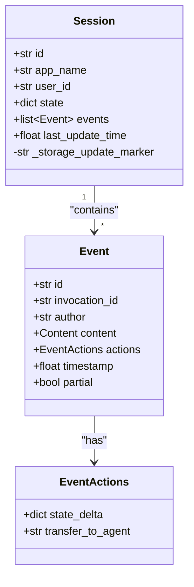
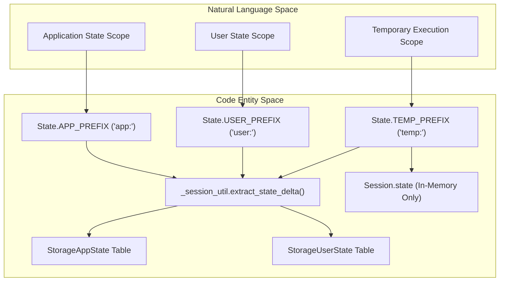
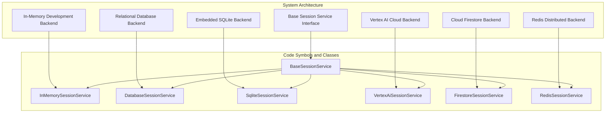
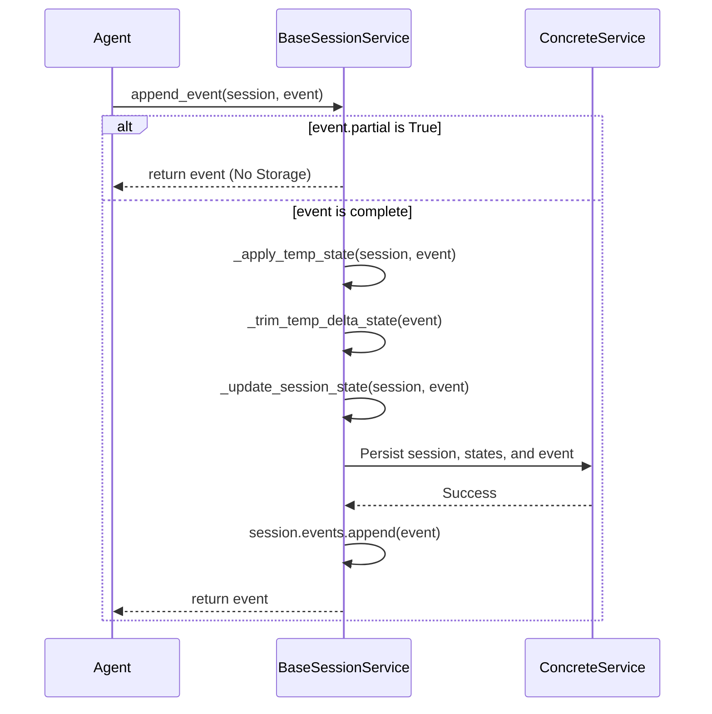

<!-- source: DeepWiki mcp.deepwiki.com · repo google/adk-python · page 8.1 Session Management · fetched 2026-10-29 -->

# Session Management

Relevant source files

The following files were used as context for generating this wiki page:

- [docs/guides/sessions/session/index.md](docs/guides/sessions/session/index.md)
- [docs/guides/sessions/state/index.md](docs/guides/sessions/state/index.md)
- [src/google/adk/errors/already_exists_error.py](src/google/adk/errors/already_exists_error.py)
- [src/google/adk/integrations/firestore/__init__.py](src/google/adk/integrations/firestore/__init__.py)
- [src/google/adk/integrations/firestore/_stop_words.py](src/google/adk/integrations/firestore/_stop_words.py)
- [src/google/adk/integrations/firestore/firestore_memory_service.py](src/google/adk/integrations/firestore/firestore_memory_service.py)
- [src/google/adk/integrations/firestore/firestore_session_service.py](src/google/adk/integrations/firestore/firestore_session_service.py)
- [src/google/adk/integrations/redis/_redis_session_service.py](src/google/adk/integrations/redis/_redis_session_service.py)
- [src/google/adk/sessions/_session_util.py](src/google/adk/sessions/_session_util.py)
- [src/google/adk/sessions/base_session_service.py](src/google/adk/sessions/base_session_service.py)
- [src/google/adk/sessions/database_session_service.py](src/google/adk/sessions/database_session_service.py)
- [src/google/adk/sessions/in_memory_session_service.py](src/google/adk/sessions/in_memory_session_service.py)
- [src/google/adk/sessions/sqlite_session_service.py](src/google/adk/sessions/sqlite_session_service.py)
- [src/google/adk/sessions/vertex_ai_session_service.py](src/google/adk/sessions/vertex_ai_session_service.py)
- [tests/unittests/integrations/__init__.py](tests/unittests/integrations/__init__.py)
- [tests/unittests/integrations/firestore/test_firestore_memory_service.py](tests/unittests/integrations/firestore/test_firestore_memory_service.py)
- [tests/unittests/integrations/firestore/test_firestore_session_service.py](tests/unittests/integrations/firestore/test_firestore_session_service.py)
- [tests/unittests/integrations/redis/_fake_redis.py](tests/unittests/integrations/redis/_fake_redis.py)
- [tests/unittests/integrations/redis/test_redis_session_service.py](tests/unittests/integrations/redis/test_redis_session_service.py)
- [tests/unittests/sessions/_conformance.py](tests/unittests/sessions/_conformance.py)
- [tests/unittests/sessions/test_session_service.py](tests/unittests/sessions/test_session_service.py)
- [tests/unittests/sessions/test_session_util.py](tests/unittests/sessions/test_session_util.py)
- [tests/unittests/sessions/test_v0_storage_event.py](tests/unittests/sessions/test_v0_storage_event.py)
- [tests/unittests/sessions/test_vertex_ai_session_service.py](tests/unittests/sessions/test_vertex_ai_session_service.py)

Session Management provides persistence and retrieval of conversational state and event history for ADK agents [src/google/adk/sessions/base_session_service.py:63-67](). This system enables stateful multi-turn conversations by storing session metadata, hierarchical state (`app:`, `user:`, session-level, and `temp:`), and complete event logs [src/google/adk/sessions/base_session_service.py:166-181](). The session service abstraction supports multiple storage backends including relational databases (`DatabaseSessionService`) [src/google/adk/sessions/database_session_service.py:143-164](), embedded SQLite (`SqliteSessionService`) [src/google/adk/sessions/sqlite_session_service.py:49-112](), Vertex AI Agent Engine (`VertexAiSessionService`) [src/google/adk/sessions/vertex_ai_session_service.py:144-156](), Google Cloud Firestore (`FirestoreSessionService`) [src/google/adk/integrations/firestore/firestore_session_service.py:80-101](), Redis (`RedisSessionService`) [src/google/adk/integrations/redis/_redis_session_service.py:58-63](), and in-memory storage (`InMemorySessionService`) [src/google/adk/sessions/in_memory_session_service.py:74-79]() for local development and testing.

Sources: [src/google/adk/sessions/base_session_service.py:63-67](), [src/google/adk/sessions/in_memory_session_service.py:74-79](), [src/google/adk/sessions/database_session_service.py:143-164](), [src/google/adk/sessions/sqlite_session_service.py:49-112](), [src/google/adk/sessions/vertex_ai_session_service.py:144-156](), [src/google/adk/integrations/firestore/firestore_session_service.py:80-101](), [src/google/adk/integrations/redis/_redis_session_service.py:58-63]()

## Core Components

### Session Model

A `Session` represents a single conversational thread containing a unique ID, user identifier, state dictionary, and event history, scoped to an application.

Diagram: Session Data Model and Code Entities

Sources: [src/google/adk/sessions/session.py:28-55](), [src/google/adk/events/event.py:27-61](), [src/google/adk/events/event_actions.py:25-42]()

### State Hierarchy

State within a session follows a tiered hierarchy with prefix-based scoping managed via `State` constants and helper utilities in `_session_util.py` [src/google/adk/sessions/state.py:23-27](), [src/google/adk/sessions/_session_util.py:51-68]().

| Prefix | Scope | Shared Across | Persistence |
|--------|-------|---------------|-------------|
| `app:` | Application-level | All users and sessions within the app | Persistent [src/google/adk/sessions/database_session_service.py:68-78]() |
| `user:` | User-level | All sessions for the same user | Persistent [src/google/adk/sessions/database_session_service.py:72-80]() |
| (none) | Session-level | Only the current session | Persistent [src/google/adk/sessions/database_session_service.py:71-77]() |
| `temp:` | Temporary | Only the current session | **Not persisted** [src/google/adk/sessions/base_session_service.py:175-180]() |

Diagram: State Scoping and Extraction Logic (Natural Language to Code Space)

Sources: [src/google/adk/sessions/state.py:23-27](), [src/google/adk/sessions/_session_util.py:51-68](), [src/google/adk/sessions/base_session_service.py:166-181]()

## Session Service Architecture

The `BaseSessionService` abstract class defines the core interface for all session service implementations [src/google/adk/sessions/base_session_service.py:63-67](). Concrete classes implement backend-specific storage and serialization.

Diagram: Session Service Implementation Registry (Natural Language to Code Space)

Sources: [src/google/adk/sessions/base_session_service.py:63-124](), [src/google/adk/sessions/database_session_service.py:143-164](), [src/google/adk/sessions/vertex_ai_session_service.py:144-156](), [src/google/adk/sessions/in_memory_session_service.py:74-79](), [src/google/adk/sessions/sqlite_session_service.py:173-180](), [src/google/adk/integrations/firestore/firestore_session_service.py:80-101](), [src/google/adk/integrations/redis/_redis_session_service.py:58-63]()

### BaseSessionService Interface

The interface exposes CRUD methods, event appending, and user state lookups:

| Method | Purpose | Returns | Code Reference |
|--------|---------|---------|----------------|
| `create_session()` | Create a new session with optional initial state | `Session` | [src/google/adk/sessions/base_session_service.py:70-89]() |
| `get_session()` | Retrieve an existing session by ID using `GetSessionConfig` | `Optional[Session]` | [src/google/adk/sessions/base_session_service.py:91-100]() |
| `list_sessions()` | List sessions for an app and optional user | `ListSessionsResponse` | [src/google/adk/sessions/base_session_service.py:103-118]() |
| `delete_session()` | Delete a session by ID | `None` | [src/google/adk/sessions/base_session_service.py:121-124]() |
| `append_event()` | Apply state deltas and append events to session | `Event` | [src/google/adk/sessions/base_session_service.py:166-181]() |
| `get_user_state()` | Read user-scoped state independently of session ID | `dict[str, Any]` | [src/google/adk/sessions/base_session_service.py:126-164]() |

Sources: [src/google/adk/sessions/base_session_service.py:63-165]()

## Key Implementations Detail

### DatabaseSessionService
`DatabaseSessionService` provides persistence via SQLAlchemy across `postgresql`, `mysql`, `mariadb`, `sqlite`, and `spanner` [src/google/adk/sessions/database_session_service.py:50-106](). It leverages versioned schemas (V0 using pickle and V1 using `DynamicJSON`) and uses `_storage_update_marker` to detect stale updates, raising `StaleSessionError` on concurrent overwrites [src/google/adk/database_session_service.py:60-78](). It also enables `pool_pre_ping` by default for database connections and disables `pool_reset_on_return` for `StaticPool` to prevent issues with shared connections [tests/unittests/sessions/test_session_service.py:108-182]().
Sources: [src/google/adk/sessions/database_session_service.py:35-106](), [tests/unittests/sessions/test_session_service.py:108-182]()

### VertexAiSessionService
Connects to the Vertex AI Agent Engine Session Service via the Google GenAI SDK [src/google/adk/sessions/vertex_ai_session_service.py:144-148](). It translates session operations, supports `ttl` and `expire_time` configuration, and strips `part_metadata` from event parts when writing to ensure API compatibility [src/google/adk/sessions/vertex_ai_session_service.py:128-142](). It also includes utilities like `_extract_short_session_id` and `_validate_session_id` for resource name parsing [src/google/adk/sessions/vertex_ai_session_service.py:77-109]().
Sources: [src/google/adk/sessions/vertex_ai_session_service.py:77-142](), [src/google/adk/sessions/vertex_ai_session_service.py:144-148]()

### SqliteSessionService
Uses `aiosqlite` for asynchronous SQLite persistence [src/google/adk/sessions/sqlite_session_service.py:31-47](). It maintains native table schemas (`app_states`, `user_states`, `sessions`, `events`) and enforces cascading deletes via foreign keys on SQLite connections [src/google/adk/sessions/sqlite_session_service.py:99-147](). It also includes JSON merging logic (`_MERGE_STATE_SQL`) to handle state updates efficiently [src/google/adk/sessions/sqlite_session_service.py:72-97]().
Sources: [src/google/adk/sessions/sqlite_session_service.py:31-147]()

### FirestoreSessionService
Uses Google Cloud Firestore with a hierarchical subcollection structure (`adk-session/<app>/users/<user>/sessions/<session>/events/<event>`) [src/google/adk/integrations/firestore/firestore_session_service.py:80-101](). It relies on process-level `_session_locks` via `_with_session_lock` to serialize event appends within the same process [src/google/adk/integrations/firestore/firestore_session_service.py:125-158](). It also provides static methods for merging app, user, and session states [src/google/adk/integrations/firestore/firestore_session_service.py:159-171]().
Sources: [src/google/adk/integrations/firestore/firestore_session_service.py:80-171]()

### RedisSessionService
Leverages Redis for distributed caching, rapid session state serialization, and scale-out multi-instance session management [src/google/adk/integrations/redis/_redis_session_service.py:58-63](). It uses a configurable key prefix (`RedisSessionServiceConfig`) and supports TTL for sessions [src/google/adk/integrations/redis/_redis_session_service.py:76-116](). It also provides static methods for merging states and extracting session-only state [src/google/adk/integrations/redis/_redis_session_service.py:118-140]().
Sources: [src/google/adk/integrations/redis/_redis_session_service.py:58-140]()

Sources: [src/google/adk/sessions/database_session_service.py:35-106](), [src/google/adk/sessions/vertex_ai_session_service.py:77-148](), [src/google/adk/sessions/sqlite_session_service.py:31-147](), [src/google/adk/integrations/firestore/firestore_session_service.py:80-171](), [src/google/adk/integrations/redis/_redis_session_service.py:58-140]()

## Session Lifecycle and Data Flow

### Event Appending Logic

When an event is appended via `append_event`, temporary state (`temp:`) is applied to the in-memory session state for downstream agents within the same invocation, but trimmed from the persisted event delta.

Diagram: Event Appending Execution Flow

Sources: [src/google/adk/sessions/base_session_service.py:166-186]()

### State Merging during Retrieval

When `get_session()` executes, the service merges app-level, user-level, and session-level records into a unified `Session.state` dictionary. The `_session_util.extract_state_delta` function is crucial for separating these state scopes during creation and update operations [src/google/adk/sessions/_session_util.py:51-68]().
Sources: [src/google/adk/sessions/database_session_service.py:179-190](), [src/google/adk/sessions/in_memory_session_service.py:184-201](), [src/google/adk/sessions/_session_util.py:51-68]()

## Conformance Tests

ADK executes a standardized test suite defined in `tests/unittests/sessions/_conformance.py` across all concrete session services [src/google/adk/tests/unittests/sessions/_conformance.py:15-31](). These tests ensure that `InMemorySessionService`, `DatabaseSessionService`, `SqliteSessionService`, `FirestoreSessionService`, and `RedisSessionService` correctly implement CRUD operations, concurrency locking, state scoping rules, and error contracts (such as `StaleSessionError` and `SessionNotFoundError`) [src/google/adk/tests/unittests/sessions/_conformance.py:135-145](). The `test_recorded_divergences_name_a_contract_test` function ensures that any recorded divergences for a backend correspond to an actual test function that takes the shared contract fixture [tests/unittests/sessions/test_session_service.py:92-106]().

Sources: [tests/unittests/sessions/test_session_service.py:92-106](), [tests/unittests/sessions/_conformance.py:15-158]()

## Implementation Comparison

| Feature | InMemorySessionService | DatabaseSessionService | SqliteSessionService | VertexAiSessionService | FirestoreSessionService | RedisSessionService |
|---------|------------------------|------------------------|----------------------|------------------------|-------------------------|---------------------|
| **Storage** | Python `dict` [src/google/adk/sessions/in_memory_session_service.py:84-88]() | SQL Tables (v0/v1) [src/google/adk/sessions/database_session_service.py:68-78]() | SQLite Tables [src/google/adk/sessions/sqlite_session_service.py:99-147]() | Vertex AI Managed [src/google/adk/sessions/vertex_ai_session_service.py:144-148]() | Cloud Firestore [src/google/adk/integrations/firestore/firestore_session_service.py:80-101]() | Redis Key-Value [src/google/adk/integrations/redis/_redis_session_service.py:58-63]() |
| **Concurrency** | None | Row-level locking / Markers | File locking | API Managed | Process-level Locks [src/google/adk/integrations/firestore/firestore_session_service.py:125-130]() | Redis Distributed Locks |
| **Schema** | Dynamic | SQLAlchemy Models [src/google/adk/sessions/database_session_service.py:68-78]() | Fixed SQL Strings [src/google/adk/sessions/sqlite_session_service.py:99-147]() | Managed | Document-based | Redis Objects |
| **TTL Support** | No | Yes (via Dialect) | No | **Yes** | No | Yes (Native Redis TTL) [src/google/adk/integrations/redis/_redis_session_service.py:189-190]() |
| **Engine Reuse**| N/A | **Yes** | No | N/A | N/A | N/A |

Sources: [src/google/adk/sessions/in_memory_session_service.py:84-88](), [src/google/adk/sessions/database_session_service.py:68-78](), [src/google/adk/sessions/sqlite_session_service.py:99-147](), [src/google/adk/sessions/vertex_ai_session_service.py:144-148](), [src/google/adk/integrations/firestore/firestore_session_service.py:80-130](), [src/google/adk/integrations/redis/_redis_session_service.py:58-190]()

---

