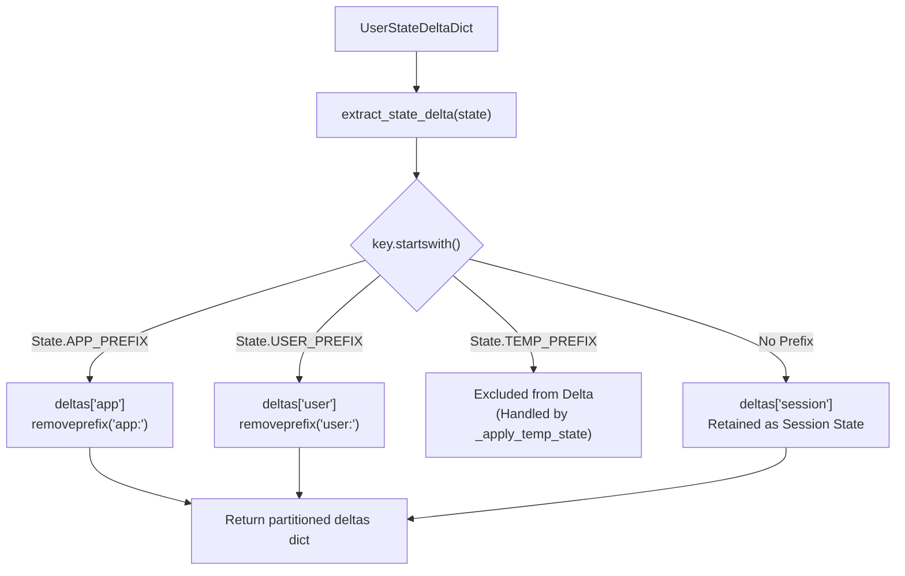
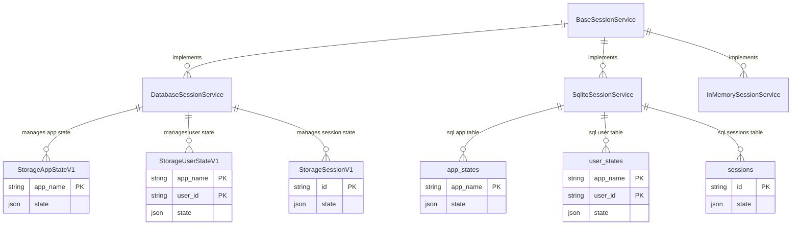
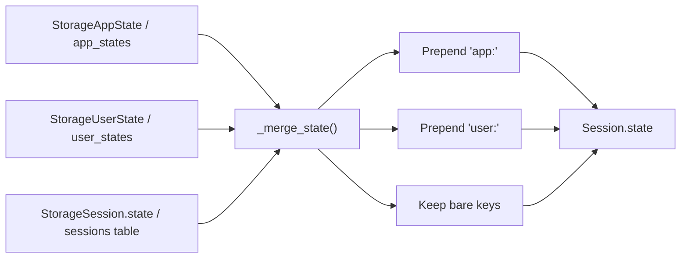

<!-- source: DeepWiki mcp.deepwiki.com · repo google/adk-python · page 8.2 State Hierarchy · fetched 2026-10-29 -->

# State Hierarchy

Relevant source files

The following files were used as context for generating this wiki page:

- [.agents/skills/adk-agent-builder/references/function-nodes.md](.agents/skills/adk-agent-builder/references/function-nodes.md)
- [docs/guides/models/llm_registry/index.md](docs/guides/models/llm_registry/index.md)
- [docs/guides/workflow/base_node/index.md](docs/guides/workflow/base_node/index.md)
- [docs/guides/workflow/node/index.md](docs/guides/workflow/node/index.md)
- [src/google/adk/events/event.py](src/google/adk/events/event.py)
- [src/google/adk/models/base_llm.py](src/google/adk/models/base_llm.py)
- [src/google/adk/sessions/_session_util.py](src/google/adk/sessions/_session_util.py)
- [src/google/adk/sessions/base_session_service.py](src/google/adk/sessions/base_session_service.py)
- [src/google/adk/sessions/database_session_service.py](src/google/adk/sessions/database_session_service.py)
- [src/google/adk/sessions/in_memory_session_service.py](src/google/adk/sessions/in_memory_session_service.py)
- [src/google/adk/sessions/session.py](src/google/adk/sessions/session.py)
- [src/google/adk/sessions/sqlite_session_service.py](src/google/adk/sessions/sqlite_session_service.py)
- [src/google/adk/sessions/state.py](src/google/adk/sessions/state.py)
- [src/google/adk/sessions/vertex_ai_session_service.py](src/google/adk/sessions/vertex_ai_session_service.py)
- [tests/unittests/events/test_event.py](tests/unittests/events/test_event.py)
- [tests/unittests/sessions/test_session_service.py](tests/unittests/sessions/test_session_service.py)
- [tests/unittests/sessions/test_session_util.py](tests/unittests/sessions/test_session_util.py)
- [tests/unittests/sessions/test_state.py](tests/unittests/sessions/test_state.py)
- [tests/unittests/sessions/test_v0_storage_event.py](tests/unittests/sessions/test_v0_storage_event.py)
- [tests/unittests/sessions/test_vertex_ai_session_service.py](tests/unittests/sessions/test_vertex_ai_session_service.py)
- [tests/unittests/workflow/test_state_schema.py](tests/unittests/workflow/test_state_schema.py)

## Purpose and Scope

This page documents the **four-level state hierarchy** in ADK sessions: `app`, `user`, `session`, and `temp` scopes. Each scope defines distinct persistence characteristics, sharing semantics, and validation rules managed via the `State` class [src/google/adk/sessions/state.py:86-120]() and backend session services.

For session service abstractions, see `BaseSessionService` [src/google/adk/sessions/base_session_service.py:63-125](). For state schema validation and prefix definitions, see `State` [src/google/adk/sessions/state.py:86-120]().

Sources:
- [src/google/adk/sessions/base_session_service.py:63-125]()
- [src/google/adk/sessions/state.py:86-120]()

---

## State Scopes Overview

ADK organizes state into four distinct scopes, each identified by a prefix managed through the `State` class [src/google/adk/sessions/state.py:96-98]().

| Scope | Prefix Constant | Persistence | Sharing Scope | Code Representation / Backend Storage |
|-------|-----------------|-------------|---------------|---------------------------------------|
| **App** | `State.APP_PREFIX` (`"app:"`) [src/google/adk/sessions/state.py:96]() | Persistent | All users, all sessions | `StorageAppStateV1` [src/google/adk/sessions/database_session_service.py:74](), `app_states` table [src/google/adk/sessions/sqlite_session_service.py:99-105]() |
| **User** | `State.USER_PREFIX` (`"user:"`) [src/google/adk/sessions/state.py:97]() | Persistent | All sessions for the same user | `StorageUserStateV1` [src/google/adk/sessions/database_session_service.py:78](), `user_states` table [src/google/adk/sessions/sqlite_session_service.py:107-115]() |
| **Session** | *(none)* | Persistent | Single session only | `StorageSessionV1` [src/google/adk/sessions/database_session_service.py:77](), `sessions` table [src/google/adk/sessions/sqlite_session_service.py:117-127]() |
| **Temp** | `State.TEMP_PREFIX` (`"temp:"`) [src/google/adk/sessions/state.py:98]() | **Not persisted** | Current invocation only | Ephemeral in-memory state via `BaseSessionService._apply_temp_state` [src/google/adk/sessions/base_session_service.py:195-197]() |

Sources:
- [src/google/adk/sessions/state.py:96-98]()
- [src/google/adk/sessions/database_session_service.py:74-78]()
- [src/google/adk/sessions/sqlite_session_service.py:99-127]()
- [src/google/adk/sessions/base_session_service.py:195-197]()

---

## State Scope Prefixes and Delta Extraction

State deltas passed through `EventActions` are processed and partitioned by scope using `extract_state_delta()` in `_session_util.py` [src/google/adk/sessions/_session_util.py:51-68]().

Title: "Natural Language Space to Code Entity Space: State Scope Extraction"

Sources:
- [src/google/adk/sessions/_session_util.py:51-68]()
- [src/google/adk/sessions/state.py:96-98]()

### State Validation (`State` and `StateSchemaError`)

When a Pydantic `state_schema` is supplied, `_validate_state_entry()` ensures mutations conform to expected types. Keys prefixed with `app:`, `user:`, or `temp:`, as well as ADK internal owner prefixes (`<owner>:<key>`), bypass strict schema checks [src/google/adk/sessions/state.py:43-56]().

Sources:
- [src/google/adk/sessions/state.py:43-56]()

---

## State Persistence Architecture Across Backends

Different state scopes are persisted via distinct storage models and tables across `DatabaseSessionService`, `SqliteSessionService`, and `InMemorySessionService`.

Title: "Natural Language Space to Code Entity Space: Backend Persistence Mapping"

Sources:
- [src/google/adk/sessions/database_session_service.py:73-78]()
- [src/google/adk/sessions/sqlite_session_service.py:99-127]()
- [src/google/adk/sessions/base_session_service.py:63-67]()

---

## State Merging on Retrieval

When loading a session via `get_session()`, persistent storage backends combine app-level, user-level, and session-level state into a unified `Session.state` dictionary. Helper methods such as `_merge_state` prefix app and user keys accordingly [src/google/adk/sessions/in_memory_session_service.py:162]().

Title: "State Retrieval and Merging Semantics"

Sources:
- [src/google/adk/sessions/in_memory_session_service.py:162]()
- [src/google/adk/sessions/sqlite_session_service.py:72-97]()

---

## Temporary State Scope and Invocation Lifecycle

The `temp:` scope is ephemeral and restricted to the active invocation. It is managed directly in `BaseSessionService` [src/google/adk/sessions/base_session_service.py:166-181]():

1.  **Application**: `_apply_temp_state()` injects `temp:` keys into the in-memory session state during `append_event()` so downstream agents in the same run can read intermediate outputs [src/google/adk/sessions/base_session_service.py:175-178]().
2.  **Trimming**: `_trim_temp_delta_state()` strips `temp:` keys from event state deltas prior to storage commit, preventing persistence [src/google/adk/sessions/base_session_service.py:179]().

Sources:
- [src/google/adk/sessions/base_session_service.py:166-181]()

---

