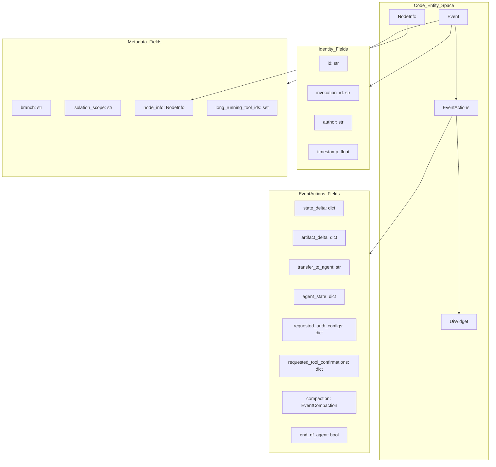
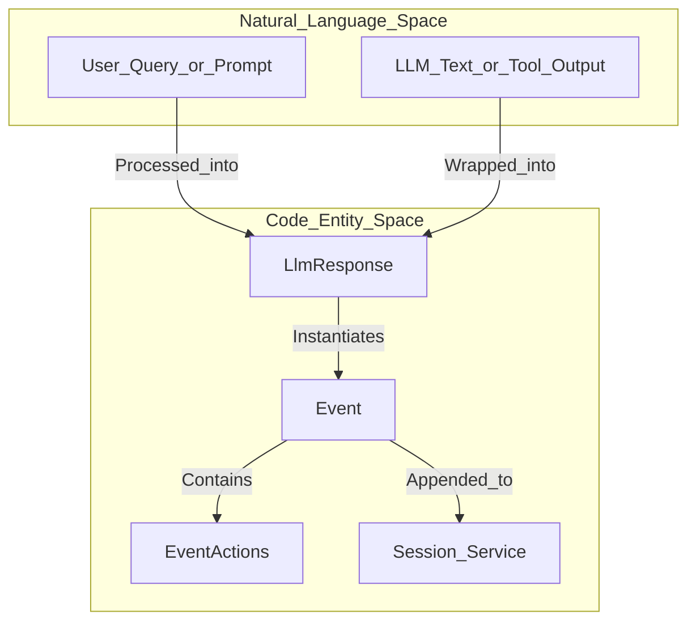
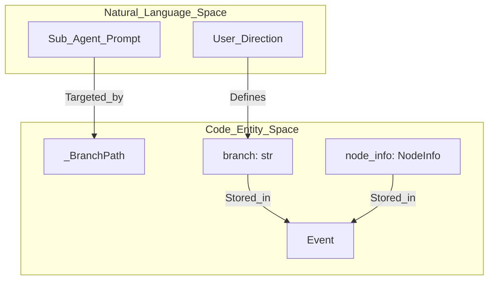
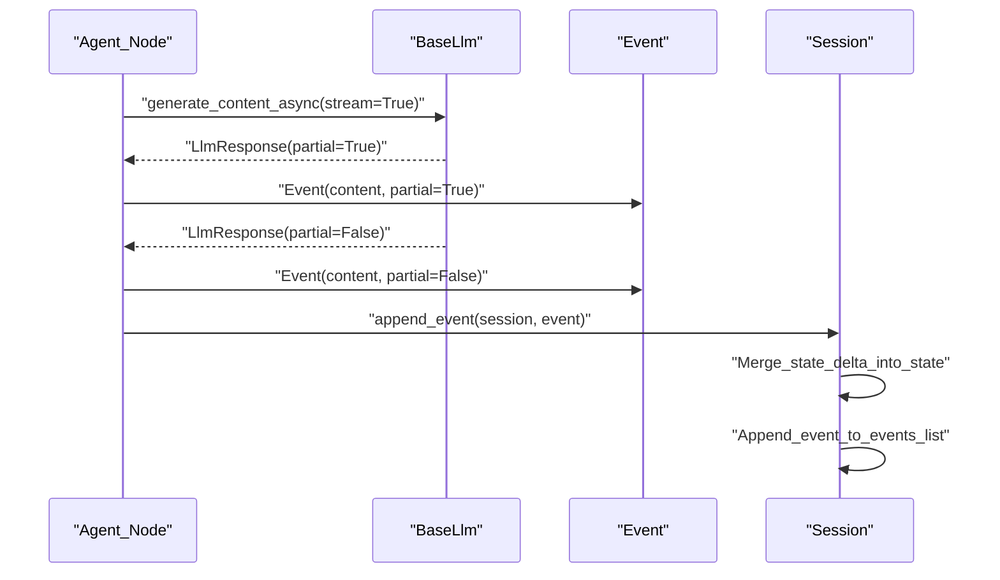

<!-- source: DeepWiki mcp.deepwiki.com · repo google/adk-python · page 8.3 Event System and History · fetched 2026-10-29 -->

# Event System and History

Relevant source files

The following files were used as context for generating this wiki page:

- [.agents/skills/adk-agent-builder/references/function-nodes.md](.agents/skills/adk-agent-builder/references/function-nodes.md)
- [contributing/samples/a2a/a2a_human_in_loop/README.md](contributing/samples/a2a/a2a_human_in_loop/README.md)
- [docs/guides/models/llm_registry/index.md](docs/guides/models/llm_registry/index.md)
- [docs/guides/workflow/base_node/index.md](docs/guides/workflow/base_node/index.md)
- [docs/guides/workflow/node/index.md](docs/guides/workflow/node/index.md)
- [src/google/adk/agents/invocation_context.py](src/google/adk/agents/invocation_context.py)
- [src/google/adk/events/_branch_path.py](src/google/adk/events/_branch_path.py)
- [src/google/adk/events/_node_path_builder.py](src/google/adk/events/_node_path_builder.py)
- [src/google/adk/events/event.py](src/google/adk/events/event.py)
- [src/google/adk/events/event_actions.py](src/google/adk/events/event_actions.py)
- [src/google/adk/events/ui_widget.py](src/google/adk/events/ui_widget.py)
- [src/google/adk/flows/llm_flows/context/_contents.py](src/google/adk/flows/llm_flows/context/_contents.py)
- [src/google/adk/models/base_llm.py](src/google/adk/models/base_llm.py)
- [src/google/adk/sessions/session.py](src/google/adk/sessions/session.py)
- [src/google/adk/sessions/state.py](src/google/adk/sessions/state.py)
- [src/google/adk/tools/transfer_to_agent_tool.py](src/google/adk/tools/transfer_to_agent_tool.py)
- [src/google/adk/workflow/_llm_agent_wrapper.py](src/google/adk/workflow/_llm_agent_wrapper.py)
- [tests/unittests/_invariants.py](tests/unittests/_invariants.py)
- [tests/unittests/agents/test_invocation_context.py](tests/unittests/agents/test_invocation_context.py)
- [tests/unittests/events/test_branch_path.py](tests/unittests/events/test_branch_path.py)
- [tests/unittests/events/test_event.py](tests/unittests/events/test_event.py)
- [tests/unittests/events/test_event_actions.py](tests/unittests/events/test_event_actions.py)
- [tests/unittests/events/test_node_path_builder.py](tests/unittests/events/test_node_path_builder.py)
- [tests/unittests/flows/llm_flows/context/test_contents.py](tests/unittests/flows/llm_flows/context/test_contents.py)
- [tests/unittests/flows/llm_flows/context/test_contents_branch.py](tests/unittests/flows/llm_flows/context/test_contents_branch.py)
- [tests/unittests/flows/llm_flows/test_context_shims.py](tests/unittests/flows/llm_flows/test_context_shims.py)
- [tests/unittests/sessions/test_state.py](tests/unittests/sessions/test_state.py)
- [tests/unittests/test_invariants.py](tests/unittests/test_invariants.py)
- [tests/unittests/tools/test_transfer_to_agent_tool.py](tests/unittests/tools/test_transfer_to_agent_tool.py)
- [tests/unittests/workflow/test_llm_agent_as_node.py](tests/unittests/workflow/test_llm_agent_as_node.py)
- [tests/unittests/workflow/test_state_schema.py](tests/unittests/workflow/test_state_schema.py)
- [tests/unittests/workflow/test_task_api_e2e.py](tests/unittests/workflow/test_task_api_e2e.py)
- [tests/unittests/workflow/test_workflow_llm_agent_interruptions.py](tests/unittests/workflow/test_workflow_llm_agent_interruptions.py)
- [tests/unittests/workflow/testing_utils.py](tests/unittests/workflow/testing_utils.py)

The Event system manages communication and state changes in ADK, capturing interactions between users, agents, and tools within a session. The scope of this subsystem includes:
- Structured representation of session interactions via `Event` [src/google/adk/events/event.py:87-92]() and `EventActions` [src/google/adk/events/event_actions.py:78-80]().
- Carrying state mutations (`state_delta`) and artifact version updates (`artifact_delta`) [src/google/adk/events/event_actions.py:94-120]().
- Chronological history tracking and persistence through session stores [src/google/adk/sessions/session.py:29-76]().
- Streaming partial events and final responses for unidirectional and bidirectional execution.
- Branch and sub-branch routing for nested sub-agents and tool isolation via `_NodePathBuilder` [src/google/adk/events/event.py:31-31]() and `_BranchPath` [src/google/adk/events/_branch_path.py:20-29]().
- Deduplication and branch-aware event context building.
- UI widget rendering metadata via `UiWidget` [src/google/adk/events/event_actions.py:35-35]().
- Human-in-the-loop interaction handling via `RequestInput` events [tests/unittests/events/test_event.py:25-25]().
- Serialization safety mechanisms using fallback sanitization for non-JSON objects [src/google/adk/events/event_actions.py:45-55]().

Sources: [src/google/adk/events/event.py:87-155](), [src/google/adk/events/event_actions.py:45-183](), [src/google/adk/events/_branch_path.py:20-29](), [src/google/adk/events/ui_widget.py:25-35](), [src/google/adk/sessions/session.py:29-76]()

## Event Structure

An `Event` inherits from `LlmResponse` [src/google/adk/events/event.py:87-87]() and encapsulates conversation state, metadata, and agent actions.

Title: "Event and EventActions Hierarchy"

Sources: [src/google/adk/events/event.py:35-155](), [src/google/adk/events/event_actions.py:78-183]()

### Key Event Fields and Metadata

| Category | Field Name | Type | Description |
|----------|------------|------|-------------|
| **Identity** | `id` | `str` | Unique identifier assigned by the session service [src/google/adk/events/event.py:151-152](). |
| | `invocation_id` | `str` | Groups events generated during a single user query or invocation [src/google/adk/events/event.py:105-106](). |
| | `author` | `str` | Identifies the author as `'user'` or an agent name [src/google/adk/events/event.py:107-109](). |
| | `timestamp` | `float` | Creation timestamp in seconds [src/google/adk/events/event.py:153-154](). |
| **Actions** | `actions.state_delta` | `dict[str, Any]` | Dictionary of state updates to merge into session state [src/google/adk/events/event_actions.py:94-96](). |
| | `actions.artifact_delta` | `dict[str, int]` | Mapping of artifact filename to updated version number [src/google/adk/events/event_actions.py:118-120](). |
| | `actions.transfer_to_agent` | `Optional[str]` | Target agent name when executing a handoff or transfer [src/google/adk/events/event_actions.py:122-123](). This field is set by the `transfer_to_agent` function, typically called by a `TransferToAgentTool` [src/google/adk/tools/transfer_to_agent_tool.py:64-65](). |
| | `actions.transfer_reason` | `Optional[str]` | The reason for transferring to the target agent [src/google/adk/events/event_actions.py:125-126](). |
| | `actions.escalate` | `Optional[bool]` | Indicates if the agent is escalating to a higher-level agent [src/google/adk/events/event_actions.py:128-129](). |
| | `actions.requested_auth_configs` | `dict[str, AuthConfig]` | Authentication configurations requested by tool responses [src/google/adk/events/event_actions.py:131-141](). |
| | `actions.requested_tool_confirmations` | `dict[str, ToolConfirmation]` | A dictionary of tool confirmations requested by this event, keyed by function call ID [src/google/adk/events/event_actions.py:155-159](). |
| | `actions.compaction` | `Optional[EventCompaction]` | The compaction of the events [src/google/adk/events/event_actions.py:161-162](). |
| | `actions.end_of_agent` | `Optional[bool]` | If true, the current agent has finished its current run [src/google/adk/events/event_actions.py:164-167](). |
| | `actions.agent_state` | `Optional[dict]` | Checkpoint state used for workflow resumption [src/google/adk/events/event_actions.py:169-172](). |
| **Metadata** | `branch` | `Optional[str]` | Hierarchical branch tag (e.g., `agent_1.agent_2`) for conversation scoping [src/google/adk/events/event.py:125-133](). |
| | `isolation_scope` | `Optional[str]` | Internal scope tag for logical isolation (e.g., Task API) [src/google/adk/events/event.py:134-147](). |
| | `node_info` | `NodeInfo` | Workflow node metadata including path and run IDs [src/google/adk/events/event.py:35-85](). |
| | `long_running_tool_ids` | `set[str]` | Set of IDs of long-running function calls [src/google/adk/events/event.py:119-123](). |

Sources: [src/google/adk/events/event.py:35-154](), [src/google/adk/events/event_actions.py:78-172](), [src/google/adk/tools/transfer_to_agent_tool.py:64-65]()

## Event Lifecycle and Data Flow

Events bridge natural language interactions with structured execution data structures.

Title: "Natural Language to Code Entity Space"

Sources: [src/google/adk/events/event.py:87-113](), [src/google/adk/events/event_actions.py:78-86]()

## Branch and Sub-Branch Routing

The event system supports hierarchical dynamic execution branches through node paths via `_NodePathBuilder` [src/google/adk/events/event.py:31-31]() and `_BranchPath` [src/google/adk/events/_branch_path.py:20-29]().

Title: "Branch Routing to Code Entity Space"

Sources: [src/google/adk/events/event.py:31-133](), [src/google/adk/events/_branch_path.py:20-45]()

- **Branches:** The `branch` field in `Event` [src/google/adk/events/event.py:125-133]() is a dot-separated string (e.g., `agent_1.agent_2.agent_3`) indicating the hierarchical relationship of agents. This is used to isolate sub-agent conversations, preventing peer agents from seeing each other's history.
- **Node Paths:** The `node_info.path` field in `Event` [src/google/adk/events/event.py:45-49]() provides the path of the node in the workflow (e.g., "A/B" for node B under workflow A). The `_NodePathBuilder` [src/google/adk/events/event.py:31-31]() and `_BranchPath` [src/google/adk/events/_branch_path.py:20-29]() classes are used to parse and construct these paths, providing access to `run_id` [src/google/adk/events/event.py:68-71](), `parent_run_id` [src/google/adk/events/event.py:73-79](), and helper methods such as `is_tool_branch` [src/google/adk/events/_branch_path.py:147-150]() and `create_sub_branch` [src/google/adk/events/_branch_path.py:180-186]().

Sources: [src/google/adk/events/event.py:31-79](), [src/google/adk/events/event.py:125-133](), [src/google/adk/events/_branch_path.py:20-194]()

## Event Deduplication and History Filtering

When sessions accumulate events across multiple turns and parallel workflows, history builders filter and deduplicate events based on branch context, invocation IDs, and isolation scopes.
- `_BranchPath` logic evaluates ancestral relationships (`is_descendant_of` [src/google/adk/events/_branch_path.py:89-94]()) to determine which historical events are visible to a given sub-agent or branch.
- Orphaned function calls and responses are cleaned up using rearrangers to maintain valid conversation structures for non-Gemini LLM providers (e.g. Anthropic, LiteLLM) that pair tool calls strictly by identifier [src/google/adk/flows/llm_flows/context/_contents.py:122-142]().

Sources: [src/google/adk/events/_branch_path.py:89-98](), [src/google/adk/flows/llm_flows/context/_contents.py:122-142]()

## UI Widgets and Interactive Elements

Events can carry rendering metadata for interactive UI widgets via `UiWidget` attached to `Event.actions`.

- **Providers:** Identified by the `provider` string (e.g., `'mcp'` for Model Context Protocol UI iframe bridges) [src/google/adk/events/event_actions.py:35-35]().
- **Payloads:** Contains provider-specific parameters such as `resource_uri`, `tool`, and `tool_args` for rich client rendering [src/google/adk/events/event_actions.py:35-35]().

Sources: [src/google/adk/events/event_actions.py:35-35]()

## Request Input Events and Human-in-the-Loop

`RequestInput` events [tests/unittests/events/test_event.py:25-25]() represent execution pauses where agent workflows wait for human input, credentials, or tool confirmations. These events pause execution until resumed via synthetic user events or explicit API actions.

Sources: [tests/unittests/events/test_event.py:25-25]()

## Chronological History and State Deltas

Sessions maintain an ordered chronological list of `Event` objects representing the conversation history. The `Session` class [src/google/adk/sessions/session.py:29-76]() stores these events in its `events` field [src/google/adk/sessions/session.py:59-66]().

### Serialization and Fallback Sanitization
To ensure persistence safety when complex state objects (such as callables) are passed via `state_delta` or `agent_state`, `EventActions` utilizes wrap serializers [src/google/adk/events/event_actions.py:97-100](). If standard Pydantic serialization fails, the `_make_json_serializable` utility invokes `pydantic_core.to_jsonable_python(..., serialize_unknown=True)` [src/google/adk/events/event_actions.py:45-55](), replacing unserializable callables with their string representations. This mechanism is tested in `TestStateDeltaSerialization` [tests/unittests/events/test_event_actions.py:66-123]() and `TestAgentStateSerialization` [tests/unittests/events/test_event_actions.py:125-150]().

Sources: [src/google/adk/events/event_actions.py:45-183](), [src/google/adk/sessions/session.py:29-76](), [tests/unittests/events/test_event_actions.py:66-150]()

## Event System Flow

Title: "LLM to Session Event Flow"

Sources: [src/google/adk/events/event.py:87-154](), [src/google/adk/events/event_actions.py:78-172](), [src/google/adk/models/base_llm.py:132-134]()

---

