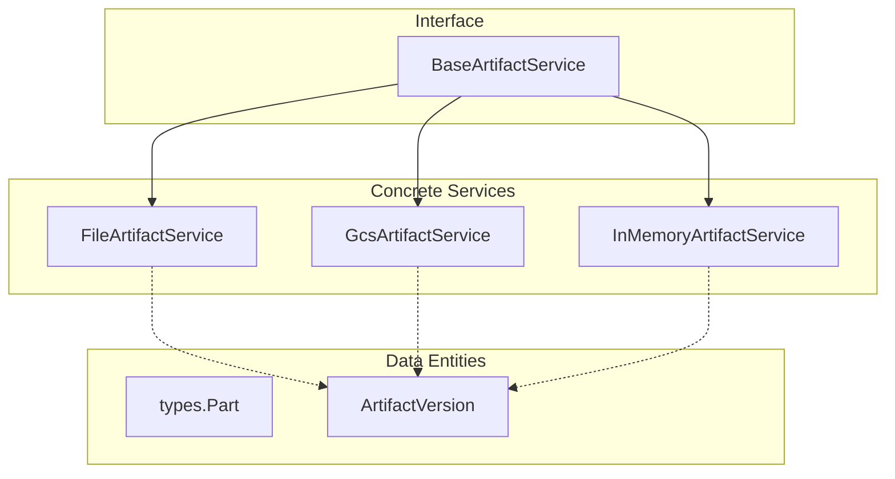
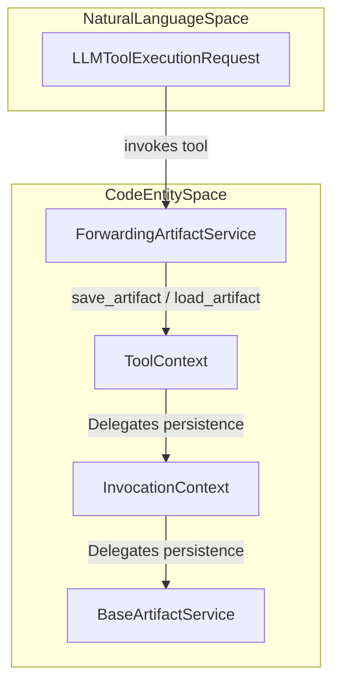
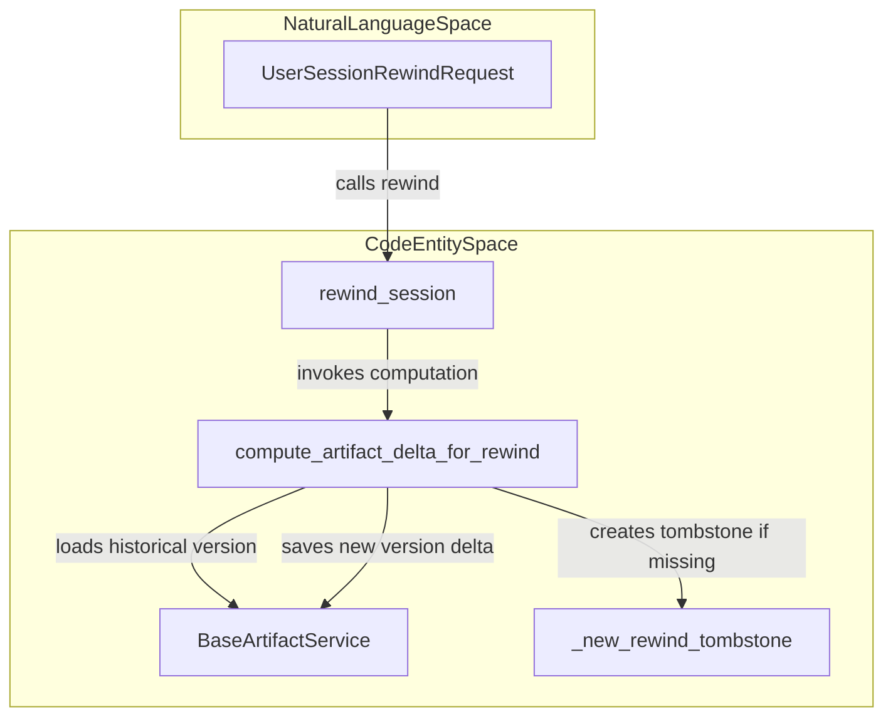

<!-- source: DeepWiki mcp.deepwiki.com · repo google/adk-python · page 8.4 Artifact Storage · fetched 2026-10-29 -->

# Artifact Storage

Relevant source files

The following files were used as context for generating this wiki page:

- [src/google/adk/artifacts/artifact_util.py](src/google/adk/artifacts/artifact_util.py)
- [src/google/adk/artifacts/base_artifact_service.py](src/google/adk/artifacts/base_artifact_service.py)
- [src/google/adk/artifacts/file_artifact_service.py](src/google/adk/artifacts/file_artifact_service.py)
- [src/google/adk/artifacts/gcs_artifact_service.py](src/google/adk/artifacts/gcs_artifact_service.py)
- [src/google/adk/artifacts/in_memory_artifact_service.py](src/google/adk/artifacts/in_memory_artifact_service.py)
- [src/google/adk/errors/input_validation_error.py](src/google/adk/errors/input_validation_error.py)
- [src/google/adk/sessions/_rewind_utils.py](src/google/adk/sessions/_rewind_utils.py)
- [src/google/adk/tools/_forwarding_artifact_service.py](src/google/adk/tools/_forwarding_artifact_service.py)
- [tests/unittests/artifacts/test_artifact_service.py](tests/unittests/artifacts/test_artifact_service.py)
- [tests/unittests/artifacts/test_artifact_util.py](tests/unittests/artifacts/test_artifact_util.py)
- [tests/unittests/runners/test_runner_rewind.py](tests/unittests/runners/test_runner_rewind.py)
- [tests/unittests/sessions/test_rewind_utils.py](tests/unittests/sessions/test_rewind_utils.py)
- [tests/unittests/tools/test_forwarding_artifact_service.py](tests/unittests/tools/test_forwarding_artifact_service.py)

## Purpose and Scope

Artifact storage provides persistent file management for ADK sessions. Artifacts are binary or text files (images, audio, documents, etc.) that tools and agents save or load during execution. The system handles versioning, metadata, atomic publishing semantics, and multiple storage backends including local files (`FileArtifactService`), Google Cloud Storage (`GcsArtifactService`), and in-memory storage (`InMemoryArtifactService`) for testing [src/google/adk/artifacts/base_artifact_service.py:101-123]().

This page covers the `BaseArtifactService` abstract interface, concrete storage implementations, the `ForwardingArtifactService` proxy, versioning semantics, custom metadata handling, and atomic write publishing.

Sources: [src/google/adk/artifacts/base_artifact_service.py:101-123]()

## The ArtifactService Interface

The `BaseArtifactService` is an abstract base class (`ABC`) defining the contract for artifact persistence [src/google/adk/artifacts/base_artifact_service.py:87-88](). All operations are scoped by application name (`app_name`), user ID (`user_id`), and optionally session ID (`session_id`).

### Core Operations

| Method | Key Parameters | Return Type | Purpose |
|--------|----------------|-------------|---------|
| `save_artifact` | `app_name`, `user_id`, `filename`, `artifact`, `session_id`, `custom_metadata` | `int` | Saves an artifact part and returns the monotonically increasing version/revision ID [src/google/adk/artifacts/base_artifact_service.py:91-123](). |
| `load_artifact` | `app_name`, `user_id`, `filename`, `session_id`, `version` | `Optional[types.Part]` | Retrieves an artifact part. If `version` is `None`, the latest version is returned [src/google/adk/artifacts/base_artifact_service.py:126-150](). |
| `list_artifact_keys` | `app_name`, `user_id`, `session_id` | `list[str]` | Lists all artifact filenames available within the scope [src/google/adk/artifacts/base_artifact_service.py:153-176](). |
| `delete_artifact` | `app_name`, `user_id`, `filename`, `session_id` | `None` | Removes an artifact and all stored versions [src/google/adk/artifacts/base_artifact_service.py:179-195](). |
| `list_versions` | `app_name`, `user_id`, `filename`, `session_id` | `list[int]` | Returns all version numbers associated with a specific artifact [src/google/adk/artifacts/base_artifact_service.py:198-209](). |
| `list_artifact_versions` | `app_name`, `user_id`, `filename`, `session_id` | `list[ArtifactVersion]` | Returns all `ArtifactVersion` metadata objects for a specific artifact [src/google/adk/artifacts/base_artifact_service.py:212-225](). |
| `get_artifact_version` | `app_name`, `user_id`, `filename`, `session_id`, `version` | `Optional[ArtifactVersion]` | Retrieves the `ArtifactVersion` metadata for a specific version of an artifact [src/google/adk/artifacts/base_artifact_service.py:228-241](). |

### Artifact Normalization with `ensure_part`
The service uses `ensure_part()` to normalize inputs before persistence [src/google/adk/artifacts/base_artifact_service.py:67-84](). It accepts either a `google.genai.types.Part` object or a dictionary (supporting both camelCase and snake_case keys) and validates them using Pydantic `types.Part.model_validate()` [src/google/adk/artifacts/base_artifact_service.py:72-84]().

Sources: [src/google/adk/artifacts/base_artifact_service.py:33-241]()

## Storage Implementations

ADK ships with three concrete implementations of `BaseArtifactService`.

### Implementation Hierarchy

Title: "Artifact Service Class Hierarchy"

*Figure 1: Class hierarchy of artifact services in `src/google/adk/artifacts/`.*

Sources: [src/google/adk/artifacts/base_artifact_service.py:33-88](), [src/google/adk/artifacts/file_artifact_service.py:38-42](), [src/google/adk/artifacts/gcs_artifact_service.py:124-139](), [src/google/adk/artifacts/in_memory_artifact_service.py:51-56]()

### 1. Local File Storage (`FileArtifactService`)
`FileArtifactService` stores artifacts on the local filesystem under structured directories [src/google/adk/artifacts/file_artifact_service.py:38-40]().
*   **Path Resolution & Security:** Filenames and path segments are validated and resolved via `_resolve_scoped_artifact_path` to prevent path traversal attacks (`..`, drive-qualified paths, absolute roots) [src/google/adk/artifacts/file_artifact_service.py:192-194](). The `artifact_util.validate_path_segment` function is used to ensure path segments are safe [src/google/adk/artifacts/artifact_util.py:214-220]().
*   **Versioning Layout:** Each artifact version stores its payload and a `metadata.json` document in version subdirectories [src/google/adk/artifacts/file_artifact_service.py:127-135]().

Sources: [src/google/adk/artifacts/file_artifact_service.py:38-194](), [src/google/adk/artifacts/artifact_util.py:214-220]()

### 2. Google Cloud Storage (`GcsArtifactService`)
`GcsArtifactService` uses Google Cloud Storage buckets for durable, distributed persistence [src/google/adk/artifacts/gcs_artifact_service.py:15-22]().
*   **Blob Naming Strategy:**
    *   User-scoped: `{app_name}/{user_id}/user/{filename}/{version}` [src/google/adk/artifacts/gcs_artifact_service.py:18-19]()
    *   Session-scoped: `{app_name}/{user_id}/{session_id}/{filename}/{version}` [src/google/adk/artifacts/gcs_artifact_service.py:20-21]()
*   **Metadata & Flags:** Custom metadata is stored directly in GCS blob metadata, using keys like `adkDisplayName`, `adkIsText`, `adkFileUri`, and `adkFileMimeType` [src/google/adk/artifacts/gcs_artifact_service.py:47-50](). Internal metadata keys are filtered out when returning custom metadata to the user [src/google/adk/artifacts/gcs_artifact_service.py:64-74]().

Sources: [src/google/adk/artifacts/gcs_artifact_service.py:15-22](), [src/google/adk/artifacts/gcs_artifact_service.py:47-50](), [src/google/adk/artifacts/gcs_artifact_service.py:64-74]()

### 3. InMemory Storage (`InMemoryArtifactService`)
`InMemoryArtifactService` maintains an in-memory dictionary mapping paths to lists of `_ArtifactEntry` items [src/google/adk/artifacts/in_memory_artifact_service.py:38-57](). It is designed strictly for unit tests and local development rather than multi-threaded production deployments [src/google/adk/artifacts/in_memory_artifact_service.py:51-56]().

Sources: [src/google/adk/artifacts/in_memory_artifact_service.py:38-57]()

## Forwarding Artifact Service

When agents or tools execute within a runner context, tool methods that need artifact operations do not instantiate storage clients directly. Instead, they interact via `ForwardingArtifactService`, which delegates artifact calls to the parent `ToolContext` and `InvocationContext` [src/google/adk/tools/_forwarding_artifact_service.py:32-37]().

Title: "Forwarding Artifact Service Data Flow"

*Figure 2: Data flow bridging agent-level tool calls to the underlying artifact service via `ForwardingArtifactService`.*

Sources: [src/google/adk/tools/_forwarding_artifact_service.py:32-154]()

## Artifact Versioning, Metadata, and Atomic Publishing

### Versioning Semantics
Artifacts are append-only. Each call to `save_artifact` generates a monotonically increasing integer version starting at `0` [src/google/adk/artifacts/base_artifact_service.py:121-122]().

### Metadata Model
The `ArtifactVersion` Pydantic model encapsulates metadata for each saved revision [src/google/adk/artifacts/base_artifact_service.py:33-35]():
*   `version`: Integer version identifier [src/google/adk/artifacts/base_artifact_service.py:41-45]()
*   `canonical_uri`: Unique reference URI (e.g., `artifact://...` or `memory://...`) [src/google/adk/artifacts/base_artifact_service.py:46-48]()
*   `custom_metadata`: User-supplied dictionary of key-value attributes [src/google/adk/artifacts/base_artifact_service.py:49-52]()
*   `create_time`: Unix timestamp when the version was created [src/google/adk/artifacts/base_artifact_service.py:53-58]()
*   `mime_type`: Content MIME type [src/google/adk/artifacts/base_artifact_service.py:59-64]()

### Atomic Publishing & Concurrency Control
To ensure consistency across concurrent agent turns or distributed workers, artifact services utilize atomic publishing primitives:
*   **GCS Generation Preconditions:** `GcsArtifactService` supports conditional writes using generation match parameters (such as `if_generation_match=0` for creation checks) to prevent race conditions when initializing files [tests/unittests/artifacts/test_artifact_service.py:89-111]().
*   **Filesystem Locking & Atomic Writes:** `FileArtifactService` employs atomic file replacement patterns (writing to temporary files and renaming) and robust read guards (`_read_bytes_if_present`) to handle concurrent readers and writers safely without partial state observations [src/google/adk/artifacts/file_artifact_service.py:60-79]().

Sources: [src/google/adk/artifacts/base_artifact_service.py:33-65](), [src/google/adk/artifacts/file_artifact_service.py:60-79](), [tests/unittests/artifacts/test_artifact_service.py:89-111]()

## URI Parsing and Scoping Rules

The `artifact_util` module manages `artifact://` URIs, parsing canonical references and validating scopes [src/google/adk/artifacts/artifact_util.py:14-56]().

*   **URI Structure:** `artifact://apps/{app_name}/users/{user_id}/sessions/{session_id}/artifacts/{filename}/versions/{version}` for session-scoped artifacts [src/google/adk/artifacts/artifact_util.py:56-58]() and `artifact://apps/{app_name}/users/{user_id}/artifacts/{filename}/versions/{version}` for user-scoped artifacts [src/google/adk/artifacts/artifact_util.py:59-61]().
*   **Scope Validation:** `validate_artifact_reference_scope` ensures that artifact references cannot escape the application, user, or session boundaries of the caller [src/google/adk/artifacts/artifact_util.py:176-192]().
*   **User Namespace Prefix:** Filenames prefixed with `user:` are stored at the user level rather than the session level, making them accessible across all sessions belonging to the same user [src/google/adk/artifacts/in_memory_artifact_service.py:92-94]().

### Session Rewind and Artifact Restoration

When a session is rewound via `rewind_session` in `src/google/adk/sessions/_rewind_utils.py`, artifact states are recalculated using `compute_artifact_delta_for_rewind` [src/google/adk/sessions/_rewind_utils.py:84-90](). If an artifact did not exist at the rewind point, a rewind tombstone part is saved [src/google/adk/artifacts/artifact_util.py:140-160](), [src/google/adk/sessions/_rewind_utils.py:121-125](); otherwise, the correct historical version is loaded and re-saved as the latest version [src/google/adk/sessions/_rewind_utils.py:126-153]().

Title: "Rewind and Artifact Delta Computation Flow"

*Figure 3: Mapping session rewind requests to artifact delta recalculation and version restoration.*

Sources: [src/google/adk/artifacts/artifact_util.py:140-160](), [src/google/adk/sessions/_rewind_utils.py:84-154]()

---

