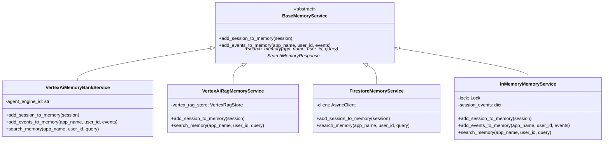
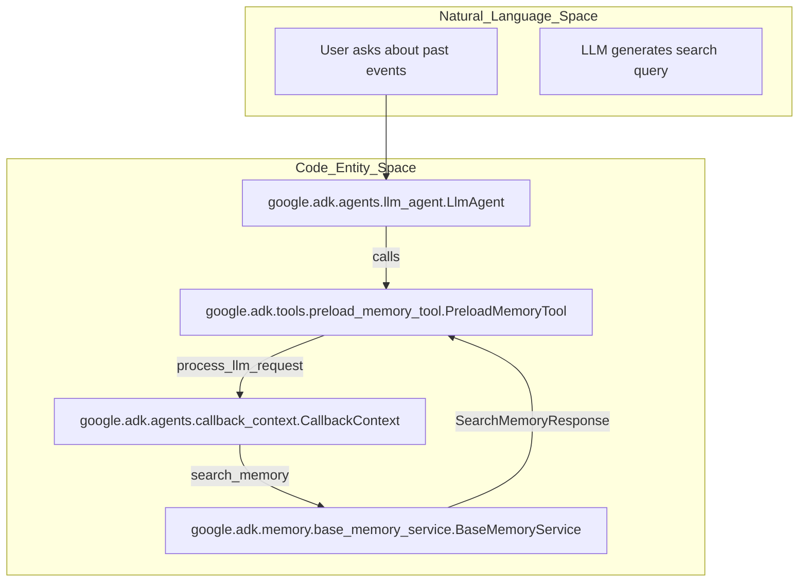

<!-- source: DeepWiki mcp.deepwiki.com · repo google/adk-python · page 8.5 Memory Services · fetched 2026-10-29 -->

# Memory Services

<details>
<summary>Relevant source files</summary>

The following files were used as context for generating this wiki page:

- [docs/guides/memory/memory_service/index.md](docs/guides/memory/memory_service/index.md)
- [src/google/adk/code_executors/__init__.py](src/google/adk/code_executors/__init__.py)
- [src/google/adk/code_executors/agent_engine_sandbox_code_executor.py](src/google/adk/code_executors/agent_engine_sandbox_code_executor.py)
- [src/google/adk/code_executors/code_execution_utils.py](src/google/adk/code_executors/code_execution_utils.py)
- [src/google/adk/errors/already_exists_error.py](src/google/adk/errors/already_exists_error.py)
- [src/google/adk/flows/llm_flows/_code_execution.py](src/google/adk/flows/llm_flows/_code_execution.py)
- [src/google/adk/flows/llm_flows/_nl_planning.py](src/google/adk/flows/llm_flows/_nl_planning.py)
- [src/google/adk/flows/llm_flows/agent_transfer.py](src/google/adk/flows/llm_flows/agent_transfer.py)
- [src/google/adk/flows/llm_flows/auto_flow.py](src/google/adk/flows/llm_flows/auto_flow.py)
- [src/google/adk/flows/llm_flows/extensions/__init__.py](src/google/adk/flows/llm_flows/extensions/__init__.py)
- [src/google/adk/flows/llm_flows/instructions.py](src/google/adk/flows/llm_flows/instructions.py)
- [src/google/adk/integrations/firestore/__init__.py](src/google/adk/integrations/firestore/__init__.py)
- [src/google/adk/integrations/firestore/_stop_words.py](src/google/adk/integrations/firestore/_stop_words.py)
- [src/google/adk/integrations/firestore/firestore_memory_service.py](src/google/adk/integrations/firestore/firestore_memory_service.py)
- [src/google/adk/integrations/firestore/firestore_session_service.py](src/google/adk/integrations/firestore/firestore_session_service.py)
- [src/google/adk/memory/_utils.py](src/google/adk/memory/_utils.py)
- [src/google/adk/memory/base_memory_service.py](src/google/adk/memory/base_memory_service.py)
- [src/google/adk/memory/in_memory_memory_service.py](src/google/adk/memory/in_memory_memory_service.py)
- [src/google/adk/memory/vertex_ai_memory_bank_service.py](src/google/adk/memory/vertex_ai_memory_bank_service.py)
- [src/google/adk/memory/vertex_ai_rag_memory_service.py](src/google/adk/memory/vertex_ai_rag_memory_service.py)
- [src/google/adk/tools/_memory_entry_utils.py](src/google/adk/tools/_memory_entry_utils.py)
- [src/google/adk/tools/preload_memory_tool.py](src/google/adk/tools/preload_memory_tool.py)
- [tests/unittests/code_executors/test_agent_engine_sandbox_code_executor.py](tests/unittests/code_executors/test_agent_engine_sandbox_code_executor.py)
- [tests/unittests/code_executors/test_code_execution_utils.py](tests/unittests/code_executors/test_code_execution_utils.py)
- [tests/unittests/integrations/firestore/test_firestore_memory_service.py](tests/unittests/integrations/firestore/test_firestore_memory_service.py)
- [tests/unittests/integrations/firestore/test_firestore_session_service.py](tests/unittests/integrations/firestore/test_firestore_session_service.py)
- [tests/unittests/memory/test_in_memory_memory_service.py](tests/unittests/memory/test_in_memory_memory_service.py)
- [tests/unittests/memory/test_vertex_ai_memory_bank_service.py](tests/unittests/memory/test_vertex_ai_memory_bank_service.py)
- [tests/unittests/memory/test_vertex_ai_rag_memory_service.py](tests/unittests/memory/test_vertex_ai_rag_memory_service.py)
- [tests/unittests/tools/test_preload_memory_tool.py](tests/unittests/tools/test_preload_memory_tool.py)

</details>


Memory Services provide long-term context retention across multiple sessions in ADK agents. Unlike session event history (see `[src/google/adk/memory/base_memory_service.py:27-49]())` which stores chronological conversation events within a single session, memory services extract and persist important information that should be recalled across different conversations and time periods.

---

## Purpose and Scope

This section documents the memory service subsystem in ADK Python, which manages cross-session persistence, semantic retrieval, and ingestion of conversational history. It covers the abstract base interface `BaseMemoryService`, concrete implementations including `InMemoryMemoryService`, `VertexAiMemoryBankService`, `VertexAiRagMemoryService`, and `FirestoreMemoryService`, as well as automated integration utilities like `PreloadMemoryTool`.

Sources: `[src/google/adk/memory/base_memory_service.py:27-49]()`, `[src/google/adk/memory/vertex_ai_memory_bank_service.py:181-202]()`

---

## Overview

Memory Services serve as a persistent knowledge store that agents can query and update across multiple invocations and sessions. The system is built around the `BaseMemoryService` abstract base class `[src/google/adk/memory/base_memory_service.py:27-49]()`, which defines the interface for ingesting conversation history and retrieving relevant memories via semantic or keyword search.

### Key Capabilities
*   **Session Ingestion**: Adding entire `Session` objects to memory via `add_session_to_memory` `[src/google/adk/memory/in_memory_memory_service.py:99-112]()`.
*   **Incremental Updates**: Adding specific `Event` sequences to memory via `add_events_to_memory` `[src/google/adk/memory/in_memory_memory_service.py:114-142]()`.
*   **Semantic Retrieval**: Searching for memories relevant to a natural language query via `search_memory` `[src/google/adk/memory/in_memory_memory_service.py:144-190]()`.

Sources: `[src/google/adk/memory/base_memory_service.py:27-49]()`, `[src/google/adk/memory/in_memory_memory_service.py:99-190]()`

---

## Architecture and Data Flow

The Memory Service is accessible through execution contexts such as `CallbackContext` and `ToolContext`, allowing agents and tools to interact with long-term storage during execution.

### Memory Service Class Hierarchy

Diagram: Memory Service Class Hierarchy


Sources: `[src/google/adk/memory/vertex_ai_memory_bank_service.py:181-182]()`, `[src/google/adk/memory/vertex_ai_rag_memory_service.py:169-171]()`, `[src/google/adk/memory/in_memory_memory_service.py:76-84]()`

### Context Integration Flow

Diagram: Context Integration Flow
```mermaid
graph TD
    subgraph "Natural_Language_Space"
        UserQuery[""What did I tell you about my cat last week?""]
        AgentLogic[""Agent needs historical context""]
    end

    subgraph "Code_Entity_Space"
        Ctx[""google.adk.agents.callback_context.CallbackContext""]
        MemService[""google.adk.memory.vertex_ai_memory_bank_service.VertexAiMemoryBankService""]
        VertexAPI[""Vertex AI Agent Engine API""]
    end

    UserQuery --> AgentLogic
    AgentLogic -->|ctx.search_memory| Ctx
    Ctx -->|delegate| MemService
    MemService -->|memories.retrieve| VertexAPI
    VertexAPI -->|SearchMemoryResponse| MemService
    MemService -->|List[MemoryEntry]| Ctx
```

Sources: `[src/google/adk/memory/vertex_ai_memory_bank_service.py:181-202]()`

---

## Vertex AI Memory Bank Service

The `VertexAiMemoryBankService` is the production-grade implementation that leverages Google Cloud's Agent Engine Memory Bank `[src/google/adk/memory/vertex_ai_memory_bank_service.py:181-182]()`.

### Implementation Details
*   **Initialization**: Requires an `agent_engine_id` and supports "Express Mode" via API keys `[src/google/adk/memory/vertex_ai_memory_bank_service.py:184-192]()`.
*   **Memory Consolidation**: Uses the `memories.generate` or `memories.ingest_events` API to automatically summarize and consolidate session events. It maintains strong references to fire-and-forget background tasks via `_background_tasks` `[src/google/adk/memory/vertex_ai_memory_bank_service.py:52-54]()` to prevent garbage collection.
*   **Retrieval**: Implements `search_memory` using underlying memory retrieval APIs with support for metadata filtering and dynamic configuration keys `[src/google/adk/memory/vertex_ai_memory_bank_service.py:138-179]()`.

### Configuration Logic
The service dynamically determines supported API features (like `metadata` or `revision_labels`) by inspecting the installed Vertex AI SDK's model fields at runtime via `_get_generate_memories_config_keys` `[src/google/adk/memory/vertex_ai_memory_bank_service.py:138-157]()` and `_get_create_memory_config_keys` `[src/google/adk/memory/vertex_ai_memory_bank_service.py:159-179]()`.

Sources: `[src/google/adk/memory/vertex_ai_memory_bank_service.py:44-202]()`, `[tests/unittests/memory/test_vertex_ai_memory_bank_service.py:169-226]()`

---

## Vertex AI RAG Memory Service

The `VertexAiRagMemoryService` uses Vertex AI Retrieval-Augmented Generation (RAG) for storage and retrieval `[src/google/adk/memory/vertex_ai_rag_memory_service.py:169-171]()`.

*   **Session Ingestion**: Converts session events into structured formats and uploads them as temporary files to a RAG corpus `[src/google/adk/memory/vertex_ai_rag_memory_service.py:104-166]()`.
*   **Metadata Encoding**: Encodes `app_name`, `user_id`, and `session_id` into the `display_name` of the uploaded file using URL-safe Base64 encoding via `_build_source_display_name` `[src/google/adk/memory/vertex_ai_rag_memory_service.py:70-78]()`.
*   **Retrieval**: Uses client retrieval methods to search the corpus `[src/google/adk/memory/vertex_ai_rag_memory_service.py:104-166]()` while scoping retrieval to tenant files via `_scoped_rag_resources` `[src/google/adk/memory/vertex_ai_rag_memory_service.py:104-166]().

Sources: `[src/google/adk/memory/vertex_ai_rag_memory_service.py:44-166]()`, `[tests/unittests/memory/test_vertex_ai_rag_memory_service.py:1-50]()`

---

## Firestore Memory Service

The `FirestoreMemoryService` uses Google Cloud Firestore for persisting and indexing structured memory records across tenants.

*   **Indexing**: Records are stored with keywords, authors, and timestamps to enable efficient document-based querying.
*   **Storage Structure**: Memories are persisted in structured collections mapping application and user hierarchies.

Sources: `[src/google/adk/integrations/firestore/firestore_memory_service.py:1-50]()`

---

## In-Memory Memory Service

For prototyping and testing, `InMemoryMemoryService` `[src/google/adk/memory/in_memory_memory_service.py:76-84]()` provides a local, non-persistent memory store.

*   **Matching Logic**: Extracts searchable tokens via `_extract_searchable_words` `[src/google/adk/memory/in_memory_memory_service.py:55-73]()` and scores memories based on token overlap with the query.
*   **Concurrency**: Uses a reentrant thread lock `_lock` `[src/google/adk/memory/in_memory_memory_service.py:87-87]()` to ensure thread-safety during concurrent updates and queries.
*   **Storage**: Maintains internal dictionaries mapping user and session keys to event lists.

Sources: `[src/google/adk/memory/in_memory_memory_service.py:76-190]()`, `[tests/unittests/memory/test_in_memory_memory_service.py:113-143]()`

---

## Memory vs. Session Storage

| Feature | Session Storage (Event History) | Memory Service (Long-term) |
| :--- | :--- | :--- |
| **Persistence** | Duration of a single conversation | Persistent across many sessions |
| **Data Format** | Raw `Event` objects (chronological) | Consolidated `MemoryEntry` items |
| **Search Method** | Chronological index | Semantic Search / Keyword Filtering |
| **Primary Use** | Short-term context (chat history) | User preferences, historical facts |
| **Implementation** | `DatabaseSessionService` | `VertexAiMemoryBankService` `[src/google/adk/memory/vertex_ai_memory_bank_service.py:181-182]()` |

Sources: `[src/google/adk/memory/base_memory_service.py:27-49]()`

---

## Usage in Agents and Tools

Agents access memory through the context object (aliased as `ToolContext` or `CallbackContext`).

### Pre-built Memory Tools
ADK provides built-in tools for interacting with memory:
*   **`load_memory`**: A tool that invokes search methods to fetch past conversations based on model-provided queries.
*   **`preload_memory`**: Implemented via `PreloadMemoryTool` `[src/google/adk/tools/preload_memory_tool.py:34-42]()`, this tool intercepts LLM requests (`process_llm_request` `[src/google/adk/tools/preload_memory_tool.py:49-54]()`), extracts user input text, queries memory via `tool_context.search_memory` `[src/google/adk/tools/preload_memory_tool.py:62-62]()`, and injects relevant past conversational context into instructions.

### Memory Tool Invocation Flow

Diagram: Memory Tool Invocation Flow


Sources: `[src/google/adk/tools/preload_memory_tool.py:34-99]()`, `[src/google/adk/memory/base_memory_service.py:27-49]()`

---

