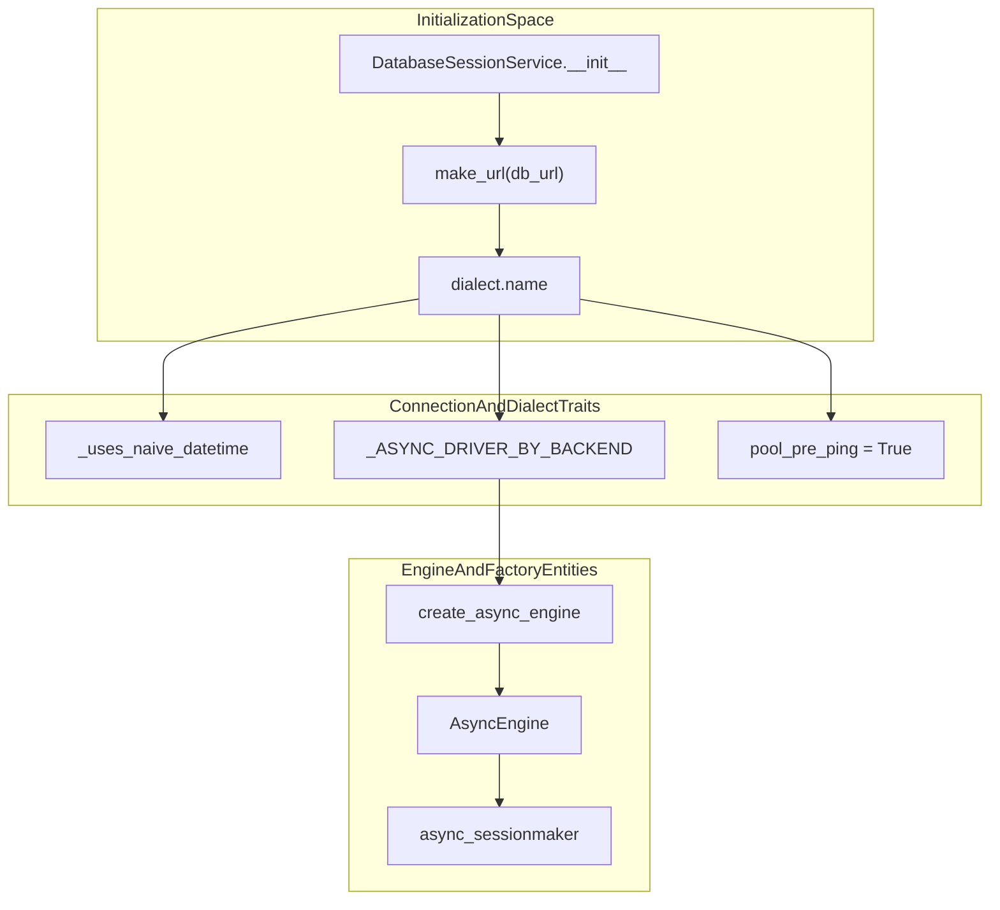
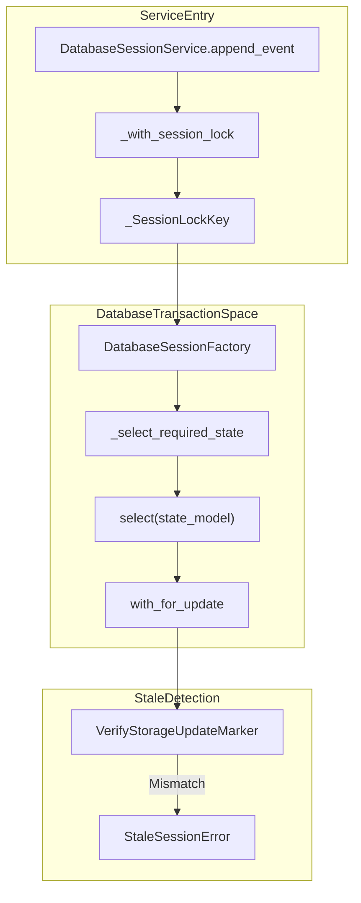

<!-- source: DeepWiki mcp.deepwiki.com · repo google/adk-python · page 8.6 Database Session Service · fetched 2026-10-29 -->

# Database Session Service

Relevant source files

The following files were used as context for generating this wiki page:

- [src/google/adk/sessions/_restricted_pickle.py](src/google/adk/sessions/_restricted_pickle.py)
- [src/google/adk/sessions/_session_util.py](src/google/adk/sessions/_session_util.py)
- [src/google/adk/sessions/base_session_service.py](src/google/adk/sessions/base_session_service.py)
- [src/google/adk/sessions/database_session_service.py](src/google/adk/sessions/database_session_service.py)
- [src/google/adk/sessions/in_memory_session_service.py](src/google/adk/sessions/in_memory_session_service.py)
- [src/google/adk/sessions/migration/_schema_check_utils.py](src/google/adk/sessions/migration/_schema_check_utils.py)
- [src/google/adk/sessions/migration/migrate_from_sqlalchemy_pickle.py](src/google/adk/sessions/migration/migrate_from_sqlalchemy_pickle.py)
- [src/google/adk/sessions/migration/migrate_from_sqlalchemy_sqlite.py](src/google/adk/sessions/migration/migrate_from_sqlalchemy_sqlite.py)
- [src/google/adk/sessions/migration/migration_runner.py](src/google/adk/sessions/migration/migration_runner.py)
- [src/google/adk/sessions/schemas/shared.py](src/google/adk/sessions/schemas/shared.py)
- [src/google/adk/sessions/schemas/v0.py](src/google/adk/sessions/schemas/v0.py)
- [src/google/adk/sessions/schemas/v1.py](src/google/adk/sessions/schemas/v1.py)
- [src/google/adk/sessions/sqlite_session_service.py](src/google/adk/sessions/sqlite_session_service.py)
- [src/google/adk/sessions/vertex_ai_session_service.py](src/google/adk/sessions/vertex_ai_session_service.py)
- [tests/unittests/sessions/migration/test_database_schema.py](tests/unittests/sessions/migration/test_database_schema.py)
- [tests/unittests/sessions/migration/test_migration.py](tests/unittests/sessions/migration/test_migration.py)
- [tests/unittests/sessions/test_dynamic_pickle_type.py](tests/unittests/sessions/test_dynamic_pickle_type.py)
- [tests/unittests/sessions/test_schemas_shared.py](tests/unittests/sessions/test_schemas_shared.py)
- [tests/unittests/sessions/test_session_service.py](tests/unittests/sessions/test_session_service.py)
- [tests/unittests/sessions/test_session_util.py](tests/unittests/sessions/test_session_util.py)
- [tests/unittests/sessions/test_v0_storage_event.py](tests/unittests/sessions/test_v0_storage_event.py)
- [tests/unittests/sessions/test_vertex_ai_session_service.py](tests/unittests/sessions/test_vertex_ai_session_service.py)

The Database Session Service (`DatabaseSessionService`) provides a production-related SQL database backend for persistent session storage within the ADK framework. It implements the `BaseSessionService` interface and supports PostgreSQL, MySQL, MariaDB, SQLite, and Google Cloud Spanner databases via SQLAlchemy's asynchronous ORM (`sqlalchemy.ext.asyncio`). This subsystem is engineered for multi-process deployments requiring session state persistence across application restarts and safe concurrent access across distributed workers.

Sources: `[src/google/adk/sessions/database_session_service.py:1-64]()`, `[src/google/adk/sessions/base_session_service.py:63-67]()`

---

## Architecture Overview and SQLAlchemy Integration

`DatabaseSessionService` initializes or accepts an SQLAlchemy `AsyncEngine`, manages asynchronous session factories (`async_sessionmaker`), and maps relational tables to ORM entities across versioned schemas (`v0` and `v1`).

### Code Entity Space: Engine Initialization and Dialect Mapping
The following diagram illustrates how `DatabaseSessionService` inspects connection URLs, determines dialect-specific behaviors, and instantiates the asynchronous engine and session factory.

Title: DatabaseSessionService Initialization Architecture

Sources: `[src/google/adk/sessions/database_session_service.py:39-53]()`, `[src/google/adk/sessions/database_session_service.py:83-122]()`, `[tests/unittests/sessions/test_session_service.py:102-122]()`

---

## Database Support and Dialect Adaptations

The service handles database-specific quirks through explicit dialect detection and parameter tuning:

| Database Backend | Dialect Name | Asynchronous Driver | Timezone / Datetime Handling | Connection Pooling |
|------------------|--------------|---------------------|------------------------------|--------------------|
| **PostgreSQL** | `postgresql` | `asyncpg` | Strips tzinfo (`_NAIVE_DATETIME_DIALECTS`) `[src/google/adk/sessions/database_session_service.py:101]()` | `pool_pre_ping=True` `[tests/unittests/sessions/test_session_service.py:102-122]()` |
| **MySQL** | `mysql` | `aiomysql` | Strips tzinfo `[src/google/adk/sessions/database_session_service.py:102]()` | `pool_pre_ping=True` `[tests/unittests/sessions/test_session_service.py:102-122]()` |
| **MariaDB** | `mariadb` | `asyncmy` | Strips tzinfo `[src/google/adk/sessions/database_session_service.py:100]()` | `pool_pre_ping=True` `[tests/unittests/sessions/test_session_service.py:102-122]()` |
| **SQLite** | `sqlite` | `aiosqlite` | Strips tzinfo `[src/google/adk/sessions/database_session_service.py:99]()` | `StaticPool` for `:memory:` `[tests/unittests/sessions/test_session_service.py:124-149]()` |
| **Cloud Spanner** | `spanner+spanner` | `spanner_dbapi` | Preserves timezone-aware TIMESTAMPs `[src/google/adk/sessions/database_session_service.py:98]()` | Dialect-managed pooling |

Sources: `[src/google/adk/sessions/database_session_service.py:83-114]()`, `[tests/unittests/sessions/test_session_service.py:102-177]()`

---

## Schema Versioning: v0 and v1 Schemas

Database schema evolution is managed via versioned schema bundles (`v0` and `v1`). The service inspects internal metadata tables during startup to determine which ORM models to bind.

### Schema Comparison

| Schema Version | Target ADK Versions | Event Actions Serialization | State Representation | Migration Utility |
|----------------|---------------------|-----------------------------|----------------------|-------------------|
| **v0** | v1.19.0 — v1.21.0 | `PickleType` with restricted unpickler (`DynamicPickleType`) `[src/google/adk/sessions/schemas/v0.py:103-104]()` | `DynamicJSON` `[src/google/adk/sessions/schemas/v0.py:163-164]()` | `migrate_from_sqlalchemy_pickle.py` `[src/google/adk/sessions/migration/migrate_from_sqlalchemy_pickle.py:14-48]()` |
| **v1** (Latest) | v1.22.0+ | `DynamicJSON` (JSON-serialized `EventActions`) `[src/google/adk/sessions/schemas/v1.py:15-23]()` | `DynamicJSON` `[src/google/adk/sessions/schemas/v1.py:89-90]()` | `migration_runner.py` `[src/google/adk/sessions/migration/migration_runner.py:1-40]()` |

Sources: `[src/google/adk/sessions/schemas/v0.py:14-24]()`, `[src/google/adk/sessions/schemas/v1.py:15-30]()`, `[src/google/adk/sessions/migration/migrate_from_sqlalchemy_pickle.py:14-48]()`

---

## PreciseTimestamp and Type Decorators

Timestamp columns utilize `PreciseTimestamp` (defined in `schemas/shared.py`), which ensures high-precision microsecond storage across database dialects. Furthermore, session type decorators implement `cache_ok = True` to prevent SQLAlchemy statement caching warnings.

For v0 schemas utilizing binary pickling, `DynamicPickleType` enforces restricted unpickling on all database results.

Sources: `[src/google/adk/sessions/schemas/v0.py:97-107]()`, `[tests/unittests/sessions/test_session_service.py:178-183]()`

---

## Row-Level Locking and Concurrency Control

To prevent race conditions during concurrent event appends (`append_event`), `DatabaseSessionService` enforces a dual-layer concurrency mechanism:

1. **In-Process Locks:** A per-session `asyncio.Lock` mapped by `_SessionLockKey` (`tuple[str, str, str]` representing `app_name`, `user_id`, `session_id`) serializes coroutines within the same Python process `[src/google/adk/sessions/database_session_service.py:115-116]()`.
2. **Row-Level Database Locking:** For database backends supporting row-level locks, state selection queries invoke `.with_for_update()` inside `_select_required_state()` `[src/google/adk/sessions/database_session_service.py:184-190]()`.

### Code Entity Space: Concurrency Control and Locking Flow
The following diagram details the code entities responsible for row-level locking and stale session detection during database transactions.

Title: Concurrency Control and Locking Flow

Sources: `[src/google/adk/sessions/database_session_service.py:49-52]()`, `[src/google/adk/sessions/database_session_service.py:115-123]()`, `[src/google/adk/sessions/database_session_service.py:184-191]()`

---

## Restricted Unpickling Security

In legacy `v0` schemas where objects or `EventActions` may be stored via SQLAlchemy's `PickleType`, `DatabaseSessionService` and migration utilities avoid unsafe global unpickling. 

- `DynamicPickleType` routes unpickling through `_restricted_pickle` (`src/google/adk/sessions/_restricted_pickle.py`) `[src/google/adk/sessions/schemas/v0.py:103-104]()`.
- Migration scripts (`migrate_from_sqlalchemy_pickle.py`) invoke `_restricted_pickle_loads()` by default, restricting deserialization strictly to permitted ADK classes and data primitives `[src/google/adk/sessions/migration/migrate_from_sqlalchemy_pickle.py:42-49]()`.

Sources: `[src/google/adk/sessions/schemas/v0.py:97-138]()`, `[src/google/adk/sessions/migration/migrate_from_sqlalchemy_pickle.py:42-49]()`

---

## State Hierarchy and Storage Scoping

Session data is decoupled into application-level (`app_states`), user-level (`user_states`), and session-level (`sessions`) tables. 

State keys prefixed with `app:` map to application storage, `user:` maps to user storage, and unprefixed keys map to session storage. Temporary state (`temp:`) is retained exclusively in memory during an invocation and is filtered out prior to database persistence `[src/google/adk/sessions/base_session_service.py:175-180]()`, `[src/google/adk/sessions/_session_util.py:51-68]()`.

Sources: `[src/google/adk/sessions/_session_util.py:51-68]()`, `[src/google/adk/sessions/base_session_service.py:175-180]()`

---

