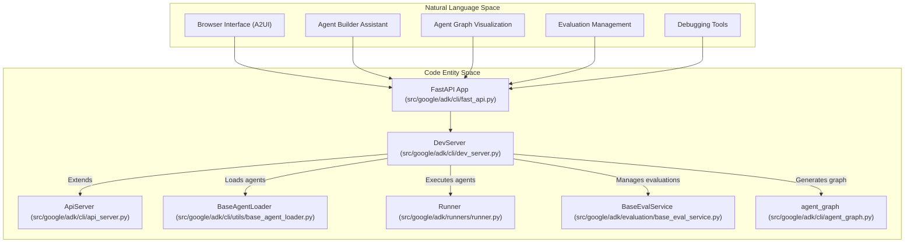

<!-- source: DeepWiki mcp.deepwiki.com · repo google/adk-python · page 9 User Interfaces · fetched 2026-10-29 -->

# User Interfaces

Relevant source files

The following files were used as context for generating this wiki page:

- [src/google/adk/cli/_dev_deploy.py](src/google/adk/cli/_dev_deploy.py)
- [src/google/adk/cli/adk_web_server.py](src/google/adk/cli/adk_web_server.py)
- [src/google/adk/cli/api_server.py](src/google/adk/cli/api_server.py)
- [src/google/adk/cli/cli_deploy.py](src/google/adk/cli/cli_deploy.py)
- [src/google/adk/cli/cli_tools_click.py](src/google/adk/cli/cli_tools_click.py)
- [src/google/adk/cli/dev_server.py](src/google/adk/cli/dev_server.py)
- [src/google/adk/cli/fast_api.py](src/google/adk/cli/fast_api.py)
- [tests/unittests/cli/test_adk_web_server_run_live.py](tests/unittests/cli/test_adk_web_server_run_live.py)
- [tests/unittests/cli/test_adk_web_server_tests.py](tests/unittests/cli/test_adk_web_server_tests.py)
- [tests/unittests/cli/test_dev_deploy.py](tests/unittests/cli/test_dev_deploy.py)
- [tests/unittests/cli/test_dns_rebinding_protection.py](tests/unittests/cli/test_dns_rebinding_protection.py)
- [tests/unittests/cli/test_fast_api.py](tests/unittests/cli/test_fast_api.py)
- [tests/unittests/cli/test_local_client_check.py](tests/unittests/cli/test_local_client_check.py)
- [tests/unittests/cli/utils/test_cli_deploy.py](tests/unittests/cli/utils/test_cli_deploy.py)
- [tests/unittests/cli/utils/test_cli_deploy_ignore.py](tests/unittests/cli/utils/test_cli_deploy_ignore.py)
- [tests/unittests/cli/utils/test_cli_deploy_to_cloud_run.py](tests/unittests/cli/utils/test_cli_deploy_to_cloud_run.py)
- [tests/unittests/cli/utils/test_cli_tools_click.py](tests/unittests/cli/utils/test_cli_tools_click.py)

## Purpose and Scope

The ADK framework provides three primary user interfaces for interacting with agents: a **Command Line Interface (CLI)** for local development, testing, and deployment; a **Development Web UI** for browser-based interactive testing and agent graph visualization; and a **FastAPI Server** (`api_server`) for programmatic REST API access and cloud deployment. All three interfaces share the same core execution engine and service layer, ensuring consistent behavior across different interaction modes.

This is a parent page providing a high-level architectural overview of the ADK user interfaces. For deep implementation details, feature flags, endpoint schemas, and service configuration options, please refer to the child pages:
- [Command Line Interface](#9.1) — adk CLI commands: create, run, deploy, eval, optimize, conformance, telemetry, test; CLI telemetry group and feature flags.
- [Development Web UI](#9.2) — adk web command, DevServer, bundled browser assets, agent graph visualization, agent hot reload, agent builder assistant.
- [FastAPI Server](#9.3) — adk api_server, get_fast_api_app, ApiServer vs DevServer, Gemini Enterprise reasoning-engine endpoints, DNS-rebinding protection, agent loaders.
- [API Endpoints Reference](#9.4) — REST API documentation: /apps/.../sessions, artifacts, /builder/*, /debug/trace, /trigger/pubsub, /trigger/eventarc, and the conformance web server client.
- [Service URIs and Configuration](#9.5) — session_service_uri, artifact_service_uri, memory_service_uri, use_local_storage, service factory/registry, .adk folder.

Sources: [src/google/adk/cli/cli_tools_click.py:37-47](), [src/google/adk/cli/dev_server.py:15-21](), [src/google/adk/cli/fast_api.py:95-130]()

---

## Command Line Interface

The ADK CLI is implemented using the `click` framework and provides commands for agent creation, local execution, evaluation, telemetry configuration, and deployment [src/google/adk/cli/cli_tools_click.py:37-47](). The CLI routes commands to appropriate modules such as `cli_create`, `cli_eval`, and `cli_deploy`. It also includes decorators for common options like logging (`_logging_options`) and feature flags (`feature_options`) [src/google/adk/cli/cli_tools_click.py:88-201]().

### CLI Command Hierarchy

Title: "ADK CLI Command Hierarchy to Code Modules"

```mermaid
graph TB
    subgraph Natural_Language_Space["Natural Language Space"]
        AdkCLI["adk cli"]
        CreateCmd["adk create"]
        RunCmd["adk run"]
        WebCmd["adk web"]
        ApiServerCmd["adk api_server"]
        EvalCmd["adk eval"]
        DeployCmd["adk deploy"]
        OptimizeCmd["adk optimize"]
        ConformanceCmd["adk conformance"]
        TelemetryCmd["adk telemetry"]
        TestCmd["adk test"]
    end

    subgraph Code_Entity_Space["Code Entity Space"]
        Main["main (src/google/adk/cli/cli_tools_click.py)"]
        CliCreate["cli_create.run_cmd"]
        CliRun["cli_run.callback"]
        CliWeb["cli_web.callback"]
        CliApiServer["cli_api_server.callback"]
        CliEval["cli_eval.callback"]
        CliDeploy["cli_deploy.run"]
        CliOptimize["cli_optimize.callback"]
        CliConformance["cli_conformance.callback"]
        CliTelemetry["cli_telemetry.callback"]
        CliTest["cli_test.callback"]
    end

    AdkCLI --> Main
    Main --> CreateCmd
    Main --> RunCmd
    Main --> WebCmd
    Main --> ApiServerCmd
    Main --> EvalCmd
    Main --> DeployCmd
    Main --> OptimizeCmd
    Main --> ConformanceCmd
    Main --> TelemetryCmd
    Main --> TestCmd

    CreateCmd --> CliCreate
    RunCmd --> CliRun
    WebCmd --> CliWeb
    ApiServerCmd --> CliApiServer
    EvalCmd --> CliEval
    DeployCmd --> CliDeploy
    OptimizeCmd --> CliOptimize
    ConformanceCmd --> CliConformance
    TelemetryCmd --> CliTelemetry
    TestCmd --> CliTest
```

Sources: [src/google/adk/cli/cli_tools_click.py:37-47](), [src/google/adk/cli/cli_tools_click.py:88-201](), [tests/unittests/cli/utils/test_cli_tools_click.py:201-210]()

For complete details on commands, feature flags, and telemetry configuration, see [Command Line Interface](#9.1).

---

## Development Web UI

The development web UI provides a browser-based interface for interacting with chat sessions, visualizing agent execution graphs, and running the agent builder assistant. It is launched using the `adk web` command, which initializes a `DevServer` instance extending `ApiServer` [src/google/adk/cli/dev_server.py:15-21](). The `DevServer` adds development-specific endpoints for evaluation, debugging, graph visualization, and test management [src/google/adk/cli/dev_server.py:17-18](). The `AdkWebServer` class is a deprecated wrapper around `DevServer` for backward compatibility [src/google/adk/cli/adk_web_server.py:29-36]().

### Web UI Component Architecture

Title: "Web UI to Backend Runner Architecture"

Sources: [src/google/adk/cli/adk_web_server.py:29-36](), [src/google/adk/cli/fast_api.py:95-130](), [src/google/adk/cli/dev_server.py:15-21](), [src/google/adk/cli/dev_server.py:63-63]()

For details on bundled browser assets, hot reload, and graph visualization, see [Development Web UI](#9.2).

---

## FastAPI Server and API Endpoints

The FastAPI server (`get_fast_api_app` in `fast_api.py`) powers both programmatic access and the web UI backend [src/google/adk/cli/fast_api.py:95-130](). It handles session CRUD endpoints, artifact management, builder uploads, debugging traces, and event triggers (`/trigger/pubsub`, `/trigger/eventarc`) [src/google/adk/cli/fast_api.py:121-126](). The `ApiServer` class provides the core production-ready endpoints [src/google/adk/cli/api_server.py:15-17]().

The server enforces security checks such as DNS-rebinding protection via loopback binding checks [src/google/adk/cli/api_server.py:181-193]() and module blocklists for uploaded configurations [src/google/adk/cli/dev_server.py:204-209](). It also supports OpenTelemetry for tracing and metrics [src/google/adk/cli/fast_api.py:38-41]().

For detailed endpoint documentation, see [FastAPI Server](#9.3) and [API Endpoints Reference](#9.4).

Sources: [src/google/adk/cli/fast_api.py:95-167](), [src/google/adk/cli/api_server.py:15-17](), [src/google/adk/cli/api_server.py:181-193](), [src/google/adk/cli/fast_api.py:38-41](), [src/google/adk/cli/dev_server.py:204-209]()

---

## Service URIs and Configuration

ADK interfaces configure backend services through uniform URIs and factory functions managed in the `.adk` environment. The `get_fast_api_app` function, used by both `adk web` and `adk api_server`, takes parameters to configure these services:
- `session_service_uri`: Defines the backend for session persistence (e.g., `memory://`, `sqlite://`, `postgresql://`, `mysql://`, or `agentengine://`) [src/google/adk/cli/fast_api.py:99-100]().
- `artifact_service_uri`: Specifies the URI for the artifact service [src/google/adk/cli/fast_api.py:101-101]().
- `memory_service_uri`: Configures the URI for the memory service [src/google/adk/cli/fast_api.py:102-102]().
- `use_local_storage`: A boolean flag to determine whether to use local storage for session and artifacts [src/google/adk/cli/fast_api.py:103-103]().

These URIs are processed by service factory functions to instantiate the appropriate service implementations [src/google/adk/cli/fast_api.py:59-63]().

For configuration options and factory wiring, see [Service URIs and Configuration](#9.5).

Sources: [src/google/adk/cli/fast_api.py:59-63](), [src/google/adk/cli/fast_api.py:95-155]()

---

