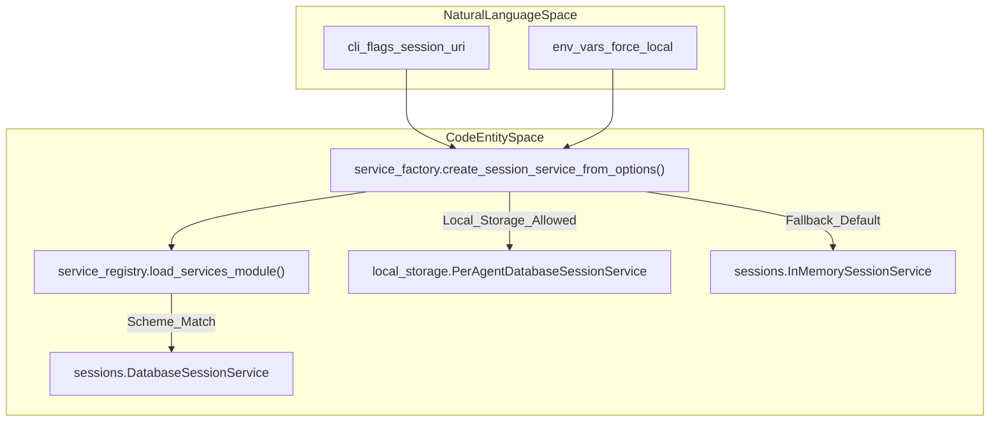

<!-- source: DeepWiki mcp.deepwiki.com · repo google/adk-python · page 9.1 Command Line Interface · fetched 2026-10-29 -->

# Command Line Interface

Relevant source files

The following files were used as context for generating this wiki page:

- [src/google/adk/cli/_dev_deploy.py](src/google/adk/cli/_dev_deploy.py)
- [src/google/adk/cli/_telemetry/_constants.py](src/google/adk/cli/_telemetry/_constants.py)
- [src/google/adk/cli/_telemetry/_metrics_collector.py](src/google/adk/cli/_telemetry/_metrics_collector.py)
- [src/google/adk/cli/_telemetry/_metrics_reporter.py](src/google/adk/cli/_telemetry/_metrics_reporter.py)
- [src/google/adk/cli/adk_web_server.py](src/google/adk/cli/adk_web_server.py)
- [src/google/adk/cli/api_server.py](src/google/adk/cli/api_server.py)
- [src/google/adk/cli/cli.py](src/google/adk/cli/cli.py)
- [src/google/adk/cli/cli_create.py](src/google/adk/cli/cli_create.py)
- [src/google/adk/cli/cli_deploy.py](src/google/adk/cli/cli_deploy.py)
- [src/google/adk/cli/cli_tools_click.py](src/google/adk/cli/cli_tools_click.py)
- [src/google/adk/cli/dev_server.py](src/google/adk/cli/dev_server.py)
- [src/google/adk/cli/fast_api.py](src/google/adk/cli/fast_api.py)
- [src/google/adk/cli/service_registry.py](src/google/adk/cli/service_registry.py)
- [src/google/adk/cli/utils/_onboarding.py](src/google/adk/cli/utils/_onboarding.py)
- [src/google/adk/cli/utils/dot_adk_folder.py](src/google/adk/cli/utils/dot_adk_folder.py)
- [src/google/adk/cli/utils/gcp_utils.py](src/google/adk/cli/utils/gcp_utils.py)
- [src/google/adk/cli/utils/local_storage.py](src/google/adk/cli/utils/local_storage.py)
- [src/google/adk/cli/utils/service_factory.py](src/google/adk/cli/utils/service_factory.py)
- [tests/unittests/cli/_telemetry/test_metrics_collector.py](tests/unittests/cli/_telemetry/test_metrics_collector.py)
- [tests/unittests/cli/_telemetry/test_metrics_reporter.py](tests/unittests/cli/_telemetry/test_metrics_reporter.py)
- [tests/unittests/cli/conformance/test_generate_markdown_utils.py](tests/unittests/cli/conformance/test_generate_markdown_utils.py)
- [tests/unittests/cli/test_adk_web_server_run_live.py](tests/unittests/cli/test_adk_web_server_run_live.py)
- [tests/unittests/cli/test_adk_web_server_tests.py](tests/unittests/cli/test_adk_web_server_tests.py)
- [tests/unittests/cli/test_cli_utf8_encoding.py](tests/unittests/cli/test_cli_utf8_encoding.py)
- [tests/unittests/cli/test_dev_deploy.py](tests/unittests/cli/test_dev_deploy.py)
- [tests/unittests/cli/test_dns_rebinding_protection.py](tests/unittests/cli/test_dns_rebinding_protection.py)
- [tests/unittests/cli/test_fast_api.py](tests/unittests/cli/test_fast_api.py)
- [tests/unittests/cli/test_local_client_check.py](tests/unittests/cli/test_local_client_check.py)
- [tests/unittests/cli/test_service_registry.py](tests/unittests/cli/test_service_registry.py)
- [tests/unittests/cli/utils/test_cli.py](tests/unittests/cli/utils/test_cli.py)
- [tests/unittests/cli/utils/test_cli_create.py](tests/unittests/cli/utils/test_cli_create.py)
- [tests/unittests/cli/utils/test_cli_deploy.py](tests/unittests/cli/utils/test_cli_deploy.py)
- [tests/unittests/cli/utils/test_cli_deploy_ignore.py](tests/unittests/cli/utils/test_cli_deploy_ignore.py)
- [tests/unittests/cli/utils/test_cli_deploy_to_cloud_run.py](tests/unittests/cli/utils/test_cli_deploy_to_cloud_run.py)
- [tests/unittests/cli/utils/test_cli_tools_click.py](tests/unittests/cli/utils/test_cli_tools_click.py)
- [tests/unittests/cli/utils/test_dot_adk_folder.py](tests/unittests/cli/utils/test_dot_adk_folder.py)
- [tests/unittests/cli/utils/test_gcp_utils.py](tests/unittests/cli/utils/test_gcp_utils.py)
- [tests/unittests/cli/utils/test_local_storage.py](tests/unittests/cli/utils/test_local_storage.py)
- [tests/unittests/cli/utils/test_service_factory.py](tests/unittests/cli/utils/test_service_factory.py)
- [tests/unittests/streaming/test_multi_agent_streaming.py](tests/unittests/streaming/test_multi_agent_streaming.py)

## Purpose and Scope

The ADK Command Line Interface (CLI) provides a comprehensive set of tools for developing, testing, evaluating, deploying, and interacting with AI agents. All CLI functionality is accessed through the `adk` command, which is installed as a script entry point defined in `pyproject.toml` and implemented via the `main` entry point in `cli_tools_click.py` [src/google/adk/cli/cli_tools_click.py:204-208]().

Sources: [src/google/adk/cli/cli_tools_click.py:204-208]()

---

## CLI Entry Point and Architecture

The CLI is implemented using the [Click](https://click.platform.readthedocs.io/) framework. The `main` function in `cli_tools_click.py` serves as the root command group. The CLI utilizes a custom error-handling approach to display full help text when required arguments are missing, providing better context for users [src/google/adk/cli/cli_tools_click.py:203-221]().

### Command Hierarchy and Code Entities

This diagram bridges natural language command names to the corresponding Python functions and modules handling their execution.

Title: "CLI Command Hierarchy to Code Entity Mapping"

```mermaid
graph TB
    subgraph NaturalLanguageSpace
        cmd_root["adk_command"]
        cmd_run["adk_run"]
        cmd_create["adk_create"]
        cmd_eval["adk_eval"]
        cmd_web["adk_web"]
        cmd_api["adk_api_server"]
        cmd_deploy["adk_deploy"]
        cmd_conf["adk_conformance"]
        cmd_optimize["adk_optimize"]
        cmd_telemetry["adk_telemetry"]
        cmd_test["adk_test"]
    end

    subgraph CodeEntitySpace
        main_entry["cli_tools_click.main()"]
        run_fn["cli_tools_click.cli_run()"]
        create_fn["cli_create.run_cmd()"]
        eval_fn["cli_eval.cli_eval()"]
        web_fn["adk_web_server.DevServer"]
        api_fn["fast_api.get_fast_api_app()"]
        deploy_mod["cli_deploy.run()"]
        conf_mod["cli_conformance"]
        optimize_mod["cli_optimize"]
        telemetry_mod["cli_telemetry"]
        test_mod["cli_test"]
    end

    cmd_root --> main_entry
    cmd_run --> run_fn
    cmd_create --> create_fn
    cmd_eval --> eval_fn
    cmd_web --> web_fn
    cmd_api --> api_fn
    cmd_deploy --> deploy_mod
    cmd_conf --> conf_mod
    cmd_optimize --> optimize_mod
    cmd_telemetry --> telemetry_mod
    cmd_test --> test_mod
```

Sources: [src/google/adk/cli/cli_tools_click.py:203-221](), [src/google/adk/cli/adk_web_server.py:33-36](), [src/google/adk/cli/fast_api.py:107-134]()

---

## Core Commands

### adk run

The `run` command provides an interactive terminal interface for testing agents locally. It supports multi-turn conversations and human-in-the-loop (HITL) interactions. It can also execute predefined queries from a JSON file using run input file arguments [src/google/adk/cli/cli.py:73-110]().

**Key Execution Logic:**
- **Interactive Mode:** Managed by interactive loops to accept user input and stream responses from the `Runner` [src/google/adk/cli/cli.py:98-110]().
- **HITL Handling:** Specifically handles tool calls like input requests and confirmations by prompting the user in the terminal and returning responses to the model [src/google/adk/cli/cli.py:117-185]().

Sources: [src/google/adk/cli/cli.py:73-110](), [src/google/adk/cli/cli.py:117-185]()

### adk create

Initializes a new agent project via `cli_create.run_cmd()`. It creates the directory structure and populates it with either a Python-based agent (`agent.py`) or a YAML-configured agent (`root_agent.yaml`), along with a `.env` file and `.gitignore` configuration [src/google/adk/cli/cli_create.py:114-166]().

Sources: [src/google/adk/cli/cli_create.py:114-166]()

### adk eval

The `eval` command is used to evaluate agent performance against predefined evaluation sets via `cli_eval`. It resolves agent modules and root agents using `get_app_or_root_agent()` to participate in app plugins, context caches, and resumability lifecycles [tests/unittests/cli/utils/test_cli_tools_click.py:73-82]().

Sources: [tests/unittests/cli/utils/test_cli_tools_click.py:73-82]()

### adk optimize, conformance, and test

- **`adk optimize`**: Used for prompt optimization, leveraging optimization engines and prompt samplers [src/google/adk/cli/cli_tools_click.py:204-208]().
- **`adk conformance`**: Tests agent behavior against a set of predefined conformance schemas and replay plugins [src/google/adk/cli/cli_tools_click.py:204-208]().
- **`adk test`**: Provides utilities for running unit and integration tests for agent packages [src/google/adk/cli/cli_tools_click.py:204-208]().

Sources: [src/google/adk/cli/cli_tools_click.py:204-208]()

---

## Deployment Infrastructure

The `deploy` subgroup handles packaging and pushing agents to various platforms such as Cloud Run and Vertex AI Agent Engine [src/google/adk/cli/cli_deploy.py:43-46]().

### Cloud Run Deployment
The `cloud_run` command generates a `Dockerfile` using a template that sets up a non-root user, installs `google-adk`, and copies agent source files [src/google/adk/cli/cli_deploy.py:43-46](). It configures requirements and build options, validating worker pools via `_validate_worker_pool()` and `_apply_worker_pool_to_agent_config()` [src/google/adk/cli/cli_deploy.py:105-184]().

Sources: [src/google/adk/cli/cli_deploy.py:43-46](), [src/google/adk/cli/cli_deploy.py:105-184]()

---

## Service Initialization and Registry

The CLI uses a factory pattern to instantiate the necessary backend services (Session, Artifact, Memory) based on user configuration and environment [src/google/adk/cli/fast_api.py:63-66]().

### Service Factory Data Flow and Entity Mapping

This diagram maps user-facing storage flags and configurations to underlying code factories and service classes.

Title: "Service Configuration to Factory Implementation Mapping"

**Implementation Details:**
- `create_session_service_from_options`: Resolves the session backend from URI schemes [src/google/adk/cli/fast_api.py:63-66]().
- Service Registry: Loads custom services registered via modules in the agent workspace [src/google/adk/cli/fast_api.py:58-58]().

Sources: [src/google/adk/cli/fast_api.py:58-66]()

---

## Telemetry Group and Feature Flags

### Feature Overrides
The CLI provides a mechanism to override experimental features without changing environment variables. The `feature_options()` decorator adds `--enable_features` and `--disable_features` flags to commands [src/google/adk/cli/cli_tools_click.py:205-215](). These overrides are parsed by `_apply_feature_overrides()` and applied globally to the `FeatureName` registry via `override_feature_enabled()` [src/google/adk/cli/cli_tools_click.py:165-203](). Valid features are defined in `FeatureName` [src/google/adk/cli/cli_tools_click.py:44-45]().

### Telemetry Consent and Management
The CLI includes telemetry utilities backed by `read_telemetry_consent()` and `write_telemetry_consent()` [src/google/adk/cli/cli_tools_click.py:46-47](), allowing users to check or update telemetry sharing preferences and collect command-level metrics via `MetricsCollector` [src/google/adk/cli/cli_tools_click.py:48-48]().

Sources: [src/google/adk/cli/cli_tools_click.py:44-48](), [src/google/adk/cli/cli_tools_click.py:165-203]()

---

## API and Web Integration

The CLI acts as a launcher for `ApiServer` and `DevServer` [src/google/adk/cli/fast_api.py:56]().
- **`adk api_server`**: Launches the production API server providing REST endpoints for sessions, artifacts, and agent execution via `get_fast_api_app()` [src/google/adk/cli/fast_api.py:107-146]().
- **`adk web`**: Launches the development server (`DevServer`), which adds debugging, evaluation, graph visualization, and agent builder endpoints [src/google/adk/cli/dev_server.py:15-35](). It enforces strict checks such as `_require_local_agent_builder_client()` to prevent unauthorized remote mutation of local agent files [src/google/adk/cli/dev_server.py:128-164]().

Sources: [src/google/adk/cli/fast_api.py:107-146](), [src/google/adk/cli/dev_server.py:15-35](), [src/google/adk/cli/dev_server.py:128-164]()

---

