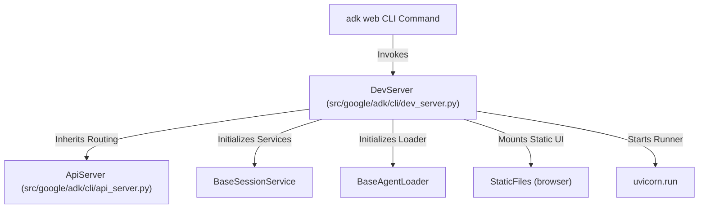
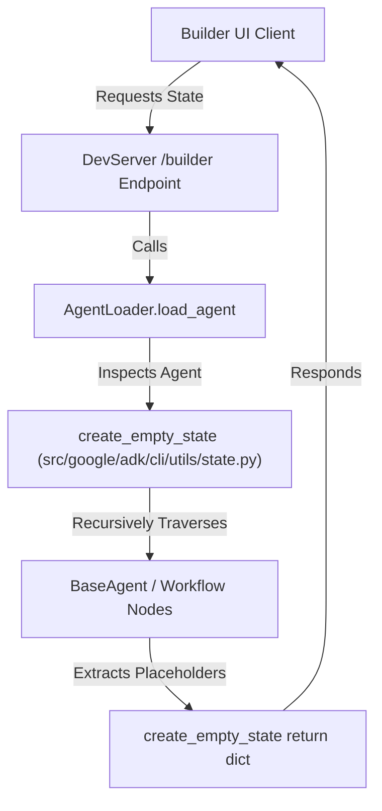
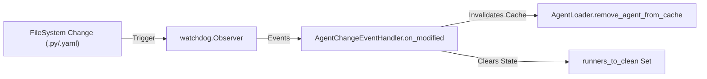

<!-- source: DeepWiki mcp.deepwiki.com · repo google/adk-python · page 9.2 Development Web UI · fetched 2026-10-29 -->

# Development Web UI

Relevant source files

The following files were used as context for generating this wiki page:

- [src/google/adk/cli/_dev_deploy.py](src/google/adk/cli/_dev_deploy.py)
- [src/google/adk/cli/adk_web_server.py](src/google/adk/cli/adk_web_server.py)
- [src/google/adk/cli/agent_graph.py](src/google/adk/cli/agent_graph.py)
- [src/google/adk/cli/api_server.py](src/google/adk/cli/api_server.py)
- [src/google/adk/cli/browser/index.html](src/google/adk/cli/browser/index.html)
- [src/google/adk/cli/cli_deploy.py](src/google/adk/cli/cli_deploy.py)
- [src/google/adk/cli/cli_tools_click.py](src/google/adk/cli/cli_tools_click.py)
- [src/google/adk/cli/dev_server.py](src/google/adk/cli/dev_server.py)
- [src/google/adk/cli/fast_api.py](src/google/adk/cli/fast_api.py)
- [src/google/adk/cli/utils/__init__.py](src/google/adk/cli/utils/__init__.py)
- [src/google/adk/cli/utils/agent_change_handler.py](src/google/adk/cli/utils/agent_change_handler.py)
- [src/google/adk/cli/utils/shared_value.py](src/google/adk/cli/utils/shared_value.py)
- [src/google/adk/cli/utils/state.py](src/google/adk/cli/utils/state.py)
- [tests/unittests/cli/test_adk_web_server_run_live.py](tests/unittests/cli/test_adk_web_server_run_live.py)
- [tests/unittests/cli/test_adk_web_server_tests.py](tests/unittests/cli/test_adk_web_server_tests.py)
- [tests/unittests/cli/test_dev_deploy.py](tests/unittests/cli/test_dev_deploy.py)
- [tests/unittests/cli/test_dns_rebinding_protection.py](tests/unittests/cli/test_dns_rebinding_protection.py)
- [tests/unittests/cli/test_fast_api.py](tests/unittests/cli/test_fast_api.py)
- [tests/unittests/cli/test_local_client_check.py](tests/unittests/cli/test_local_client_check.py)
- [tests/unittests/cli/utils/test_agent_change_handler.py](tests/unittests/cli/utils/test_agent_change_handler.py)
- [tests/unittests/cli/utils/test_cli_deploy.py](tests/unittests/cli/utils/test_cli_deploy.py)
- [tests/unittests/cli/utils/test_cli_deploy_ignore.py](tests/unittests/cli/utils/test_cli_deploy_ignore.py)
- [tests/unittests/cli/utils/test_cli_deploy_to_cloud_run.py](tests/unittests/cli/utils/test_cli_deploy_to_cloud_run.py)
- [tests/unittests/cli/utils/test_cli_tools_click.py](tests/unittests/cli/utils/test_cli_tools_click.py)
- [tests/unittests/cli/utils/test_state.py](tests/unittests/cli/utils/test_state.py)
- [tests/unittests/tools/test_enterprise_web_search_tool.py](tests/unittests/tools/test_enterprise_web_search_tool.py)

The Development Web UI provides an interactive browser-based interface for building, testing, and debugging ADK agents locally. Served via the `adk web` command, it hosts a FastAPI-powered development server (`DevServer`) that combines production API endpoints with specialized development tools, visual agent builders, session explorers, and graph visualizations [src/google/adk/cli/dev_server.py:15-29](), [src/google/adk/cli/api_server.py:15-17]().

**Security Warning**: The development web UI has full file system and session access within the target agents directory. It is intended solely for local development on a trusted machine and must never be exposed to public networks or multi-user production environments [src/google/adk/cli/dev_server.py:24-29]().

Sources: [src/google/adk/cli/dev_server.py:15-29](), [src/google/adk/cli/api_server.py:15-17]()

---

## Server Initialization and DevServer Architecture

The `adk web` CLI command instantiates the `DevServer` class (inheriting from `ApiServer`) and launches it using `uvicorn`. The server dynamically registers standard application routes alongside debugging, evaluation, and builder endpoints [src/google/adk/cli/dev_server.py:15-29](), [src/google/adk/cli/api_server.py:43-52](). Mutating endpoints validate that the request originates from the local loopback interface or permits remote access explicitly [src/google/adk/cli/dev_server.py:128-164]().

Title: Natural Language Space to Code Entity Space (`DevServer` Initialization)

Sources: [src/google/adk/cli/dev_server.py:15-29](), [src/google/adk/cli/api_server.py:43-52]()

---

## Static Web Assets and Frontend Configuration

The UI is a bundled Single Page Application (SPA) located in the browser assets directory. The primary markup file is `index.html`, which loads the frontend scripts and styles [src/google/adk/cli/browser/index.html:1-25](). Configuration settings—such as backend connection endpoints—are provided via runtime configurations.

Sources: [src/google/adk/cli/browser/index.html:1-25]()

---

## Builder API and Agent Builder Assistant

The development server exposes specialized `/builder/*` endpoints that empower the web UI to inspect, modify, and save agent code and configurations on disk [src/google/adk/cli/dev_server.py:214-225]().

### File Management and Security
To prevent unauthorized file access or path traversal attacks during builder operations, the backend applies strict path validation via functions like `_require_local_agent_builder_client()` to restrict mutating `/dev` and builder calls to loopback clients unless overridden [src/google/adk/cli/dev_server.py:128-164]().

### Builder Assistant and State Initialization
The builder assistant helps users define agent configurations by providing initial state values. The `create_empty_state()` function [src/google/adk/cli/utils/state.py:58-68]() is used to generate an empty dictionary for all placeholders found in an `LlmAgent`'s instruction string [src/google/adk/cli/utils/state.py:46-52](). This function recursively traverses the agent's sub-agents and workflow nodes to identify all potential state variables [src/google/adk/cli/utils/state.py:37-43]().

Title: Natural Language Space to Code Entity Space (Builder State Initialization Workflow)

Sources: [src/google/adk/cli/dev_server.py:128-225](), [src/google/adk/cli/utils/state.py:29-68]()

---

## Agent Discovery and Hot Reloading

Agents are discovered dynamically via agent loaders and monitored in real time using the `watchdog` library paired with `AgentChangeEventHandler` [src/google/adk/cli/api_server.py:60-74](), [src/google/adk/cli/utils/agent_change_handler.py:31-94](). When changes to `.py`, `.yaml`, or `.yml` files are detected, `on_modified()` invalidates the agent cache and marks the runner for cleanup [src/google/adk/cli/utils/agent_change_handler.py:58-94](). The `AgentChangeEventHandler` identifies the affected agent(s) by traversing the file path relative to the `agents_dir` [src/google/adk/cli/utils/agent_change_handler.py:70-91]().

Title: Hot Reload Pipeline

Sources: [src/google/adk/cli/api_server.py:60-74](), [src/google/adk/cli/utils/agent_change_handler.py:31-94]()

---

## Agent Graph Visualization

The web UI provides visual representations of agent hierarchies, sub-agent delegations, and workflows using `graphviz` [src/google/adk/cli/agent_graph.py:20-46]().

The core rendering function `build_graph()` inspects agent hierarchies and constructs graph nodes based on agent types such as `SequentialAgent`, `LoopAgent`, and `ParallelAgent` [src/google/adk/cli/agent_graph.py:45-76](). It also handles different tool types, assigning appropriate shapes and captions [src/google/adk/cli/agent_graph.py:84-127](). For complex agents like `Workflow`, `SequentialAgent`, `LoopAgent`, and `ParallelAgent`, `build_cluster()` is called to create subgraphs and define the flow between sub-agents [src/google/adk/cli/agent_graph.py:129-190]().

| Code Entity / Function | Role in Visualization |
|------------------------|------------------------|
| `build_graph()` | Recursively traverses agent structures and builds `graphviz.Digraph` nodes and edges [src/google/adk/cli/agent_graph.py:45-52]() |
| `get_node_name()` | Generates a unique name for each node, including agent type for clarity [src/google/adk/cli/agent_graph.py:72-88]() |
| `get_node_caption()` | Provides a user-friendly label for each node, often with emojis [src/google/adk/cli/agent_graph.py:90-112]() |
| `get_node_shape()` | Determines the visual shape of the node based on its type (e.g., `ellipse` for agents, `box` for tools) [src/google/adk/cli/agent_graph.py:114-134]() |
| `should_build_agent_cluster()` | Decides if a given agent or tool should be represented as a cluster (subgraph) [src/google/adk/cli/agent_graph.py:135-158]() |
| `build_cluster()` | Orchestrates nested sub-agent cluster layouts and control-flow links, handling specific logic for `LoopAgent` and `SequentialAgent` [src/google/adk/cli/agent_graph.py:160-190]() |

Sources: [src/google/adk/cli/agent_graph.py:20-190]()

---

