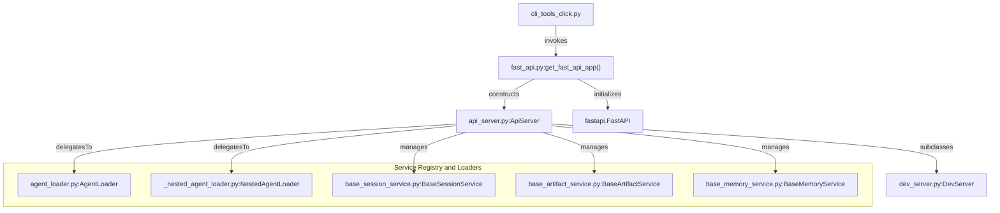
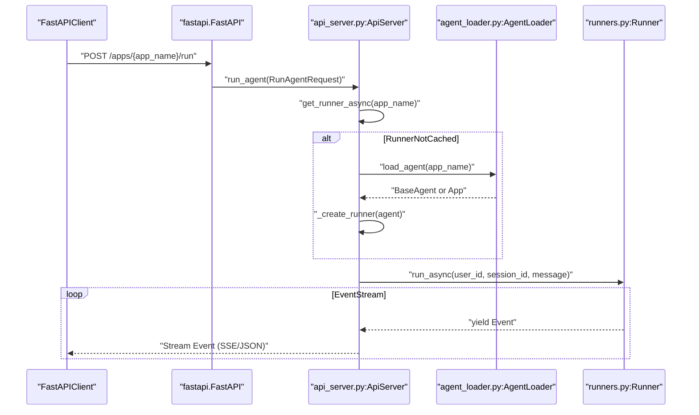

<!-- source: DeepWiki mcp.deepwiki.com · repo google/adk-python · page 9.3 FastAPI Server · fetched 2026-10-29 -->

# FastAPI Server

Relevant source files

The following files were used as context for generating this wiki page:

- [src/google/adk/apps/__init__.py](src/google/adk/apps/__init__.py)
- [src/google/adk/apps/app.py](src/google/adk/apps/app.py)
- [src/google/adk/cli/_dev_deploy.py](src/google/adk/cli/_dev_deploy.py)
- [src/google/adk/cli/adk_web_server.py](src/google/adk/cli/adk_web_server.py)
- [src/google/adk/cli/api_server.py](src/google/adk/cli/api_server.py)
- [src/google/adk/cli/cli_deploy.py](src/google/adk/cli/cli_deploy.py)
- [src/google/adk/cli/cli_tools_click.py](src/google/adk/cli/cli_tools_click.py)
- [src/google/adk/cli/dev_server.py](src/google/adk/cli/dev_server.py)
- [src/google/adk/cli/fast_api.py](src/google/adk/cli/fast_api.py)
- [src/google/adk/cli/utils/_nested_agent_loader.py](src/google/adk/cli/utils/_nested_agent_loader.py)
- [src/google/adk/cli/utils/agent_loader.py](src/google/adk/cli/utils/agent_loader.py)
- [src/google/adk/cli/utils/base_agent_loader.py](src/google/adk/cli/utils/base_agent_loader.py)
- [tests/unittests/apps/__init__.py](tests/unittests/apps/__init__.py)
- [tests/unittests/apps/test_apps.py](tests/unittests/apps/test_apps.py)
- [tests/unittests/cli/test_adk_web_server_run_live.py](tests/unittests/cli/test_adk_web_server_run_live.py)
- [tests/unittests/cli/test_adk_web_server_tests.py](tests/unittests/cli/test_adk_web_server_tests.py)
- [tests/unittests/cli/test_dev_deploy.py](tests/unittests/cli/test_dev_deploy.py)
- [tests/unittests/cli/test_dns_rebinding_protection.py](tests/unittests/cli/test_dns_rebinding_protection.py)
- [tests/unittests/cli/test_fast_api.py](tests/unittests/cli/test_fast_api.py)
- [tests/unittests/cli/test_local_client_check.py](tests/unittests/cli/test_local_client_check.py)
- [tests/unittests/cli/utils/test_agent_loader.py](tests/unittests/cli/utils/test_agent_loader.py)
- [tests/unittests/cli/utils/test_cli_deploy.py](tests/unittests/cli/utils/test_cli_deploy.py)
- [tests/unittests/cli/utils/test_cli_deploy_ignore.py](tests/unittests/cli/utils/test_cli_deploy_ignore.py)
- [tests/unittests/cli/utils/test_cli_deploy_to_cloud_run.py](tests/unittests/cli/utils/test_cli_deploy_to_cloud_run.py)
- [tests/unittests/cli/utils/test_cli_tools_click.py](tests/unittests/cli/utils/test_cli_tools_click.py)
- [tests/unittests/cli/utils/test_nested_agent_loader.py](tests/unittests/cli/utils/test_nested_agent_loader.py)

This page documents the FastAPI Server module within the ADK Python repository (`src/google/adk/cli/fast_api.py`, `src/google/adk/cli/api_server.py`, and `src/google/adk/cli/dev_server.py`), covering its role as the HTTP/WebSocket API layer, the initialization function `get_fast_api_app()`, the architectural differences between `ApiServer` and `DevServer`, reasoning-engine endpoints, DNS-rebinding protection mechanisms, and agent loaders.

Sources:
- [src/google/adk/cli/fast_api.py:107-146]()
- [src/google/adk/cli/api_server.py:15-16]()
- [src/google/adk/cli/dev_server.py:15-35]()

## Architecture Overview

The FastAPI server initializes through `get_fast_api_app()` [src/google/adk/cli/fast_api.py:107-146](), which binds core services and constructs either an `ApiServer` [src/google/adk/cli/api_server.py:45-67]() for production or a `DevServer` [src/google/adk/cli/dev_server.py:58-101]() for local development environments.

Title: "ADK Server Component Architecture"

Sources:
- [src/google/adk/cli/fast_api.py:107-146]()
- [src/google/adk/cli/api_server.py:45-92]()
- [src/google/adk/cli/dev_server.py:58-101]()
- [src/google/adk/cli/utils/agent_loader.py:65-77]()

### Request Processing Flow

Incoming execution requests are mapped to active `Runner` instances via application names and dispatched asynchronously.

Title: "Agent Execution Request Lifecycle"

Sources:
- [src/google/adk/cli/fast_api.py:107-146]()
- [src/google/adk/cli/api_server.py:21-48]()
- [tests/unittests/cli/test_fast_api.py:157-181]()

## Core Components

### ApiServer vs DevServer

- **`ApiServer`**: Manages production routes, CORS configuration (`CORSMiddleware`) [src/google/adk/cli/api_server.py:50](), session persistence factories, and runner caching.
- **`DevServer`**: Inherits from `ApiServer` [src/google/adk/cli/dev_server.py:94-100]() and registers file-watching capabilities via `watchdog.observers.Observer` [src/google/adk/cli/fast_api.py:72-74]() for hot-reloading along with auxiliary debugging, evaluation, and deployment endpoints [src/google/adk/cli/dev_server.py:15-21]().
- **`AdkWebServer`**: Maintained as a deprecated wrapper class pointing to `DevServer` for backward compatibility [src/google/adk/cli/adk_web_server.py:29-36]().

Sources:
- [src/google/adk/cli/api_server.py:45-92]()
- [src/google/adk/cli/dev_server.py:58-101]()
- [src/google/adk/cli/adk_web_server.py:29-36]()

### Agent Loaders (`AgentLoader` and `NestedAgentLoader`)

Agent discovery is handled by concrete subclasses of `BaseAgentLoader` [src/google/adk/cli/utils/base_agent_loader.py:28](). `AgentLoader` searches `agents_dir` using specific structural patterns:
1. `{agent_name}/agent.py` defining `root_agent` or `app` [src/google/adk/cli/utils/agent_loader.py:67-68]()
2. `{agent_name}.py` [src/google/adk/cli/utils/agent_loader.py:69-70]()
3. `{agent_name}/__init__.py` [src/google/adk/cli/utils/agent_loader.py:71-72]()
4. `{agent_name}/root_agent.yaml` [src/google/adk/cli/utils/agent_loader.py:73-74]()

Sources:
- [src/google/adk/cli/utils/base_agent_loader.py:28]()
- [src/google/adk/cli/utils/agent_loader.py:64-76]()

## Gemini Enterprise Reasoning-Engine Endpoints

When configured for Vertex AI Agent Engine deployments, the server registers reasoning-engine endpoints that execute specific class methods. Incoming queries are structured using the `_QueryRequest` Pydantic model [src/google/adk/cli/fast_api.py:81-85]().

- **`_QueryRequest`**: Contains an `input` mapping and an optional `class_method` string selector [src/google/adk/cli/fast_api.py:81-85]().
- **Method Validation**: Method dispatch is filtered against `_ALLOWED_AGENT_ENGINE_CLASS_METHODS` derived from `_AGENT_ENGINE_CLASS_METHODS` to prevent arbitrary code execution via unsupported attributes [src/google/adk/cli/fast_api.py:76-78]().

Sources:
- [src/google/adk/cli/fast_api.py:76-85]()
- [src/google/adk/cli/cli_deploy.py:55-68]()

## Security and DNS-Rebinding Protection

To prevent DNS-rebinding vulnerabilities when servers bind to loopback interfaces, the application inspects incoming `Host` headers and request scopes.

- **`_is_loopback_address`**: Evaluates whether configured bind addresses reside within loopback blocks [src/google/adk/cli/api_server.py:55]() and validates client sockets.
- **`_is_local_client`**: Restricts sensitive local-only routes to callers originating from the loopback interface [src/google/adk/cli/api_server.py:93]().
- **`_require_local_agent_builder_client`**: Used by `DevServer` to guard mutating `/dev` operations and Agent Builder modifications unless `ADK_ALLOW_REMOTE_AGENT_BUILDER=1` is explicitly set [src/google/adk/cli/dev_server.py:128-164]().

Sources:
- [src/google/adk/cli/api_server.py:55]()
- [src/google/adk/cli/api_server.py:93]()
- [src/google/adk/cli/dev_server.py:128-164]()

## Service Integration

The FastAPI server initializes persistence layer services dynamically using options passed to `get_fast_api_app()`:
- Session Service: Created via `create_session_service_from_options` [src/google/adk/cli/fast_api.py:66]()
- Artifact Service: Created via `create_artifact_service_from_options` [src/google/adk/cli/fast_api.py:64]()
- Memory Service: Created via `create_memory_service_from_options` [src/google/adk/cli/fast_api.py:65]()

Sources:
- [src/google/adk/cli/fast_api.py:63-66]()

---

