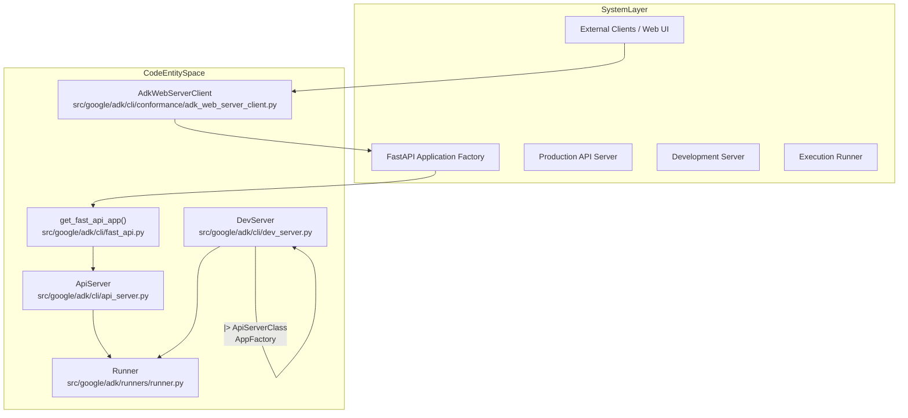
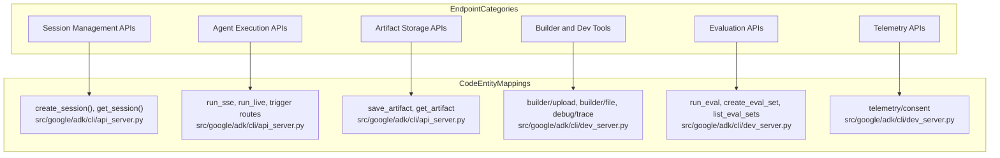
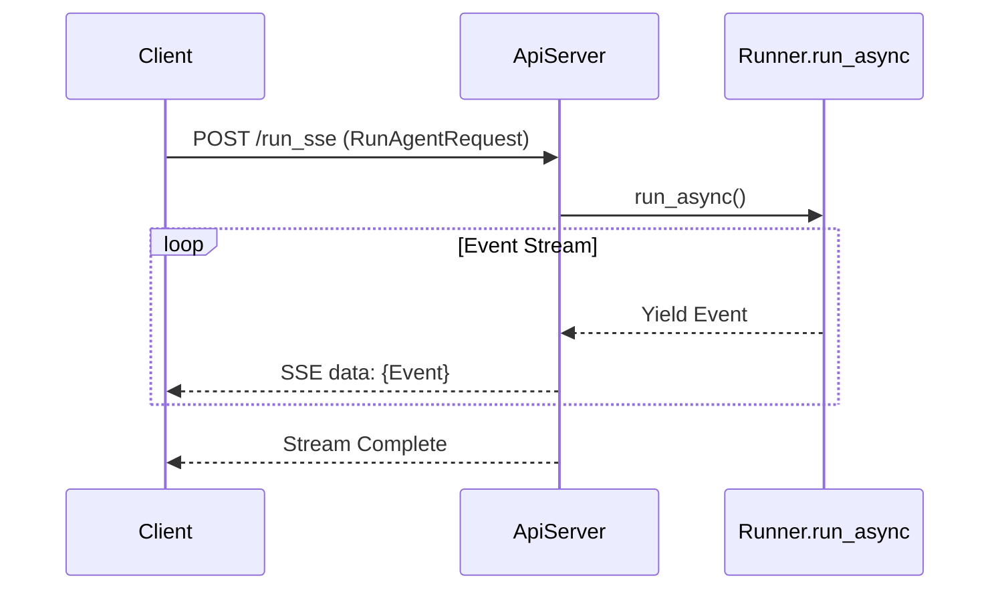
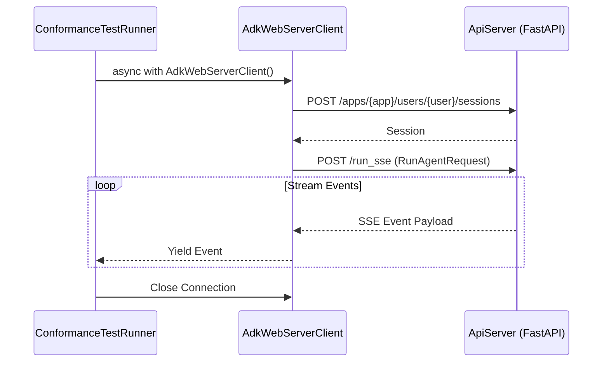

<!-- source: DeepWiki mcp.deepwiki.com · repo google/adk-python · page 9.4 API Endpoints Reference · fetched 2026-10-29 -->

# API Endpoints Reference

Relevant source files

The following files were used as context for generating this wiki page:

- [src/google/adk/cli/_dev_deploy.py](src/google/adk/cli/_dev_deploy.py)
- [src/google/adk/cli/adk_web_server.py](src/google/adk/cli/adk_web_server.py)
- [src/google/adk/cli/api_server.py](src/google/adk/cli/api_server.py)
- [src/google/adk/cli/cli_deploy.py](src/google/adk/cli/cli_deploy.py)
- [src/google/adk/cli/cli_tools_click.py](src/google/adk/cli/cli_tools_click.py)
- [src/google/adk/cli/conformance/__init__.py](src/google/adk/cli/conformance/__init__.py)
- [src/google/adk/cli/conformance/adk_web_server_client.py](src/google/adk/cli/conformance/adk_web_server_client.py)
- [src/google/adk/cli/dev_server.py](src/google/adk/cli/dev_server.py)
- [src/google/adk/cli/fast_api.py](src/google/adk/cli/fast_api.py)
- [src/google/adk/utils/yaml_utils.py](src/google/adk/utils/yaml_utils.py)
- [tests/unittests/cli/conformance/__init__.py](tests/unittests/cli/conformance/__init__.py)
- [tests/unittests/cli/conformance/test_adk_web_server_client.py](tests/unittests/cli/conformance/test_adk_web_server_client.py)
- [tests/unittests/cli/test_adk_web_server_run_live.py](tests/unittests/cli/test_adk_web_server_run_live.py)
- [tests/unittests/cli/test_adk_web_server_tests.py](tests/unittests/cli/test_adk_web_server_tests.py)
- [tests/unittests/cli/test_dev_deploy.py](tests/unittests/cli/test_dev_deploy.py)
- [tests/unittests/cli/test_dns_rebinding_protection.py](tests/unittests/cli/test_dns_rebinding_protection.py)
- [tests/unittests/cli/test_fast_api.py](tests/unittests/cli/test_fast_api.py)
- [tests/unittests/cli/test_local_client_check.py](tests/unittests/cli/test_local_client_check.py)
- [tests/unittests/cli/utils/test_cli_deploy.py](tests/unittests/cli/utils/test_cli_deploy.py)
- [tests/unittests/cli/utils/test_cli_deploy_ignore.py](tests/unittests/cli/utils/test_cli_deploy_ignore.py)
- [tests/unittests/cli/utils/test_cli_deploy_to_cloud_run.py](tests/unittests/cli/utils/test_cli_deploy_to_cloud_run.py)
- [tests/unittests/cli/utils/test_cli_tools_click.py](tests/unittests/cli/utils/test_cli_tools_click.py)
- [tests/unittests/utils/test_yaml_utils.py](tests/unittests/utils/test_yaml_utils.py)

This page documents the HTTP API endpoints exposed by the ADK FastAPI server. These endpoints enable programmatic interaction with agents, sessions, artifacts, evaluation, and other ADK services. The API server is implemented via `ApiServer` in [src/google/adk/cli/api_server.py]() and `DevServer` in [src/google/adk/cli/dev_server.py](), orchestrated by `get_fast_api_app` in [src/google/adk/cli/fast_api.py]().

## Overview and Architecture

The API server initializes and coordinates core ADK persistence and execution engines, including `Runner`, `BaseSessionService`, `BaseArtifactService`, and `BaseMemoryService`.

Title: "ApiServerComponentArchitectureCodeEntityMapping"

Sources: [src/google/adk/cli/api_server.py:15-119](), [src/google/adk/cli/dev_server.py:15-35](), [src/google/adk/cli/fast_api.py:107-146]()

## Endpoint Categories

API endpoints are separated into functional groups supporting runtime session management, agent execution via SSE and WebSockets, artifact persistence, builder tools, and debug traces.

Title: "EndpointCategoriesAndHandlerMappings"

Sources: [src/google/adk/cli/api_server.py:15-119](), [src/google/adk/cli/dev_server.py:17-108]()

## Session Management

Session endpoints manage conversational state scoped by `app_name`, `user_id`, and `session_id`. Persistence backends are instantiated through `create_session_service_from_options` in [src/google/adk/cli/fast_api.py]().

- **Create Session:** `POST /apps/{app_name}/users/{user_id}/sessions` initializes a new session context with optional initial state.
- **Get Session:** `GET /apps/{app_name}/users/{user_id}/sessions/{session_id}` retrieves session metadata and event history.
- **Update Session:** `PATCH /apps/{app_name}/users/{user_id}/sessions/{session_id}` applies state deltas directly without executing the agent.
- **Delete Session:** `DELETE /apps/{app_name}/users/{user_id}/sessions/{session_id}` terminates and removes a session.
- **Rewind Session:** `POST /apps/{app_name}/users/{user_id}/sessions/{session_id}/rewind` invokes `Runner.rewind_async` to rollback state and event history [src/google/adk/cli/api_server.py:98-103]().

Sources: [src/google/adk/cli/fast_api.py:60-66](), [src/google/adk/cli/api_server.py:98-103]()

## Agent Execution Endpoints

### Server-Sent Events (SSE)
**Endpoint:** `POST /run_sse`  
Executes an agent asynchronously and streams back events using Server-Sent Events. It accepts a payload defining the `app_name`, `user_id`, `session_id`, `new_message`, and `streaming` configuration flags.

Title: "SseExecutionFlow"

Sources: [src/google/adk/cli/api_server.py:98-103](), [src/google/adk/agents/_streaming_mode.py:22-43]()

### WebSocket Live Streaming
**Endpoint:** `WS /run_live`  
Opens a bidirectional WebSocket channel managed by `Runner.run_live` for real-time multimodal inputs and outputs.

Sources: [src/google/adk/cli/api_server.py:98-103]()

### Event-Driven Triggers
**Endpoints:** `/trigger/pubsub` and `/trigger/eventarc`  
These endpoints are invoked by external push subscriptions and cloud event routers. They parse incoming `PubSubMessage` payloads, handle concurrency throttling via semaphores, and manage transient errors with exponential backoff. The `trigger_auth_verifier` parameter in `get_fast_api_app` allows for custom authentication logic for these endpoints [src/google/adk/cli/fast_api.py:138-140]().

Sources: [src/google/adk/cli/fast_api.py:132-140](), [src/google/adk/cli/api_server.py:98-103]()

## Artifact Management Endpoints

Artifacts represent versioned binary or text payloads tied to user sessions.
- **Save Artifact:** `POST /apps/{app_name}/users/{user_id}/sessions/{session_id}/artifacts`
- **Get Artifact:** `GET /apps/{app_name}/users/{user_id}/sessions/{session_id}/artifacts/{artifact_name}`

The underlying service is provisioned via `create_artifact_service_from_options` in [src/google/adk/cli/fast_api.py]() to target either local storage or Google Cloud Storage.

Sources: [src/google/adk/cli/fast_api.py:60-67]()

## Builder and Debugging Endpoints

Provided by `DevServer` for local agent development workflows, protected by `_require_local_agent_builder_client` to prevent remote execution on unauthenticated ports:
- **Upload File:** `POST /builder/upload` — Uploads and validates agent configuration files [src/google/adk/cli/dev_server.py:128-164]().
- **Delete File:** `DELETE /builder/file` — Removes files from the agent workspace directory [src/google/adk/cli/dev_server.py:128-164]().
- **Debug Trace:** `GET /debug/trace` — Queries OpenTelemetry diagnostic trace spans captured by the `TracerProvider`.
- **Get Agent Graph:** `GET /builder/graph` - Returns the agent's workflow graph in DOT format [src/google/adk/cli/dev_server.py:105-106]().
- **Get Agent Config:** `GET /builder/config` - Retrieves the agent's configuration.
- **List Agents:** `GET /builder/agents` - Lists available agents.

Sources: [src/google/adk/cli/dev_server.py:17-35](), [src/google/adk/cli/fast_api.py:35-46](), [src/google/adk/cli/dev_server.py:128-164]()

## Evaluation Endpoints

These endpoints are available in the `DevServer` for managing and running evaluation tests.
- **Create Eval Set:** `POST /evals/eval_sets` - Creates a new evaluation set.
- **List Eval Sets:** `GET /evals/eval_sets` - Lists all available evaluation sets.
- **Get Eval Set:** `GET /evals/eval_sets/{eval_set_id}` - Retrieves a specific evaluation set.
- **Delete Eval Set:** `DELETE /evals/eval_sets/{eval_set_id}` - Deletes an evaluation set.
- **Add Session to Eval Set:** `POST /evals/eval_sets/{eval_set_id}/sessions` - Adds a session to an evaluation set.
- **Run Eval:** `POST /evals/run` - Runs evaluation cases against an agent.
- **List Eval Results:** `GET /evals/results` - Lists evaluation results.
- **Get Eval Result:** `GET /evals/results/{eval_result_id}` - Retrieves a specific evaluation result.
- **List Metrics Info:** `GET /evals/metrics_info` - Provides information about available evaluation metrics.

Sources: [src/google/adk/cli/dev_server.py:78-92]()

## Telemetry Endpoints

- **Telemetry Consent:** `POST /telemetry/consent` - Sets the user's telemetry consent preference [src/google/adk/cli/dev_server.py:96-97]().

Sources: [src/google/adk/cli/dev_server.py:96-97]()

## Conformance Web Server Client

The `AdkWebServerClient` class in [src/google/adk/cli/conformance/adk_web_server_client.py]() wraps `httpx.AsyncClient` to execute end-to-end conformance test suites against the server.

Title: "ConformanceClientIntegrationFlow"

Sources: [src/google/adk/cli/conformance/adk_web_server_client.py:43-115]()

## Service Configuration and Security

The API server incorporates several protective middleware and configuration checks:
- **DNS Rebinding Protection:** Validates that incoming `Host` headers match loopback binding configurations when bound locally [src/google/adk/cli/api_server.py:180-220]().
- **CORS Handling:** Uses `_parse_cors_origins` to resolve explicit origins and regex match patterns [src/google/adk/cli/api_server.py:139-165]().
- **Service Discovery:** Loads custom extensions using `load_services_module` [src/google/adk/cli/fast_api.py:58]().

Sources: [src/google/adk/cli/fast_api.py:58-67](), [src/google/adk/cli/api_server.py:139-220]()

---

