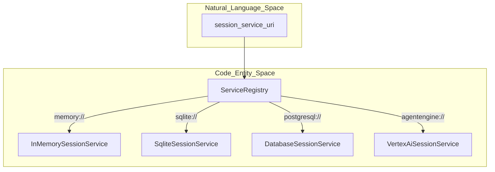
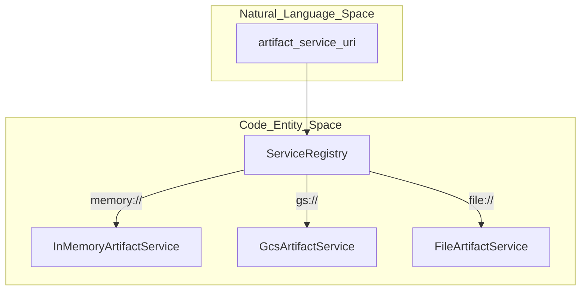
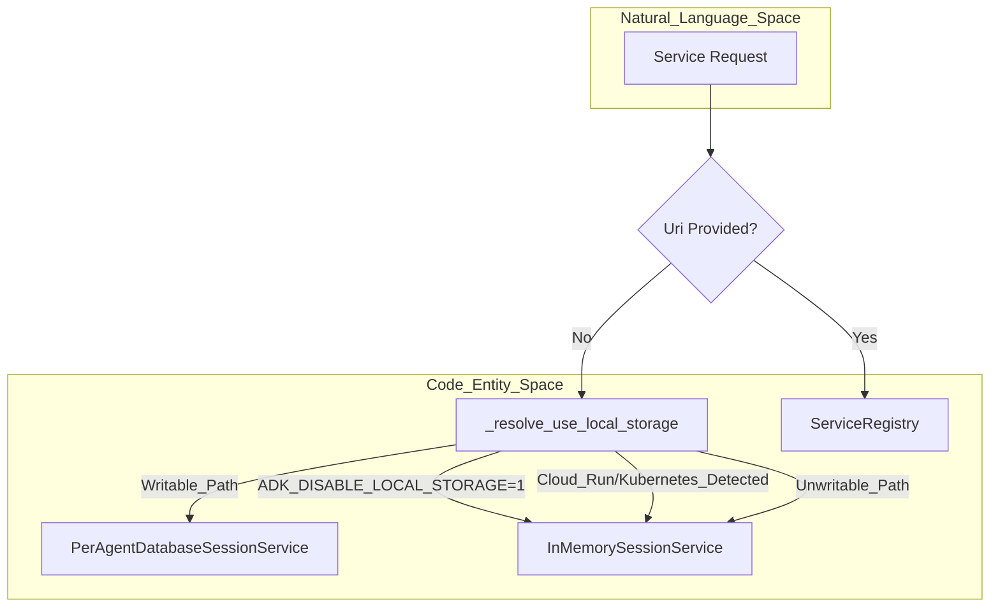

<!-- source: DeepWiki mcp.deepwiki.com · repo google/adk-python · page 9.5 Service URIs and Configuration · fetched 2026-10-29 -->

# Service URIs and Configuration

<details>
<summary>Relevant source files</summary>

The following files were used as context for generating this wiki page:

- [src/google/adk/cli/cli.py](src/google/adk/cli/cli.py)
- [src/google/adk/cli/service_registry.py](src/google/adk/cli/service_registry.py)
- [src/google/adk/cli/utils/dot_adk_folder.py](src/google/adk/cli/utils/dot_adk_folder.py)
- [src/google/adk/cli/utils/envs.py](src/google/adk/cli/utils/envs.py)
- [src/google/adk/cli/utils/local_storage.py](src/google/adk/cli/utils/local_storage.py)
- [src/google/adk/cli/utils/service_factory.py](src/google/adk/cli/utils/service_factory.py)
- [src/google/adk/live/_runner_utils.py](src/google/adk/live/_runner_utils.py)
- [src/google/adk/live/live_request_queue.py](src/google/adk/live/live_request_queue.py)
- [src/google/adk/utils/_gcp_metadata.py](src/google/adk/utils/_gcp_metadata.py)
- [tests/unittests/cli/test_service_registry.py](tests/unittests/cli/test_service_registry.py)
- [tests/unittests/cli/utils/test_cli.py](tests/unittests/cli/utils/test_cli.py)
- [tests/unittests/cli/utils/test_dot_adk_folder.py](tests/unittests/cli/utils/test_dot_adk_folder.py)
- [tests/unittests/cli/utils/test_envs.py](tests/unittests/cli/utils/test_envs.py)
- [tests/unittests/cli/utils/test_local_storage.py](tests/unittests/cli/utils/test_local_storage.py)
- [tests/unittests/cli/utils/test_service_factory.py](tests/unittests/cli/utils/test_service_factory.py)
- [tests/unittests/live/test__runner_utils.py](tests/unittests/live/test__runner_utils.py)
- [tests/unittests/live/test_live_request_queue.py](tests/unittests/live/test_live_request_queue.py)
- [tests/unittests/streaming/test_multi_agent_streaming.py](tests/unittests/streaming/test_multi_agent_streaming.py)
- [tests/unittests/utils/test_gcp_metadata.py](tests/unittests/utils/test_gcp_metadata.py)

</details>


This page documents the technical implementation of ADK's configuration and persistence subsystems. It details how the framework instantiates backend services via Uniform Resource Identifiers (URIs), manages the `ServiceRegistry` and custom extension points (`services.yaml` and `services.py`), resolves local storage using the `.adk` directory structure, and redacts sensitive URI parameters in logs.

Sources: `[src/google/adk/cli/cli.py:48-50]()`, `[src/google/adk/cli/utils/service_factory.py:103-153]()`, `[src/google/adk/cli/service_registry.py:15-62]()`

## Overview and Core Service Map

ADK decouples agent orchestration logic from underlying persistence layers by defining pluggable service interfaces. Services are instantiated dynamically through parsing URI strings or falling back to local storage defaults.

| Service Type | Purpose | Configuration Parameter | Factory Function / Registry Method |
|:-------------|:--------|:------------------------|:-----------------------------------|
| **Session Service** | Stores conversation history, events, and state | `session_service_uri` | `create_session_service_from_options` `[src/google/adk/cli/utils/service_factory.py:179-186]()` |
| **Artifact Service** | Manages file attachments and versioned assets | `artifact_service_uri` | `create_artifact_service_from_options` `[src/google/adk/cli/utils/service_factory.py:207-215]()` |
| **Memory Service** | Handles long-term memory and RAG corpora | `memory_service_uri` | `create_memory_service_from_options` `[src/google/adk/cli/utils/service_factory.py:230-237]()` |

Sources: `[src/google/adk/cli/cli.py:48-50]()`, `[src/google/adk/cli/utils/service_factory.py:179-204]()`, `[src/google/adk/cli/utils/service_factory.py:207-215]()`, `[src/google/adk/cli/utils/service_factory.py:230-237]()`

## Service Registry and Custom Services Extension

The `ServiceRegistry` class manages pluggable backend service factories for sessions, artifacts, and memory `[src/google/adk/cli/service_registry.py:95-178]()`. It defines the `ServiceFactory` protocol for callables matching `(uri: str, **kwargs) -> Service` `[src/google/adk/cli/service_registry.py:86-93]()`.

### Registration Mechanisms

1. **YAML Configuration (`services.yaml` or `services.yml`)**: Allows registering custom schemes declaratively by specifying a `scheme`, `type` (`session`, `memory`, or `artifact`), and the fully qualified Python target `class` `[src/google/adk/cli/service_registry.py:24-38]()`.
2. **Python Registration (`services.py`)**: For programmatic initialization, agents define a `services.py` module invoking `get_service_registry().register_session_service(scheme, factory)` `[src/google/adk/cli/service_registry.py:40-56]()`.

When both files are present, YAML entries load first, followed by `services.py`, which overwrites overlapping schemes `[src/google/adk/cli/service_registry.py:58-61]()`.

Sources: `[src/google/adk/cli/service_registry.py:15-62]()`, `[src/google/adk/cli/service_registry.py:86-178]()`

## Service URIs and Implementation Mapping

### Session Service URIs

Session URIs specify persistence backends. `ServiceRegistry` maps the URI scheme to registered factories, falling back to `DatabaseSessionService` for SQLAlchemy-compatible engines `[src/google/adk/cli/utils/service_factory.py:200-208]()`.

| Scheme | Format | Target Class / Implementation |
|:-------|:-------|:------------------------------|
| `memory://` | `memory://` | `InMemorySessionService` `[src/google/adk/cli/utils/service_factory.py:155-165]()` |
| `sqlite://` | `sqlite://<path>` | `SqliteSessionService` `[src/google/adk/cli/utils/local_storage.py:46-67]()` |
| `postgresql://` | `postgresql://<connection>` | `DatabaseSessionService` `[src/google/adk/cli/utils/service_factory.py:200-208]()` |
| `agentengine://` | `agentengine://<id>` | `VertexAiSessionService` `[src/google/adk/cli/service_registry.py:104-108]()` |

#### Title: Session Service Routing

Sources: `[src/google/adk/cli/service_registry.py:95-143]()`, `[src/google/adk/cli/utils/service_factory.py:170-208]()`, `[src/google/adk/cli/utils/local_storage.py:46-67]()`

### Artifact Service URIs

Artifact URIs control asset and file storage backends.

| Scheme | Format | Target Class / Implementation |
|:-------|:-------|:------------------------------|
| `memory://` | `memory://` | `InMemoryArtifactService` `[src/google/adk/cli/utils/service_factory.py:167-176]()` |
| `gs://` | `gs://<bucket>` | `GcsArtifactService` `[src/google/adk/cli/service_registry.py:122-128]()` |
| `file://` | `file://<path>` | `FileArtifactService` / `PerAgentFileArtifactService` `[src/google/adk/cli/utils/local_storage.py:101-132]()` |

#### Title: Artifact Service Routing

Sources: `[src/google/adk/cli/service_registry.py:95-128]()`, `[src/google/adk/cli/utils/service_factory.py:167-176]()`, `[src/google/adk/cli/utils/local_storage.py:101-132]()`

### Memory Service URIs

Memory URIs configure long-term memory and retrieval corpora.

| Scheme | Format | Target Class / Implementation |
|:-------|:-------|:------------------------------|
| `memory://` | `memory://` | `InMemoryMemoryService` `[src/google/adk/cli/utils/service_factory.py:358-368]()` |
| `rag://` | `rag://<corpus_id>` | `VertexAiRagMemoryService` `[src/google/adk/cli/service_registry.py:165-172]()` |
| `agentengine://` | `agentengine://<id>` | `VertexAiMemoryBankService` `[src/google/adk/cli/service_registry.py:182-186]()` |
| `sqlite://` | `sqlite://<path>` | `SqliteMemoryService` `[src/google/adk/cli/utils/local_storage.py:171-192]()` |

Sources: `[src/google/adk/cli/service_registry.py:158-186]()`, `[src/google/adk/cli/utils/service_factory.py:358-368]()`, `[src/google/adk/cli/utils/local_storage.py:171-192]()`

## Local Storage and Environment Resolution

When explicit service URIs are absent, ADK evaluates `use_local_storage` through `_resolve_use_local_storage` `[src/google/adk/cli/utils/service_factory.py:112-153]()`.

* **Environment Guards**: Local storage is bypassed in Cloud Run (`K_SERVICE`) or Kubernetes (`KUBERNETES_SERVICE_HOST`) environments unless explicitly forced via `ADK_FORCE_LOCAL_STORAGE=1` `[src/google/adk/cli/utils/service_factory.py:36-47]()`, `[src/google/adk/cli/utils/service_factory.py:126-143]()`.
* **Explicit Disable**: Setting `ADK_DISABLE_LOCAL_STORAGE=1` forces fallback to ephemeral in-memory services `[src/google/adk/cli/utils/service_factory.py:36]()`, `[src/google/adk/cli/utils/service_factory.py:118-124]()`.

#### Title: Storage Resolution Logic

Sources: `[src/google/adk/cli/utils/service_factory.py:36-47]()`, `[src/google/adk/cli/utils/service_factory.py:112-153]()`

### The `.adk` Folder Structure

When local storage is active, `DotAdkFolder` and `dot_adk_folder_for_agent` manage per-agent persistence paths under `.adk/` `[src/google/adk/cli/utils/dot_adk_folder.py:36-76]()`.

```
agent_dir/
└── .adk/
    ├── session.db          # SqliteSessionService database file
    └── artifacts/          # FileArtifactService root directory
```

`PerAgentDatabaseSessionService` intercepts routing requests and assigns sessions to the corresponding agent's `.adk/session.db` based on `app_name` `[src/google/adk/cli/utils/local_storage.py:134-169]()`. Administrative agents with names starting with `__` fall back to the root directory `[src/google/adk/cli/utils/local_storage.py:150-153]()`.

Sources: `[src/google/adk/cli/utils/dot_adk_folder.py:36-76]()`, `[src/google/adk/cli/utils/local_storage.py:46-169]()`

## Configuration Redaction

To prevent sensitive credentials and tokens from leaking into runtime logs during service initialization, `_redact_uri_for_log` sanitizes connection strings `[src/google/adk/cli/utils/service_factory.py:49-82]()`.

* **Credential Stripping**: Usernames and passwords preceding the `@` symbol in URIs are removed `[src/google/adk/cli/utils/service_factory.py:67-69]()`.
* **Query Parameter Masking**: All query parameter values are replaced with `<redacted>` `[src/google/adk/cli/utils/service_factory.py:71-79]()`.

Sources: `[src/google/adk/cli/utils/service_factory.py:49-82]()`

---

