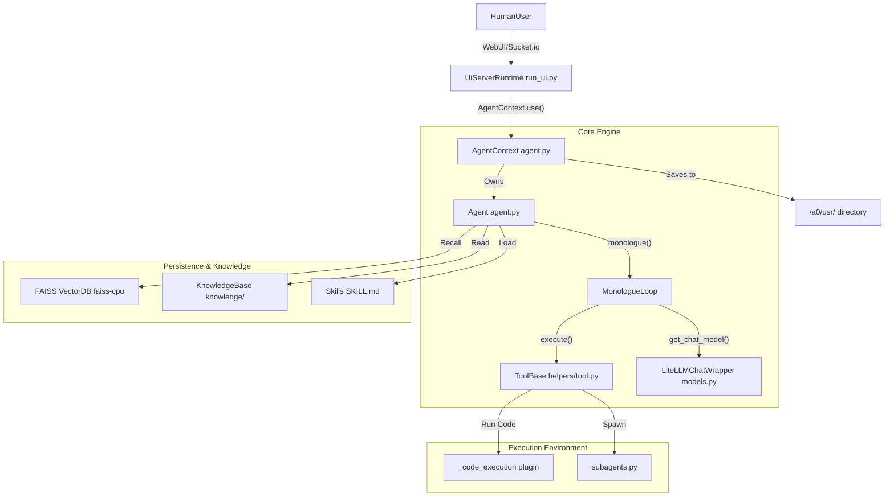
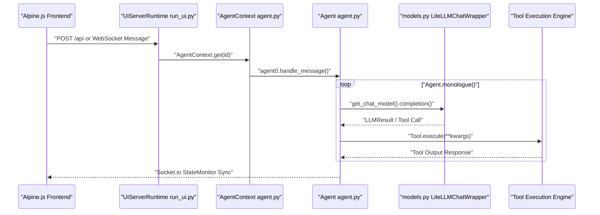

<!-- source: DeepWiki mcp.deepwiki.com · repo agent0ai/agent-zero · page 1 Agent Zero Overview · fetched 2026-10-29 -->

# Agent Zero Overview

Relevant source files

The following files were used as context for generating this wiki page:

- [AGENTS.md](AGENTS.md)
- [README.md](README.md)
- [agent.py](agent.py)
- [docker/run/fs/exe/initialize.sh](docker/run/fs/exe/initialize.sh)
- [docs/README.md](docs/README.md)
- [docs/guides/troubleshooting.md](docs/guides/troubleshooting.md)
- [docs/quickstart.md](docs/quickstart.md)
- [docs/setup/dev-setup.md](docs/setup/dev-setup.md)
- [docs/setup/installation.md](docs/setup/installation.md)
- [initialize.py](initialize.py)
- [models.py](models.py)
- [plugins/_browser/api/status.py](plugins/_browser/api/status.py)
- [plugins/_browser/extensions/python/startup_migration/_20_browser_playwright_cache.py](plugins/_browser/extensions/python/startup_migration/_20_browser_playwright_cache.py)
- [plugins/_browser/helpers/playwright.py](plugins/_browser/helpers/playwright.py)
- [plugins/_browser/hooks.py](plugins/_browser/hooks.py)
- [preload.py](preload.py)
- [requirements.txt](requirements.txt)
- [run_ui.py](run_ui.py)
- [tests/test_docker_initialize_limits.py](tests/test_docker_initialize_limits.py)
- [tests/test_embedding_model_preload.py](tests/test_embedding_model_preload.py)

## Purpose and Scope
Sources: `[README.md:6-9]`, `[run_ui.py:9-38]`

This page serves as a high-level introduction to Agent Zero, outlining its core philosophy, architectural concepts, and the relationship between its major subsystems. It acts as a parent portal, providing concise summaries of fundamental components and linking directly to dedicated child pages for deeper technical coverage.

- For setup procedures, environment variables, and first-run configuration, refer to [Getting Started & Installation](#1.1).
- For foundational architectural ideas like the Monologue loop and `AgentContext`, see [Core Concepts & Terminology](#1.2).
- For initialization workflows and provider selection gates, see [Onboarding & Discovery Experience](#1.3).

---

## Philosophy & Core Principles
Sources: `[README.md:6-40]`, `[agent.py:18-19]`, `[initialize.py:12-17]`

Agent Zero is built upon organic agentic growth and direct interaction with the operating environment rather than relying strictly on constrained, pre-programmed API calls.

1. **Computer as a Tool:** The agent leverages a fully realized Linux environment, local shell terminals, GUI applications, and web browsers to execute real-world tasks `[README.md:6-9]`, `[README.md:32]`, `[README.md:117-125]`.
2. **Superior/Subordinate Hierarchy:** Complex goals are dynamically decomposed by orchestrators and delegated to specialized child instances managed via helper modules `[agent.py:18-19]`, `[README.md:38]`.
3. **Framework vs. Execution Runtime:** Clear separation between the control plane framework (`run_ui.py`) and sandbox execution environments `[run_ui.py:9-22]`.
4. **Universal Canvas:** Shared collaborative surfaces combining browser viewport annotation, interactive markdown editing, and virtual desktop cowork spaces `[README.md:32-34]`, `[README.md:117-125]`.

---

## System Architecture & Code Entity Space
Sources: `[agent.py:56-111]`, `[run_ui.py:9-49]`, `[initialize.py:1-68]`, `[models.py:142-164]`

Agent Zero bridges high-level natural language user inputs to concrete Python classes, API handlers, and execution routines.

### Subsystem Component Mapping

Sources: `[agent.py:56-111]`, `[run_ui.py:9-49]`, `[initialize.py:1-68]`

### Request Execution Flow

Sources: `[run_ui.py:9-49]`, `[agent.py:56-111]`, `[models.py:142-164]`

---

## Key Subsystems & Child Pages
Sources: `[README.md:44-93]`, `[agent.py:56-111]`, `[initialize.py:12-17]`, `[run_ui.py:76-96]`

Detailed technical specifications are divided across dedicated child pages:

### 1.1 Getting Started & Installation
Covers installation pathways including Docker containers, native scripts, and hybrid RFC development modes. Discusses environment variables in `.env` and first-run server configuration.
- For setup instructions, see [Getting Started & Installation](#1.1).
Sources: `[README.md:44-93]`, `[docs/setup/installation.md:20-75]`

### 1.2 Core Concepts & Terminology
Explores foundational paradigms such as the Computer-as-a-Tool philosophy, Superior/Subordinate agent hierarchies, `AgentContext` state isolation, the Monologue loop execution cycle, and the distinction between Framework and Execution Runtimes.
- For deep dives, see [Core Concepts & Terminology](#1.2).
Sources: `[agent.py:56-111]`, `[agent.py:50-54]`

### 1.3 Onboarding & Discovery Experience
Examines initialization plugins (`_onboarding`, `_discovery`), model setup gates, provider selection flows, discovery cards, notification banners, and welcome screen hand-offs.
- For configuration walkthroughs, see [Onboarding & Discovery Experience](#1.3).
Sources: `[run_ui.py:76-96]`, `[initialize.py:6-47]`

---

