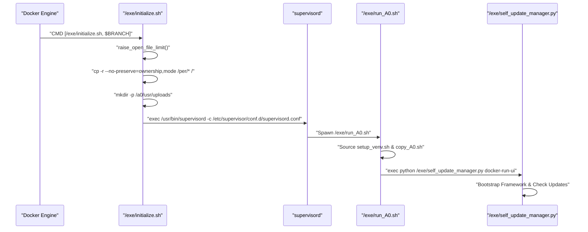

<!-- source: DeepWiki mcp.deepwiki.com · repo agent0ai/agent-zero · page 1.1 Getting Started & Installation · fetched 2026-10-29 -->

# Getting Started & Installation

<details>
<summary>Relevant source files</summary>

The following files were used as context for generating this wiki page:

- [LICENSE](LICENSE)
- [README.md](README.md)
- [docker/base/build.txt](docker/base/build.txt)
- [docker/run/Dockerfile](docker/run/Dockerfile)
- [docker/run/build.txt](docker/run/build.txt)
- [docker/run/docker-compose.yml](docker/run/docker-compose.yml)
- [docker/run/fs/exe/initialize.sh](docker/run/fs/exe/initialize.sh)
- [docker/run/fs/exe/run_A0.sh](docker/run/fs/exe/run_A0.sh)
- [docker/run/fs/ins/install_A0.sh](docker/run/fs/ins/install_A0.sh)
- [docker/run/fs/ins/install_A02.sh](docker/run/fs/ins/install_A02.sh)
- [docs/README.md](docs/README.md)
- [docs/guides/troubleshooting.md](docs/guides/troubleshooting.md)
- [docs/quickstart.md](docs/quickstart.md)
- [docs/setup/dev-setup.md](docs/setup/dev-setup.md)
- [docs/setup/installation.md](docs/setup/installation.md)
- [plugins/_browser/api/status.py](plugins/_browser/api/status.py)
- [plugins/_browser/extensions/python/startup_migration/_20_browser_playwright_cache.py](plugins/_browser/extensions/python/startup_migration/_20_browser_playwright_cache.py)
- [plugins/_browser/helpers/playwright.py](plugins/_browser/helpers/playwright.py)
- [plugins/_browser/hooks.py](plugins/_browser/hooks.py)
- [tests/test_docker_initialize_limits.py](tests/test_docker_initialize_limits.py)

</details>


## Purpose & Scope

This page provides a comprehensive technical guide for setting up the Agent Zero environment. It covers primary Docker-based deployment, automated installer scripts, build internals, container initialization mechanics (`docker/run/fs/exe/initialize.sh`), environment configuration, and the hybrid development mode utilizing the A0 CLI connector for host-machine integration.

Sources: [README.md:41-95](), [docs/setup/installation.md:7-75](), [docs/quickstart.md:8-26]()

---

## Installation Paths & Quick Start

Agent Zero is designed to run within an isolated containerized environment while interacting with the host system via specific bridges. Depending on your operational environment, several installation pathways are supported:

| Path | Target Audience | Command / Reference |
| :--- | :--- | :--- |
| **A0 Launcher** | Desktop users (macOS, Windows, Linux) | [A0 Launcher Releases](https://github.com/agent0ai/a0-launcher/releases/tag/v1.9) [README.md:51-54]() |
| **A0 Install (Unix)** | Headless servers, SSH sessions, scripts | `curl -fsSL https://bash.agent-zero.ai \| bash` [README.md:66-66]() |
| **A0 Install (Windows)** | Windows PowerShell environments | `irm https://ps.agent-zero.ai | iex` [README.md:72-72]() |
| **Docker Direct** | Manual deployment / CLI control | `docker run -p 80:80 -v a0_usr:/a0/usr agent0ai/agent-zero` [README.md:92-92]() |

For automated infrastructure deployments, the install script accepts a Quick Start flag to provision a single instance without interactive prompts [README.md:77-85](), [docs/setup/installation.md:58-64]().

Sources: [README.md:41-95](), [docs/setup/installation.md:7-75](), [docs/quickstart.md:8-26]()

---

## Docker Deployment Architecture

The Docker container acts as both the **Framework Runtime** (hosting the Flask and Socket.io servers) and the **Execution Runtime** (where the agent executes code, manages tools, and invokes shell commands). 

### Container Initialization Flow
When the container initializes, the entrypoint triggers `docker/run/fs/exe/initialize.sh`, which invokes `raise_open_file_limit()` to adjust descriptor limits, configures persistent mount directories, and hands process management over to `supervisord` [docker/run/fs/exe/initialize.sh:1-68]().

Title: "Container Startup Sequence and Process Hand-off"

Sources: [docker/run/fs/exe/initialize.sh:1-68](), [docker/run/fs/exe/run_A0.sh:1-7](), [docker/run/Dockerfile:33-36]()

### Persistence and Volume Structure
To persist settings, project workspaces, memory stores, and chat logs across container rebuilds, the `/a0/usr` path must be mapped to a host-side volume or directory.

*   **Docker Compose Configuration**: Mapped via `docker-compose.yml` under services [docker/run/docker-compose.yml:5-6]().
*   **Key Subdirectories under `/a0/usr/`**:
    *   `/a0/usr/chats/`: Serialized conversation histories in JSON format [docs/quickstart.md:102-102]().
    *   `/a0/usr/uploads/`: Temporary and persistent file storage for Web UI uploads [docker/run/fs/exe/initialize.sh:58-60]().
    *   `/a0/usr/secrets.env`: Environment secrets and masked API credentials [docs/guides/troubleshooting.md:53-54]().

Sources: [docker/run/fs/exe/initialize.sh:1-68](), [docker/run/fs/exe/run_A0.sh:1-7](), [docker/run/docker-compose.yml:1-14]()

---

## Build Mechanics & Package Provisioning

For advanced deployments or custom source modifications, images can be built locally using the provided Docker configurations.

### Build Lifecycle Scripts
The build process coordinates several shell scripts to provision dependencies and initialize embedding caches:
*   **`install_A0.sh`**: Clones the specified repository branch, sets up the virtual environment, installs Python requirements via `uv`, configures Playwright binaries, and runs `preload.py` to cache embedding models [docker/run/fs/ins/install_A0.sh:1-44]().

Title: "Build and Preload Dataflow"
```mermaid
graph TD
    subgraph "Build_Stage" ["Docker Build Execution"]
        "dockerfile"["Dockerfile"] -->|"RUN install_A0.sh"| "install_script"["/ins/install_A0.sh"]
        "install_script" -->|"uv pip install"| "requirements"["requirements.txt"]
        "install_script" -->|"install_playwright.sh"| "playwright"["Playwright Binaries"]
        "install_script" -->|"preload.py"| "preload_script"["preload.py"]
    end

    subgraph "Preload_Runtime" ["Model Preloading & Caching"]
        "preload_script" -->|"dockerized=true"| "runtime_init"["Initialization Runtime"]
    end
```
Sources: [docker/run/Dockerfile:1-36](), [docker/run/fs/ins/install_A0.sh:1-44]()

---

## Hybrid Development & Host Connectivity

Agent Zero runs securely inside an isolated container, but the optional **A0 CLI Connector** enables the agent to operate directly on host-machine files and development tools.

Title: "Host Connectivity and A0 CLI Bridge Architecture"
```mermaid
graph TD
    subgraph "Host_Machine" ["Host Machine (User Space)"]
        "a0_cli"["a0 (CLI Connector Client)"]
        "local_files"["Local Project Files & Repos"]
        "host_browser"["Host Browser (Chrome/Edge)"]
    end

    subgraph "Docker_Container" ["Docker Execution Environment"]
        "connector_plugin"["_a0_connector Plugin (WsHandler)"]
        "ws_runtime"["ws_runtime.py (Remote Execution)"]
        "browser_runtime"["ConnectorBrowserRuntime"]
    end

    "a0_cli" <-->| "WebSocket Protocol (a0-connector.v1)" | "connector_plugin"
    "a0_cli" <-->| "Read/Write Operations" | "local_files"
    "a0_cli" <-->| "CDP / Screencast Stream" | "host_browser"
    "connector_plugin" --> "ws_runtime"
    "connector_plugin" --> "browser_runtime"
```
Sources: [docs/quickstart.md:34-60](), [README.md:37-37](), [docs/setup/installation.md:82-82]()

---

## Environment Configuration & First-Run Setup

### Key Environment Variables

| Variable | Default | Description |
| :--- | :--- | :--- |
| `A0_NOFILE_LIMIT` | `65535` | Sets the open file soft descriptor limit during initialization [docker/run/fs/exe/initialize.sh:13-13](). |
| `BRANCH` | `main` | Determines the git branch to clone during container build [docker/run/Dockerfile:7-9](). |
| `CACHE_DATE` | `none` | Cache buster argument forcing invalidation in `install_A02.sh` [docker/run/Dockerfile:24-25](). |

Sources: [docker/run/fs/exe/initialize.sh:12-47](), [docker/run/Dockerfile:7-25]()

### First-Run Configuration Workflow
Upon launching the Web UI for the first time (`http://localhost:<PORT>`), the application invokes the onboarding wizard:
1.  **Provider & API Key Selection**: Configured via the Web UI settings or stored in `/a0/usr/secrets.env` [docs/quickstart.md:62-67]().
2.  **Model Profile Assignment**: Assigns the primary chat model and the fast utility model used for background inference [docs/quickstart.md:66-67]().
3.  **Local Model Binding**: Optional configuration to link local inference engines such as Ollama or LM Studio via local HTTP endpoints [docs/setup/installation.md:88-89]().

Sources: [docs/quickstart.md:62-72](), [docs/setup/installation.md:88-89]()

---

