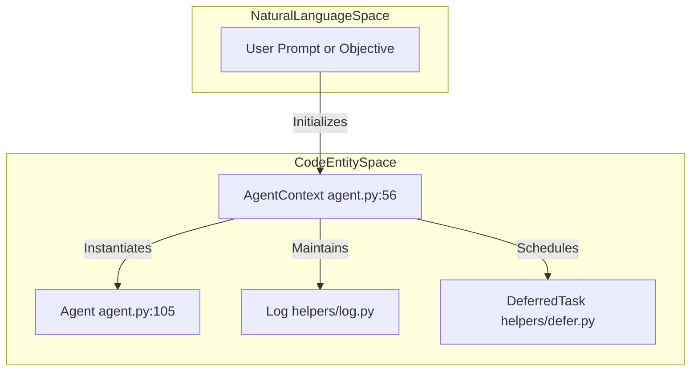
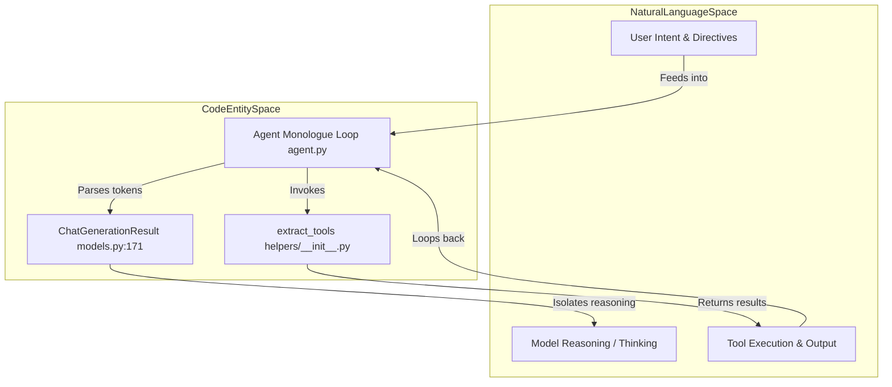
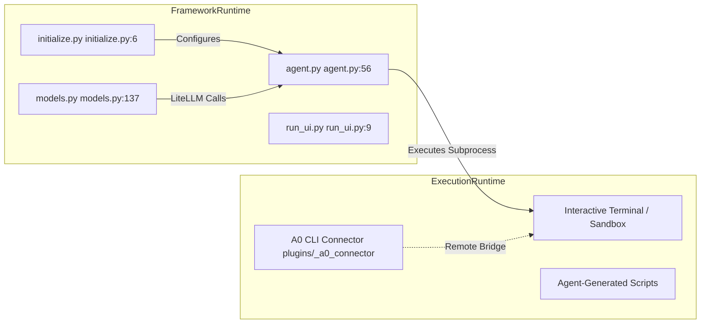

<!-- source: DeepWiki mcp.deepwiki.com · repo agent0ai/agent-zero · page 1.2 Core Concepts & Terminology · fetched 2026-10-29 -->

# Core Concepts & Terminology

Relevant source files

The following files were used as context for generating this wiki page:

- [AGENTS.md](AGENTS.md)
- [agent.py](agent.py)
- [docs/developer/architecture.md](docs/developer/architecture.md)
- [docs/developer/extensions.md](docs/developer/extensions.md)
- [docs/developer/notifications.md](docs/developer/notifications.md)
- [docs/guides/agent-profiles.md](docs/guides/agent-profiles.md)
- [docs/guides/projects.md](docs/guides/projects.md)
- [docs/guides/usage.md](docs/guides/usage.md)
- [initialize.py](initialize.py)
- [models.py](models.py)
- [plugins/_a0_connector/api/v1/agent_profile_set.py](plugins/_a0_connector/api/v1/agent_profile_set.py)
- [preload.py](preload.py)
- [requirements.txt](requirements.txt)
- [run_ui.py](run_ui.py)
- [tests/test_embedding_model_preload.py](tests/test_embedding_model_preload.py)

## Purpose and Scope

This page defines the foundational architectural ideas and core terminology behind Agent Zero. It covers the "Computer as a Tool" philosophy, the superior/subordinate execution hierarchy, `AgentContext` state management, the iterative monologue loop, and the critical security separation between the Framework Runtime and the Execution Runtime.

Sources: [agent.py:50-111](), [models.py:137-160](), [initialize.py:6-68]()

## Computer as a Tool Philosophy

Unlike traditional agent frameworks that rely on a fixed, hard-coded library of specialized functions, Agent Zero is built on the principle that the **operating system itself is the primary tool**.

*   **Dynamic Tool Creation:** The agent is not limited to static APIs; it uses general-purpose code execution (`agent.py`) to write, debug, and execute Python scripts or shell commands dynamically [agent.py:10-20]().
*   **Minimal Defaults:** The core initialization (`initialize.py`) provides essential bootstrap capabilities like online search, vector memory access, and terminal execution, expecting the agent to expand its capabilities organically [initialize.py:13-17]().
*   **Organic Growth:** Successful execution patterns are saved as reusable "Skills" or custom scripts, allowing the system to acquire new behaviors over time [models.py:137-160]().
*   **Universal Canvas:** The framework provides interactive visual surfaces (such as the virtual desktop, browser, and document editors) directly accessible to the agent runtime [models.py:137-160]().

Sources: [agent.py:10-20](), [initialize.py:13-17](), [models.py:137-160]()

## Superior/Subordinate Hierarchy

Agent Zero utilizes a recursive organizational structure to manage complex, multi-step operations cleanly.

*   **The Chain of Command:** Every `Agent` instance has a designated **Superior** (who issues directives) and can spawn **Subordinates** to handle isolated subtasks via helper utilities [agent.py:18-19]().
*   **Agent 0 (`agent0`):** The root agent instantiated within an `AgentContext`, whose ultimate superior is the human user [agent.py:105-111]().
*   **Context Isolation:** Delegating subtasks to child agents prevents the parent's context window and message history from being cluttered with low-level debugging output or intermediate tool logs [agent.py:18-19]().

| Entity | Role | Code Implementation |
| :--- | :--- | :--- |
| **Superior** | Provides tasks and guidance | Human User or parent `Agent` instance |
| **Agent** | Executes the monologue loop and tool calls | `class Agent` in [agent.py:105-111]() |
| **Subordinate** | Handles delegated subtasks in isolation | Spawned via [agent.py:18-19]() (`helpers.subagents`) |

Sources: [agent.py:18-19](), [agent.py:105-111]()

## AgentContext and State Management

The `AgentContext` class (`agent.py`) acts as the central state container for an active conversation, managing the primary agent (`agent0`), persistent logs, background deferred tasks, and metadata [agent.py:56-111]().

*   **Identity & Types:** Each context has a unique 8-character string ID generated via `AgentContext.generate_id()` and an `AgentContextType` (`USER`, `TASK`, or `BACKGROUND`) [agent.py:50-81]().
*   **Thread-Safe Tracking:** Active contexts are maintained in a thread-safe global registry (`_contexts`), supporting session resumption and concurrent execution [agent.py:56-92]().

### Diagram: Context Entity Mapping

Sources: [agent.py:56-111](), [helpers/defer.py]()

## The Monologue Loop

The core thinking engine of an agent is the **Monologue Loop**, an iterative cycle where the agent observes state, reasons through model generations, and invokes tools.

1.  **Observation:** Incoming messages, tool responses, and system constraints are compiled into the prompt structure.
2.  **Reasoning:** The LLM generates internal monologue and thoughts. The framework supports native reasoning/thinking tags (e.g., `<think>`) parsed via `ChatGenerationResult` [models.py:171-195]().
3.  **Action:** The agent executes tools via structured function calls or tool parsers [agent.py:10-20]().
4.  **Feedback & Iteration:** Tool outputs are fed back into history until the termination condition is met.

### Diagram: Monologue Loop Mapping

Sources: [agent.py:10-20](), [models.py:171-195]()

## Runtime Distinction: Framework vs. Execution Runtime

A critical security and architectural separation exists between the environment hosting Agent Zero and the environment where code executes.

### Framework Runtime
*   **Purpose:** Runs the Flask/ASGI server (`run_ui.py`), LLM client orchestration (`models.py`), WebSocket handlers, and background job loops.
*   **Initialization:** Managed by `initialize.py` and configured via `requirements.txt` [initialize.py:6-68](), [requirements.txt:1-60]().

### Execution Runtime
*   **Purpose:** The sandboxed shell or container environment where agent-generated code, shell scripts, and package installations (`pip install`) run.
*   **Isolation:** Ensures that destructive operations or dependency conflicts triggered by the agent's code execution do not compromise the core framework runtime.

### Diagram: Runtime Separation

Sources: [initialize.py:6-68](), [agent.py:56-111](), [models.py:137-160](), [run_ui.py:9-52](), [requirements.txt:1-60]()

## Key Terminology Summary

| Term | Definition | Source |
| :--- | :--- | :--- |
| **Agent Profile** | Configuration profile determining system prompts and default behaviors. | [initialize.py:13-17]() |
| **Intervention** | Manual user pause or redirection mechanism via `InterventionException`. | [agent.py:35-35]() |
| **Knowledge Base** | Document collection indexed for agent retrieval. | [initialize.py:15-15]() |
| **LiteLLM** | Unified LLM abstraction and transport wrapper layer. | [models.py:21-32]() |
| **MCP** | Model Context Protocol integration for external tools/data. | [initialize.py:57-62]() |
| **DeferredTask** | Asynchronous background task execution wrapper. | [agent.py:31-31](), [agent.py:102-102]() |

Sources: [initialize.py:13-62](), [agent.py:31-102](), [models.py:21-32]()

---

