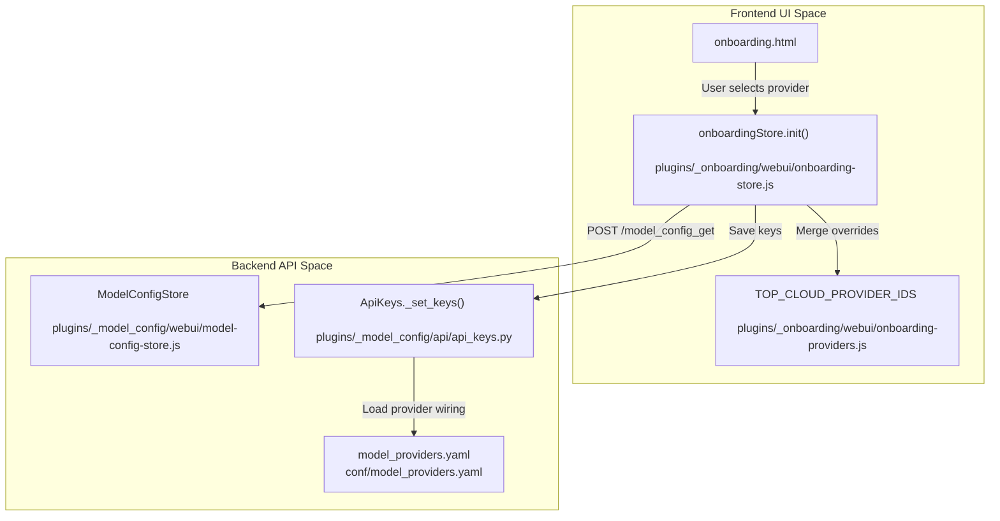
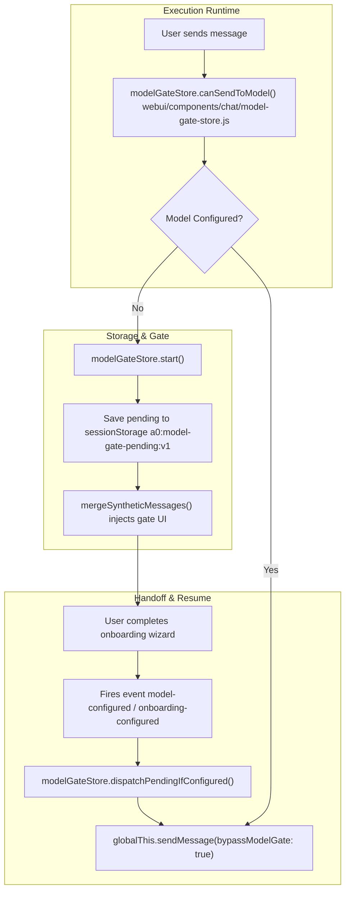
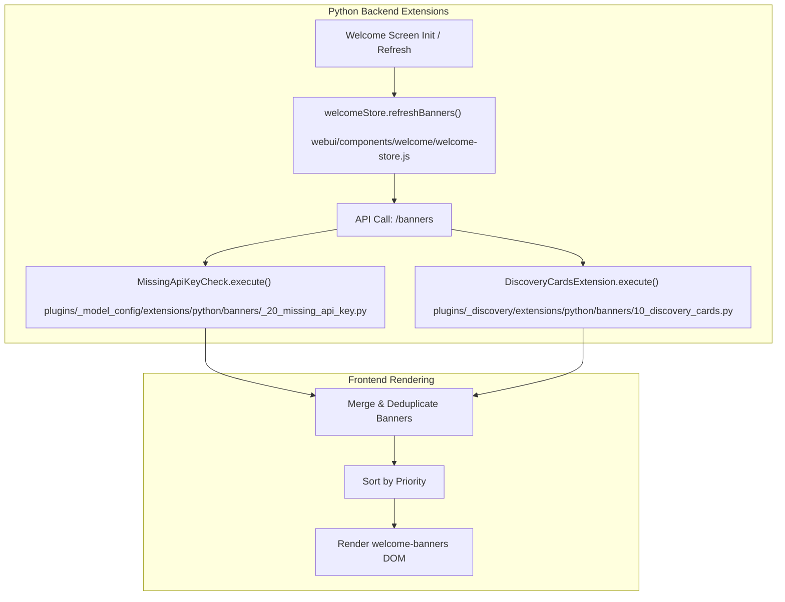

<!-- source: DeepWiki mcp.deepwiki.com · repo agent0ai/agent-zero · page 1.3 Onboarding & Discovery Experience · fetched 2026-10-29 -->

# Onboarding & Discovery Experience

<details>
<summary>Relevant source files</summary>

The following files were used as context for generating this wiki page:

- [conf/AGENTS.md](conf/AGENTS.md)
- [conf/model_providers.yaml](conf/model_providers.yaml)
- [plugins/_discovery/extensions/python/banners/10_discovery_cards.py](plugins/_discovery/extensions/python/banners/10_discovery_cards.py)
- [plugins/_discovery/extensions/webui/onboarding-success-end/discovery-cards.html](plugins/_discovery/extensions/webui/onboarding-success-end/discovery-cards.html)
- [plugins/_discovery/extensions/webui/welcome-actions-end/discovery-cards.html](plugins/_discovery/extensions/webui/welcome-actions-end/discovery-cards.html)
- [plugins/_discovery/webui/assets/cli-connector-preview.png](plugins/_discovery/webui/assets/cli-connector-preview.png)
- [plugins/_discovery/webui/assets/hero-openai-oauth.png](plugins/_discovery/webui/assets/hero-openai-oauth.png)
- [plugins/_discovery/webui/discovery-store.js](plugins/_discovery/webui/discovery-store.js)
- [plugins/_model_config/api/model_search.py](plugins/_model_config/api/model_search.py)
- [plugins/_model_config/default_config.yaml](plugins/_model_config/default_config.yaml)
- [plugins/_model_config/extensions/python/banners/_20_missing_api_key.py](plugins/_model_config/extensions/python/banners/_20_missing_api_key.py)
- [plugins/_model_config/provider_metadata.yaml](plugins/_model_config/provider_metadata.yaml)
- [plugins/_onboarding/webui/onboarding-providers.js](plugins/_onboarding/webui/onboarding-providers.js)
- [plugins/_onboarding/webui/onboarding-store.js](plugins/_onboarding/webui/onboarding-store.js)
- [plugins/_onboarding/webui/onboarding.html](plugins/_onboarding/webui/onboarding.html)
- [tests/test_litellm_sdk.py](tests/test_litellm_sdk.py)
- [tests/test_model_config_api_keys.py](tests/test_model_config_api_keys.py)
- [tests/test_model_search.py](tests/test_model_search.py)
- [tests/test_onboarding_static.py](tests/test_onboarding_static.py)
- [webui/components/chat/model-gate-store.js](webui/components/chat/model-gate-store.js)
- [webui/components/chat/model-setup-gate.html](webui/components/chat/model-setup-gate.html)

</details>


## Purpose and Scope
This page details the technical implementation of the `_onboarding` and `_discovery` plugins, covering the first-run provider wizard (`plugins/_onboarding/webui/onboarding-store.js`), unified provider selection modes, model setup gates (`webui/components/chat/model-gate-store.js`), backend model search routing (`plugins/_model_config/api/model_search.py`), banner generation extensions (`plugins/_discovery/extensions/python/banners/10_discovery_cards.py` and `plugins/_model_config/extensions/python/banners/_20_missing_api_key.py`), and the welcome screen hand-off.

---

## 1. Onboarding Plugin & First-Run Wizard (`_onboarding`)

The onboarding subsystem guides unconfigured instances through selecting a primary LLM provider, providing API keys or account links, configuring utility models, and validating setup readiness.

The wizard state is driven by the Alpine.js store defined in `plugins/_onboarding/webui/onboarding-store.js` [plugins/_onboarding/webui/onboarding-store.js:80-155] and rendered via `plugins/_onboarding/webui/onboarding.html` [plugins/_onboarding/webui/onboarding.html:1-178]. The multi-step wizard progresses through four sequential steps: `connect`, `setup`, `utility`, and `ready` [plugins/_onboarding/webui/onboarding-store.js:81,109-114].

Providers are categorized into cloud APIs, account-backed connections, and local runtimes using provider ID arrays and metadata overrides defined in `plugins/_onboarding/webui/onboarding-providers.js`:
- **Top Cloud Providers**: `TOP_CLOUD_PROVIDER_IDS` (`openrouter`, `a0_venice`, `openai`, `anthropic`, `google`, `deepseek`, etc.) [plugins/_onboarding/webui/onboarding-providers.js:1-13].
- **More Cloud Providers**: `MORE_CLOUD_PROVIDER_IDS` (`ollama_cloud`, `bedrock`, `groq`, `cerebras`, `xai`, `moonshot`, etc.) [plugins/_onboarding/webui/onboarding-providers.js:15-28].
- **Local Providers**: `LOCAL_PROVIDER_IDS` (`ollama`, `lm_studio`, `omlx`, `llama_cpp`, `vllm`, `other`) [plugins/_onboarding/webui/onboarding-providers.js:30].

Provider-specific configurations, logos, setup URLs, documentation links, and default model strings are merged via `ONBOARDING_PROVIDER_OVERRIDES` [plugins/_onboarding/webui/onboarding-providers.js:32] and server-side definitions in `conf/model_providers.yaml` [conf/model_providers.yaml:28-227].

### Onboarding Provider & Configuration Flow


*Sources:* `plugins/_onboarding/webui/onboarding-store.js` [plugins/_onboarding/webui/onboarding-store.js:80-177], `plugins/_onboarding/webui/onboarding-providers.js` [plugins/_onboarding/webui/onboarding-providers.js:1-40], `conf/model_providers.yaml` [conf/model_providers.yaml:28-40].

Sources: `plugins/_onboarding/webui/onboarding.html` [plugins/_onboarding/webui/onboarding.html:1-178], `plugins/_onboarding/webui/onboarding-store.js` [plugins/_onboarding/webui/onboarding-store.js:80-155], `plugins/_onboarding/webui/onboarding-providers.js` [plugins/_onboarding/webui/onboarding-providers.js:1-40].

---

## 2. Model Setup Gate & Deferred Message Dispatch

When a user attempts to send a message without a configured model or valid API key, the chat interface intercepts the action via the model setup gate managed by `modelGateStore` in `webui/components/chat/model-gate-store.js` and rendered via `webui/components/chat/model-setup-gate.html`.

Instead of blocking the UI with static error modals, missing model setup is deferred. The pending message and its attachments are cached in `sessionStorage` under `a0:model-gate-pending:v1`, and synthetic log entries are injected into the active message list (`syntheticMessages()` and `mergeSyntheticMessages()`) [tests/test_model_config_api_keys.py:86-103]. Once the onboarding wizard or preset configuration fires configuration events, `dispatchPendingIfConfigured()` automatically resumes and dispatches the payload via `globalThis.sendMessage()`.

### Model Setup Gate Execution & Deferred Dispatch Flow


*Sources:* `tests/test_model_config_api_keys.py` [tests/test_model_config_api_keys.py:86-103].

Sources: `tests/test_model_config_api_keys.py` [tests/test_model_config_api_keys.py:86-103].

---

## 3. Model Search & Endpoint Resolution (`ModelSearch`)

The model configuration plugin provides backend model discovery via the `ModelSearch` class located in `plugins/_model_config/api/model_search.py`. This handler resolves provider endpoint URLs, constructs authentication headers, and queries upstream model listing APIs.

```python
# Core request handling and fallback in ModelSearch
# plugins/_model_config/api/model_search.py:37-70
```

`ModelSearch` performs the following validation and fetching steps:
1. **Config & URL Resolution**: Resolves provider configuration via `get_provider_config` [plugins/_model_config/api/model_search.py:74] and determines endpoint URLs using `_resolve_url()` [plugins/_model_config/api/model_search.py:142].
2. **Authentication Injection**: Attaches provider-specific API keys retrieved via `models.get_api_key(provider)` [plugins/_model_config/api/model_search.py:95], supporting custom query parameters (e.g., Google API keys) [plugins/_model_config/api/model_search.py:114] and headers (e.g., Anthropic `x-api-key`) [plugins/_model_config/api/model_search.py:181].
3. **Filtering**: Excludes non-chat models (such as text-to-speech, embeddings, and image generation) using `_NON_CHAT_EXCLUDE` [plugins/_model_config/api/model_search.py:11].
4. **LiteLLM Fallback**: If upstream provider endpoints fail or return empty lists, `ModelSearch` falls back to LiteLLM's internal registry (`_litellm_fallback`) [plugins/_model_config/api/model_search.py:53].

Sources: `plugins/_model_config/api/model_search.py` [plugins/_model_config/api/model_search.py:1-296], `conf/model_providers.yaml` [conf/model_providers.yaml:1-227].

---

## 4. Discovery Cards & Banner Subsystem (`_discovery` & `_model_config`)

Agent Zero features an extensible banner notification and discovery card system powered by Python extension classes and rendered on the welcome screen and onboarding success surfaces.

### Banner Aggregation & Ingestion Pipeline


*Sources:* `webui/components/welcome/welcome-store.js` [webui/components/welcome/welcome-store.js:56-141], `plugins/_discovery/extensions/python/banners/10_discovery_cards.py` [plugins/_discovery/extensions/python/banners/10_discovery_cards.py:58-153], `plugins/_model_config/extensions/python/banners/_20_missing_api_key.py` [plugins/_model_config/extensions/python/banners/_20_missing_api_key.py:11-28].

Key components of the discovery and banner subsystem:
- **Missing API Key Check**: `MissingApiKeyCheck` (`plugins/_model_config/extensions/python/banners/_20_missing_api_key.py`) evaluates effective missing model providers and injects the `missing-api-key` warning banner with a direct Call-to-Action (CTA) launching the onboarding modal (`open-modal:/plugins/_onboarding/webui/onboarding.html`) [plugins/_model_config/extensions/python/banners/_20_missing_api_key.py:5-28].
- **Discovery Cards Extension**: `DiscoveryCardsExtension` (`plugins/_discovery/extensions/python/banners/10_discovery_cards.py`) inspects configuration states for integrations (`_telegram_integration`, `_email_integration`, `_whatsapp_integration`) and OAuth account summaries (`_oauth`), injecting feature cards, plugin hub banners, and OAuth account cards with usage windows into the banner list [plugins/_discovery/extensions/python/banners/10_discovery_cards.py:58-153].

Sources: `plugins/_discovery/extensions/python/banners/10_discovery_cards.py` [plugins/_discovery/extensions/python/banners/10_discovery_cards.py:1-155], `plugins/_model_config/extensions/python/banners/_20_missing_api_key.py` [plugins/_model_config/extensions/python/banners/_20_missing_api_key.py:1-28].

---

## 5. Welcome Screen Hand-off & Session Initialization

When Agent Zero loads with no active chat selected (`chatsStore.selected` is null), the application displays the welcome screen defined in `webui/components/welcome/welcome-screen.html` and managed by `welcomeStore` (`webui/components/welcome/welcome-store.js`).

The hand-off from the welcome screen to an active chat session occurs when a user submits input into the welcome composer or triggers a quick action card. This instantiates a new chat session via `chatsStore`, transitioning `welcomeStore.isVisible` to `false` and mounting the chat interface.

Sources: `webui/components/welcome/welcome-store.js` [webui/components/welcome/welcome-store.js:1-286], `plugins/_discovery/extensions/python/banners/10_discovery_cards.py` [plugins/_discovery/extensions/python/banners/10_discovery_cards.py:1-155].

---

