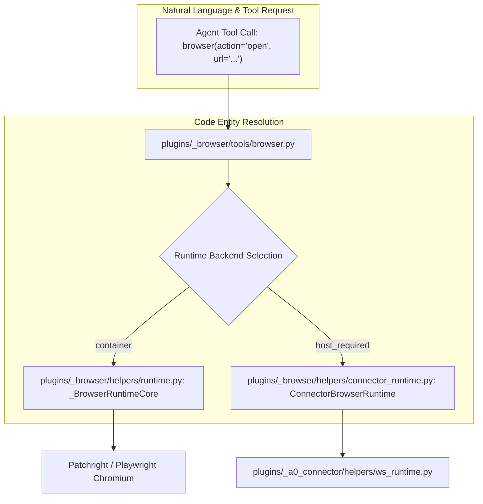
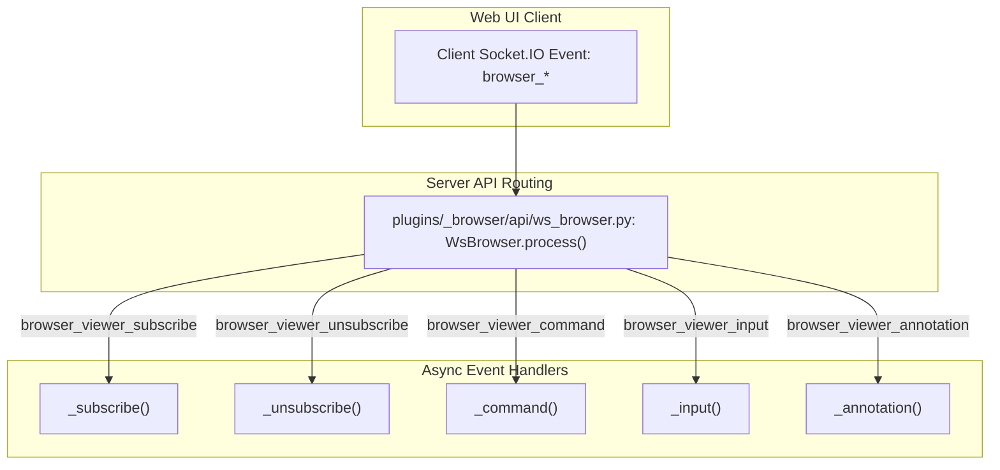
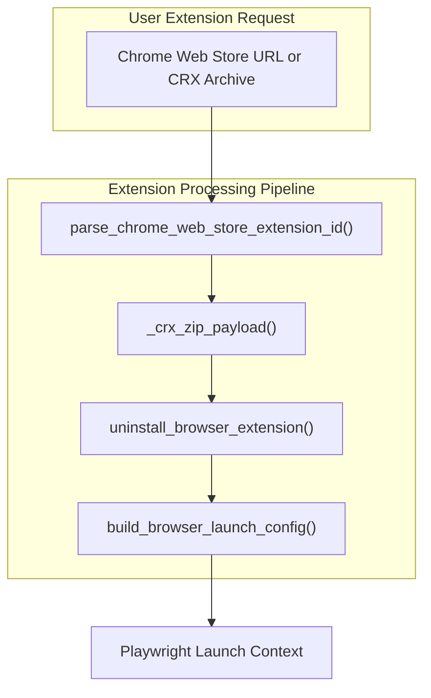

<!-- source: DeepWiki mcp.deepwiki.com · repo agent0ai/agent-zero · page 10.1 Browser Runtime & WebSocket API · fetched 2026-10-29 -->

# Browser Runtime & WebSocket API

Relevant source files

The following files were used as context for generating this wiki page:

- [docs/guides/a0-cli-connector.md](docs/guides/a0-cli-connector.md)
- [docs/guides/browser.md](docs/guides/browser.md)
- [plugins/_browser/AGENTS.md](plugins/_browser/AGENTS.md)
- [plugins/_browser/api/extensions.py](plugins/_browser/api/extensions.py)
- [plugins/_browser/api/ws_browser.py](plugins/_browser/api/ws_browser.py)
- [plugins/_browser/default_config.yaml](plugins/_browser/default_config.yaml)
- [plugins/_browser/helpers/config.py](plugins/_browser/helpers/config.py)
- [plugins/_browser/helpers/connector_runtime.py](plugins/_browser/helpers/connector_runtime.py)
- [plugins/_browser/helpers/extension_manager.py](plugins/_browser/helpers/extension_manager.py)
- [plugins/_browser/helpers/runtime.py](plugins/_browser/helpers/runtime.py)
- [plugins/_browser/helpers/selector.py](plugins/_browser/helpers/selector.py)
- [plugins/_browser/prompts/agent.system.tool.browser.md](plugins/_browser/prompts/agent.system.tool.browser.md)
- [plugins/_browser/skills/browser-automation/SKILL.md](plugins/_browser/skills/browser-automation/SKILL.md)
- [plugins/_browser/skills/browser-form-workflows/SKILL.md](plugins/_browser/skills/browser-form-workflows/SKILL.md)
- [plugins/_browser/tools/browser.py](plugins/_browser/tools/browser.py)
- [plugins/_browser/webui/browser-config-store.js](plugins/_browser/webui/browser-config-store.js)
- [plugins/_browser/webui/browser-panel.html](plugins/_browser/webui/browser-panel.html)
- [plugins/_browser/webui/browser-store.js](plugins/_browser/webui/browser-store.js)
- [plugins/_browser/webui/config.html](plugins/_browser/webui/config.html)
- [plugins/_browser/webui/main.html](plugins/_browser/webui/main.html)
- [tests/test_browser_agent_regressions.py](tests/test_browser_agent_regressions.py)
- [tests/test_browser_tool_output.py](tests/test_browser_tool_output.py)
- [tests/test_host_browser_connector.py](tests/test_host_browser_connector.py)

This leaf page covers the internal architecture of the browser subsystem in Agent Zero (`plugins/_browser`), detailing the `BrowserRuntime`, persistent context management, CDP screencasting, the `WsBrowser` WebSocket handler implementation, viewport synchronization, Playwright binary provisioning, interactive Xpra viewing, profile cleanup, and Chrome extension management.

---

## 1. Browser Runtime & Persistent Context Management

The browser runtime provides a managed Chromium environment through either a sandboxed **Internal Docker browser** running Playwright (specifically the `patchright` fork) or a **Host browser** via the A0 CLI bridge [plugins/_browser/helpers/runtime.py:1-158](), [plugins/_browser/AGENTS.md:5-12]().

### Core Implementation: `_BrowserRuntimeCore`
`_BrowserRuntimeCore` controls the local Chromium lifecycle within the container, implementing a command-dispatch pattern via `.call()` which delegates to specific internal methods [plugins/_browser/helpers/runtime.py:104-158]().

*   **Persistent Context & Singleton Protection**: Browser profiles persist in user storage to retain cookies, credentials, and local state across sessions [plugins/_browser/helpers/runtime.py:40-48](). Stale Chrome singleton files (`SingletonLock`, `SingletonCookie`, `SingletonSocket`) are automatically pruned prior to launch to prevent startup failures [plugins/_browser/helpers/runtime.py:48-48]().
*   **Tab Scoping**: Tab ownership can be configured as `per_context` (chat-scoped) or `shared` across all active conversations [plugins/_browser/helpers/config.py:1-140](), [plugins/_browser/AGENTS.md:38-39]().

### Host Browser: `ConnectorBrowserRuntime`
When `runtime_backend` is set to `host_required`, the system switches from local Playwright execution to `ConnectorBrowserRuntime`, which forwards browser operations over WebSocket channels to the connected host machine [plugins/_browser/helpers/connector_runtime.py:120-137]().
*   **Privacy Policy Enforcement**: Configurable via `host_browser_privacy_policy` supporting `enforce_local` (blocking sensitive content transmission for cloud models), `warn`, or `allow` [plugins/_browser/helpers/connector_runtime.py:41-52]().
*   **Target Selection**: Supports automatic host selection, specific browser family identifiers (Chrome, Edge, Brave, Safari), or exact DevTools protocol endpoints [plugins/_browser/AGENTS.md:43-45]().

Sources: [plugins/_browser/helpers/runtime.py:1-158](), [plugins/_browser/helpers/connector_runtime.py:120-137](), [plugins/_browser/tools/browser.py:1-40](), [plugins/_browser/AGENTS.md:5-13]()

---

## 2. Playwright Binary Provisioning & Startup

Playwright and its underlying Chromium binaries are provisioned via dedicated helper functions and startup migration hooks to ensure a reliable browser execution environment inside the container [plugins/_browser/helpers/playwright.py:114](), [plugins/_browser/extensions/python/startup_migration/_20_browser_playwright_cache.py:1-25]().

*   **Cache Management**: `get_playwright_cache_dir()` and `ensure_playwright_binary()` verify and provision the required browser drivers and binaries within the container file system [plugins/_browser/helpers/playwright.py:114]().
*   **Startup Migration**: The `_20_browser_playwright_cache.py` startup migration hook executes during initialization to ensure browser caches are correctly unpacked and accessible before any agent tool invocation [plugins/_browser/extensions/python/startup_migration/_20_browser_playwright_cache.py:1-25]().

Sources: [plugins/_browser/helpers/playwright.py:114](), [plugins/_browser/extensions/python/startup_migration/_20_browser_playwright_cache.py:1-25](), [plugins/_browser/AGENTS.md:31-33]()

---

## 3. CDP Screencast & Interactive Xpra View

Real-time rendering in the Web UI canvas utilizes a dual-mode transport architecture combining Chrome DevTools Protocol (CDP) screencasting and an interactive Xpra HTML5 view [plugins/_browser/AGENTS.md:21-35]().

*   **CDP Screencast (`_BrowserScreencast`)**: Leverages `Page.startScreencast` to stream JPEG frames directly from Chromium [plugins/_browser/api/ws_browser.py:133-142](). Frames are compressed at quality 80 for screencasts and 92 for static snapshots [plugins/_browser/api/ws_browser.py:28-29]().
*   **Interactive View (`BrowserInteractiveView`)**: When available, the browser surface embeds an authenticated HTML5 Xpra shadow display allowing direct pointer and keyboard interaction without intermediate screenshot round-trips [plugins/_browser/helpers/interactive_view.py:1-50](), [plugins/_browser/AGENTS.md:21-22]().

Sources: [plugins/_browser/helpers/interactive_view.py:1-50](), [plugins/_browser/api/ws_browser.py:24-37](), [plugins/_browser/AGENTS.md:21-35]()

---

## 4. WebSocket API & `WsBrowser` Handlers

The `WsBrowser` class manages bidirectional WebSocket communication for the browser UI namespace (`/ws`), routing client messages to appropriate runtime actions [plugins/_browser/api/ws_browser.py:40-77]().

Sources: [plugins/_browser/api/ws_browser.py:40-77](), [plugins/_browser/webui/browser-store.js:1-20]()

### Key Handler Operations
*   `_subscribe(data, sid)`: Validates the `context_id`, resolves or initializes the browser runtime session, negotiates transport capabilities (screencast vs snapshot vs interactive), and starts background frame streaming tasks [plugins/_browser/api/ws_browser.py:78-177]().
*   `_unsubscribe(data, sid)`: Cancels active streaming tasks associated with the given socket session and context ID [plugins/_browser/api/ws_browser.py:43-47]().
*   `_command(data, sid)`: Dispatches navigation and control commands (`back`, `forward`, `reload`, `open`) to the runtime [plugins/_browser/api/ws_browser.py:65-66]().
*   `_input(data, sid)` & `_annotation(data, sid)`: Bridge mouse, keyboard, and DOM annotation payloads to the underlying browser page [plugins/_browser/api/ws_browser.py:67-70]().

Sources: [plugins/_browser/api/ws_browser.py:40-300]()

---

## 5. Viewport Synchronization & Clipboard Bridge

To maintain visual parity between the browser container viewport and the Web UI canvas, the system runs continuous synchronization loops.

*   **Viewport Size Tolerance**: The frontend monitors container dimensions and dispatches resize updates using a `VIEWPORT_SYNC_INTERVAL_MS` of 50ms and a tolerance threshold (`VIEWPORT_SIZE_TOLERANCE` = 4px) to avoid infinite resize layout loops [plugins/_browser/webui/browser-store.js:27-28](), [plugins/_browser/helpers/runtime.py:48-51]().
*   **Clipboard Bridge**: The `CLIPBOARD_BRIDGE_SCRIPT` is injected into pages to mediate text selection, copy, paste, and input events between the host browser clipboard and target DOM elements [plugins/_browser/helpers/runtime.py:54-65]().

Sources: [plugins/_browser/helpers/runtime.py:48-65](), [plugins/_browser/webui/browser-store.js:25-35]()

---

## 6. Extension Management

The `extension_manager.py` utility handles programmatic installation, verification, and extraction of Chrome extensions [plugins/_browser/helpers/extension_manager.py:120-149]().

Sources: [plugins/_browser/helpers/extension_manager.py:120-149](), [plugins/_browser/helpers/config.py:1-140]()

*   **Web Store Integration**: Extracts extension IDs from Chrome Web Store URLs and downloads `.crx` binary payloads [plugins/_browser/helpers/extension_manager.py:140-149]().
*   **Extraction & Launch**: Converts CRX packages to standard ZIP archives, extracts them to `EXTENSIONS_ROOT`, and injects their paths into `extension_paths` for Playwright initialization [plugins/_browser/helpers/extension_manager.py:135-149](), [plugins/_browser/helpers/config.py:1-140]().

Sources: [plugins/_browser/helpers/extension_manager.py:120-149](), [plugins/_browser/helpers/config.py:1-140](), [plugins/_browser/AGENTS.md:10-15]()

---

