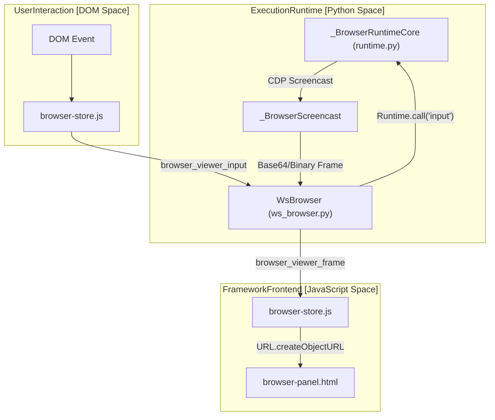
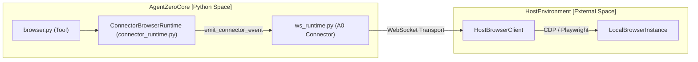

<!-- source: DeepWiki mcp.deepwiki.com · repo agent0ai/agent-zero · page 10.2 Browser UI & Tool Integration · fetched 2026-10-29 -->

# Browser UI & Tool Integration

Relevant source files

The following files were used as context for generating this wiki page:

- [plugins/_browser/AGENTS.md](plugins/_browser/AGENTS.md)
- [plugins/_browser/api/extensions.py](plugins/_browser/api/extensions.py)
- [plugins/_browser/api/ws_browser.py](plugins/_browser/api/ws_browser.py)
- [plugins/_browser/default_config.yaml](plugins/_browser/default_config.yaml)
- [plugins/_browser/extensions/webui/get_tool_message_handler/browser-tool-handler.js](plugins/_browser/extensions/webui/get_tool_message_handler/browser-tool-handler.js)
- [plugins/_browser/extensions/webui/right_canvas_register_surfaces/register-browser.js](plugins/_browser/extensions/webui/right_canvas_register_surfaces/register-browser.js)
- [plugins/_browser/extensions/webui/set_messages_after_loop/auto-open-browser-results.js](plugins/_browser/extensions/webui/set_messages_after_loop/auto-open-browser-results.js)
- [plugins/_browser/helpers/config.py](plugins/_browser/helpers/config.py)
- [plugins/_browser/helpers/connector_runtime.py](plugins/_browser/helpers/connector_runtime.py)
- [plugins/_browser/helpers/extension_manager.py](plugins/_browser/helpers/extension_manager.py)
- [plugins/_browser/helpers/runtime.py](plugins/_browser/helpers/runtime.py)
- [plugins/_browser/prompts/agent.system.tool.browser.md](plugins/_browser/prompts/agent.system.tool.browser.md)
- [plugins/_browser/skills/browser-automation/SKILL.md](plugins/_browser/skills/browser-automation/SKILL.md)
- [plugins/_browser/skills/browser-form-workflows/SKILL.md](plugins/_browser/skills/browser-form-workflows/SKILL.md)
- [plugins/_browser/tools/browser.py](plugins/_browser/tools/browser.py)
- [plugins/_browser/webui/browser-config-store.js](plugins/_browser/webui/browser-config-store.js)
- [plugins/_browser/webui/browser-panel.html](plugins/_browser/webui/browser-panel.html)
- [plugins/_browser/webui/browser-store.js](plugins/_browser/webui/browser-store.js)
- [plugins/_browser/webui/config.html](plugins/_browser/webui/config.html)
- [plugins/_browser/webui/main.html](plugins/_browser/webui/main.html)
- [tests/test_browser_agent_regressions.py](tests/test_browser_agent_regressions.py)
- [tests/test_browser_tool_output.py](tests/test_browser_tool_output.py)
- [tests/test_host_browser_connector.py](tests/test_host_browser_connector.py)

The Browser UI and Tool Integration subsystem bridges the gap between the Playwright/Patchright-based `BrowserRuntime` and the user-facing Web UI. It provides a real-time, interactive view of the browser state, manual inspection via Annotate Mode, configuration management for browser LLM presets, and Bring Your Own Browser (BYOB) capabilities through the A0 Connector.

Sources: [plugins/_browser/AGENTS.md:1-15]()

## Browser Store & Frontend Architecture

Frontend state and real-time interaction are managed by `browser-store.js`, an Alpine.js store that coordinates WebSocket messaging, viewport sizing, and binary frame decoding.

### Key Store Responsibilities
- **Session & Tab Management**: Tracks open browser tabs (`browsers`), active browser IDs (`activeBrowserId`), and context bindings (`activeBrowserContextId`) across the system [plugins/_browser/webui/browser-store.js:180-188]().
- **Viewer Transports**: Dynamically negotiates and switches between `interactive`, `snapshot`, and `screencast` transport modes depending on client capabilities and network constraints [plugins/_browser/webui/browser-store.js:189-191]().
- **Viewport Synchronization**: Automatically tracks container size adjustments via observers and synchronizes dimensions with the backend runtime [plugins/_browser/webui/browser-store.js:27-32]().

### Data Flow: Screencast to UI
The following diagram bridges the conceptual browser pipeline to specific Python and JavaScript code entities.

**Browser Rendering Pipeline**

Sources: [plugins/_browser/api/ws_browser.py:133-151](), [plugins/_browser/webui/browser-store.js:124-149](), [plugins/_browser/webui/browser-panel.html:11-15]()

Sources: [plugins/_browser/webui/browser-store.js:1-194](), [plugins/_browser/api/ws_browser.py:40-77]()

## Right Canvas Integration & Dock Handoff

The Browser surface is registered as a component within the right canvas layout, supporting seamless transitions between modals and docked side panels.

- **Surface Registration**: Registered via URL surface handlers in `right_canvas_register_surfaces` [plugins/_browser/webui/browser-store.js:10-14]().
- **Dock Handoff**: Manages lifecycle transitions to move the active browser frame between modal views and panel docks without destroying the backing runtime or reloading the interactive iframe [plugins/_browser/webui/browser-panel.html:11-15](). Exactly one interactive viewer iframe remains connected during canvas/modal handoff so hidden surfaces cannot compete to resize the same display [plugins/_browser/AGENTS.md:27-28]().

Sources: [plugins/_browser/webui/browser-store.js:10-14](), [plugins/_browser/webui/browser-panel.html:11-15](), [plugins/_browser/AGENTS.md:27-28]()

## Tool Message Handler & Interactive Execution

The browser tool execution pipeline formats agent-driven operations and renders visual feedback directly inside the chat interface.

- **Action Normalization**: Converts raw tool parameters into standardized internal payloads before dispatching to the active runtime backend [plugins/_browser/helpers/connector_runtime.py:137-146]().
- **Live Previews**: Automatically updates the chat view with snapshots or status summaries following state-mutating browser actions [plugins/_browser/api/ws_browser.py:152-154]().

Sources: [plugins/_browser/api/ws_browser.py:131-154](), [plugins/_browser/helpers/connector_runtime.py:137-146]()

## Annotate Mode & Interaction

Annotate Mode enables users to visually highlight elements and send targeted commentary back to the agent engine.

- **State Flag**: Managed via the `annotating` property and `toggleAnnotationMode()` inside `browser-store.js` [plugins/_browser/webui/browser-store.js:193-195](), [plugins/_browser/webui/browser-panel.html:69-73]().
- **WebSocket Dispatch**: User commentary and coordinate markers are transmitted to the backend via the `browser_viewer_annotation` event handler [plugins/_browser/api/ws_browser.py:69-70]().

Sources: [plugins/_browser/webui/browser-panel.html:69-77](), [plugins/_browser/api/ws_browser.py:69-70]()

## Browser LLM Preset

The browser UI provides an isolated LLM preset selector to route browser reasoning tasks to specialized models (such as vision-capable variants).

- **Configuration Key**: Stored under the `model_preset` configuration attribute in browser settings [plugins/_browser/helpers/config.py:11-12]().
- **UI Binding**: Exposed via the settings dropdown inside `browser-panel.html` and managed by the associated store bindings [plugins/_browser/webui/browser-panel.html:88-97]().

Sources: [plugins/_browser/helpers/config.py:11-12](), [plugins/_browser/webui/browser-panel.html:88-97]()

## Host Browser & Connector Integration (BYOB)

Bring Your Own Browser (BYOB) mode delegates execution from the container runtime to an external host browser via the A0 Connector.

- **ConnectorBrowserRuntime**: Implements the runtime interface, translating tool invocations into structured WebSocket operations (`connector_browser_op`) dispatched to the connected host client [plugins/_browser/helpers/connector_runtime.py:120-136]().
- **Privacy Policies**: Controlled by `host_browser_privacy_policy` to enforce restrictions like local-only model processing (`enforce_local`), warnings, or unrestricted access (`allow`) [plugins/_browser/helpers/config.py:18-20]().
- **Profile Modes**: Allows choosing between an existing host browser profile or a clean, isolated A0-controlled profile (`host_browser_profile_mode`) [plugins/_browser/helpers/config.py:19-20]().

### Architecture: BYOB & Connector Bridge

Sources: [plugins/_browser/helpers/connector_runtime.py:120-136](), [plugins/_a0_connector/helpers/ws_runtime.py]()

Sources: [plugins/_browser/helpers/connector_runtime.py:120-136](), [plugins/_browser/helpers/config.py:18-30](), [plugins/_browser/webui/config.html:24-42]()

## Browser Tool Prompt & Agent Interface

The system prompt for the browser tool instructs the agent on effective execution strategies, action scoping, and visual reasoning.

- **Guidance & Constraints**: Defined in `agent.system.tool.browser.md`, instructing the agent to prefer DOM/CDP references over raw coordinates, use explicit screenshot commands before vision reasoning, and keep open tab counts small [plugins/_browser/prompts/agent.system.tool.browser.md:1-15]().
- **Action Set**: Details available actions across tabs (`open`, `list`, `navigate`, `close`), inspection (`content`, `detail`, `screenshot`), and interaction (`click`, `type`, `submit`, `scroll`) [plugins/_browser/prompts/agent.system.tool.browser.md:8]().

Sources: [plugins/_browser/prompts/agent.system.tool.browser.md:1-15]()

---

