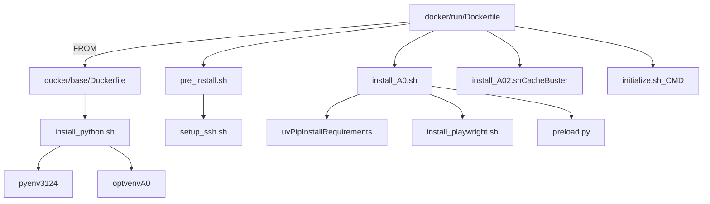
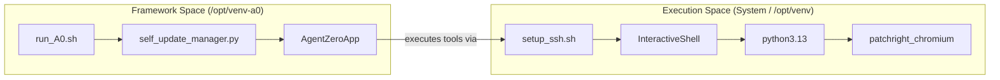
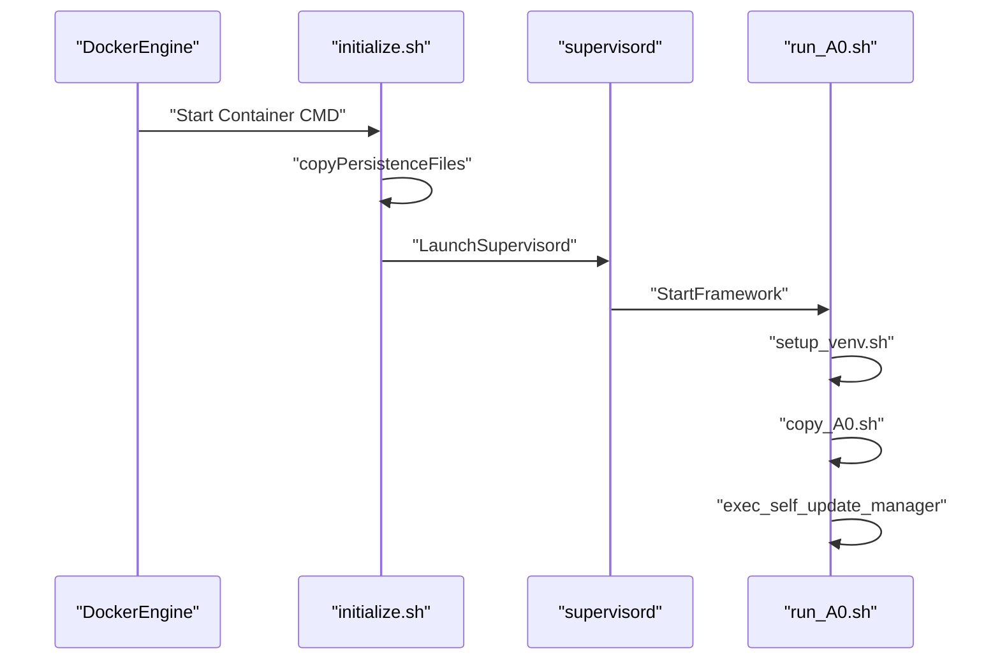

<!-- source: DeepWiki mcp.deepwiki.com · repo agent0ai/agent-zero · page 11.1 Docker Architecture · fetched 2026-10-29 -->

# Docker Architecture

Relevant source files

The following files were used as context for generating this wiki page:

- [.github/FUNDING.yml](.github/FUNDING.yml)
- [LICENSE](LICENSE)
- [docker/base/Dockerfile](docker/base/Dockerfile)
- [docker/base/build.txt](docker/base/build.txt)
- [docker/base/fs/etc/searxng/limiter.toml](docker/base/fs/etc/searxng/limiter.toml)
- [docker/base/fs/etc/searxng/settings.yml](docker/base/fs/etc/searxng/settings.yml)
- [docker/base/fs/ins/after_install.sh](docker/base/fs/ins/after_install.sh)
- [docker/base/fs/ins/configure_ssh.sh](docker/base/fs/ins/configure_ssh.sh)
- [docker/base/fs/ins/install_base_packages2.sh](docker/base/fs/ins/install_base_packages2.sh)
- [docker/base/fs/ins/install_base_packages3.sh](docker/base/fs/ins/install_base_packages3.sh)
- [docker/base/fs/ins/install_base_packages4.sh](docker/base/fs/ins/install_base_packages4.sh)
- [docker/base/fs/ins/install_python.sh](docker/base/fs/ins/install_python.sh)
- [docker/base/fs/ins/install_searxng.sh](docker/base/fs/ins/install_searxng.sh)
- [docker/base/fs/ins/install_searxng2.sh](docker/base/fs/ins/install_searxng2.sh)
- [docker/run/Dockerfile](docker/run/Dockerfile)
- [docker/run/build.txt](docker/run/build.txt)
- [docker/run/docker-compose.yml](docker/run/docker-compose.yml)
- [docker/run/fs/etc/searxng/limiter.toml](docker/run/fs/etc/searxng/limiter.toml)
- [docker/run/fs/etc/searxng/settings.yml](docker/run/fs/etc/searxng/settings.yml)
- [docker/run/fs/exe/run_A0.sh](docker/run/fs/exe/run_A0.sh)
- [docker/run/fs/ins/copy_A0.sh](docker/run/fs/ins/copy_A0.sh)
- [docker/run/fs/ins/install_A0.sh](docker/run/fs/ins/install_A0.sh)
- [docker/run/fs/ins/install_A02.sh](docker/run/fs/ins/install_A02.sh)
- [docker/run/fs/ins/install_playwright.sh](docker/run/fs/ins/install_playwright.sh)
- [docker/run/fs/ins/pre_install.sh](docker/run/fs/ins/pre_install.sh)
- [docker/run/fs/ins/setup_venv.sh](docker/run/fs/ins/setup_venv.sh)

The purpose and scope of this section is to cover the Docker-based deployment infrastructure of Agent Zero, including the split-image architecture (`agent-zero-base` and `agent-zero`), the run Dockerfile build lifecycle (`pre_install.sh`, `install_A0.sh`, `install_A02.sh`, virtual environment setup, playwright installation, and cache busting), the architectural distinction between the Framework Runtime and Execution Runtime, process supervision via `supervisord`, bundled components like SearXNG and SSH, and container orchestration with `docker-compose`.

## Image Hierarchy and Build Lifecycle

Agent Zero uses a two-tier Docker image strategy to balance environment stability with rapid development build times.

### 1. The Base Image (`agent-zero-base`)
The base image (`docker/base/Dockerfile`) provides the foundational "Execution Runtime"—the OS and system-level dependencies where the agent executes scripts, tools, and terminal commands.

*   **Python Runtimes**: Installs Python 3.13 globally [docker/base/fs/ins/install_python.sh:11-12]() and creates a dedicated virtual environment at `/opt/venv-a0` using Python 3.12.4 via `pyenv` [docker/base/fs/ins/install_python.sh:52-54](). A default venv is also set up at `/opt/venv` using Python 3.13 [docker/base/fs/ins/install_python.sh:19]().
*   **Machine Learning Packages**: Pre-installs CPU-optimized `torch==2.4.0` and `torchvision==0.19.0` to avoid lengthy downloads during run-image builds [docker/base/fs/ins/install_python.sh:61-64]().
*   **Package Management**: Installs `uv` globally for high-speed Python package resolution [docker/base/fs/ins/install_python.sh:68]().

### 2. The Run Image (`agent-zero`)
The run image inherits from the base image [docker/run/Dockerfile:4]() and configures the "Framework Runtime"—running the Agent Zero application logic, Web UI, and API.

*   **Branch-Based Builds**: The `BRANCH` build argument specifies whether the image clones from a remote GitHub branch or uses local files [docker/run/fs/ins/install_A0.sh:14-27]().
*   **Install Scripts**:
    *   `install_A0.sh`: Clones the repository, sets up the venv, installs Python requirements via `uv pip install`, runs Playwright setup, and executes `preload.py` with `--dockerized=true` [docker/run/fs/ins/install_A0.sh:23-44]().
    *   `install_playwright.sh`: Installs system libraries and Chromium for Playwright under `PLAYWRIGHT_BROWSERS_PATH=/a0/tmp/playwright` [docker/run/fs/ins/install_playwright.sh:8-13]().
    *   `install_A02.sh`: Acts as a **Cache Buster**. It removes the repository (unless local) and re-runs `install_A0.sh` to pull fresh code without rebuilding base layers, leveraging the `CACHE_DATE` build arg [docker/run/build.txt:6-38]().

### Docker Build Flow (Code Entity Space)

Sources: [docker/run/Dockerfile:1-36](), [docker/run/fs/ins/install_A0.sh:1-44](), [docker/base/fs/ins/install_python.sh:1-73](), [docker/run/fs/ins/install_playwright.sh:1-13](), [docker/run/fs/ins/pre_install.sh:1-13]()

Sources: [docker/base/Dockerfile:1-40](), [docker/run/Dockerfile:1-36](), [docker/run/fs/ins/install_A0.sh:1-44](), [docker/base/fs/ins/install_python.sh:1-73](), [docker/run/fs/ins/install_playwright.sh:1-13](), [docker/run/fs/ins/install_A02.sh:1-17](), [docker/run/build.txt:1-42]()

---

## Framework Runtime vs. Execution Runtime

Agent Zero maintains a clean separation between the environment hosting its own control plane and the environment where tasks are executed.

| Feature | Framework Runtime | Execution Runtime |
| :--- | :--- | :--- |
| **Purpose** | Running Agent Zero core logic, Flask API, and Web UI. | Executing agent-generated code, shell commands, and browser sessions. |
| **Venv Path** | `/opt/venv-a0` (Python 3.12.4) [docker/base/fs/ins/install_python.sh:54]() | System Python 3.13 or `/opt/venv` [docker/base/fs/ins/install_python.sh:19]() |
| **Entrypoint** | `run_A0.sh` -> `self_update_manager.py` [docker/run/fs/exe/run_A0.sh:7]() | Spawned via SSH daemon / subprocesses inside the container. |

### Runtime Data Flow & Entities

Sources: [docker/base/fs/ins/install_python.sh:19-54](), [docker/run/fs/exe/run_A0.sh:1-7](), [docker/run/fs/ins/pre_install.sh:1-13]()

Sources: [docker/base/fs/ins/install_python.sh:1-73](), [docker/run/fs/exe/run_A0.sh:1-7](), [docker/run/fs/ins/pre_install.sh:1-13]()

---

## Process Management and Services

The container relies on `supervisord` as its process supervisor, invoked via `/exe/initialize.sh` [docker/run/Dockerfile:36](). Runtime startup configures services via init scripts and configuration files.

### Key Services & Initialization
1.  **Agent Zero Framework**: Launched via `run_A0.sh`, which executes `self_update_manager.py docker-run-ui` [docker/run/fs/exe/run_A0.sh:7]().
2.  **SearXNG**: Configured via `/etc/searxng/settings.yml` [docker/run/fs/etc/searxng/settings.yml:1-26]() and started via `run_searxng.sh` [docker/run/Dockerfile:33]().
3.  **SSH Daemon**: Prepared by `setup_ssh.sh` during `pre_install.sh` to support remote tool execution [docker/run/fs/ins/pre_install.sh:13]().
4.  **Tunnel API**: Managed via `run_tunnel_api.sh` for external connectivity [docker/run/Dockerfile:33]().

Sources: [docker/run/Dockerfile:33-36](), [docker/run/fs/exe/run_A0.sh:1-7](), [docker/run/fs/ins/pre_install.sh:1-13]()

Sources: [docker/run/Dockerfile:33-36](), [docker/run/fs/exe/run_A0.sh:1-7](), [docker/run/fs/ins/pre_install.sh:1-13](), [docker/run/fs/etc/searxng/settings.yml:1-98]()

---

## Docker Compose and Deployment

The default `docker-compose.yml` mounts `./agent-zero` to `/a0` for persistent storage, maps port `50080` to container port `80`, configures high file descriptor `ulimits` (soft and hard limit `65535`), and maps `host.docker.internal` [docker/run/docker-compose.yml:1-14](). Build automation supports multi-architecture targets (`linux/amd64`, `linux/arm64`) using `docker buildx` [docker/run/build.txt:32-38]().

Sources: [docker/run/docker-compose.yml:1-14](), [docker/run/build.txt:1-42]()

---

