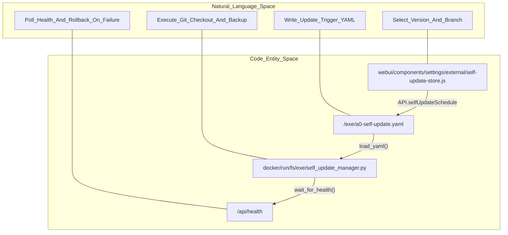
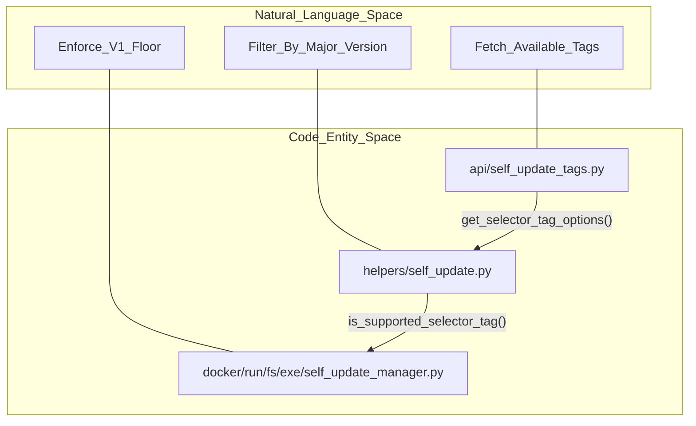

<!-- source: DeepWiki mcp.deepwiki.com · repo agent0ai/agent-zero · page 11.2 Self-Update System · fetched 2026-10-29 -->

# Self-Update System

Relevant source files

The following files were used as context for generating this wiki page:

- [api/self_update_tags.py](api/self_update_tags.py)
- [docker/run/fs/exe/self_update_manager.py](docker/run/fs/exe/self_update_manager.py)
- [docs/guides/self-update.md](docs/guides/self-update.md)
- [helpers/self_update.py](helpers/self_update.py)
- [tests/test_self_update_tag_filter.py](tests/test_self_update_tag_filter.py)
- [webui/components/settings/backup/backup_restore.html](webui/components/settings/backup/backup_restore.html)
- [webui/components/settings/backup/self-update.html](webui/components/settings/backup/self-update.html)
- [webui/components/settings/external/self-update-modal.html](webui/components/settings/external/self-update-modal.html)
- [webui/components/settings/external/self-update-store.js](webui/components/settings/external/self-update-store.js)

This page covers the architecture, implementation, data flow, and recovery procedures of the Agent Zero Self-Update System (`self_update_manager.py`). The system provides durable, Docker-oriented framework upgrades while ensuring data safety through automatic backup archives, health checks, and transactional rollbacks [docs/guides/self-update.md:17-20]().

---

## Architectural Overview & Data Flow

The self-update mechanism is split between a durable manager script residing outside the repository (`/exe/self_update_manager.py`) and the application layer (`helpers/self_update.py`, `api/self_update_tags.py`, and the Web UI `selfUpdateStore`) [docs/guides/self-update.md:33-41](). This decoupling ensures that even if the main repository checkout in `/a0` is corrupted, downgraded, or replaced during an update failure, the execution runtime retains full control to roll back or re-apply updates.

### Update Lifecycle
1. **Request Initiation**: The user configures an update target in the Web UI (`self-update-modal.html`), which invokes backend endpoints via `helpers/self_update.py` [docs/guides/self-update.md:7-11]().
2. **Trigger Creation**: A YAML configuration file is written to the durable trigger path `/exe/a0-self-update.yaml` [helpers/self_update.py:30-30]().
3. **Container Restart**: The application restarts under the supervisor/Docker runtime.
4. **Bootstrap Invocation**: During container startup, the entrypoint invokes `self_update_manager.py` before starting the web server [docs/guides/self-update.md:21-25]().
5. **Backup & Synchronization**: The manager optionally archives `/a0/usr`, fetches the requested Git commit/tag, and updates `/a0` while preserving gitignored directories [docs/guides/self-update.md:26-29]().
6. **Health Verification & Rollback**: The manager polls the health endpoint (`DEFAULT_HEALTH_URL`). If health checks fail within the timeout window, it automatically rolls back to the pre-update stash/commit [docs/guides/self-update.md:30-31](), [docker/run/fs/exe/self_update_manager.py:34-37]().

### Code Entity Mapping: Update Process

Title: "Update Lifecycle Entity Mapping"

Sources: [webui/components/settings/external/self-update-store.js:1-10](), [helpers/self_update.py:30-33](), [docker/run/fs/exe/self_update_manager.py:31-33](), [docker/run/fs/exe/self_update_manager.py:96-100]()

---

## Durable Manager (`self_update_manager.py`) & Trigger System

The durable manager is located at `docker/run/fs/exe/self_update_manager.py` and is instantiated alongside status and log files in the durable `/exe` directory [helpers/self_update.py:30-34]().

### Durable Files
- **Trigger File**: `/exe/a0-self-update.yaml` — Stores pending update configurations including branch, tag, backup options, and conflict policies [helpers/self_update.py:30-30]().
- **Status File**: `/exe/a0-self-update-status.yaml` — Records execution results, timestamps, error states, and rollback flags [helpers/self_update.py:31-31]().
- **Log File**: `/exe/a0-self-update.log` — Detailed textual logs of the last update attempt managed by `AttemptLogger` [docker/run/fs/exe/self_update_manager.py:33-33](), [docker/run/fs/exe/self_update_manager.py:60-83]().

### Key Functions & Classes in `self_update_manager.py`
| Function / Class | Description |
| :--- | :--- |
| `AttemptLogger` | Writes timestamped logs to `/exe/a0-self-update.log` with support for block logging [docker/run/fs/exe/self_update_manager.py:60-83](). |
| `normalize_requested_tag()` | Validates release tags against the `vX.Y` format and enforces the `>= v1.0` floor [docker/run/fs/exe/self_update_manager.py:185-196](). |
| `get_latest_same_major_tag()` | Resolves the `latest` keyword to the highest semantic release tag within the current major version line [docker/run/fs/exe/self_update_manager.py:205-225](). |
| `create_rollback_stash()` | Creates a git stash preserving tracked modifications, staged files, and untracked entries before updating [tests/test_self_update_tag_filter.py:34-69](). |
| `wait_for_health()` | Polls the local health endpoint (`DEFAULT_HEALTH_URL`) with configurable timeouts (`180s`) and intervals (`2s`) [docker/run/fs/exe/self_update_manager.py:34-43](). |

Sources: [docker/run/fs/exe/self_update_manager.py:30-83](), [helpers/self_update.py:30-34](), [tests/test_self_update_tag_filter.py:34-69]()

---

## Tag Filtering & Major Version Lock

To prevent breaking changes at the container image level (such as underlying operating system dependencies, Python runtime upgrades, or breaking database schemas), self-updates are strictly bound to the **current major version line** [docs/guides/self-update.md:70-74]().

### Tag Validation Rules
- Version tags must follow the format `v{major}.{minor}` (e.g., `v1.0`, `v1.1`, `v2.0`) [docs/guides/self-update.md:59-61]().
- Tags below `v1.0` (such as `v0.9`) are rejected by `is_supported_selector_tag()` and `MIN_SELECTOR_VERSION = (1, 0)` [docker/run/fs/exe/self_update_manager.py:47-47](), [docker/run/fs/exe/self_update_manager.py:152-154]().
- The Web UI requests available tags via `api/self_update_tags.py`, which filters options through `get_selector_tag_options()` in `helpers/self_update.py` [api/self_update_tags.py:23-25]().
- If a newer major version line exists on the selected branch, the UI displays an attention banner (`majorUpgradeBannerMessage`) advising the user to pull a new Docker image manually [webui/components/settings/external/self-update-store.js:132-140](), [docs/guides/self-update.md:50-53]().

### Code Entity Mapping: Tag Filtering & Version Selection

Title: "Tag Filtering Entity Mapping"

Sources: [api/self_update_tags.py:23-25](), [helpers/self_update.py:1-50](), [docker/run/fs/exe/self_update_manager.py:47-155]()

---

## Data Persistence, Backup (`usr/`) & Conflict Policy

The system ensures user data, agent configurations, and memory stores inside `/a0/usr` are protected during code checkouts.

### Backup Mechanics
- **Automatic Archiving**: Before replacing repository files, the updater can create a ZIP archive of `/a0/usr` [docs/guides/self-update.md:43-46]().
- **Default Storage**: Backups are written to `/root/update-backups` with default names formatted as `usr-YYYYMMDD-HHMMSS.zip` [docker/run/fs/exe/self_update_manager.py:44-44](), [docker/run/fs/exe/self_update_manager.py:180-183]().
- **Transient State Exclusions**: Backups automatically skip transient execution state, shadow history, and desktop profiles specified in `DESKTOP_PROFILE_STATE_RELATIVE_DIRS` [docker/run/fs/exe/self_update_manager.py:49-53]().
- **Conflict Policies**: The backup system supports three conflict resolution policies when target archive names collide: `rename` (appends timestamp/suffix), `overwrite`, or `fail` [docker/run/fs/exe/self_update_manager.py:45-46](), [docker/run/fs/exe/self_update_manager.py:198-202]().

Sources: [docker/run/fs/exe/self_update_manager.py:44-53](), [docker/run/fs/exe/self_update_manager.py:180-202](), [docs/guides/self-update.md:43-46]()

---

## Frontend Reconnection Loop (`selfUpdateStore`)

The Web UI manages the user experience during update scheduling, container restart, and health polling via `webui/components/settings/external/self-update-store.js` [webui/components/settings/external/self-update-store.js:7-10]().

### Reconnection Flow
1. **Trigger Submission**: The user initiates an update, sending settings to the backend.
2. **Overlay & Polling**: The frontend displays a progress overlay and initiates a reconnection timer (`_reconnectTimer`) that polls `/api/health` every `2000ms` [webui/components/settings/external/self-update-store.js:7-9]().
3. **Reload**: Once the backend returns a successful health status (`200 OK`), the store forces a browser page reload (`location.reload()`) to load the updated frontend assets.

Sources: [webui/components/settings/external/self-update-store.js:7-10]()

---

## Runtime Synchronization & CLI Recovery

Because `self_update_manager.py` lives outside `/a0` in `/exe`, it can occasionally become stale relative to new framework releases.

### Startup Synchronization
- **Migration Extension**: Startup migration extensions run on backend boot to ensure runtime manager scripts match the installed repository version [docs/guides/self-update.md:33-41]().
- **Codex Refresh**: Upon updating the manager runtime, it triggers background processes so command-line interfaces are synchronized without requiring an additional container reboot.

### CLI Recovery Procedures
If the Web UI is inaccessible due to a broken startup state:
1. **Manual Trigger File Creation**: Write a YAML payload directly to `/exe/a0-self-update.yaml` specifying the desired branch and tag [docs/guides/self-update.md:37-41]().
2. **Log Inspection**: Examine update failure logs and stack traces at `/exe/a0-self-update.log` [helpers/self_update.py:32-32]().
3. **Status Inspection**: Check `/exe/a0-self-update-status.yaml` to verify whether a rollback was successfully executed [helpers/self_update.py:31-31]().

Sources: [helpers/self_update.py:30-32](), [docs/guides/self-update.md:33-41]()

---

