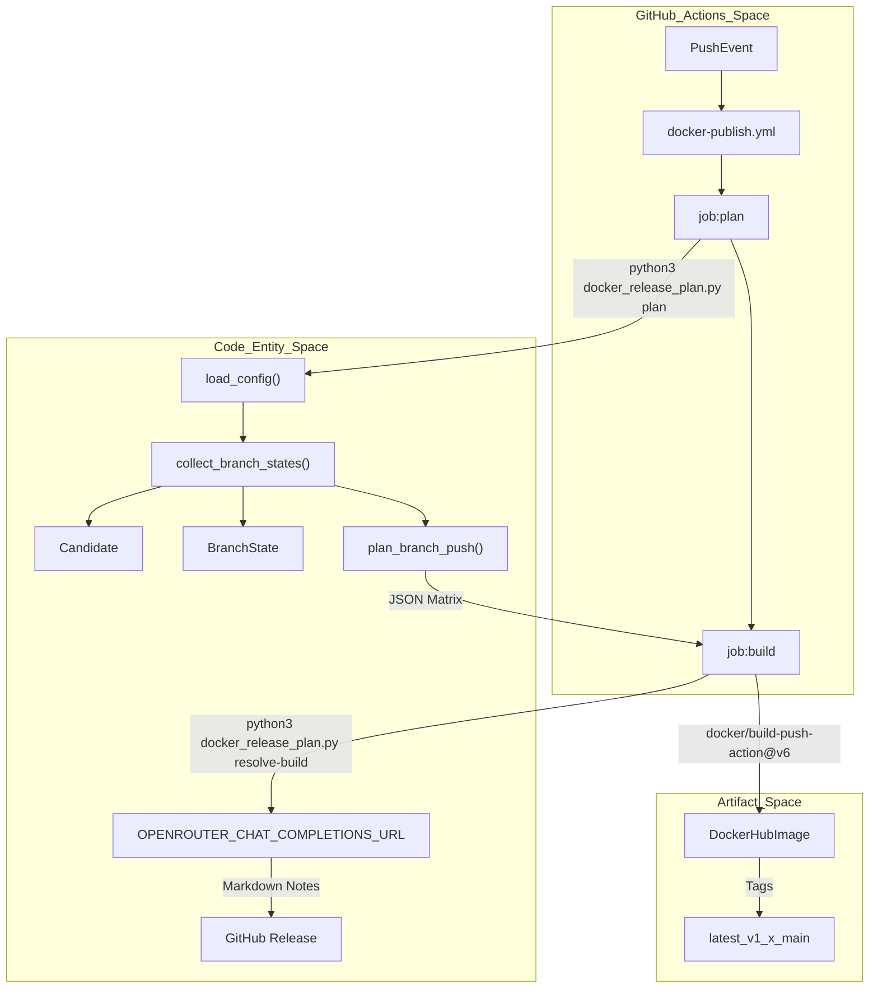
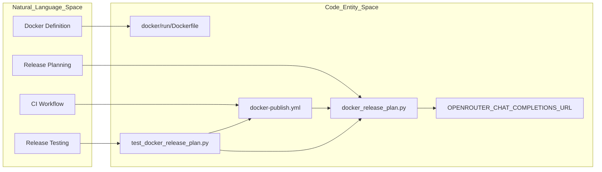

<!-- source: DeepWiki mcp.deepwiki.com · repo agent0ai/agent-zero · page 11.3 CI/CD Pipeline & Bundling · fetched 2026-10-29 -->

# CI/CD Pipeline & Bundling

Relevant source files

The following files were used as context for generating this wiki page:

- [.dockerignore](.dockerignore)
- [.github/scripts/docker_release_plan.py](.github/scripts/docker_release_plan.py)
- [.github/workflows/close-inactive.yml](.github/workflows/close-inactive.yml)
- [.github/workflows/docker-publish.yml](.github/workflows/docker-publish.yml)
- [.gitignore](.gitignore)
- [tests/test_docker_release_plan.py](tests/test_docker_release_plan.py)

This page documents the automated infrastructure responsible for building, tagging, testing, and distributing Agent Zero. The pipeline handles Docker image publication to Docker Hub via GitHub Actions, automated release plan calculation, multi-branch deployment strategies, maintenance workflows, and environment bundling definitions.

---

## 1. GitHub Actions Workflow: Docker Publish

The primary delivery mechanism for Agent Zero is the `Build And Publish Docker Images` workflow defined in `[.github/workflows/docker-publish.yml:1-191]()`. This workflow is automatically triggered by pushes to specific tracked branches (`testing`, `ready`, `main`), new version tags matching the `v*` glob, or manual dispatch triggers via `workflow_dispatch` `[.github/workflows/docker-publish.yml:3-16]()`.

### Workflow Architecture & Jobs

The pipeline executes through two primary sequential and matrix-driven jobs: `plan` and `build` `[.github/workflows/docker-publish.yml:33-88]()`:

1.  **Plan Job (`plan`)**: Runs on `ubuntu-latest` when the repository matches `agent0ai/agent-zero` `[.github/workflows/docker-publish.yml:34-36]()`. It validates Docker Hub credentials (`DOCKERHUB_ORG` and `DOCKERHUB_OAT_TOKEN`) `[.github/workflows/docker-publish.yml:41-49]()`, checks out the repository with full commit history (`fetch-depth: 0`) `[.github/workflows/docker-publish.yml:51-54]()`, fetches remote tags and branches `[.github/workflows/docker-publish.yml:56-57]()`, and invokes `[.github/scripts/docker_release_plan.py:78]()` to calculate target publishing matrices.
2.  **Build Job (`build`)**: Dependent on `needs.plan.outputs.has_work == 'true'`, this job runs across a dynamic matrix strategy (`fail-fast: false`) `[.github/workflows/docker-publish.yml:81-88]()`. Concurrency is managed per branch using a dedicated group block `[.github/workflows/docker-publish.yml:89-91]()`.
    *   **Disk Space Optimization**: Purges heavy caches and unused tools (`/opt/az`, CodeQL, Android SDK, .NET, etc.) and runs `docker system prune` to free disk space for multi-platform image compilation `[.github/workflows/docker-publish.yml:111-130]()`.
    *   **Buildx & QEMU Setup**: Sets up QEMU emulation and Docker Buildx to build cross-platform images for `linux/amd64` and `linux/arm64` architectures `[.github/workflows/docker-publish.yml:132-136]()`.
    *   **Build Execution**: Compiles and pushes images using `docker/build-push-action@v6` against `docker/run/Dockerfile`, supplying `BRANCH` and `CACHE_DATE` build arguments `[.github/workflows/docker-publish.yml:25-26, 172-181]()`.

Sources: `[.github/workflows/docker-publish.yml:1-191]()`

---

## 2. Release Planning Logic (`docker_release_plan.py`)

The orchestration logic for determining versions, tag promotions, and release notes resides in `[.github/scripts/docker_release_plan.py:1-228]()`. 

### Tagging Strategy & Configuration
The configuration loader `load_config()` reads environment variables such as `ALLOWED_BRANCHES` (`testing ready main`), `MAIN_BRANCH` (`main`), and the tag regex pattern `RELEASE_TAG_REGEX` (`^v([0-9]+)\.([0-9]+)$`) `[.github/scripts/docker_release_plan.py:129-153]()`. It enforces a minimum version floor defined by `MIN_RELEASE_MAJOR` and `MIN_RELEASE_MINOR` `[.github/scripts/docker_release_plan.py:143-146]()`.

| Event Type | Target Docker Tag | Resolution Logic |
| :--- | :--- | :--- |
| **Branch Push** | `testing`, `ready`, `main` | Tags the resulting container image with the name of the updated branch `[.github/workflows/docker-publish.yml:19-21]()`. |
| **Version Tag** | `v1.x` | Publishes immutable version-tagged containers matching the semantic release regex `[.github/scripts/docker_release_plan.py:156-163]()`. |
| **Latest** | `latest` | Automatically applied to container builds originating from the designated `MAIN_BRANCH` `[.github/scripts/docker_release_plan.py:133-135]()`. |

### LLM-Based Release Notes
During release finalization, release notes are automatically generated by querying an LLM through OpenRouter (`OPENROUTER_CHAT_COMPLETIONS_URL`) using a system prompt loaded from `scripts/openrouter_release_notes_system_prompt.md` `[.github/scripts/docker_release_plan.py:17-18]()`. Commits are aggregated between references into structured `CommitEntry` dataclass objects to summarize changes for GitHub Releases `[.github/scripts/docker_release_plan.py:123-127]()`.

Sources: `[.github/scripts/docker_release_plan.py:1-228]`, `[tests/test_docker_release_plan.py:1-122]()`

---

## 3. Maintenance Automation: Inactive Issues (`close-inactive.yml`)

The repository includes a scheduled housekeeping workflow defined in `[.github/workflows/close-inactive.yml:1-108]()` that runs daily at `17 3 * * *` `[.github/workflows/close-inactive.yml:4-5]()`.

*   **Querying**: It searches for open issues and pull requests lacking updates past a configurable threshold (`INACTIVE_DAYS`, defaulting to 90 days) using `github.paginate` with search queries `[.github/workflows/close-inactive.yml:37-64]()`.
*   **Action Execution**: For each inactive item, it posts an automated notification comment (`Closing due to inactivity of ${inactiveDays} days.`) and updates the issue state to `closed` via `github.rest.issues.update` `[.github/workflows/close-inactive.yml:85-97]()`.
*   **Dry Run Support**: Supports a `dry_run` input parameter to preview targeted URLs without mutating repository items `[.github/workflows/close-inactive.yml:12-15, 44-46, 76-78]()`.

Sources: `[.github/workflows/close-inactive.yml:1-108]()`

---

## 4. Bundling, Context Exclusions & Testing

Agent Zero relies on containerization boundaries and exclusion filters to maintain clean build contexts.

*   **Docker Definition**: The main production runtime container image is defined in `docker/run/Dockerfile` `[.github/workflows/docker-publish.yml:26]()`. Unwanted build context files are omitted via `.dockerignore` `[.dockerignore:1-50]()`.
*   **Local Development Exclusions**: Global exclusions for virtual environments, caches, and IDE artifacts are governed by `.gitignore` `[.gitignore:1-50]()`.
*   **Release Validation Testing**: The test suite includes `tests/test_docker_release_plan.py` to verify that branch promotions correctly evaluate tagging rules and generate appropriate release matrices `[tests/test_docker_release_plan.py:43-122]()`. The tests utilize a dynamic module loader helper `load_module()` to validate release scripts in isolated temporary git repos `[tests/test_docker_release_plan.py:11-17]()`.

Sources: `[tests/test_docker_release_plan.py:1-123]`, `[.gitignore:1-51]`, `[.dockerignore:1-50]()`

---

## 5. Diagrams

### CI/CD Implementation Flow

Sources: `[.github/workflows/docker-publish.yml:34-191]`, `[.github/scripts/docker_release_plan.py:17-153]`, `[.github/workflows/docker-publish.yml:170-176]()`

### Build-to-Entity Mapping

Sources: `[.github/workflows/docker-publish.yml:25-26]`, `[.github/scripts/docker_release_plan.py:17-18]`, `[tests/test_docker_release_plan.py:8-17, 43-45]`, `[.gitignore:1-51]`, `[.dockerignore:1-50]()`

---

