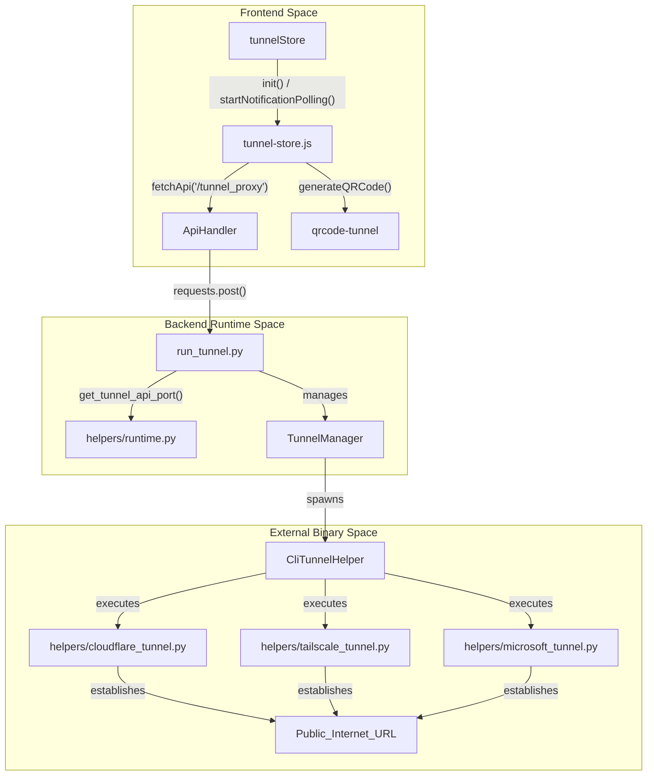
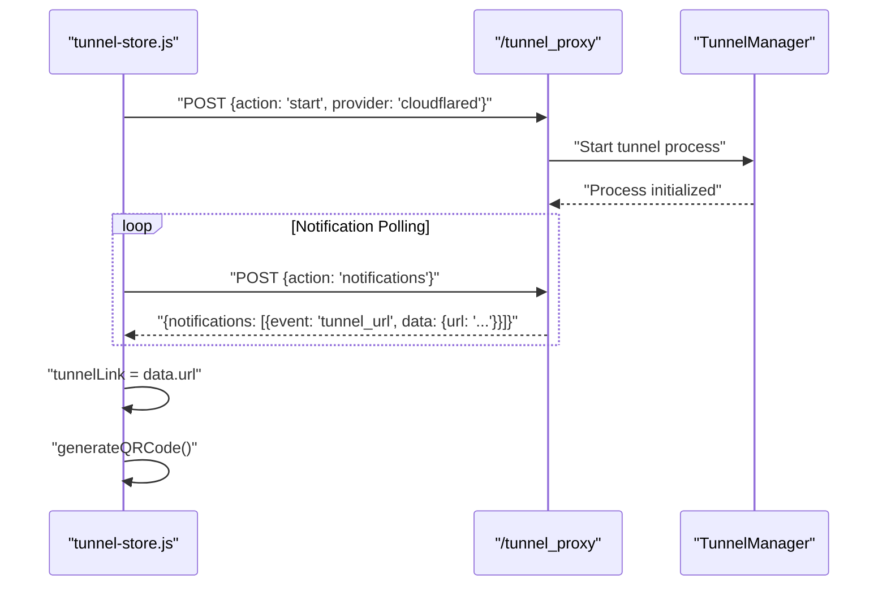
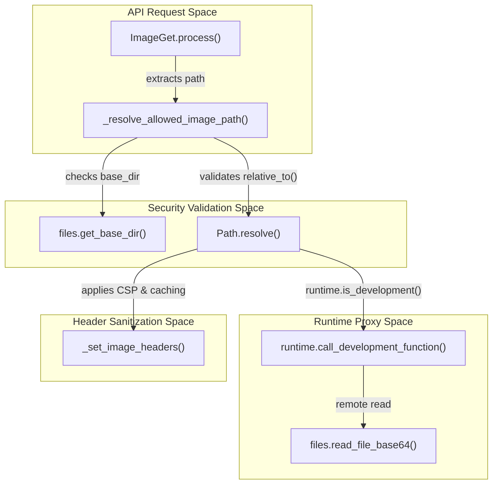

<!-- source: DeepWiki mcp.deepwiki.com · repo agent0ai/agent-zero · page 11.4 Tunnel & Cloudflare Connectivity · fetched 2026-10-29 -->

# Tunnel & Cloudflare Connectivity

Relevant source files

The following files were used as context for generating this wiki page:

- [api/image_get.py](api/image_get.py)
- [extensions/webui/right_canvas_register_surfaces/register-remote-link.js](extensions/webui/right_canvas_register_surfaces/register-remote-link.js)
- [extensions/webui/right_canvas_register_surfaces/register-space-agent.js](extensions/webui/right_canvas_register_surfaces/register-space-agent.js)
- [helpers/cli_tunnel.py](helpers/cli_tunnel.py)
- [helpers/cloudflare_tunnel._py](helpers/cloudflare_tunnel._py)
- [helpers/cloudflare_tunnel.py](helpers/cloudflare_tunnel.py)
- [helpers/microsoft_tunnel.py](helpers/microsoft_tunnel.py)
- [helpers/runtime.py](helpers/runtime.py)
- [helpers/serveo_tunnel.py](helpers/serveo_tunnel.py)
- [helpers/tailscale_tunnel.py](helpers/tailscale_tunnel.py)
- [helpers/tunnel_common.py](helpers/tunnel_common.py)
- [helpers/tunnel_manager.py](helpers/tunnel_manager.py)
- [tests/test_image_get_security.py](tests/test_image_get_security.py)
- [tests/test_tunnel_remote_link.py](tests/test_tunnel_remote_link.py)
- [webui/components/settings/tunnel/remote-link.html](webui/components/settings/tunnel/remote-link.html)
- [webui/components/settings/tunnel/tunnel-section.html](webui/components/settings/tunnel/tunnel-section.html)
- [webui/components/settings/tunnel/tunnel-store.js](webui/components/settings/tunnel/tunnel-store.js)

The Tunnel subsystem in Agent Zero provides secure, temporary public HTTPS access to a local instance without requiring manual router port forwarding. It is designed for remote access from external browsers or mobile devices, and for receiving webhooks from external services. While built around **Cloudflare Tunnels** (`cloudflared`), Agent Zero also integrates **Tailscale Funnel**, **Microsoft Dev Tunnels**, and **Serveo** `[webui/components/settings/tunnel/tunnel-section.html:48-52]`, `[tests/test_tunnel_remote_link.py:153-158]`.

Sources: `[webui/components/settings/tunnel/tunnel-section.html:48-52]`, `[tests/test_tunnel_remote_link.py:153-158]()`.

---

## Architecture & Data Flow

Tunnel operations run as a background service managed independently from the main Agent Zero Flask server. This isolation ensures that external binary downloads, background polling, or authentication flows do not block core agent reasoning loops or UI responses.

### Tunnel Component Hierarchy

The following diagram bridges the natural language concepts of remote control to the concrete code entities implementing them across the frontend and backend runtimes.

**Tunnel System Entity Map**

Sources: `[webui/components/settings/tunnel/tunnel-store.js:20-156]`, `[helpers/runtime.py:178-184]`, `[helpers/cli_tunnel.py:134-196]()`.

---

## Tunnel Manager & API

The low-level runner execution resides in `run_tunnel.py`, which instantiates a secondary management server running on an independent port. This port is retrieved via `runtime.get_tunnel_api_port()`, defaulting to `55520` `[helpers/runtime.py:178-184]()`.

### Key Backend Modules

| Subsystem | File Path | Role |
| :--- | :--- | :--- |
| **Runner Daemon** | `run_tunnel.py` | Standalone server controlling active tunnel child processes. |
| **Runtime Configuration** | `helpers/runtime.py` | Supplies port mapping (`get_tunnel_api_port()`) and environment checks `[helpers/runtime.py:178-184]()`. |
| **Common Tunnel Helper** | `helpers/tunnel_common.py` | Base abstractions for process wrappers and notification dispatching. |

Sources: `[helpers/runtime.py:178-184]()`.

---

## Supported Providers & CLI Tunnel Helpers

Agent Zero unifies external tunneling tools under `helpers/tunnel_manager.py`, which normalizes provider identifiers (e.g. mapping aliases like `cloudflare` to `cloudflared`) `[tests/test_tunnel_remote_link.py:153-158]()`.

### Provider Implementations
1. **Cloudflare Tunnel (`cloudflared`)**: Manages binary acquisition via `helpers/cloudflare_tunnel.py` and establishes secure outbound tunnels `[helpers/cloudflare_tunnel.py:1-11]()`.
2. **Tailscale Funnel**: Managed via `helpers/tailscale_tunnel.py`. It starts a userspace daemon (`tailscaled`), provisions state directories `[helpers/tailscale_tunnel.py:27-31]`, and executes `tailscale funnel --yes --https=443 http://127.0.0.1:<port>` `[tests/test_tunnel_remote_link.py:164-186]()`.
3. **Microsoft Dev Tunnels**: Managed via `helpers/microsoft_tunnel.py`. It generates a unique device tunnel ID (`agent-zero-<digest>`) to avoid global identifier collisions `[tests/test_tunnel_remote_link.py:199-209]()`.
4. **Serveo**: Backed by `helpers/serveo_tunnel.py` using SSH port forwarding.

The `CliTunnelHelper` class in `helpers/cli_tunnel.py` provides a unified execution wrapper (`subprocess.Popen`) that parses stdout streams to capture active public URLs `[helpers/cli_tunnel.py:134-196]()`.

Sources: `[helpers/cli_tunnel.py:134-196]`, `[helpers/tailscale_tunnel.py:27-186]`, `[helpers/cloudflare_tunnel.py:1-12]`, `[tests/test_tunnel_remote_link.py:153-209]()`.

---

## Web UI & User Experience

The remote control management UI is implemented in `webui/components/settings/tunnel/tunnel-section.html` and bound to the Alpine.js store in `webui/components/settings/tunnel/tunnel-store.js` `[webui/components/settings/tunnel/tunnel-section.html:10-17]`, `[webui/components/settings/tunnel/tunnel-store.js:5-19]()`.

### QR Code and Notification Flow
When a tunnel starts, `tunnel-store.js` polls the `/tunnel_proxy` endpoint (`startNotificationPolling()`) for status updates and asynchronous notification events (`tunnel_url`, `info`, `error`) `[webui/components/settings/tunnel/tunnel-store.js:77-156]()`. Once a URL is returned, `generateQRCode()` renders a scannable QR code into the `#qrcode-tunnel` container element `[webui/components/settings/tunnel/tunnel-store.js:165-189]()`.

**Tunnel Startup and QR Code Generation**

Sources: `[webui/components/settings/tunnel/tunnel-store.js:77-189]()`.

### Authentication Login Flows
For providers requiring external sign-in (such as Tailscale or Microsoft Dev Tunnels), `tunnel-store.js` extracts device login codes or authentication URLs from notification payloads and renders an interactive sign-in box (`loginActionVisible`) `[webui/components/settings/tunnel/tunnel-section.html:61-85]`, `[webui/components/settings/tunnel/tunnel-store.js:40-54]`, `[webui/components/settings/tunnel/tunnel-store.js:99-111]()`.

Sources: `[webui/components/settings/tunnel/tunnel-section.html:61-85]`, `[webui/components/settings/tunnel/tunnel-store.js:40-54]`, `[webui/components/settings/tunnel/tunnel-store.js:99-111]()`.

---

## Persistence, Origin & CSRF Handling

Active tunnel URLs are cached inside the browser's `localStorage` under the key `agent_zero_tunnel_url` `[webui/components/settings/tunnel/tunnel-store.js:207]()`. When the settings panel initializes, `checkTunnelStatus()` queries the backend to restore active tunnel sessions without restarting processes `[webui/components/settings/tunnel/tunnel-store.js:191-201]()`. Requests dispatched across remote origins rely on session verification and API handlers to mitigate cross-site request forgery.

Sources: `[webui/components/settings/tunnel/tunnel-store.js:191-207]()`.

---

## Image Delivery & Security over Tunnels

When users access Agent Zero remotely via a tunnel, media files and UI images are retrieved via the `ImageGet` API handler (`api/image_get.py`) `[api/image_get.py:29-35]()`.

### Security & Sanitization
- **Path Confinement**: `_resolve_allowed_image_path()` ensures requested file paths remain strictly inside allowed workspace directories (`base_dir`), preventing path traversal attacks and symlink escapes `[api/image_get.py:95-114]()`.
- **Response Hardening**: Applied headers include `Cache-Control: public, max-age=3600`, `X-Content-Type-Options: nosniff`, and a strict `Content-Security-Policy` sandboxing policy for SVG assets (`sandbox; default-src 'none'; script-src 'none'; img-src 'self' data:`) to prevent script execution via untrusted tunnel links `[api/image_get.py:23-26]`, `[api/image_get.py:117-125]()`.
- **Development RFC Fallback**: In hybrid development mode (`runtime.is_development()`), if local file assets are missing, `ImageGet` proxies retrieval safely from the Docker runtime container using Remote Function Calls (`runtime.call_development_function()`) `[api/image_get.py:53-77]()`.

### Image Security & Resolution Entity Map

Sources: `[api/image_get.py:29-125]`, `[helpers/runtime.py:63-65]()`.

---

