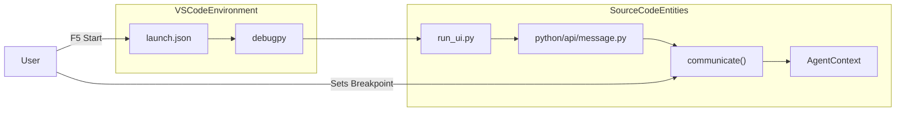
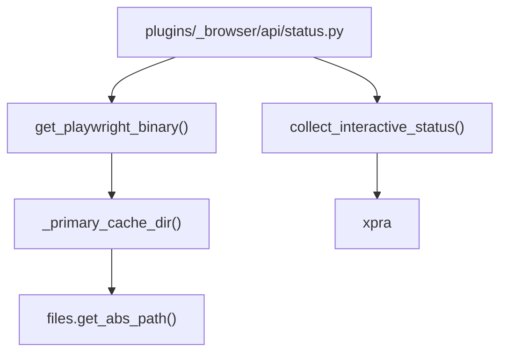

<!-- source: DeepWiki mcp.deepwiki.com · repo agent0ai/agent-zero · page 12.2 Developer Setup & RFC Mode · fetched 2026-10-29 -->

# Developer Setup & RFC Mode

<details>
<summary>Relevant source files</summary>

The following files were used as context for generating this wiki page:

- [README.md](README.md)
- [docker/base/fs/etc/searxng/limiter.toml](docker/base/fs/etc/searxng/limiter.toml)
- [docker/base/fs/etc/searxng/settings.yml](docker/base/fs/etc/searxng/settings.yml)
- [docker/base/fs/ins/after_install.sh](docker/base/fs/ins/after_install.sh)
- [docker/base/fs/ins/configure_ssh.sh](docker/base/fs/ins/configure_ssh.sh)
- [docker/run/fs/etc/searxng/limiter.toml](docker/run/fs/etc/searxng/limiter.toml)
- [docker/run/fs/etc/searxng/settings.yml](docker/run/fs/etc/searxng/settings.yml)
- [docker/run/fs/exe/initialize.sh](docker/run/fs/exe/initialize.sh)
- [docker/run/fs/ins/copy_A0.sh](docker/run/fs/ins/copy_A0.sh)
- [docs/README.md](docs/README.md)
- [docs/guides/troubleshooting.md](docs/guides/troubleshooting.md)
- [docs/quickstart.md](docs/quickstart.md)
- [docs/setup/dev-setup.md](docs/setup/dev-setup.md)
- [docs/setup/installation.md](docs/setup/installation.md)
- [plugins/_browser/api/status.py](plugins/_browser/api/status.py)
- [plugins/_browser/extensions/python/startup_migration/_20_browser_playwright_cache.py](plugins/_browser/extensions/python/startup_migration/_20_browser_playwright_cache.py)
- [plugins/_browser/helpers/playwright.py](plugins/_browser/helpers/playwright.py)
- [plugins/_browser/hooks.py](plugins/_browser/hooks.py)
- [tests/test_docker_initialize_limits.py](tests/test_docker_initialize_limits.py)

</details>


This page covers the hybrid development loop (local framework + Docker execution), VS Code launch configuration, the RFC (Remote Function Call) protocol, synchronization scripts such as `copy_A0.sh`, and the comprehensive developer setup guide.

Sources: [docs/setup/dev-setup.md:1-15](), [docker/run/fs/ins/copy_A0.sh:1-1]()

---

## Hybrid Development Architecture

Agent Zero supports a hybrid development workflow designed to provide the best of both worlds: the safety and isolation of a Dockerized environment for code execution, and the speed and debuggability of a local IDE for framework development. This is achieved through the **RFC (Remote Function Call)** protocol.

The hybrid loop splits the system into two distinct runtimes:
1.  **Framework Runtime:** Runs on the host machine (e.g., via VS Code). This handles the Web UI, LLM orchestration, and agent logic [docs/setup/dev-setup.md:12-15]().
2.  **Execution Runtime:** Runs inside a Docker container (`agent0ai/agent-zero`). This provides the isolated environment for terminal commands, Python code execution, and pre-installed tools like SearXNG [docs/setup/dev-setup.md:12-15]().

### Runtime Isolation
When running in Docker, the system further isolates these roles to prevent the agent's code execution from interfering with the framework's stability. The framework runtime typically uses Python 3.12 [docs/setup/dev-setup.md:59-60](), while the agent execution runtime inside the container uses a separate virtual environment. This ensures that packages installed by the agent during a task do not pollute the framework environment.

### Data Flow Diagram: Hybrid Loop
This diagram illustrates how a developer's local IDE communicates with the Docker container via the RFC protocol and synchronization routines (`copy_A0.sh`).

Title: "Hybrid Development Data Flow"
```mermaid
graph TD
    subgraph "HostMachine[LocalIDE]"
        VS_Code["VSCode"] --> run_ui_py["run_ui.py"]
        run_ui_py --> initialize_sh["initialize.sh"]
    end

    subgraph "DockerContainer"
        copy_A0_sh["copy_A0.sh"] --> container_filesystem["container filesystem"]
        RFC_Server["RFCServer"] --> execution_runtime["execution runtime"]
        RFC_Server --> code_execution_tool["code execution tool"]
    end

    run_ui_py -->|"RFC Protocol [JSON-RPC]"| RFC_Server

    style HostMachine_[LocalIDE] stroke-dasharray: 5 5
    style DockerContainer stroke-dasharray: 5 5
```
Sources: [docs/setup/dev-setup.md:12-15](), [docker/run/fs/exe/initialize.sh:50-51](), [docker/run/fs/ins/copy_A0.sh:1-1]()

---

## RFC (Remote Function Call) Protocol & Synchronization

The RFC mode allows a local instance of Agent Zero to delegate "heavy" or "dangerous" operations to a running Docker container.

### Key Implementation Details
*   **Trigger:** When the framework detects it is running in a development environment but needs to execute a tool (like `code_execution`), it uses the RFC protocol to bridge to the container [docs/setup/dev-setup.md:101-102]().
*   **Synchronization:** In development, local changes must be synchronized to the container. The `copy_A0.sh` script (`docker/run/fs/ins/copy_A0.sh`) handles copying core application code into the container runtime during builds and initialization sequences alongside mount scripts like `/exe/initialize.sh` [docker/run/fs/exe/initialize.sh:50-51]().
*   **Browser Setup:** The Browser plugin includes specific logic to ensure the `patchright` Chromium binary is available. In local dev, `ensure_playwright_binary` in `plugins/_browser/helpers/playwright.py` attempts to install it if missing [plugins/_browser/helpers/playwright.py:98-114]().
*   **Cache Migration:** Startup migrations such as `_20_browser_playwright_cache.py` ensure that browser caches are correctly located and migrated to the unified `/a0/tmp/playwright` path [plugins/_browser/extensions/python/startup_migration/_20_browser_playwright_cache.py:1-47]().

Sources: [docs/setup/dev-setup.md:101-102](), [plugins/_browser/helpers/playwright.py:98-114](), [plugins/_browser/extensions/python/startup_migration/_20_browser_playwright_cache.py:1-47](), [docker/run/fs/exe/initialize.sh:50-51](), [docker/run/fs/ins/copy_A0.sh:1-1]()

---

## Developer Setup Guide

The recommended setup uses VS Code (or derivatives like Cursor/Windsurf) to enable real-time debugging.

### 1. Environment Preparation
Developers must install dependencies for the framework runtime locally:
*   **Python 3.12:** Recommended for the local framework environment [docs/setup/dev-setup.md:59-60]().
*   **Dependencies:** Run `pip install -r requirements.txt` [docs/setup/dev-setup.md:70-70]().
*   **Browser Setup:** For local browser tool use, run `PLAYWRIGHT_BROWSERS_PATH=./tmp/playwright patchright install chromium --no-shell` [docs/setup/dev-setup.md:71-72](). This sets the cache to `tmp/playwright` relative to the project root [plugins/_browser/helpers/playwright.py:16-16]().

### 2. VS Code Configuration
The repository includes pre-defined configurations:
*   **Extensions:** Recommended extensions include `ms-python.python`, `ms-python.debugpy`, and `usernamehw.errorlens` [docs/setup/dev-setup.md:49-54]().
*   **Launch Profiles:** The project is pre-configured for debugging `run_ui.py` [docs/setup/dev-setup.md:93-95](). Configuration for this is found in `.vscode/launch.json` [docs/setup/dev-setup.md:97-97]().

### 3. Debugging Workflow
By setting breakpoints in backend files, developers can inspect the `AgentContext` and `Monologue` loop state. For example, placing a breakpoint in `python/api/message.py` at the `communicate` function [docs/setup/dev-setup.md:112-114]().

Title: "Code Entity Mapping: Debugging Loop"

Sources: [docs/setup/dev-setup.md:89-117]()

---

## Browser Development & Troubleshooting

A common area for developer setup issues is the Browser tool.

*   **Binary Discovery:** The system searches for Chromium in multiple patterns including `chromium-*/chrome-linux*/chrome` [plugins/_browser/helpers/playwright.py:11-14]().
*   **Status API:** Developers can check the status of the browser runtime via the `Status` API handler, which reports `playwright.binary_found` and `playwright.install_required` [plugins/_browser/api/status.py:12-34]().
*   **Interactive View:** The status also includes `interactive_view` health, checking for binaries like `xpra`, `Xvfb`, and `xfce4-session` [helpers/virtual_desktop.py:153-176]().
*   **Host Browser:** In "Bring Your Own Browser" mode, the system looks for connectors advertised by the A0 CLI [plugins/_browser/api/status.py:19-23]().

Title: "Code Entity Mapping: Browser Runtime Check"

Sources: [plugins/_browser/api/status.py:1-43](), [plugins/_browser/helpers/playwright.py:75-81](), [helpers/virtual_desktop.py:153-176]()

---

## Key Development Files & Commands

| File/Command | Purpose |
| :--- | :--- |
| `python run_ui.py` | Starts the WebUI and Backend Framework [docs/setup/dev-setup.md:93-95](). |
| `patchright install chromium` | Installs the required browser for local development [docs/setup/dev-setup.md:71-72](). |
| `docker/run/fs/ins/copy_A0.sh` | Synchronization script for packaging and deploying code into runtime containers [docker/run/fs/ins/copy_A0.sh:1-1](). |
| `helpers/virtual_desktop.py` | Registry for Xpra-based virtual desktop sessions [helpers/virtual_desktop.py:46-50](). |
| `plugins/_browser/hooks.py` | Handles plugin installation and Playwright cache preparation [plugins/_browser/hooks.py:110-121](). |
| `Status` (in `_browser/api/status.py`) | API endpoint for diagnosing browser and playwright health [plugins/_browser/api/status.py:12-13](). |

Sources:
- [docs/setup/dev-setup.md:1-117]()
- [plugins/_browser/helpers/playwright.py:1-114]()
- [plugins/_browser/api/status.py:1-43]()
- [helpers/virtual_desktop.py:1-230]()
- [plugins/_browser/hooks.py:1-195]()
- [docker/run/fs/ins/copy_A0.sh:1-1]()

---

