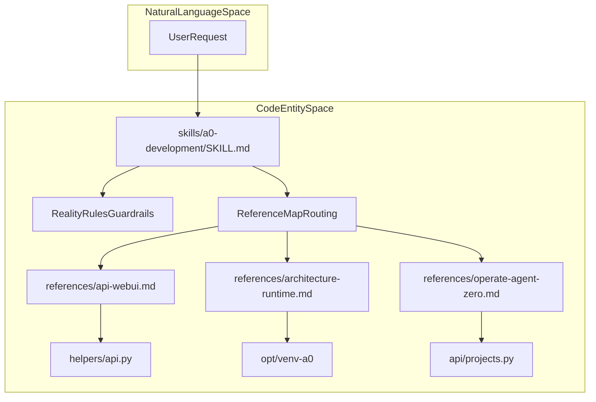
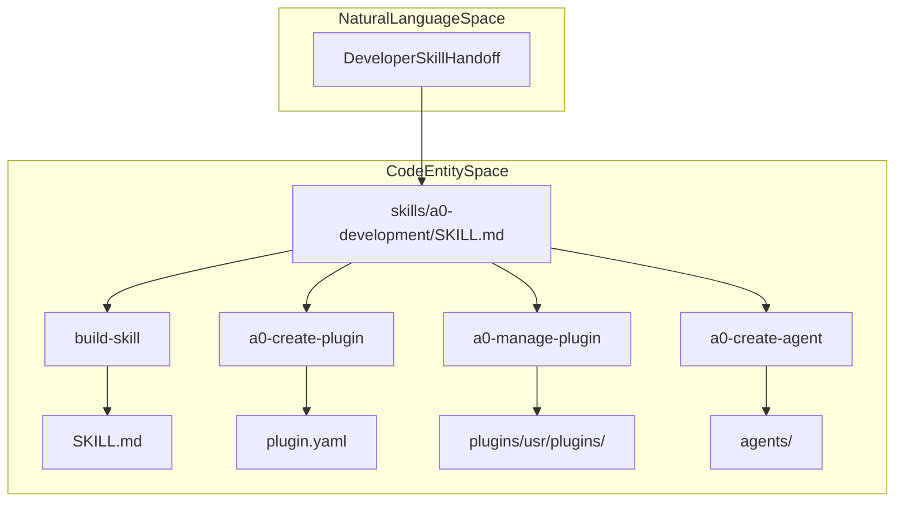
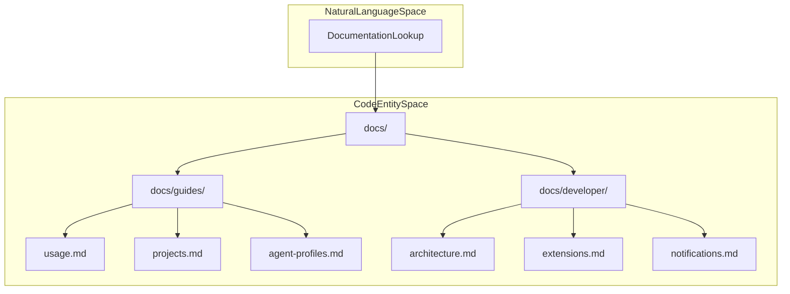

<!-- source: DeepWiki mcp.deepwiki.com · repo agent0ai/agent-zero · page 12.3 Developer Skills & Documentation · fetched 2026-10-29 -->

# Developer Skills & Documentation

Relevant source files

The following files were used as context for generating this wiki page:

- [docs/developer/architecture.md](docs/developer/architecture.md)
- [docs/developer/extensions.md](docs/developer/extensions.md)
- [docs/developer/notifications.md](docs/developer/notifications.md)
- [docs/guides/agent-profiles.md](docs/guides/agent-profiles.md)
- [docs/guides/projects.md](docs/guides/projects.md)
- [docs/guides/usage.md](docs/guides/usage.md)
- [plugins/_a0_connector/api/v1/agent_profile_set.py](plugins/_a0_connector/api/v1/agent_profile_set.py)
- [prompts/agent.system.main.environment.md](prompts/agent.system.main.environment.md)
- [skills/a0-development/AGENTS.md](skills/a0-development/AGENTS.md)
- [skills/a0-development/SKILL.md](skills/a0-development/SKILL.md)
- [skills/a0-development/references/AGENTS.md](skills/a0-development/references/AGENTS.md)
- [skills/a0-development/references/agents-prompts-skills-projects.md](skills/a0-development/references/agents-prompts-skills-projects.md)
- [skills/a0-development/references/api-webui.md](skills/a0-development/references/api-webui.md)
- [skills/a0-development/references/architecture-runtime.md](skills/a0-development/references/architecture-runtime.md)
- [skills/a0-development/references/dox-workflow.md](skills/a0-development/references/dox-workflow.md)
- [skills/a0-development/references/extensions.md](skills/a0-development/references/extensions.md)
- [skills/a0-development/references/operate-agent-zero.md](skills/a0-development/references/operate-agent-zero.md)
- [skills/a0-development/references/tools.md](skills/a0-development/references/tools.md)

## Purpose & Scope

This page covers the developer-facing automation skills, setup utilities, documentation hierarchy, and sidecar documentation workflows in Agent Zero. It details the `a0-development` skill framework, its modular reference map, supplementary skill authoring utilities (`build-skill`, `a0-create-plugin`, `a0-manage-plugin`), CLI tooling setup (`setup-a0-cli`), the structure of the `docs/` tree, and the `.dox.md` / `AGENTS.md` sidecar documentation lifecycle.

Sources: `skills/a0-development/SKILL.md`, `docs/developer/extensions.md`, `docs/developer/architecture.md`

---

## 1. The `a0-development` Developer Skill & Reference Map

The `a0-development` skill (`[skills/a0-development/SKILL.md:1-33]`) acts as the primary entry point for agents and developers modifying or operating Agent Zero. It enforces strict **Reality Rules** (such as source code and nearest DOX taking precedence over memory or examples) and provides a lookup table to load specialized reference files on demand via `skills_tool` (`[skills/a0-development/SKILL.md:35-67]()`).

### Reality Rules & Execution Boundaries
- **Source of Truth**: Source files and nearest `.dox.md` / `AGENTS.md` anchors override general memory (`[skills/a0-development/SKILL.md:41-41]()`).
- **Pre-flight Checks**: Developers and agents must read the root `AGENTS.md` and any child `AGENTS.md` files along the path before editing (`[skills/a0-development/SKILL.md:42-42]()`).
- **Runtime Separation**: In Docker environments, framework runtime checks utilize `/opt/venv-a0/bin/python`, whereas task and agent code execution runs inside `/opt/venv/bin/python` (`[skills/a0-development/SKILL.md:45-45]()`, `[prompts/agent.system.main.environment.md:1-10]()`).

### Reference Map Breakdown
The skill maps specific operational or developmental needs to modular reference documents:
- `references/operate-agent-zero.md`: Automating application operations, chats, tasks, and projects through HTTP APIs (`[skills/a0-development/SKILL.md:59-59]()`).
- `references/architecture-runtime.md`: Framework runtime splits, root directory layouts, path boundaries, and discovery sequences (`[skills/a0-development/SKILL.md:60-60]()`).
- `references/dox-workflow.md`: DOX editing protocols, update triggers, and file-level verification rules (`[skills/a0-development/SKILL.md:61-61]()`).
- `references/tools.md`: Tool contracts, execution parameters, prompts, and tool validation (`[skills/a0-development/SKILL.md:62-62]()`).
- `references/extensions.md`: Python and WebUI extension hook points, discovery ordering, and extension decorators (`[skills/a0-development/SKILL.md:63-63]()`).
- `references/api-webui.md`: Flask HTTP API handlers (`ApiHandler`), WebSocket managers (`WsHandler`), and frontend extension loader mechanics (`[skills/a0-development/SKILL.md:64-64]()`).
- `references/agents-prompts-skills-projects.md`: Agent profiles, prompt fragment compilation, skills metadata, and project settings (`[skills/a0-development/SKILL.md:65-65]()`).
- `references/plugins-workflow.md`: Plugin-first development guidelines, structuring hooks, and hub handoffs (`[skills/a0-development/SKILL.md:66-66]()`).

Title: "Natural Language to Code Entity Space Routing in a0-development"

Sources: `skills/a0-development/SKILL.md`, `skills/a0-development/AGENTS.md`, `prompts/agent.system.main.environment.md`

---

## 2. Skill Creation & Specialized Developer Skills

Beyond general development (`a0-development`), Agent Zero maintains specialized developer skills designed to scaffold, validate, and manage discrete subsystems.

### Specialized Skill Registry
- `build-skill`: Guides the creation and formatting of standardized skill packages (`SKILL.md`) adhering to the `agentskills.io` standard (`[skills/a0-development/SKILL.md:84-84]()`).
- `a0-create-plugin`: Manages plugin authoring, review pipelines, manifest creation (`plugin.yaml`), and hook registration (`[skills/a0-development/SKILL.md:80-82]()`).
- `a0-manage-plugin`: Handles plugin discovery, runtime toggling, installation flows, and hub catalog synchronization (`[skills/a0-development/SKILL.md:81-81]()`).
- `a0-create-agent`: Facilitates profile authoring, sparse override generation, and capability configuration (tools, MCPs, skills) (`[skills/a0-development/SKILL.md:83-83]()`).

Title: "Developer Skill Registry and Target Code Artifacts"

Sources: `skills/a0-development/SKILL.md`, `skills/a0-development/AGENTS.md`

---

## 3. CLI Setup & Interface Utility (`setup-a0-cli`)

The `setup-a0-cli` utility configures the Agent Zero CLI harness, allowing host machines to interact directly with core runtime environments, execute remote tool operations, manage profile bindings, and hook into local sessions.

### Key Operational Capabilities
- **Environment Targeting**: Connects the CLI interface to active framework runtimes via configured transports or WebSocket connectors (`_a0_connector`).
- **Command Dispatch**: Exposes command structures like `/profile`, `/permissions`, and workspace configuration adjustments directly from terminal shells.

Sources: `docs/guides/agent-profiles.md`, `skills/a0-development/SKILL.md`

---

## 4. The `docs/` Documentation Tree Layout

The repository maintains an intentionally streamlined `docs/` tree to prevent duplication of code-level details while providing clear entry points for end-users and developers.

### Directory Structure & Focus Areas
- `docs/guides/`: User-facing manuals detailing core interactions:
  - `usage.md`: Practical tour of the Web UI, dashboard actions, shortcuts, and plugin navigation (`[docs/guides/usage.md:1-50]()`).
  - `projects.md`: Workspace isolation, git project cloning, variables, and project instruction syntax (`[docs/guides/projects.md:1-50]()`).
  - `agent-profiles.md`: Agent configuration via the Agent Editor (Easy and Advanced modes), capability policies, and profile overrides (`[docs/guides/agent-profiles.md:1-50]()`).
- `docs/developer/`: Minimal architectural overviews linking back to deeper source definitions:
  - `architecture.md`: High-level references pointing to source code components (`[docs/developer/architecture.md:1-32]()`).
  - `extensions.md`: Backend/frontend extension criteria and maintenance rules (`[docs/developer/extensions.md:1-41]()`).
  - `notifications.md`: Backend `AgentNotification` and frontend `$store.notificationStore` integration guidelines (`[docs/developer/notifications.md:1-50]()`).

Title: "Documentation Tree Structure and File Mapping"

Sources: `docs/developer/extensions.md`, `docs/guides/usage.md`, `docs/developer/architecture.md`, `docs/guides/projects.md`, `docs/guides/agent-profiles.md`, `docs/developer/notifications.md`

---

## 5. The `.dox.md` & `AGENTS.md` Sidecar Documentation Workflow

Agent Zero utilizes sidecar documentation files (`*.dox.md` and `AGENTS.md`) to maintain strict linkage between implementation modules and their natural language operational documentation.

### Sidecar Mechanics
- **Direct Sidecar Association**: Source files under designated paths (such as API handlers in `api/*.py`) require corresponding sidecar documentation files (e.g., `api/*.py.dox.md`) (`[skills/a0-development/references/api-webui.md:1-30]()`).
- **Subtree DOX Governance**: Subdirectories maintain structured `AGENTS.md` governance files (e.g., `skills/a0-development/AGENTS.md`, `webui/AGENTS.md`, `helpers/AGENTS.md`) which specify structural ownership, local contracts, and verification criteria (`[skills/a0-development/AGENTS.md:1-32]()`, `[skills/a0-development/references/api-webui.md:1-30]()`).
- **Validation Pipeline**: Developers modifying source contracts must update the corresponding sidecar DOX files and perform structural checks to ensure paths, helpers, and parameters remain synchronized (`[skills/a0-development/SKILL.md:70-76]()`, `[skills/a0-development/references/AGENTS.md:1-32]()`).

Sources: `skills/a0-development/SKILL.md`, `skills/a0-development/AGENTS.md`, `skills/a0-development/references/api-webui.md`, `skills/a0-development/references/AGENTS.md`

---

