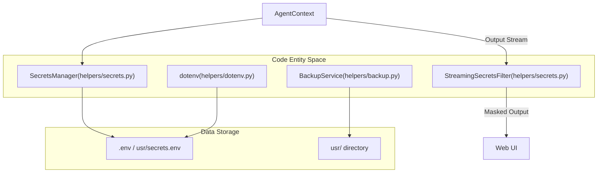
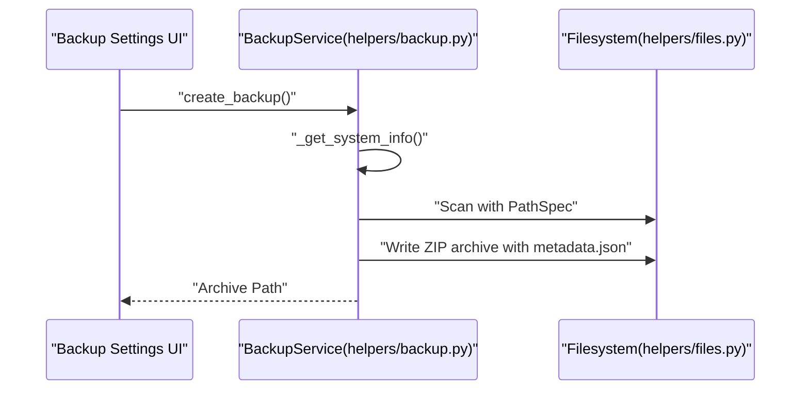

<!-- source: DeepWiki mcp.deepwiki.com · repo agent0ai/agent-zero · page 13 Secrets, Security & Backup · fetched 2026-10-29 -->

# Secrets, Security & Backup

Relevant source files

The following files were used as context for generating this wiki page:

- [helpers/secrets.py](helpers/secrets.py)
- [helpers/secrets.py.dox.md](helpers/secrets.py.dox.md)
- [tests/test_secrets.py](tests/test_secrets.py)

This section covers the security infrastructure, secrets management, and data protection mechanisms within Agent Zero. It details how the system protects sensitive information through masking, ensures the integrity of web communications and API access, and provides robust tools for backing up and restoring the application state.

## Overview

Agent Zero implements a multi-layered approach to security and data durability. The system is designed to handle sensitive API keys and personal data while providing a seamless user experience across Docker and native environments.

*   **Secrets Management**: A dedicated system for storing, using, and masking sensitive credentials so they never appear in plain text in logs or LLM outputs [helpers/secrets.py:45-52]().
*   **Web Security**: Implementation of standard security practices like Cross-Site Request Forgery (CSRF) protection for all API interactions and authentication checks for sensitive endpoints.
*   **Backup & Restore**: A comprehensive utility for packaging the framework, user data, and configuration into compressed archives for migration or recovery [helpers/backup.py:16-26]().
*   **Access Control**: Secure routing using decorators like `requires_auth` to restrict sensitive functionality [api/backup_test.py:7-8]().

### Security Architecture Overview
The following diagram illustrates how security components interface with the core system and data storage, bridging the conceptual space to concrete code entities.

Sources: [helpers/backup.py:16-26](), [helpers/secrets.py:132-147](), [helpers/secrets.py:45-52](), [api/backup_test.py:5-12](), [helpers/dotenv.py:8-11]()

## Secrets Management

The secrets system allows users to define sensitive values (like API keys) that are injected into the agent's context using aliases. This ensures that the actual values are never exposed to the LLM's primary text generation or stored in chat history files in plain text. Secrets are managed at global and project levels via `SecretsManager` and filtered on the fly using `StreamingSecretsFilter` [helpers/secrets.py:45-52](), [helpers/secrets.py:132-147]().

For details, see [Secrets Management](#13.1).

Sources: [helpers/secrets.py:45-52](), [helpers/secrets.py:132-147]()

## Backup & Restore

The backup system is managed by `BackupService` [helpers/backup.py:16-26](). It is critical for maintaining the durable nature of Agent Zero, especially during self-updates or environment migrations. It primarily targets the centralized `usr/` directory while excluding transient history like time travel snapshots [helpers/backup.py:63-67](). It provides APIs for creating, inspecting, previewing, and restoring archives with checksum validation and pattern scanning [helpers/backup.py:37-53]().

### Backup Process Flow
This diagram maps the interaction between the backup logic and the underlying filesystem entities, linking user actions to code modules.

Sources: [helpers/backup.py:16-53](), [helpers/backup.py:119-155](), [tests/test_backup_large_archives.py:135-181]()

For details, see [Backup & Restore](#13.2).

Sources: [helpers/backup.py:16-53](), [helpers/backup.py:119-155](), [tests/test_backup_large_archives.py:135-181]()

## Security & Resilience

Agent Zero implements security measures to protect the backend API and provides a secure interface for data handling. File operations are governed by `PathSpec` to ensure backups and scans respect ignore rules and directory boundaries [helpers/backup.py:9]().

| Security Feature | Implementation Entity | Purpose |
| :--- | :--- | :--- |
| **API Auth** | `requires_auth` | Protect API endpoints from unauthorized access [api/backup_test.py:7](). |
| **Masking** | `StreamingSecretsFilter` | Stateful masking of secrets in streaming output [helpers/secrets.py:45](). |
| **Runtime Creds** | `_RUNTIME_CREDENTIAL_KEYS` | Automatic identification of sensitive env vars [helpers/secrets.py:20](). |
| **Integrity** | `integrity_check` | Checksum validation for backup archives [helpers/backup.py:51](). |
| **Persistence** | `save_dotenv_value` | Securely update `.env` configuration [helpers/dotenv.py:24](). |

Sources: [helpers/secrets.py:20-52](), [helpers/backup.py:9](), [helpers/backup.py:49-52](), [api/backup_test.py:5-12](), [helpers/dotenv.py:24-44]()

---

