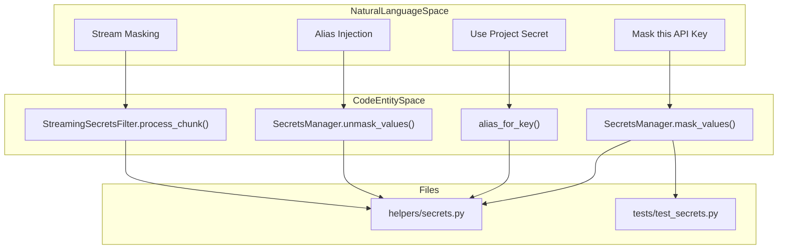
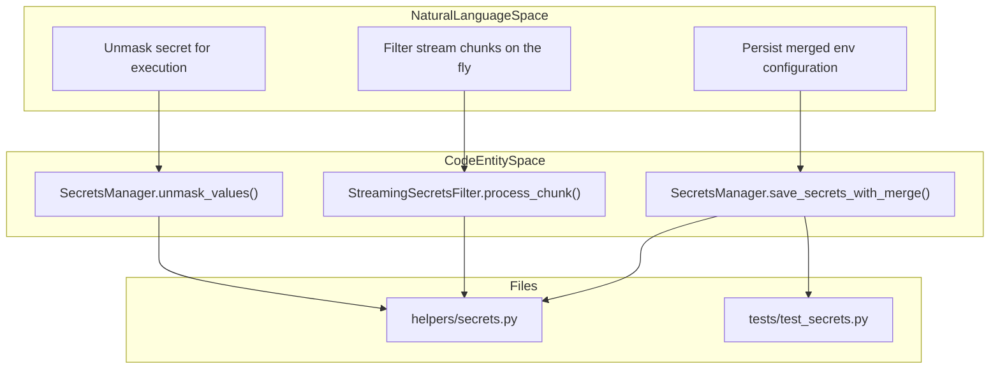

<!-- source: DeepWiki mcp.deepwiki.com · repo agent0ai/agent-zero · page 13.1 Secrets Management · fetched 2026-10-29 -->

# Secrets Management

Relevant source files

The following files were used as context for generating this wiki page:

- [helpers/secrets.py](helpers/secrets.py)
- [helpers/secrets.py.dox.md](helpers/secrets.py.dox.md)
- [tests/test_secrets.py](tests/test_secrets.py)
- [tests/test_settings_developer_sections.py](tests/test_settings_developer_sections.py)
- [webui/components/settings/developer/dev.html](webui/components/settings/developer/dev.html)
- [webui/components/settings/external/api_keys.html](webui/components/settings/external/api_keys.html)
- [webui/components/settings/external/auth.html](webui/components/settings/external/auth.html)
- [webui/components/settings/external/external_api.html](webui/components/settings/external/external_api.html)
- [webui/components/settings/external/litellm.html](webui/components/settings/external/litellm.html)
- [webui/components/settings/external/secrets.html](webui/components/settings/external/secrets.html)

## Purpose and Scope

The Agent Zero framework implements a robust secrets management system designed to protect sensitive information (API keys, passwords, tokens) from leaking into LLM contexts, chat histories, or log files. This is achieved through a placeholder-based aliasing system where actual values are only injected immediately before tool execution and are masked in all outbound communications.

This page covers the implementation details of `helpers/secrets.py`, project-level secrets vs. variables, streaming and static masking in chat history and error messages, the secrets system-prompt extension, and the Secrets settings UI (`webui/components/settings/external/secrets.html`) [webui/components/settings/external/secrets.html:1-41]().

Sources: [helpers/secrets.py:1-186](), [tests/test_secrets.py:1-89](), [helpers/secrets.py.dox.md:1-66](), [webui/components/settings/external/secrets.html:1-41]().

## Architecture & Data Flow

Secrets management is centralized in the framework's helper utilities, providing logic for loading, masking, and streaming secret values safely. The system distinguishes between **Secrets** (sensitive data that must be masked) and **Variables** (non-sensitive configuration data).

### Core Components

*   **Secrets Manager**: Managed via `helpers/secrets.py`, the `SecretsManager` class handles sensitive string identification, replacement, and persistence [helpers/secrets.py:132-156](). It utilizes a singleton pattern via `get_instance` to manage multiple secret files (e.g., global and project-specific) [helpers/secrets.py:140-147]().
*   **Placeholder Format**: Secrets are presented to the LLM as aliases using the format `§§secret(KEY)` defined by `ALIAS_PATTERN` [helpers/secrets.py:17-18](). The LLM is instructed to use these exact aliases in its generated code or shell commands instead of raw values.
*   **Streaming Filter**: The `StreamingSecretsFilter` class provides stateful, on-the-fly masking for stream outputs. It holds back the longest suffix of the current buffer that matches any secret prefix (minimum trigger length of 3) to prevent leaking partial secrets across chunk boundaries [helpers/secrets.py:45-52]().
*   **EnvLine Representation**: The `EnvLine` dataclass preserves raw lines, comments, blanks, keys, values, and inline comments when parsing `.env` files [helpers/secrets.py:34-43]().

### Natural Language to Code Entity Mapping

The following diagram illustrates how natural language concepts in the "Secrets" domain map to specific code entities and files within the Agent Zero repository.

**Diagram: Secrets Entity Mapping**

Sources: [helpers/secrets.py:17-31](), [helpers/secrets.py:45-52](), [helpers/secrets.py:132-156](), [tests/test_secrets.py:1-43]().

## Project-Level Secrets vs. Variables

Secrets and variables can be defined at both the global level and the project level. Global secrets are stored in `usr/secrets.env` [helpers/secrets.py:19]().

| Feature | Secrets | Variables |
| :--- | :--- | :--- |
| **Format** | `§§secret(KEY)` | Plain text |
| **Masking** | Always masked in UI, logs, and prompt contexts | Never masked, visible to agent |
| **LLM Access** | Sees only the alias; real values injected at runtime | Sees the actual values directly via prompt injection |
| **Data Source** | `usr/secrets.env`, project metadata, and runtime credentials | Global settings (`usr/.env`) and project metadata |

### Runtime Credentials
The system specifically monitors `usr/.env` for a subset of critical runtime credentials defined in `_RUNTIME_CREDENTIAL_KEYS`, including `AUTH_LOGIN`, `AUTH_PASSWORD`, `RFC_PASSWORD`, and `ROOT_PASSWORD` [helpers/secrets.py:20-25](). These, along with any keys starting with `API_KEY_`, are automatically added to the masking list even if they are not in the dedicated `secrets.env` file [helpers/secrets.py:169-176]().

Sources: [helpers/secrets.py:19-25](), [helpers/secrets.py:169-176](), [tests/test_secrets.py:13-37]().

## Security Implementation & Masking Flow

The framework ensures that sensitive data is never exposed in chat history, error messages, or terminal output.

### Masking and Unmasking
The `SecretsManager` maintains state and provides methods to swap between raw values and aliases:
*   **`mask_values(text)`**: Scans text for raw secret values and replaces them with `§§secret(KEY)` placeholders.
*   **`unmask_values(text)`**: Scans text for placeholders and injects the actual sensitive values.
*   **`finalize()`**: In the `StreamingSecretsFilter`, any unresolved partial match at the end of a stream is masked with `***` to ensure no trailing characters of a secret are leaked [helpers/secrets.py:115-130]().

### Natural Language to Code Entity Mapping: Execution and Masking Pipeline

The following diagram maps natural language requests regarding security operations to the concrete code entities responsible for executing them during agent operations.

**Diagram: Execution and Masking Pipeline Mapping**

Sources: [helpers/secrets.py:93-113](), [helpers/secrets.py:132-186](), [tests/test_secrets.py:55-89]().

## System Prompt Integration & UI

Secrets are exposed to project prompt contexts and managed via the Web UI settings interface located at `webui/components/settings/external/secrets.html` [webui/components/settings/external/secrets.html:1-41](). This panel allows operators to separate non-sensitive environment variables from critical secrets that require automatic masking [webui/components/settings/external/secrets.html:10-36]().

Sources: [helpers/secrets.py.dox.md:1-66](), [webui/components/settings/external/secrets.html:1-41]().

---

