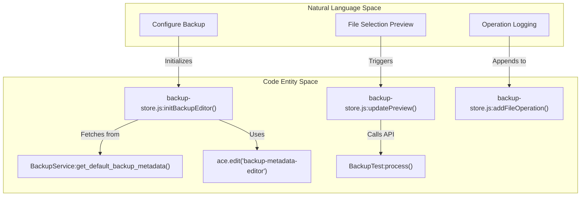
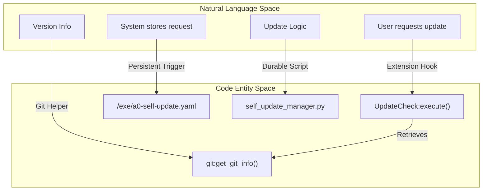
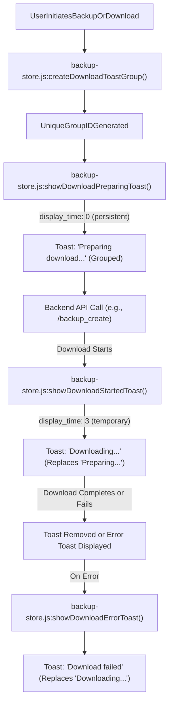

<!-- source: DeepWiki mcp.deepwiki.com · repo agent0ai/agent-zero · page 13.2 Backup & Restore · fetched 2026-10-29 -->

# Backup & Restore

Relevant source files

The following files were used as context for generating this wiki page:

- [api/backup_test.py](api/backup_test.py)
- [api/backup_test.py.dox.md](api/backup_test.py.dox.md)
- [api/notification_create.py](api/notification_create.py)
- [api/settings_set.py](api/settings_set.py)
- [extensions/python/message_loop_prompts_after/_60_include_current_datetime.py](extensions/python/message_loop_prompts_after/_60_include_current_datetime.py)
- [helpers/backup.py](helpers/backup.py)
- [helpers/backup.py.dox.md](helpers/backup.py.dox.md)
- [helpers/dotenv.py](helpers/dotenv.py)
- [helpers/dotenv.py.dox.md](helpers/dotenv.py.dox.md)
- [helpers/notification.py](helpers/notification.py)
- [helpers/notification.py.dox.md](helpers/notification.py.dox.md)
- [helpers/state_snapshot.py](helpers/state_snapshot.py)
- [helpers/state_snapshot.py.dox.md](helpers/state_snapshot.py.dox.md)
- [tests/test_backup_large_archives.py](tests/test_backup_large_archives.py)
- [tests/test_snapshot_parity.py](tests/test_snapshot_parity.py)
- [tests/test_snapshot_schema_v1.py](tests/test_snapshot_schema_v1.py)
- [webui/components/settings/backup/backup-store.js](webui/components/settings/backup/backup-store.js)

This page covers the backup and restore subsystem of Agent Zero, detailing the backend implementation in `helpers/backup.py`, the core backup/restore/inspect/preview API endpoints, large-archive handling, the backup settings UI in the Web UI, and its interaction with the self-update architecture.

---

## User Data Backup & Restore

The backup system is designed to safeguard the user data directory (`/usr`), which contains chat history, secrets, project configurations, and custom tools. The `.env` file is explicitly identified as a critical component for backup as it contains API keys and essential configuration [webui/components/settings/backup/backup-store.js:15-16]().

### Core Logic: `BackupService`
The backend implementation is encapsulated in the `BackupService` class within `helpers/backup.py` [helpers/backup.py:16-26](). This service handles system information collection, path resolution, and ZIP archive management.

*   **Metadata Generation**: `get_default_backup_metadata()` provides a standard JSON structure including version info, system specs, and default glob patterns [helpers/backup.py:37-53]().
*   **Path Resolution**: The service centralizes user data in the `/usr` directory for simplified management. Default patterns are resolved to absolute paths within the Agent Zero root [helpers/backup.py:61-66]().
*   **Version Tracking**: Backups are tagged with the current Agent Zero version retrieved via Git metadata using `git.get_git_info()` [helpers/backup.py:69-75]().
*   **System Information**: The service collects detailed environmental data including platform, CPU count, memory, and runtime mode (development vs production) to include in the backup metadata [helpers/backup.py:119-154]().
*   **Pattern Scanning**: The pattern testing mechanism performs filesystem scans using `PathSpec`. It supports a `max_files` limit for UI previews but uses an unlimited mode during actual archive creation to ensure no data is silently truncated [helpers/backup.py:176-188](), [helpers/backup.py.dox.md:28-28]().
*   **Environment Preservation**: During restoration, the system specifically handles the `.env` file to preserve the destination instance's `ALLOWED_ORIGINS` while restoring portable configuration like `AUTH_LOGIN` and `AUTH_PASSWORD` [tests/test_backup_large_archives.py:66-113]().

**Backup UI State Management**

Sources: [helpers/backup.py:16-75](), [webui/components/settings/backup/backup-store.js:18-102](), [webui/components/settings/backup/backup-store.js:174-229]()

---

## API Endpoints and Operations

The system supports a full lifecycle of backup management through dedicated API endpoints backed by `BackupService` and helper modules:

| Operation | Description | Implementation |
| :--- | :--- | :--- |
| **`backup_create`** | Generates a ZIP archive based on provided metadata and patterns. | `BackupService.create_backup` [helpers/backup.py.dox.md:17-17]() |
| **`backup_restore`** | Extracts a backup archive with configurable conflict policies. | `BackupService.restore_backup` [helpers/backup.py.dox.md:20-20]() |
| **`backup_inspect`** | Reads metadata and system info from an existing archive. | `BackupService.inspect_backup` [helpers/backup.py.dox.md:18-18]() |
| **`backup_test`** | Simulates a backup to show matched files and total size (Preview). | `BackupTest.process` [api/backup_test.py:14-57]() |
| **`backup_get_defaults`** | Fetches standard inclusion/exclusion patterns with absolute paths. | `BackupService.get_default_backup_metadata` [helpers/backup.py:37-53]() |

Sources: [helpers/backup.py:37-53](), [helpers/backup.py.dox.md:17-20](), [api/backup_test.py:14-57]()

---

## Frontend Integration & Backup Settings UI

The **Backup Store** (`webui/components/settings/backup/backup-store.js`) manages the UI state, including file operation logs, download progress toasts, and editor states [webui/components/settings/backup/backup-store.js:18-44]().

*   **Ace Editor Integration**: Uses Ace Editor instances (`backup-metadata-editor` and `restore-metadata-editor`) to let users inspect and modify JSON backup/restore configurations with syntax highlighting [webui/components/settings/backup/backup-store.js:174-229]().
*   **File Operations Log**: Appends timestamped operational logs during archive creation and restoration via `addFileOperation()` [webui/components/settings/backup/backup-store.js:79-94]().
*   **Progress Feedback**: Emits grouped download toasts ("Preparing download...", "Downloading...", "Download failed") to provide responsive visual feedback during heavy archive transfers [webui/components/settings/backup/backup-store.js:100-114]().

Sources: [webui/components/settings/backup/backup-store.js:18-229]()

---

## Large-Archive Handling & Path Specs

Handling large user directories (e.g., thousands of history files or vector database fragments) requires efficient streaming and pattern matching:

*   **PathSpec Matching**: `BackupService` uses `pathspec` to evaluate `include_patterns` and `exclude_patterns` against directory trees without excessive memory overhead [helpers/backup.py:9-11]().
*   **Exclusion Rules**: Default backup metadata explicitly excludes generated caches and sensitive local histories such as `usr/.time_travel/**` and `usr/plugins/_orchestrator/data/**` [helpers/backup.py:61-68](), [helpers/backup.py.dox.md:29-29]().
*   **Stress Testing**: Test suites (`tests/test_backup_large_archives.py`) verify that the system successfully handles large archives with 50,000+ entries, ensuring that streaming and checksum validation complete without running into recursion depth or memory limits [tests/test_backup_large_archives.py:117-192]().

Sources: [helpers/backup.py:9-11](), [helpers/backup.py:61-68](), [helpers/backup.py.dox.md:29-29](), [tests/test_backup_large_archives.py:117-192]()

---

## Self-Update System & Backup Interaction

The self-update system is a specialized workflow for updating the Agent Zero framework. It relies on automated pre-update backups to protect user state.

### The Durable Update Flow
When an update is triggered, the system executes a durable sequence managed outside the standard Python runtime via self-update hooks and version managers:

1.  **Request & Trigger**: The Web UI invokes the update manager, writing update directives to configuration files.
2.  **Pre-Update Backup**: Before pulling framework changes, the manager automatically executes a backup snapshot of `/usr` to safeguard user data.
3.  **Checkout & Pull**: The framework performs a `git checkout` / pull while preserving gitignored paths and user state.
4.  **Health Check & Rollback**: The manager restarts the application and polls `/api/health`. If startup fails, the pre-update backup is restored automatically.

**Update System Mapping**

Sources: [helpers/backup.py:72-73](), [webui/components/settings/backup/backup-store.js:15-16]()

---

## Notification & Progress Feedback

During backup, restore, and download operations, the system uses a grouped notification system to provide real-time feedback via the notification API [api/notification_create.py:6-21]().

*   **Grouped Toasts**: To avoid UI clutter, download and backup events use a `group` parameter to replace existing toasts in the same category [webui/components/settings/backup/backup-store.js:100-102]().
*   **Persistent Toasts**: Critical operations like "Preparing download..." are set as persistent by providing appropriate display configurations [webui/components/settings/backup/backup-store.js:104-105]().
*   **Toast Lifecycle**: The `backup-store.js` creates unique group IDs for operations like `backup-create` or `backup-download` to manage these toast stacks [webui/components/settings/backup/backup-store.js:100-114]().

**Notification Flow for Backup/Download**

Sources: [api/notification_create.py:6-21](), [webui/components/settings/backup/backup-store.js:100-114]()

---

