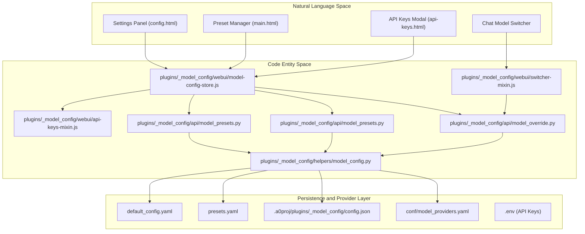
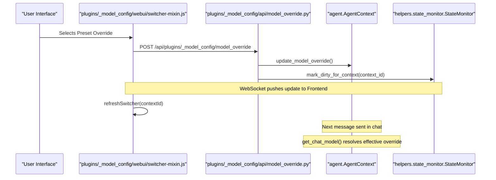

<!-- source: DeepWiki mcp.deepwiki.com · repo agent0ai/agent-zero · page 14 Model Configuration Plugin · fetched 2026-10-29 -->

# Model Configuration Plugin

Relevant source files

The following files were used as context for generating this wiki page:

- [plugins/_a0_connector/api/v1/model_switcher.py](plugins/_a0_connector/api/v1/model_switcher.py)
- [plugins/_model_config/AGENTS.md](plugins/_model_config/AGENTS.md)
- [plugins/_model_config/README.md](plugins/_model_config/README.md)
- [plugins/_model_config/api/model_override.py](plugins/_model_config/api/model_override.py)
- [plugins/_model_config/api/model_presets.py](plugins/_model_config/api/model_presets.py)
- [plugins/_model_config/extensions/python/_functions/agent/Agent/read_prompt/end/_20_anthropic_thoughts.py](plugins/_model_config/extensions/python/_functions/agent/Agent/read_prompt/end/_20_anthropic_thoughts.py)
- [plugins/_model_config/extensions/webui/chat-input-progress-start/model-switcher.html](plugins/_model_config/extensions/webui/chat-input-progress-start/model-switcher.html)
- [plugins/_model_config/helpers/model_config.py](plugins/_model_config/helpers/model_config.py)
- [plugins/_model_config/webui/api-keys-mixin.js](plugins/_model_config/webui/api-keys-mixin.js)
- [plugins/_model_config/webui/api-keys.html](plugins/_model_config/webui/api-keys.html)
- [plugins/_model_config/webui/config.html](plugins/_model_config/webui/config.html)
- [plugins/_model_config/webui/main.html](plugins/_model_config/webui/main.html)
- [plugins/_model_config/webui/model-config-store.js](plugins/_model_config/webui/model-config-store.js)
- [plugins/_model_config/webui/model-field.html](plugins/_model_config/webui/model-field.html)
- [plugins/_model_config/webui/models-summary.html](plugins/_model_config/webui/models-summary.html)
- [plugins/_model_config/webui/switcher-mixin.js](plugins/_model_config/webui/switcher-mixin.js)
- [tests/test_anthropic_thoughts_prompt.py](tests/test_anthropic_thoughts_prompt.py)
- [tests/test_model_config_project_presets.py](tests/test_model_config_project_presets.py)
- [tests/test_model_parameter_text.py](tests/test_model_parameter_text.py)
- [tests/test_webui_overflow.py](tests/test_webui_overflow.py)
- [webui/css/overflow.css](webui/css/overflow.css)

The purpose of this page is to provide a high-level overview of the `_model_config` plugin, which governs global LLM preset definitions, scoped preset selection, API-key checks, chat overrides, startup migration, and the model settings UI in Agent Zero [plugins/_model_config/README.md:3-5](), [plugins/_model_config/AGENTS.md:5](). 

As a parent page, this document covers the architecture at a macro level. For deep technical details, see the child pages:
- **[Model Config Store & UI](#14.1)** — Covers `model-config-store.js`, `config.html`, `model-field.html` field abstraction, the chat-input model switcher, API keys management, model search, and models-summary panel.
- **[Model Presets & Provider Configuration](#14.2)** — Covers `model_config.py` helpers, `presets.yaml` schema, startup migration, remote preset bootstrap, APIs, and the `model_providers.yaml` registry.

---

## Architecture Overview

The plugin bridges the gap between Python model abstractions and the Alpine.js frontend. It manages four model slots [plugins/_model_config/webui/model-config-store.js:8-13]():
1. **Main Model**: Primary model for chat, reasoning, and browser tasks.
2. **Vision Model**: Optional model used by `vision_load` when Main vision is unavailable or overridden.
3. **Utility Model**: Lightweight model for background tasks: memory management, prompt preparation, summarization.
4. **Embedding Model**: Model for generating vector embeddings used in knowledge retrieval.

### Model Configuration Data Flow

Title: "Model Configuration Data Flow: Natural Language to Code Entities"

Sources: [plugins/_model_config/webui/model-config-store.js:1-12](), [plugins/_model_config/helpers/model_config.py:32-40](), [plugins/_model_config/webui/api-keys.html:1-50](), [plugins/_model_config/README.md:9-12]()

---

## Core Subsystems

### 1. Unified Presets & Scoped Selection
Global presets are stored in `presets.yaml`, defining named collections of model slots [plugins/_model_config/README.md:8-10](). The `Default` preset is mandatory and cannot be renamed or deleted [plugins/_model_config/README.md:7](). Scopes (global, project, or agent profile) store only a lightweight reference pointing to a preset name (e.g., `{"model_preset": "Balance"}`) [plugins/_model_config/README.md:13-18](). 

For comprehensive details on preset validation, migration, and the provider registry, see **[Model Presets & Provider Configuration](#14.2)**.

Sources: [plugins/_model_config/README.md:7-18]()

### 2. API Key Management & Security
API keys are handled via a shared backend store and managed on the frontend through `api-keys-mixin.js` and `api-keys.html` [plugins/_model_config/webui/api-keys-mixin.js:1-10](), [plugins/_model_config/webui/api-keys.html:1-10](). Keys are masked in the UI and never serialized into preset YAML definitions [plugins/_model_config/README.md:11]().

Sources: [plugins/_model_config/webui/api-keys-mixin.js:1-10](), [plugins/_model_config/README.md:11]()

### 3. Model Switcher & UI Surfaces
Chats can override the scoped preset via the chat input model switcher, communicating through the `model_override` API [plugins/_model_config/README.md:27](). The user interface provides multiple modular surfaces, including the preset editor (`main.html`), scoped settings (`config.html`), and the models summary panel (`models-summary.html`) [plugins/_model_config/webui/config.html:1-27](), [plugins/_model_config/README.md:30-38]().

### Model Switching Sequence

Title: "Model Override and Resolution Sequence"

Sources: [plugins/_model_config/webui/model-config-store.js:5](), [plugins/_model_config/helpers/model_config.py:157-158]()

For deep technical implementation details on the store pattern, field abstractions, and UI components, see **[Model Config Store & UI](#14.1)**.

---

## Child Pages

- **[Model Config Store & UI](#14.1)** — Covers `model-config-store.js`, `config.html`, `model-field.html` field abstraction, the chat-input model switcher, API keys management, model search, and models-summary panel.
- **[Model Presets & Provider Configuration](#14.2)** — Covers `model_config.py` helpers, `presets.yaml` schema, startup migration, remote preset bootstrap, APIs, and the `model_providers.yaml` registry.

---
**Sources:**
* [plugins/_model_config/README.md:1-59]()
* [plugins/_model_config/helpers/model_config.py:1-174]()
* [plugins/_model_config/webui/model-config-store.js:1-213]()
* [plugins/_model_config/webui/model-field.html:1-128]()
* [plugins/_model_config/webui/api-keys-mixin.js:1-10]()
* [plugins/_model_config/AGENTS.md:1-58]()

---

