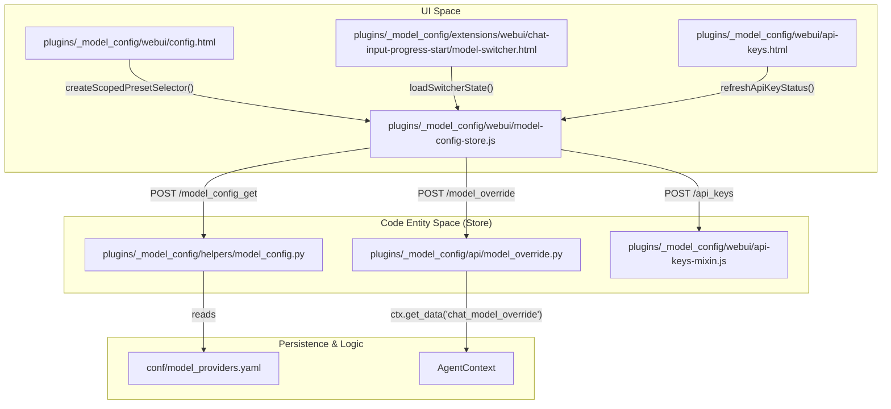
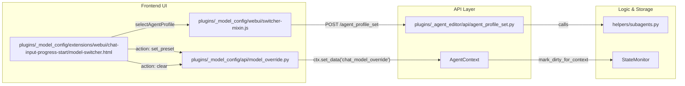

<!-- source: DeepWiki mcp.deepwiki.com · repo agent0ai/agent-zero · page 14.1 Model Config Store & UI · fetched 2026-10-29 -->

# Model Config Store & UI

Relevant source files

The following files were used as context for generating this wiki page:

- [plugins/_a0_connector/api/v1/model_switcher.py](plugins/_a0_connector/api/v1/model_switcher.py)
- [plugins/_model_config/AGENTS.md](plugins/_model_config/AGENTS.md)
- [plugins/_model_config/README.md](plugins/_model_config/README.md)
- [plugins/_model_config/api/model_override.py](plugins/_model_config/api/model_override.py)
- [plugins/_model_config/api/model_presets.py](plugins/_model_config/api/model_presets.py)
- [plugins/_model_config/extensions/python/_functions/agent/Agent/read_prompt/end/_20_anthropic_thoughts.py](plugins/_model_config/extensions/python/_functions/agent/Agent/read_prompt/end/_20_anthropic_thoughts.py)
- [plugins/_model_config/extensions/webui/chat-input-progress-start/model-switcher.html](plugins/_model_config/extensions/webui/chat-input-progress-start/model-switcher.html)
- [plugins/_model_config/helpers/model_config.py](plugins/_model_config/helpers/model_config.py)
- [plugins/_model_config/webui/api-keys-mixin.js](plugins/_model_config/webui/api-keys-mixin.js)
- [plugins/_model_config/webui/api-keys.html](plugins/_model_config/webui/api-keys.html)
- [plugins/_model_config/webui/config.html](plugins/_model_config/webui/config.html)
- [plugins/_model_config/webui/main.html](plugins/_model_config/webui/main.html)
- [plugins/_model_config/webui/model-config-store.js](plugins/_model_config/webui/model-config-store.js)
- [plugins/_model_config/webui/model-field.html](plugins/_model_config/webui/model-field.html)
- [plugins/_model_config/webui/models-summary.html](plugins/_model_config/webui/models-summary.html)
- [plugins/_model_config/webui/switcher-mixin.js](plugins/_model_config/webui/switcher-mixin.js)
- [tests/test_anthropic_thoughts_prompt.py](tests/test_anthropic_thoughts_prompt.py)
- [tests/test_model_config_project_presets.py](tests/test_model_config_project_presets.py)
- [tests/test_model_parameter_text.py](tests/test_model_parameter_text.py)
- [tests/test_webui_overflow.py](tests/test_webui_overflow.py)
- [webui/css/overflow.css](webui/css/overflow.css)

The Model Configuration system provides a unified interface for managing LLM providers, model selection, API keys, and presets. It bridges low-level provider configurations and the dynamic needs of the user interface, supporting global, project-specific, and per-chat model overrides [plugins/_model_config/AGENTS.md:5-19]().

## Overview and Data Flow

The frontend architecture centers around an Alpine.js store defined in `plugins/_model_config/webui/model-config-store.js` that synchronizes with backend API handlers. Configuration is resolved hierarchically: global defaults are overridden by project settings, which can further be overridden by agent profiles or per-chat presets [plugins/_model_config/AGENTS.md:5-19]().

### Configuration Resolution Flow

The following diagram illustrates how a request for a model configuration moves from the UI components through the store to the backend Python implementation.

**Model Configuration Resolution**

Sources: [plugins/_model_config/webui/model-config-store.js:1-213](), [plugins/_model_config/webui/config.html:10-12](), [plugins/_model_config/api/model_override.py](), [plugins/_model_config/webui/api-keys-mixin.js]()

---

## Model Config Store (`model-config-store.js`)

The `modelConfig` store is the central state manager for model settings. It is initialized via `createStore` and utilizes mixins for specialized logic [plugins/_model_config/webui/model-config-store.js:1-7]().

### Key Components
*   **MODEL_SECTIONS**: Defines the four primary model slots: `chat_model` (Main), `vision_model` (Vision sidecar), `utility_model` (Background), and `embedding_model` (Vectorization) [plugins/_model_config/webui/model-config-store.js:8-13]().
*   **State Management**: Tracks provider lists, API key statuses, and global presets [plugins/_model_config/webui/model-config-store.js:191-213]().
*   **Mixins**:
    *   `apiKeysMethods`: Handles key lifecycle including reveal, set, and persist actions [plugins/_model_config/webui/api-keys-mixin.js]().
    *   `switcherMethods`: Manages per-chat overrides and agent profile switching [plugins/_model_config/webui/switcher-mixin.js:45-182]().

### Core Functions
| Function | Purpose |
| :--- | :--- |
| `kwargsToText(obj)` | Serializes a JSON object of model parameters into an editable string format [plugins/_model_config/webui/model-config-store.js:15-21](). |
| `textToKwargs(text)` | Parses the editable string back into a JSON object for API consumption [plugins/_model_config/webui/model-config-store.js:23-45](). |
| `configFromPreset(preset, baseConfig)` | Merges a preset slot into a base configuration object [plugins/_model_config/webui/model-config-store.js:162-184](). |
| `mergeModelSlot()` | Deep merges specific model settings while handling special fields like `kwargs` [plugins/_model_config/webui/model-config-store.js:134-160](). |

Sources: [plugins/_model_config/webui/model-config-store.js:1-213]()

---

## UI Components

### Model Field Abstraction (`model-field.html`)
This is a reusable component for configuring a single model slot. It handles provider selection, model name input with search capabilities, and API key management [plugins/_model_config/webui/model-field.html:9-21]().

*   **Model Search**: Uses `searchModelsDetailed` in the store to query available models for a specific provider [plugins/_model_config/webui/model-field.html:48-60]().
*   **API Key Modes**:
    *   `store`: Keys are managed in the global provider store (shared across slots) [plugins/_model_config/webui/model-field.html:94-119]().
    *   `inline`: Keys are managed within the model object itself (used for specific overrides in presets) [plugins/_model_config/webui/model-field.html:121-128]().

Sources: [plugins/_model_config/webui/model-field.html:1-128]()

### Chat-Input Model Switcher
Located in the chat navigation bar via `plugins/_model_config/extensions/webui/chat-input-progress-start/model-switcher.html`, this component allows users to switch between configured presets or agent profiles on the fly [plugins/_model_config/extensions/webui/chat-input-progress-start/model-switcher.html:1-36]().

*   **Preset Override**: Allows storing a `chat_model_override` in the `AgentContext` via the `model_override` API [plugins/_model_config/api/model_override.py]().
*   **Agent Profiles**: The switcher supports returning to the scoped preset or applying chat-only selections. It fetches available profiles via the agent editor API [plugins/_model_config/AGENTS.md:32-44]().
*   **Notification**: When a model override changes, the system notifies the context and marks the state as dirty to trigger UI updates [plugins/_model_config/api/model_override.py]().

**UI Interaction to Code Mapping**

Sources: [plugins/_model_config/api/model_override.py](), [plugins/_model_config/AGENTS.md:32-44](), [plugins/_model_config/webui/switcher-mixin.js:45-182]()

### API Key Management (`api-keys.html`)
A dedicated modal for managing credentials across all providers [plugins/_model_config/webui/api-keys.html:50-55]().
*   **Round-Robin Support**: Users can input multiple keys separated by commas for load balancing or rate-limit mitigation [plugins/_model_config/webui/api-keys.html:53-54]().
*   **Dirty State Tracking**: The store tracks which keys have been modified (`apiKeyDirty`) to enable the "Save" button only when changes exist [plugins/_model_config/webui/api-keys.html:17-20]().
*   **Reveal Mechanism**: API keys are masked by default; the `revealApiKey` method fetches the plain-text key from the backend when requested [plugins/_model_config/webui/api-keys.html:27-33]().
*   **Sync to Settings**: Successfully saved keys are synchronized back to the main settings store to prevent accidental overwrites [plugins/_model_config/webui/api-keys.html:34-45]().

Sources: [plugins/_model_config/webui/api-keys.html:1-135]()

### Models Summary Panel (`models-summary.html`)
The `models-summary.html` panel provides a high-level overview of the currently active model configuration. It uses `createGlobalPresetSelector()` to initialize the selection state [plugins/_model_config/webui/models-summary.html:18-20]().

*   **Loading State**: Displays a progress indicator while model presets are being fetched [plugins/_model_config/webui/models-summary.html:21-25]().
*   **Component Reuse**: Reuses the `preset-overview.html` component to show the details of the selected preset [plugins/_model_config/webui/models-summary.html:26-28]().

Sources: [plugins/_model_config/webui/models-summary.html:1-48]()

---

## Preset System

The preset system allows saving named groups of model configurations. Presets are managed via `plugins/_model_config/webui/main.html` and the `modelConfig` store [plugins/_model_config/webui/main.html:19-26]().

*   **Normalization**: Raw presets are normalized to include standard fields and serialized `kwargs` for the UI [plugins/_model_config/webui/model-config-store.js:162-184]().
*   **Cleaning**: Before saving, UI-specific fields and implicit defaults are stripped to maintain a clean YAML schema [plugins/_model_config/webui/model-config-store.js:103-128]().
*   **Implicit Defaults**: The system defines default values for context lengths and rate limits for utility and embedding slots to avoid bloating the saved configuration files [plugins/_model_config/webui/model-config-store.js:70-95]().
*   **Locked Presets**: The "Default" preset is the baseline and cannot be renamed or deleted by the user [plugins/_model_config/helpers/model_config.py:13]().
*   **Replacement Policy**: Specific fields like `kwargs` are replaced rather than merged when applying presets to prevent parameter leakage between different providers [plugins/_model_config/webui/model-config-store.js:96-101]().

Sources: [plugins/_model_config/webui/model-config-store.js:70-184](), [plugins/_model_config/webui/main.html:18-128](), [plugins/_model_config/helpers/model_config.py:1-51](), [plugins/_model_config/AGENTS.md:15-30]()

---

