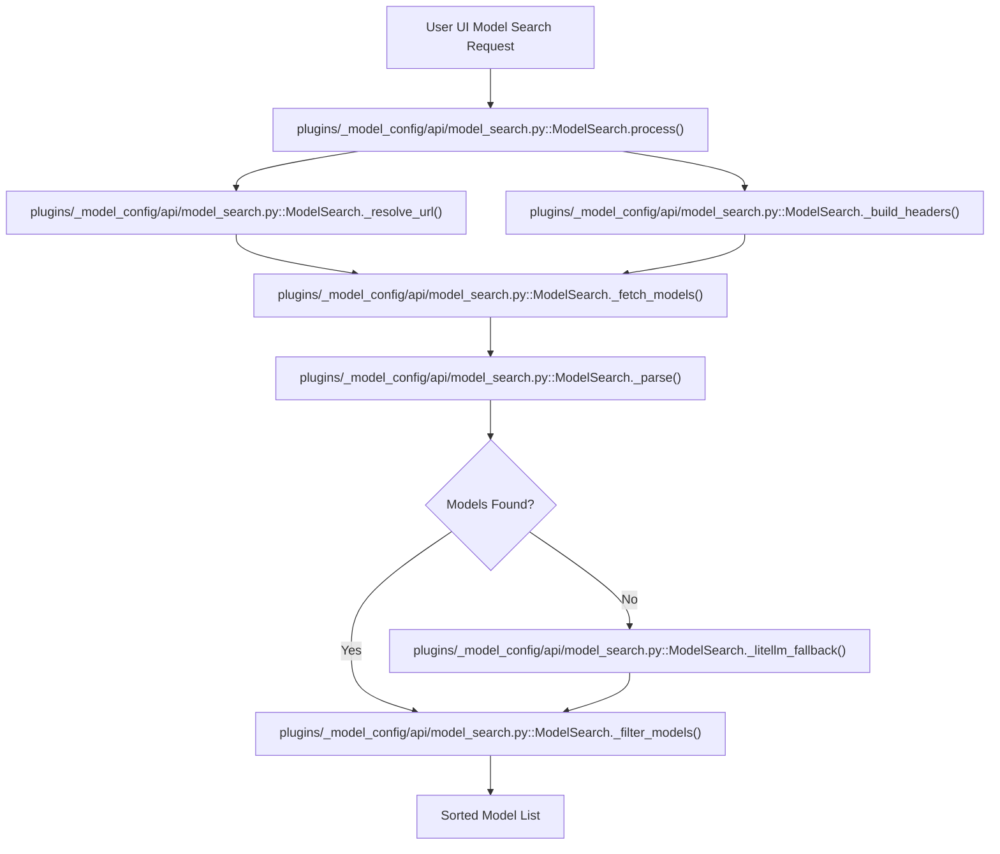
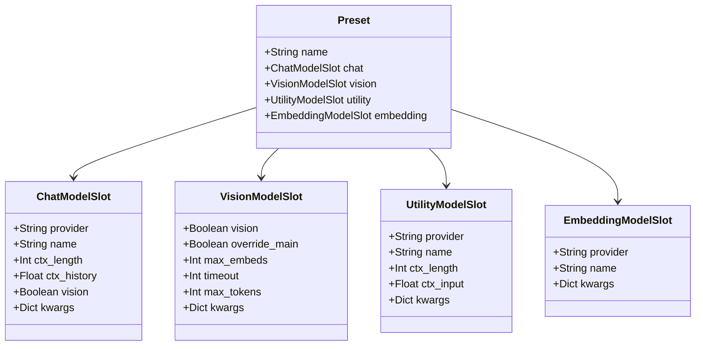
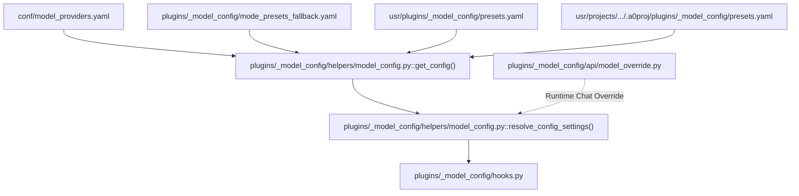
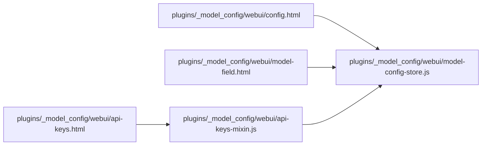

<!-- source: DeepWiki mcp.deepwiki.com · repo agent0ai/agent-zero · page 14.2 Model Presets & Provider Configuration · fetched 2026-10-29 -->

# Model Presets & Provider Configuration

Relevant source files

The following files were used as context for generating this wiki page:

- [conf/AGENTS.md](conf/AGENTS.md)
- [conf/model_providers.yaml](conf/model_providers.yaml)
- [conf/projects.default.gitignore](conf/projects.default.gitignore)
- [conf/skill.default.gitignore](conf/skill.default.gitignore)
- [conf/workdir.gitignore](conf/workdir.gitignore)
- [extensions/python/message_loop_prompts_after/_70_include_agent_info.py](extensions/python/message_loop_prompts_after/_70_include_agent_info.py)
- [plugins/_model_config/api/model_config_get.py](plugins/_model_config/api/model_config_get.py)
- [plugins/_model_config/api/model_config_set.py](plugins/_model_config/api/model_config_set.py)
- [plugins/_model_config/api/model_search.py](plugins/_model_config/api/model_search.py)
- [plugins/_model_config/default_config.yaml](plugins/_model_config/default_config.yaml)
- [plugins/_model_config/extensions/python/banners/_20_missing_api_key.py](plugins/_model_config/extensions/python/banners/_20_missing_api_key.py)
- [plugins/_model_config/hooks.py](plugins/_model_config/hooks.py)
- [plugins/_model_config/plugin.yaml](plugins/_model_config/plugin.yaml)
- [plugins/_model_config/provider_metadata.yaml](plugins/_model_config/provider_metadata.yaml)
- [plugins/_onboarding/webui/onboarding-providers.js](plugins/_onboarding/webui/onboarding-providers.js)
- [prompts/agent.extras.agent_info.md](prompts/agent.extras.agent_info.md)
- [prompts/agent.extras.workdir_structure.md](prompts/agent.extras.workdir_structure.md)
- [tests/test_litellm_sdk.py](tests/test_litellm_sdk.py)
- [tests/test_model_config_api_keys.py](tests/test_model_config_api_keys.py)
- [tests/test_model_search.py](tests/test_model_search.py)

The **Model Configuration** system in Agent Zero provides a robust abstraction layer for managing LLM providers, model parameters, and reusable presets across different organizational scopes (Global, Project, and Agent Profile). It centralizes the complexity of LiteLLM integration, API key management, dynamic model discovery, and startup preset bootstrap.

---

## Provider Registry (`conf/model_providers.yaml`)

The provider registry defines how Agent Zero communicates with various LLM backends. It maps internal provider IDs to LiteLLM configurations and supplies metadata for model discovery and the Web UI.

### Configuration Structure
The registry is defined in `conf/model_providers.yaml`. It separates configurations into `chat` and `embedding` sections [conf/model_providers.yaml:28-231]().

| Field | Description | Code / File Reference |
| :--- | :--- | :--- |
| `name` | Human-readable label used in the Settings UI. | [conf/model_providers.yaml:12]() |
| `litellm_provider` | The string passed to LiteLLM to identify the backend protocol (e.g., `openai`, `anthropic`, `gemini`). | [conf/model_providers.yaml:13]() |
| `kwargs` | Dictionary of extra parameters like `api_base`, `extra_headers`, or provider-specific flags. | [conf/model_providers.yaml:16-17]() |
| `models_list` | Configuration for dynamic model discovery via API (endpoint URL, format, query parameters). | [conf/model_providers.yaml:19-26]() |

### Model Discovery Flow
The `ModelSearch` API handler [plugins/_model_config/api/model_search.py:37]() uses the `models_list` configuration to fetch available models from a provider's endpoint.

1. **URL Resolution**: The `_resolve_url` method combines `endpoint_url` with either `api_base` or `default_base` [plugins/_model_config/api/model_search.py:142](). It handles versioned endpoints to avoid duplicated path segments.
2. **Authentication**: `_build_headers` injects API keys into headers or query parameters [plugins/_model_config/api/model_search.py:175](). Local providers like `omlx`, `vllm`, or `llama_cpp` omit auth headers when using placeholder keys.
3. **Parsing**: The `_parse` method converts provider-specific JSON responses (OpenAI, Google, Ollama formats) into a standard list of model strings [plugins/_model_config/api/model_search.py:37-188]().
4. **Fallback**: If no API is available, `_litellm_fallback` queries the local `litellm` registry for known models [plugins/_model_config/api/model_search.py:53]().
5. **Filtering**: The `_filter_models` method removes non-chat models (e.g., `dall-e`, `whisper`, `embedding`) from chat dropdowns [plugins/_model_config/api/model_search.py:60]().

Diagram: Model Discovery & Search Pipeline (Natural Language to Code Entity Space)

Sources:
- [conf/model_providers.yaml:1-231]()
- [plugins/_model_config/api/model_search.py:37-188]()

---

## Unified Preset Schema & `presets.yaml`

Presets are named shortcuts for model configurations, allowing users to switch between setups like "Default", "Balance", or "Max Power" without manual re-entry.

### Preset Scopes & File Layout
* **Global**: User-defined presets stored in `usr/plugins/_model_config/presets.yaml`.
* **Project**: Scoped overrides stored within a project's metadata directory at `.a0proj/plugins/_model_config/presets.yaml`.
* **Fallback**: Plugin-local fallback `mode_presets_fallback.yaml` used when no saved user presets exist.

### Unified Schema Structure
A preset defines configurations for four distinct model slots: `chat`, `vision`, `utility`, and `embedding`. Non-default presets may inherit omitted slots from `Default`, but replace per-slot `kwargs` to prevent parameter leakage across providers [conf/AGENTS.md:26]().

Diagram: Unified Preset Schema Classes

Sources:
- [conf/AGENTS.md:17-34]()

---

## Startup Migration & Remote Preset Bootstrap

The `_model_config` plugin coordinates automatic configuration migration and remote preset bootstrapping on application startup.

### Startup Migration Flow
1. **Legacy Conversion**: On startup, migration routines convert legacy full model configurations and project-level presets into the unified preset schema [conf/AGENTS.md:12]().
2. **File Backup & Sanitization**: Replaced user files are backed up once. Inline API keys and secrets are stripped from preset YAML files before persistence.
3. **Idempotency**: Migration checks short-circuit on subsequent launches once `usr/plugins/_model_config/presets.yaml` is detected.

### Remote Preset Bootstrap
* If `usr/plugins/_model_config/presets.yaml` is completely missing on startup, the system attempts to fetch remote presets from official repositories.
* Downloaded templates are validated, stripped of any embedded credentials, and saved locally.
* If network connectivity fails or validation errors occur, the system falls back to bundling and persisting `mode_presets_fallback.yaml`.

Sources:
- [conf/AGENTS.md:12]()

---

## `model_config.py` Helpers & Resolution Engine

The core logic for resolving model definitions and parameters resides in `plugins/_model_config/helpers/model_config.py`.

### Key Functions
* `get_config(agent, project_name, agent_profile)`: Retrieves the fully resolved model configuration for an active agent or scope.
* `resolve_config_settings(settings)`: Merges selection-only plugin settings with preset definitions to produce the full runtime model configuration.
* `preset_to_config(preset)` / `config_to_preset(config)`: Serializers converting between unified preset objects and legacy multi-slot runtime config structures.
* `provider_requires_api_key(provider, model_type)`: Evaluates provider metadata and configuration flags to determine if an API key is mandatory.

### Resolution Precedence & Data Flow
Configuration resolution follows a strict hierarchical inheritance and override chain:

Diagram: Configuration Resolution Engine (Natural Language to Code Entity Space)

Sources:
- [plugins/_model_config/hooks.py]()

---

## `model_presets` & `model_override` APIs

Backend API endpoints coordinate model preset management and runtime chat overrides via Flask routes:
* **`model_presets` API**: Manages global and project-level preset collections (`GET`, `POST`, `DELETE`), handling renaming, resetting to bundled defaults, and validation against the unified schema.
* **`model_override` API**: Allows runtime, per-chat model adjustments stored in context metadata without mutating global or project preset definitions.

Sources:
- [conf/AGENTS.md:10]()

---

## API Keys & UI Integration

The `_model_config` plugin integrates provider authentication with frontend settings screens and prompt injection hooks.

### API Key Management
* **Vault Storage**: API keys are saved securely in `.env` via `dotenv.save_dotenv_value` and managed through the `ApiKeys` backend class [tests/test_model_config_api_keys.py:54-65]().
* **Readiness Checking**: `is_chat_model_configured` verifies that a valid provider, model name, and corresponding API key are present [tests/test_model_config_api_keys.py:73-90]().
* **Startup Banners**: The `MissingApiKeyCheck` extension [plugins/_model_config/extensions/python/banners/_20_missing_api_key.py:5]() evaluates active model configurations and surfaces actionable setup prompts in the Web UI if credentials are missing [tests/test_model_config_api_keys.py:120-143]().

### UI Component & State Mapping

Sources:
- [tests/test_model_config_api_keys.py:54-143]()
- [plugins/_model_config/extensions/python/banners/_20_missing_api_key.py:5-28]()
- [conf/AGENTS.md:9-11]()

---

