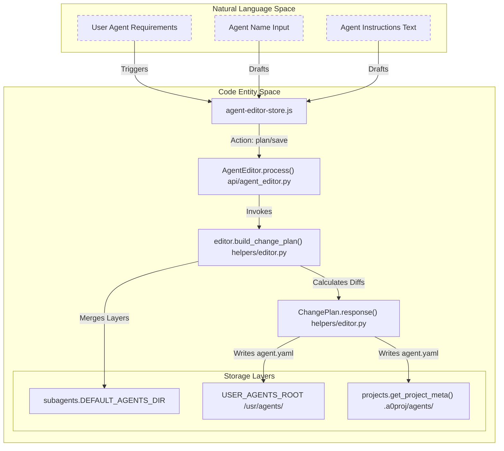
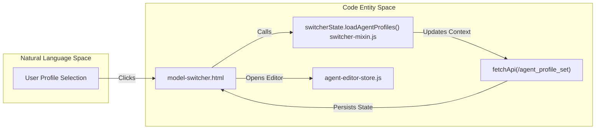

<!-- source: DeepWiki mcp.deepwiki.com · repo agent0ai/agent-zero · page 15 Agent Editor & Migration · fetched 2026-10-29 -->

# Agent Editor & Migration

Relevant source files

The following files were used as context for generating this wiki page:

- [plugins/_agent_editor/AGENTS.md](plugins/_agent_editor/AGENTS.md)
- [plugins/_agent_editor/README.md](plugins/_agent_editor/README.md)
- [plugins/_agent_editor/api/agent_editor.py](plugins/_agent_editor/api/agent_editor.py)
- [plugins/_agent_editor/helpers/editor.py](plugins/_agent_editor/helpers/editor.py)
- [plugins/_agent_editor/webui/agent-editor-store.js](plugins/_agent_editor/webui/agent-editor-store.js)
- [plugins/_agent_editor/webui/main.html](plugins/_agent_editor/webui/main.html)
- [tests/test_agent_editor.py](tests/test_agent_editor.py)
- [tests/test_agent_editor_webui.py](tests/test_agent_editor_webui.py)

## Purpose and Scope

This page provides a high-level overview of Agent Zero's profile management and harness migration subsystems. The **Agent Editor** (`_agent_editor` plugin) handles the creation and modification of agent personas through a deterministic sparse override system [plugins/_agent_editor/README.md:3-9](), while the **Migrate Agents** (`_migrate_agents` plugin) enables importing retained work and prompts from external agent harnesses. 

This is a parent page. For deep technical details, refer to the child pages:
- [Agent Editor](#15.1)
- [Migrate Agents](#15.2)

Sources: [plugins/_agent_editor/README.md:1-27](), [plugins/_agent_editor/AGENTS.md:1-83]()

---

## Agent Editor Overview

The Agent Editor subsystem manages agent definitions, prompts, and capability policies without invoking language models directly [plugins/_agent_editor/AGENTS.md:18](). It operates via a **sparse override** model [plugins/_agent_editor/README.md:3-5](), writing only modified attributes and files to writable storage scopes (`usr/agents/` globally or `.a0proj/agents/` within specific projects) while leaving bundled core profiles read-only [plugins/_agent_editor/AGENTS.md:21-23,48]().

The editor provides two distinct user interfaces: **Easy Mode** for rapid profile creation and **Advanced Mode** utilizing a full-height `ACE` editor for Markdown-based prompt refinement [plugins/_agent_editor/AGENTS.md:49-52](). All mutations are compiled into a validation artifact (`ChangePlan`) that previews exact file writes and deletions prior to application [plugins/_agent_editor/README.md:8-9]().

For deep technical coverage of editing modes, sparse overrides, scoping rules, capability policies (`tool_policy`), the `ChangePlan` mutation boundary, avatar uploads, and model preset integration, see [Agent Editor](#15.1).

Sources: [plugins/_agent_editor/README.md:1-27](), [plugins/_agent_editor/AGENTS.md:1-83](), [plugins/_agent_editor/helpers/editor.py:1-112]()

---

## Migrate Agents Overview

The **Migrate Agents** (`_migrate_agents`) plugin facilitates onboarding users from external agent harnesses and platforms into Agent Zero. It parses retained artifacts—such as custom prompts, chat threads, and tool definitions—and translates them into native Agent Zero directory structures.

The migration workflow incorporates a **Preview/Import** pipeline with built-in redaction rules to strip sensitive tokens, API keys, or private identifiers, ensuring strict privacy boundaries during ingestion. Source materials are mapped directly to project knowledge bases or global user directories.

For detailed coverage of source harnesses, preview/import flows, redaction rules, and destination mapping, see [Migrate Agents](#15.2).

Sources: [plugins/_agent_editor/README.md:3-10]()

---

## Code Mapping: Agent Editor

| Component | Code Entity | Role |
| :--- | :--- | :--- |
| **Backend Orchestration** | `plugins/_agent_editor/helpers/editor.py` | Implements `build_editor_state`, `build_change_plan`, and `apply_change_plan` [plugins/_agent_editor/helpers/editor.py:9]() |
| **API Endpoint Handler** | `plugins/_agent_editor/api/agent_editor.py` | Dispatches actions (`list`, `load`, `plan`, `save`, `set_enabled`, `delete`) [plugins/_agent_editor/api/agent_editor.py:12-122]() |
| **Frontend Store** | `plugins/_agent_editor/webui/agent-editor-store.js` | Manages Alpine.js state, modal views, and `ACE` editor synchronization [plugins/_agent_editor/webui/agent-editor-store.js:1-12]() |
| **Avatar Processing** | `plugins/_agent_editor/api/agent_editor_avatar.py` | Handles image upload normalization and staged avatar storage [plugins/_agent_editor/api/agent_editor_avatar.py:16]() |

Sources: [plugins/_agent_editor/helpers/editor.py:1-20](), [plugins/_agent_editor/api/agent_editor.py:1-20](), [plugins/_agent_editor/webui/agent-editor-store.js:1-15]()

---

## Subsystem Architecture Diagrams

### Profile Resolution and Editing Flow

Sources: [plugins/_agent_editor/helpers/editor.py:161-192](), [plugins/_agent_editor/AGENTS.md:45-48](), [plugins/_agent_editor/webui/agent-editor-store.js:173-174]()

### Model Switcher & Agent Selection

Sources: [plugins/_model_config/extensions/webui/chat-input-progress-start/model-switcher.html:17-125](), [plugins/_model_config/webui/switcher-mixin.js:166-189](), [tests/test_agent_editor_webui.py:48-55]()

---

