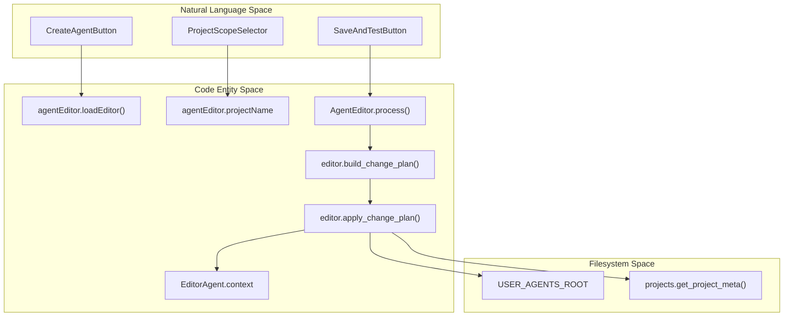
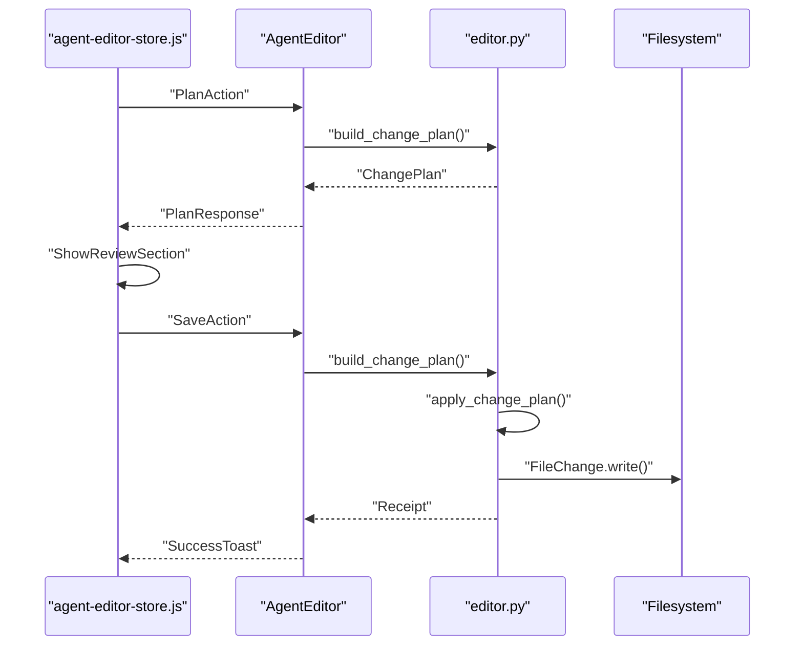

<!-- source: DeepWiki mcp.deepwiki.com · repo agent0ai/agent-zero · page 15.1 Agent Editor · fetched 2026-10-29 -->

# Agent Editor

Relevant source files

The following files were used as context for generating this wiki page:

- [api/banners.py](api/banners.py)
- [api/message.py](api/message.py)
- [extensions/python/agent_init/_15_load_profile_settings.py](extensions/python/agent_init/_15_load_profile_settings.py)
- [extensions/python/hist_add_before/_10_mask_content.py](extensions/python/hist_add_before/_10_mask_content.py)
- [extensions/python/hist_add_tool_result/AGENTS.md](extensions/python/hist_add_tool_result/AGENTS.md)
- [extensions/python/hist_add_tool_result/_90_save_tool_call_file.py](extensions/python/hist_add_tool_result/_90_save_tool_call_file.py)
- [plugins/_agent_editor/AGENTS.md](plugins/_agent_editor/AGENTS.md)
- [plugins/_agent_editor/README.md](plugins/_agent_editor/README.md)
- [plugins/_agent_editor/api/agent_editor.py](plugins/_agent_editor/api/agent_editor.py)
- [plugins/_agent_editor/helpers/editor.py](plugins/_agent_editor/helpers/editor.py)
- [plugins/_agent_editor/webui/agent-editor-store.js](plugins/_agent_editor/webui/agent-editor-store.js)
- [plugins/_agent_editor/webui/main.html](plugins/_agent_editor/webui/main.html)
- [tests/test_agent_editor.py](tests/test_agent_editor.py)
- [tests/test_agent_editor_webui.py](tests/test_agent_editor_webui.py)
- [tests/test_tool_result_file_persistence.py](tests/test_tool_result_file_persistence.py)

The Agent Editor is a deterministic system for creating and managing agent profiles [plugins/_agent_editor/AGENTS.md:3-5](). It provides two distinct workflows: an **Easy mode** for quick identity and instruction updates, and an **Advanced mode** for deep prompt engineering, capability policy management, and asset control [plugins/_agent_editor/README.md:3-5](). 

The system operates on a **sparse override** principle, writing only the necessary changes to the selected scope (Global or Project) while inheriting from read-only bundled layers [plugins/_agent_editor/AGENTS.md:18-27]().

Sources: [plugins/_agent_editor/AGENTS.md:3-27](), [plugins/_agent_editor/README.md:3-5]()

## Architecture & Data Flow

The Agent Editor follows a strict mutation boundary. It never invokes LLM models and instead uses a `ChangePlan` system to validate and preview file operations before execution [plugins/_agent_editor/AGENTS.md:16-18]().

### Core Components
*   **`helpers/editor.py`**: The central logic hub that composes state from profile, prompt, tool, and skill owners [plugins/_agent_editor/helpers/editor.py:1-20]().
*   **`AgentEditor` (API Handler)**: Manages authenticated routes for listing, loading, planning, and saving agent configurations [plugins/_agent_editor/api/agent_editor.py:1-20]().
*   **`agent-editor-store.js`**: The Alpine.js store managing the frontend state, draft tracking, and UI logic [plugins/_agent_editor/webui/agent-editor-store.js:95-131]().

### Data Mutation Boundary
The editor uses a `ChangePlan` class to track intended filesystem changes [plugins/_agent_editor/helpers/editor.py:79-88](). This ensures atomicity and allows the user to review exactly what files will be written or deleted.

| Entity | Code Identifier | Role |
| :--- | :--- | :--- |
| **Change Plan** | `ChangePlan` | Container for `FileChange` objects and warnings [plugins/_agent_editor/helpers/editor.py:79-88](). |
| **Mutation Lock** | `_MUTATION_LOCK` | RLock ensuring thread-safe filesystem writes [plugins/_agent_editor/helpers/editor.py:36-36](). |
| **Profile Root** | `_profile_root()` | Resolves the absolute path to an agent's directory based on scope [plugins/_agent_editor/helpers/editor.py:161-166](). |

### Logical Component Map

Sources: [plugins/_agent_editor/webui/agent-editor-store.js:140-160](), [plugins/_agent_editor/helpers/editor.py:24-24](), [plugins/_agent_editor/api/agent_editor.py:39-50](), [plugins/_agent_editor/helpers/editor.py:79-112]()

Sources: [plugins/_agent_editor/AGENTS.md:9-15](), [plugins/_agent_editor/api/agent_editor.py:12-15](), [plugins/_agent_editor/helpers/editor.py:24-112](), [plugins/_agent_editor/webui/agent-editor-store.js:95-131]()

## Scoping and Overrides

Agent Zero uses a layered architecture for agent profiles. The editor allows users to choose the **writable layer** [plugins/_agent_editor/AGENTS.md:21-27]():

1.  **Global Scope**: Located in `usr/agents/<profile-id>`. These agents are available across all projects.
2.  **Project Scope**: Located in `usr/projects/<project>/.a0proj/agents/<profile-id>`. These inherit from the global layer but allow project-specific overrides [plugins/_agent_editor/AGENTS.md:21-27]().

The editor detects if a profile is customized (has overrides in the current scope) or deletable (is owned by the current scope) [plugins/_agent_editor/AGENTS.md:45-47]().

Sources: [plugins/_agent_editor/AGENTS.md:21-47]()

## Capability Policies (Tools, MCPs, Skills)

The editor manages access to tools, MCP servers, and skills using a tri-state policy system [plugins/_agent_editor/AGENTS.md:55-60]():

*   **Inherit (Default)**: Follows the agent's general policy.
*   **Allow (On)**: Explicitly adds the item to the `allowed` list in the configuration [plugins/_agent_editor/webui/agent-editor-store.js:55-60]().
*   **Block (Off)**: Explicitly adds the item to the `blocked` list [plugins/_agent_editor/webui/agent-editor-store.js:55-60]().

### Policy Data Structure
The `policyFromState` function normalizes these UI states into a standard JSON structure used by the `tool_policy` and `skills` helpers [plugins/_agent_editor/webui/agent-editor-store.js:32-45]().

Sources: [plugins/_agent_editor/AGENTS.md:55-60](), [plugins/_agent_editor/webui/agent-editor-store.js:32-45]()

## Advanced Editing & Prompts

In Advanced Mode, the editor provides a full-height **ACE Editor** for Markdown files [plugins/_agent_editor/AGENTS.md:49-52]().

*   **Prompt Files**: Users can edit system prompt fragments. The `SPECIFICS_FILE` (`agent.system.main.specifics.md`) is the primary location for custom agent instructions [plugins/_agent_editor/helpers/editor.py:24-24]().
*   **Validation**: New profiles require a display name and non-empty instructions. The backend enforces a maximum size for prompt files (`MAX_PROMPT_BYTES` = 512KB) [plugins/_agent_editor/helpers/editor.py:26-26]().

Sources: [plugins/_agent_editor/AGENTS.md:49-54](), [plugins/_agent_editor/helpers/editor.py:24-26]()

## Implementation Details

### Avatar Management
The `AgentEditorAvatar` class handles image uploads. It supports cropping and resizing to a standard 512x512 resolution, storing the result as a PNG in the profile's `assets/` directory [plugins/_agent_editor/api/agent_editor_avatar.py:1-30](), [plugins/_agent_editor/helpers/editor.py:28-30]().

### Model Switcher Integration
The Agent Editor integrates with the `_model_config` plugin. It persists only a **preset reference** (e.g., "Default") rather than full model parameters, ensuring that model provider updates don't break agent definitions [plugins/_agent_editor/AGENTS.md:63-64]().

### Change Flow Diagram

Sources: [plugins/_agent_editor/webui/agent-editor-store.js:235-255](), [plugins/_agent_editor/api/agent_editor.py:39-50](), [plugins/_agent_editor/helpers/editor.py:79-112]()

### Key Functions Reference

| Function | File | Description |
| :--- | :--- | :--- |
| `build_editor_state` | [plugins/_agent_editor/helpers/editor.py:241-241]() | Aggregates all data needed to populate the editor UI for a specific profile. |
| `build_change_plan` | [plugins/_agent_editor/helpers/editor.py:448-448]() | Compares a draft patch against current state to generate file operations. |
| `apply_change_plan` | [plugins/_agent_editor/helpers/editor.py:611-611]() | Executes the filesystem mutations described in a plan. |
| `save_easy_profile` | [plugins/_agent_editor/helpers/editor.py:135-135]() | Helper for rapid profile creation (used by slash commands). |
| `list_profiles` | [plugins/_agent_editor/helpers/editor.py:194-194]() | Returns a summary list of all available agents in the current scope. |

Sources: [plugins/_agent_editor/AGENTS.md:63-64](), [plugins/_agent_editor/helpers/editor.py:135-630](), [plugins/_agent_editor/api/agent_editor.py:39-50](), [plugins/_agent_editor/webui/agent-editor-store.js:235-255]()

---

