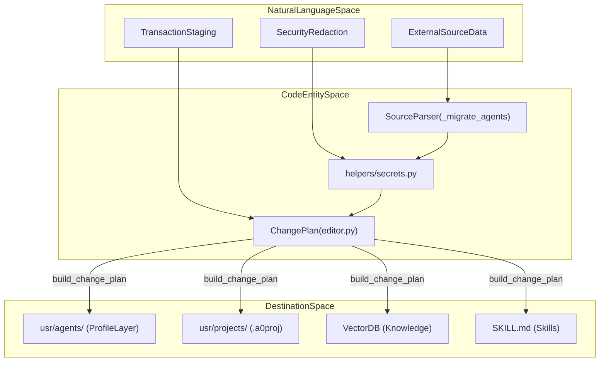
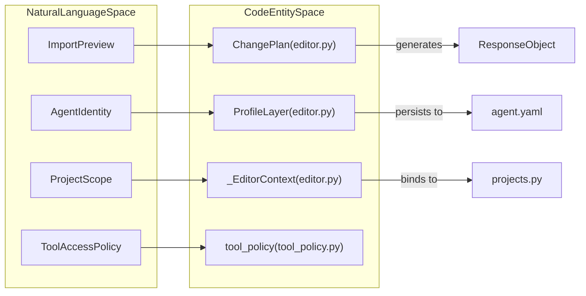

<!-- source: DeepWiki mcp.deepwiki.com · repo agent0ai/agent-zero · page 15.2 Migrate Agents · fetched 2026-10-29 -->

# Migrate Agents

Relevant source files

The following files were used as context for generating this wiki page:

- [helpers/plugins.py](helpers/plugins.py)
- [helpers/plugins.py.dox.md](helpers/plugins.py.dox.md)
- [helpers/providers.py](helpers/providers.py)
- [helpers/providers.py.dox.md](helpers/providers.py.dox.md)
- [helpers/subagents.py](helpers/subagents.py)
- [helpers/subagents.py.dox.md](helpers/subagents.py.dox.md)
- [plugins/_agent_editor/AGENTS.md](plugins/_agent_editor/AGENTS.md)
- [plugins/_agent_editor/README.md](plugins/_agent_editor/README.md)
- [plugins/_agent_editor/api/agent_editor.py](plugins/_agent_editor/api/agent_editor.py)
- [plugins/_agent_editor/helpers/editor.py](plugins/_agent_editor/helpers/editor.py)
- [plugins/_agent_editor/webui/agent-editor-store.js](plugins/_agent_editor/webui/agent-editor-store.js)
- [plugins/_agent_editor/webui/main.html](plugins/_agent_editor/webui/main.html)
- [tests/test_agent_editor.py](tests/test_agent_editor.py)
- [tests/test_agent_editor_webui.py](tests/test_agent_editor_webui.py)
- [tests/test_plugin_activation_ui.py](tests/test_plugin_activation_ui.py)
- [tests/test_plugin_asset_precedence.py](tests/test_plugin_asset_precedence.py)
- [tests/test_plugin_hook_context.py](tests/test_plugin_hook_context.py)
- [tests/test_subagent_metadata_merge.py](tests/test_subagent_metadata_merge.py)

The migration system facilitates the transition of work, settings, and agent identities from other popular agent frameworks into Agent Zero via the `_migrate_agents` subsystem. It provides a deterministic workflow for importing retained material from sources like OpenClaw, Hermes Agent, OpenCode, Claude Code, and OpenAI Codex while maintaining privacy boundaries and redaction rules `[plugins/_agent_editor/AGENTS.md:5-6]()`.

## Purpose and Scope

The migration system bridges the gap between external agent environments and Agent Zero's structured internal architecture. It maps source material to primary destinations including user profiles (`usr/agents/`), project scopes (`usr/projects/`), vector-indexed knowledge areas, and reusable skills `[plugins/_agent_editor/AGENTS.md:9-15]()`.

The migration process utilizes a **Preview/Import** flow managed by the underlying editor infrastructure (`plugins/_agent_editor/`), ensuring users can review exactly what data is being moved and how it is being transformed before any writes occur to the filesystem `[plugins/_agent_editor/helpers/editor.py:80-112]()`.

Sources: `[plugins/_agent_editor/AGENTS.md:5-15]`, `[plugins/_agent_editor/helpers/editor.py:80-112]()`

## Migration Architecture

The plugin operates as an extension of the agent editor infrastructure, leveraging sparse override systems to create new profiles or modify existing ones based on imported data `[plugins/_agent_editor/helpers/editor.py:80-112]()`.

### Data Flow Diagram

This diagram bridges natural language concepts to specific code entities in the migration pipeline.

**Migration Transformation Pipeline**

Sources: `[plugins/_agent_editor/helpers/editor.py:80-112]()`, `[plugins/_agent_editor/webui/agent-editor-store.js:20-30]()`

## Implementation Details

### The Mutation Boundary
Migration actions are handled through transactional change planning where the `ChangePlan` class acts as a transaction log tracking every file that will be written or deleted during migration `[plugins/_agent_editor/helpers/editor.py:80-112]()`.

- **`ChangePlan.write(path, content)`**: Stages a file write. If the content matches the existing file on disk, the change is ignored to minimize I/O `[plugins/_agent_editor/helpers/editor.py:89-94]()`.
- **`ChangePlan.delete(path)`**: Stages a file deletion, ensuring it only targets files that actually exist `[plugins/_agent_editor/helpers/editor.py:96-101]()`.
- **`apply_change_plan(plan)`**: The final execution step that commits the staged `FileChange` objects to the filesystem `[plugins/_agent_editor/helpers/editor.py:116-129]()`.

Sources: `[plugins/_agent_editor/helpers/editor.py:80-129]()`

### Mapping Logic and Redaction
The migration plugin maps external entities to the Agent Zero profile structure:
- **Instructions and System Prompts**: Mapped to `agent.system.main.specifics.md` `[plugins/_agent_editor/helpers/editor.py:24-24]()`.
- **Metadata**: Mapped to `agent.yaml` `[plugins/_agent_editor/helpers/editor.py:118-121]()`.
- **Privacy and Redaction**: Privacy is maintained by filtering source data before generating transaction changes, ensuring sensitive tokens or API keys are scrubbed or flagged in warnings `[plugins/_agent_editor/helpers/editor.py:80-88]()`.

Sources: `[plugins/_agent_editor/helpers/editor.py:24-24]()`, `[plugins/_agent_editor/helpers/editor.py:80-121]()`

## System Entity Mapping

The following diagram bridges natural language migration concepts to their underlying code entities.

**Code Entity Mapping: Migration Components**

Sources: `[plugins/_agent_editor/helpers/editor.py:39-66]()`, `[plugins/_agent_editor/helpers/editor.py:80-112]()`

## Technical Workflow: Preview/Import

The migration follows a two-step verification process to prevent accidental data loss or corruption of the `usr/` directory `[plugins/_agent_editor/helpers/editor.py:80-112]()`.

| Step | Action | Logic |
| :--- | :--- | :--- |
| **1. Preview** | `action: "plan"` | Calls `editor.build_change_plan`. Returns a JSON object listing all `written` and `deleted` paths without modifying the disk `[plugins/_agent_editor/helpers/editor.py:80-112]()`. |
| **2. Review** | UI Display | The WebUI renders the `ChangePlan` response, highlighting warnings `[plugins/_agent_editor/webui/agent-editor-store.js:123-125]()`. |
| **3. Import** | `action: "save"` | Calls `editor.apply_change_plan`. Executes filesystem mutations and re-indexes the new agent profile `[plugins/_agent_editor/helpers/editor.py:116-129]()`. |

Sources: `[plugins/_agent_editor/helpers/editor.py:80-129]`, `[plugins/_agent_editor/webui/agent-editor-store.js:120-130]()`

### Profile ID Normalization
During migration, external agent names are normalized to fit the Agent Zero ID standard (lowercase, alphanumeric, hyphens/underscores, max 64 chars) `[plugins/_agent_editor/helpers/editor.py:124-132]()`.
- **Function**: `slugifyProfileName(value)` in the frontend `[plugins/_agent_editor/webui/agent-editor-store.js:20-30]()`.
- **Function**: `profile_id_from_title(title)` in the backend `[plugins/_agent_editor/helpers/editor.py:124-132]()`.

Sources: `[plugins/_agent_editor/helpers/editor.py:124-132]`, `[plugins/_agent_editor/webui/agent-editor-store.js:20-30]()`

## Supported Source Mappings

| Source Framework | Data Extracted | A0 Destination |
| :--- | :--- | :--- |
| **OpenClaw** | Personalities, Prompt Fragments | `usr/agents/<id>/prompts/` `[plugins/_agent_editor/AGENTS.md:5-15]()` |
| **Hermes Agent** | Tool Definitions, Memory | `usr/agents/<id>/tools/`, VectorDB `[plugins/_agent_editor/AGENTS.md:5-15]()` |
| **Claude Code** | Project Context, Instructions | `usr/projects/<name>/.a0proj/` `[plugins/_agent_editor/AGENTS.md:5-15]()` |
| **Codex** | Skill snippets, OAuth tokens | `usr/skills/`, `_oauth` plugin `[plugins/_agent_editor/AGENTS.md:5-15]()` |

Sources: `[plugins/_agent_editor/AGENTS.md:5-15]()`

---

