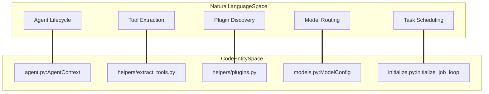
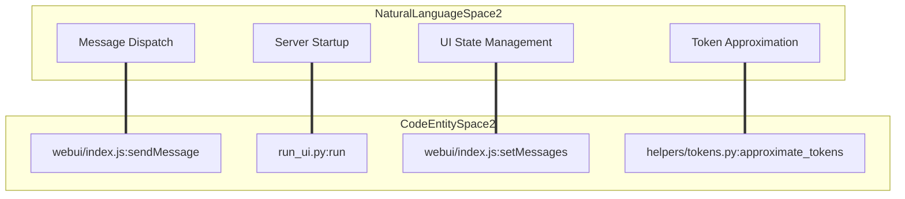
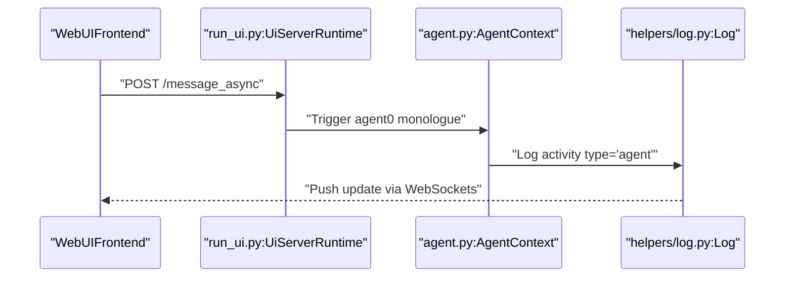

<!-- source: DeepWiki mcp.deepwiki.com · repo agent0ai/agent-zero · page 16 Glossary · fetched 2026-10-29 -->

# Glossary

Relevant source files

The following files were used as context for generating this wiki page:

- [AGENTS.md](AGENTS.md)
- [README.md](README.md)
- [agent.py](agent.py)
- [docker/run/fs/exe/initialize.sh](docker/run/fs/exe/initialize.sh)
- [docs/README.md](docs/README.md)
- [docs/guides/troubleshooting.md](docs/guides/troubleshooting.md)
- [docs/quickstart.md](docs/quickstart.md)
- [docs/setup/dev-setup.md](docs/setup/dev-setup.md)
- [docs/setup/installation.md](docs/setup/installation.md)
- [helpers/plugins.py](helpers/plugins.py)
- [helpers/plugins.py.dox.md](helpers/plugins.py.dox.md)
- [helpers/providers.py](helpers/providers.py)
- [helpers/providers.py.dox.md](helpers/providers.py.dox.md)
- [helpers/subagents.py](helpers/subagents.py)
- [helpers/subagents.py.dox.md](helpers/subagents.py.dox.md)
- [initialize.py](initialize.py)
- [models.py](models.py)
- [plugins/_browser/api/status.py](plugins/_browser/api/status.py)
- [plugins/_browser/extensions/python/startup_migration/_20_browser_playwright_cache.py](plugins/_browser/extensions/python/startup_migration/_20_browser_playwright_cache.py)
- [plugins/_browser/helpers/playwright.py](plugins/_browser/helpers/playwright.py)
- [plugins/_browser/hooks.py](plugins/_browser/hooks.py)
- [preload.py](preload.py)
- [requirements.txt](requirements.txt)
- [run_ui.py](run_ui.py)
- [tests/test_docker_initialize_limits.py](tests/test_docker_initialize_limits.py)
- [tests/test_embedding_model_preload.py](tests/test_embedding_model_preload.py)
- [tests/test_plugin_activation_ui.py](tests/test_plugin_activation_ui.py)
- [tests/test_plugin_asset_precedence.py](tests/test_plugin_asset_precedence.py)
- [tests/test_plugin_hook_context.py](tests/test_plugin_hook_context.py)
- [tests/test_subagent_metadata_merge.py](tests/test_subagent_metadata_merge.py)

This glossary defines codebase-specific terms, jargon, abbreviations, and domain concepts used within Agent Zero. It serves as a technical reference for onboarding engineers to understand the internal language, architectural building blocks, and code mappings of the system.

## Purpose and Scope
This page acts as the central dictionary for Agent Zero's codebase. It links high-level natural language concepts directly to their underlying Python classes, modules, front-end stores, and configuration files.

Sources: [README.md:1-20](), [AGENTS.md:1-15]()

---

## Core Architectural Terms

### AgentContext
The primary state container for a conversation or task. It manages the lifecycle of the `Agent` instance, its logs, and associated background tasks.
*   **Implementation:** Defined as the `AgentContext` class in [agent.py:56-110]().
*   **Data Flow:** Contexts are stored in a static dictionary `_contexts` [agent.py:58-59]() and accessed via `AgentContext.get(id)` [agent.py:115-117]().
*   **Key Attributes:** Includes a unique `id` [agent.py:81-81](), a `Log` instance for tracking history [agent.py:98-99](), and a `DeferredTask` for managing the execution loop [agent.py:102-102]().

Sources: [agent.py:56-117]()

### Monologue Loop
The iterative process where an agent processes input, reasons (monologue), executes tools, and observes results until a final response is generated.
*   **Implementation:** Handled within the `Agent` class and initialized within the context via `agent0` [agent.py:110-111]().

Sources: [agent.py:110-111]()

### Superior / Subordinate
The hierarchical relationship model used for multi-agent cooperation. Every agent (except the human-facing Agent 0) has a "Superior" that provided its task.
*   **Mechanism:** Agents use delegation and subagent helpers to spawn and manage child agents.
*   **Resolution:** File priority for subagents and path handling is managed via `helpers.subagents` [agent.py:19-20]().

Sources: [agent.py:19-20](), [README.md:38-38]()

### Extension Point (Hook)
A decorated function that allows plugins or external modules to intercept and modify core logic without altering the base code.
*   **Implementation:** Uses the `@extension.extensible` decorator from `helpers.extension` [models.py:30-30]().
*   **Example:** `AgentContext.__init__` is extensible [agent.py:63-64](), as is global initialization in `initialize.py` [initialize.py:6-7]() and runtime startup in `run_ui.py` [run_ui.py:76-77]().

Sources: [agent.py:63-64](), [run_ui.py:76-77](), [models.py:30-30](), [initialize.py:6-7]()

---

## Code Entity Mapping: Concepts to Code

This diagram bridges the "Natural Language Space" to the "Code Entity Space" by mapping system concepts directly to codebase entities.

Sources: [agent.py:56-110](), [models.py:143-155](), [initialize.py:65-68](), [helpers/plugins.py:1-227]()

---

## Code Entity Mapping: Runtime & Execution Routing

This second mapping diagram links runtime communication, configuration, and messaging components to their execution files.

Sources: [run_ui.py:9-24](), [models.py:29-29]()

---

## Technical Jargon & Abbreviations

| Term | Definition | Code Pointer |
| :--- | :--- | :--- |
| **A2A** | Agent-to-Agent protocol for communication between different Agent Zero instances. | [requirements.txt:8-8]() |
| **KVPS** | Key-Value Pairs. Used extensively in the logging system to pass structured data to the UI. | [agent.py:76-77]() |
| **MCP** | Model Context Protocol. A standard for connecting AI models to data sources and tools. | [initialize.py:57-62](), [requirements.txt:28-28]() |
| **Thinking Tags** | Delimiters like `<think>` or `<reasoning>` used to separate internal LLM reasoning from the final output. | [models.py:173-180]() |
| **A0 CLI** | A host-side connector that bridges host-machine files and shell into the Docker container. | [README.md:37-37]() |
| **LiteLLM** | The underlying transport library used to support 100+ LLM providers. | [models.py:21-21](), [requirements.txt:23-23]() |

Sources: [requirements.txt:8-28](), [models.py:21-180](), [initialize.py:57-62](), [README.md:37-37](), [agent.py:76-77]()

---

## UI & Communication Flow

The backend communicates with the frontend using a combination of REST APIs and WebSockets, managed by the `UiServerRuntime`.

Sources: [run_ui.py:31-40](), [agent.py:98-99]()

---

## Infrastructure Terms

### Execution Runtime
The environment where the agent's code and terminal commands actually run. In Agent Zero, this is a Docker container providing a full Linux system.
*   **Pointer:** [README.md:8-9]()

### Framework Runtime
The Python environment running the Agent Zero server, managing the Web UI, API, and LLM orchestration.
*   **Implementation:** Configured in `run_ui.py` [run_ui.py:9-25]().

### Universal Canvas
The right-side UI surface used for browser sessions, virtual desktops, and specialized plugin panels.
*   **Pointer:** [README.md:32-34]()

### VectorDB
The FAISS-based vector database used for persistent memory and knowledge retrieval.
*   **Requirement:** `faiss-cpu` [requirements.txt:6-6]() and `sentence-transformers` [requirements.txt:35-35]().

Sources: [README.md:8-34](), [run_ui.py:9-25](), [requirements.txt:6-35]()

---

## Domain Concepts

### Tool Fallback & Error Handling
When an agent attempts to call a tool or encounters errors, the system catches exceptions and provides fallback repair mechanisms via specialized exception classes.
*   **Implementation:** Uses `RepairableException`, `InterventionException`, and `HandledException` from `helpers.errors` [agent.py:35-35]().

Sources: [agent.py:35-35]()

### Rate Limiting & Token Approximation
The system approximates token counts locally to prevent hitting provider limits and manages request frequency.
*   **Implementation:** `approximate_tokens` in [models.py:29-29]() and the `RateLimiter` class [models.py:28-28]().

Sources: [models.py:28-29]()

### Thinking Generation
The process of parsing "thinking" or "reasoning" content from model streams, especially for models that don't natively support reasoning fields.
*   **Implementation:** `ChatGenerationResult` handles the logic for detecting `<think>` and `<reasoning>` blocks [models.py:171-180]().

Sources: [models.py:171-180]()

### Process Group & Step Rendering
The Web UI organizes agent activity into logical groups (e.g., a tool call and its result).
*   **Implementation:** Process structures and logs are orchestrated via `AgentContext` and `Log` structures.

Sources: [agent.py:98-106]()

### Status Badges (GEN, USE, END, ERR, etc.)
The UI uses codes to identify the nature of a process step.
*   **GEN:** Agent Generation.
*   **USE:** Tool Usage.
*   **END:** Response / Done.
*   **ERR:** Error Type.

Sources: [agent.py:35-42]()