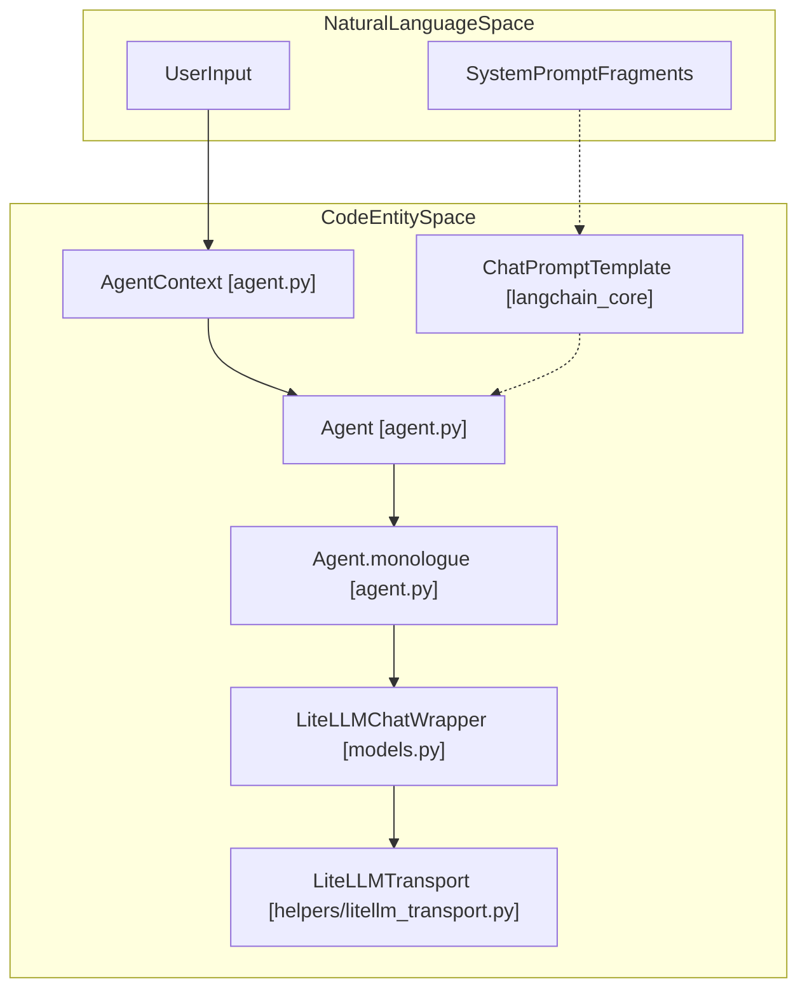
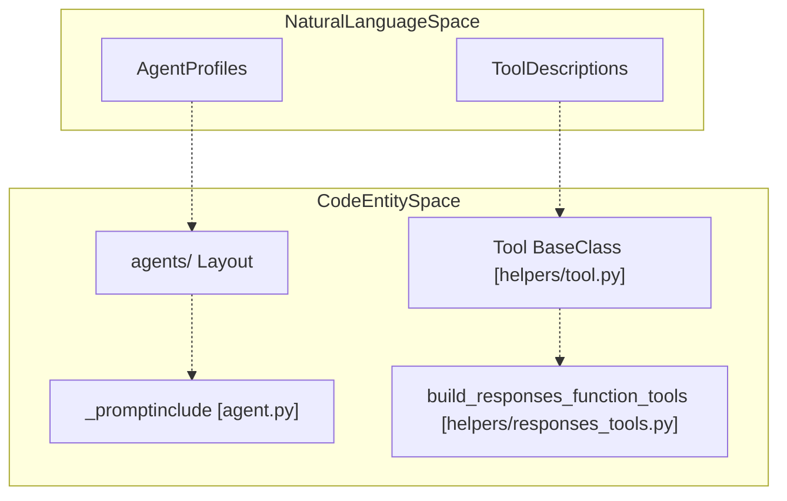
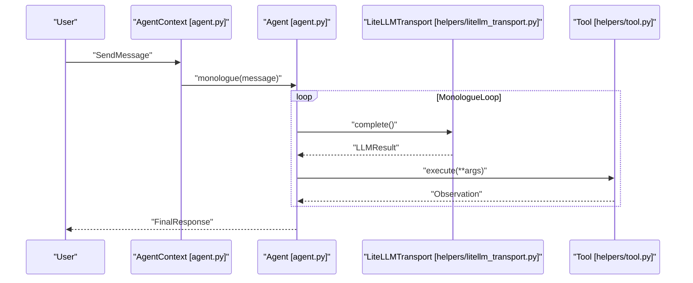

<!-- source: DeepWiki mcp.deepwiki.com · repo agent0ai/agent-zero · page 2 Core Agent Architecture · fetched 2026-10-29 -->

# Core Agent Architecture

Relevant source files

The following files were used as context for generating this wiki page:

- [AGENTS.md](AGENTS.md)
- [agent.py](agent.py)
- [initialize.py](initialize.py)
- [models.py](models.py)
- [preload.py](preload.py)
- [requirements.txt](requirements.txt)
- [run_ui.py](run_ui.py)
- [tests/test_embedding_model_preload.py](tests/test_embedding_model_preload.py)

This wiki page provides a high-level overview of the Agent Zero engine, focusing on the core architectural components that drive agent behavior, conversation state, and execution loops: `AgentContext`, `Agent`, and the Monologue Loop [agent.py:50-111](), [agent.py:1052-1100](). Deep technical details regarding the monologue lifecycle, prompts, tools, error handling, and LLM abstractions are deferred to the child pages linked below.

### High-Level Engine Overview

The following diagram illustrates how the core classes interact to process a user request, mapping the conceptual "Natural Language Space" to the concrete "Code Entity Space".

**Engine Entity Mapping**

Sources: [agent.py:50-111](), [agent.py:1052-1100](), [models.py:246-280](), [agent.py:24-28](), [helpers/litellm_transport.py:43-45]()

---

### Core Components

#### 1. AgentContext
The `AgentContext` acts as the container for a specific session or task. It manages the lifecycle of the primary agent (`agent0`), handles logging, and stores persistent data [agent.py:56-111]().
- **Identity:** Every context has a unique `id` and a `type` (`USER`, `TASK`, or `BACKGROUND`) [agent.py:50-54](), [agent.py:81-104]().
- **Persistence:** It holds `data` and `output_data` dictionaries used to maintain state across the monologue loop [agent.py:96-97](), [agent.py:177-191]().
- **Task Management:** It can wrap execution in a `DeferredTask` to allow asynchronous, non-blocking operations [agent.py:102](), [helpers/defer.py:84-104]().
- **Global Registry:** Contexts are managed via a thread-safe registry `_contexts` using an `RLock` [agent.py:58-59]().

Sources: [agent.py:56-111](), [helpers/defer.py:84-104]()

#### 2. The Agent Class
The `Agent` class is the primary reasoning engine. It manages its profile, assembles system prompts, and tracks its position in the multi-agent hierarchy [agent.py:821-860]().
- **Initialization:** Agents are initialized with an `AgentConfig` and linked to a parent `AgentContext` [agent.py:110](), [initialize.py:13-17]().
- **Hierarchy:** Agents track their level (0 for the root agent) and their superior agent, allowing recursive sub-agent spawning [helpers/subagents.py:23-43]().
- **Prompting:** The agent reads and assembles prompts using helper utilities that handle localization and fragment stitching [agent.py:919-940]().

Sources: [agent.py:110](), [initialize.py:13-17](), [helpers/subagents.py:23-43]()

#### 3. The Monologue Loop
The `Agent.monologue()` method drives execution. It is an asynchronous loop that continues until the agent provides a final response or an intervention occurs [agent.py:1052-1100]().
- **Chain of Thought:** The agent generates thoughts and tool calls via the LLM.
- **Action and Observation:** Tools execute, and results feed back into the agent history as observations.
- **Interventions:** The loop can be interrupted by users or system events using `InterventionException`, `RepairableException`, or `HandledException` [agent.py:35]().

For details on initialization, message processing, and error recovery, see **[Agent Lifecycle & Monologue Loop](#2.1)**.

Sources: [agent.py:35](), [agent.py:1052-1100]()

---

### Prompt & Tool Definition Mapping

To bridge declarative configurations and code execution, prompt fragments and tool specifications map directly to runtime loaders and tool registries.

**PromptAndToolResolutionMapping**

Sources: [agent.py:919-940](), [helpers/responses_tools.py:44-45]()

---

### Subsystem Integration & Child Overviews

The architecture delegates responsibilities to specialized systems, which are covered in depth on the child pages:

| Subsystem | Scope & Overview | Child Page Link |
| :--- | :--- | :--- |
| **Prompt System & Agent Profiles** | How system prompts assemble from fragment files and how profiles (`agent0`, `researcher`, developer, etc.) override defaults. | **[Prompt System & Agent Profiles](#2.2)** |
| **Tool System** | The `Tool` base class, built-in tools (code execution, response, call_subordinate, memory, browser, etc.), and parallel execution. | **[Tool System](#2.3)** |
| **Response Handling & History** | Message loop extensions, JSON repair (`_context_doctor`), loop limits, and history compaction (`_chat_compaction`). | **[Response Handling, Repair & History](#2.4)** |
| **LLM Model Abstraction** | `LiteLLMChatWrapper`, transport layers (`LiteLLMTransport`, `ResponsesTransport`), rate limiting, and thinking tags. | **[LLM Model Abstraction & Rate Limiting](#2.5)** |

**Agent Execution Sequence**

Sources: [agent.py:1052-1150](), [helpers/litellm_transport.py:43-45](), [helpers/llm_result.py:36-42]()

---

### Extensibility & Infrastructure

- **Plugin Hooks:** Functions marked with `@extensible` create extension points allowing plugins to mutate arguments or intercept execution flows [helpers/extension.py:52-99](), [agent.py:63-64]().
- **Thinking Tag Parsing:** The `ChatGenerationResult` class handles both native reasoning and manual parsing of `<think>` or `<reasoning>` tags [models.py:168-214]().
- **Rate Limiting:** API calls are governed via a `RateLimiter` configured per provider [models.py:27]().

Sources: [helpers/extension.py:52-99](), [models.py:27](), [models.py:168-214](), [agent.py:63-64]()

---

